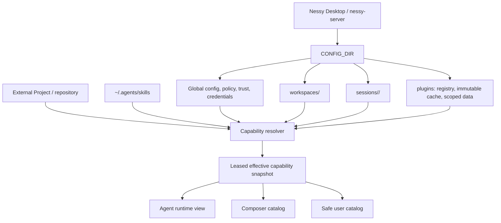

# Codex-like Workspace Storage Architecture

**Status:** Accepted 2026-07-13 for Nessy Desktop 1.0.12; still in force at 1.15.0
**Accepted:** 2026-07-13

This document is the final architecture record for the storage-v2 rollout. It
replaces the retired execution tracker and supersedes the earlier clean-cutover
design snapshot.

## Decision

Nessy Desktop has one supported runtime layout: storage v2. Nessy-managed
Workspaces, sessions, plugins, policies, trust records, and credentials live
below `CONFIG_DIR`. External Projects and shared user-authored resources remain
outside that tree.

The default `CONFIG_DIR` is `~/.nessy-agent`. `NESSY_CONFIG_DIR` may relocate
the whole managed tree; a blank value is treated as unset.



## Physical Layout

```text
CONFIG_DIR/
  config.json
  credentials.enc
  capabilities.json
  project-trust.json
  capability-trust.json
  recent-projects.json
  mcp.json
  hooks.json
  skills/
  agents/
  sessions/
    <workspaceId>/
      <sessionId>/
        session.jsonl
        attachments/
        plans/
        data/
        downloads/
        long_responses/
  workspaces/
    <workspaceId>/
      config.json
      capabilities.json
      sources/
      skills/
      agents/
      hooks.json
      automations.json
      permissions.json
      labels/
      statuses/
      views.json
  plugins/
    installed.json
    lock.json
    cache/<encoded-marketplace>/<encoded-plugin>/<encoded-version>/<bundleHash>/
    data/<encoded-plugin-key>/workspaces/<workspaceId>/...
```

Electron/Chromium profile state remains under the platform Application Support
directory. Shared Gateway authentication remains at
`~/.nessy/dp_auth_creds.json`; it is not part of `CONFIG_DIR`.

## Ownership Boundaries

| Area | Owner | Identity and rule |
| --- | --- | --- |
| Workspace | Nessy | Immutable `workspaceId`; name is mutable metadata; no user-selected storage path |
| Session | Nessy | Composite `SessionKey = { workspaceId, sessionId }`; storage is derived globally |
| Project | User/repository | External canonical path; selected through a backend-issued handle and revalidated |
| Recent Projects | Nessy | Backend-owned opaque IDs; history is not authorization |
| Plugin bundle | Nessy | One immutable content-addressed installed instance; never copied into native resource folders |
| Plugin data | Nessy | Writable non-secret data isolated by plugin and Workspace/project context |
| Credentials | Nessy | Encrypted, revisioned, scope-bound; values never enter catalogs or generation hashes |
| `~/.agents` | User | External shared personal resources; Nessy reads but never relocates or rewrites them |
| Repository config | Repository | Loaded only after explicit whole-project trust |

Workspace configuration owns resources and defaults. A Project is only an
optional external execution context. The same Project can participate in
multiple Workspaces, and each Workspace may apply different private activation
policy without changing repository files.

## Startup And Clean Cutover

Bootstrap obtains the existing process/host lease before opening any storage
consumer. Readiness then classifies the root:

1. An absent or empty root is initialized as v2.
2. A valid v2 root opens idempotently.
3. An eligible legacy default root is atomically renamed beside the default
   home as `.nessy-agent.legacy-v1.<transactionId>`.
4. A fresh staged v2 root is atomically installed at the default path.
5. Unsafe, ambiguous, custom legacy, corrupt, symlinked, or colliding layouts
   fail closed before normal windows, RPC listeners, sessions, or services start.

The transaction marker stores only validated phase and path assertions. Paths
are re-derived from its UUID and canonical parent during recovery. The runtime
never reads quarantine, imports legacy records, falls back to v1, or deletes
quarantine automatically.

Legacy conversations, settings, credentials, plugins, resources, and recents
are therefore not migrated. External Projects, `~/.agents`, and
`~/.nessy/dp_auth_creds.json` remain untouched.

## Identity And Trust

- Managed filesystem paths are derived server-side from validated IDs.
- Public Workspace DTOs contain no managed root or saved remote token.
- A Project handle is bound to its backend, Workspace, canonical realpath,
  stable filesystem identity, and expiry.
- Project selection does not grant project trust. Untrusted Projects remain
  usable as an execution cwd but contribute no repository instructions,
  skills, agents, MCP configuration, hooks, memory, or policy.
- Replacing a repository at the same path invalidates its trust identity.
- Non-managed executable capabilities require exact current-definition trust.
- Remote Workspace tokens and other secrets remain in `credentials.enc`; only
  non-secret availability and revision state enter resolution.

## Plugin And Capability Runtime

Installation and activation are separate contracts:

- `installed.json` records which immutable plugin instance is installed.
- Global, Workspace, and Project policy plus session selection decide where a
  capability is active. An explicit narrower disable is terminal.
- Stable plugin policy and data may survive a version update, while changed
  executable content requires fresh trust.
- An old plugin instance remains readable only while an in-flight snapshot
  lease references it, then it is pruned.

One server-owned resolver combines native resources, plugin candidates, policy,
project trust, executable trust, non-secret credential state, session selection,
and provider capability state. It produces one immutable generation. Agent,
Composer, and user-facing views are projections of that same generation; they
do not rediscover files or independently apply precedence.

Qualified keys preserve duplicate skills, agents, and MCP servers. Renderer
catalogs expose safe metadata and opaque actions only. Absolute managed paths,
commands, environment values, headers, executable hashes, raw credential refs,
full instruction bodies, and secret-bearing configs remain server-side.

Security-removing changes revoke affected leases and stop the active turn
before its next read or launch. Additive changes refresh before the next turn.
A turn never switches generations in place.

## Operational Invariants

- Only storage layout v2 may start the runtime.
- `workspaceId` and composite `SessionKey` are identity; paths are I/O details.
- No renderer or remote caller chooses a managed path.
- Plugin installation never implies activation, credential readiness, or trust.
- Repository content never enters resolution before explicit project trust.
- All capability views come from one captured snapshot and release their leases.
- Shared Gateway auth stays outside the storage cutover and is merge-preserved
  only by the dedicated DP auth module.
- Claude, ChatGPT, and Codex runtime provider flags remain disabled by default.

## Deferred Product Work

**All three items this section originally deferred have since shipped**, so what
follows is the invariant they had to satisfy, not a list of open work.

- **Import adapters** for Codex, Claude and the internal marketplace are on the
  ordinary import path (`packages/shared/src/plugins/format-adapters/codex.ts`,
  `.../claude.ts`), producing one `NessyPluginManifest` plus a compatibility
  report. See `docs/architecture/unified-plugin-adapter-runtime.md`.
- **Marketplace lifecycle** runs through
  `packages/shared/src/plugins/registry-catalog-fetcher.ts` and
  `.../install-service.ts`; managed policy can now DELIVER a marketplace
  (`packages/shared/src/agent/pi-harness/managed-marketplace-entries.ts`), so a
  marketplace is an admin-controllable surface, not only a user-added one.
- **Capability-management UI** is
  `apps/electron/src/renderer/components/app-shell/PluginsManagementPanel.tsx`,
  `.../SourcesListPanel.tsx` and
  `apps/electron/src/renderer/pages/PluginInfoPage.tsx`.

The invariant these had to hold, and still do: they normalize external packages
into Nessy's internal representation, but runtime behavior remains
source-agnostic. Source metadata may be retained for user-facing provenance such
as an icon or label; it must not create provider-specific runtime branches.

## Verification

W1-W12 were accepted through focused and broad offline gates, independent code
review, a detached Electron build, an unsigned arm64 DMG build, and disposable
packaged startup/cutover smoke. The obsolete screenshot bundle and duplicated
verification README were retired on 2026-07-15; canonical regression evidence
remains in the committed storage-v2 tests and accepted commit history.

No W12 runtime scenario used the only real user state or real credentials.
