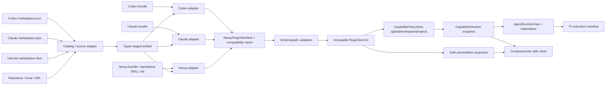

# Unified plugin adapter runtime

## Decision

Nessy Desktop has one installed/runtime plugin representation: `NessyPluginManifest`.
Codex and Claude bundle layouts, marketplace catalogs and the internal
marketplace are import/acquisition adapters only — never a second runtime mode.
A supported Codex or Claude bundle never requires the user to repackage or
hand-edit a manifest: the adapter performs the one-way conversion into Nessy IR
before anything is committed to the immutable store. Codex's layered
ownership/lifecycle model is the primary architectural reference; its filesystem
paths, field names and config files are adapter-ingress fixtures only and never
become Nessy canonical storage or a runtime discriminator.

Runtime behavior depends only on normalized capabilities, selected scope, trust,
credentials and immutable bundle identity. It never inspects `adapterId`,
provider format or marketplace origin to choose behavior — that is the same
storage-v2 invariant `docs/architecture/codex-like-workspace-storage.md`
establishes for the plugin store, extended here across every accepted format.

## Supported matrix

| Capability surface | Codex | Claude | Nessy / internal marketplace |
| --- | --- | --- | --- |
| Skills | supported | supported | supported |
| MCP servers (stdio/http/sse/ws) | supported | supported | supported |
| Command hooks | supported | supported | supported when declared |
| Prompt hooks (one-shot hidden context) | supported | supported | supported |
| Agent hooks | supported | supported | supported |
| `mcp_tool` hooks | supported | supported | supported |
| `http` hooks | supported | supported | supported |
| Plugin-declared LSP servers | supported | supported | supported |
| Output styles | supported | supported | supported |
| Monitors | supported | supported | supported |
| Plugin dependencies | supported | supported | supported |
| Prompt/slash commands | not inferred from Codex bundles | supported (Markdown, frontmatter) | native Nessy prompt commands preserved |
| Sub-agents | not inferred from Codex bundles | supported (Markdown, frontmatter) | native Nessy agents preserved |
| Generic plugin settings | supported | supported | supported |
| MCPB MCP `user_config` | supported | supported | supported |
| Manifest `user_config` | supported | supported | supported |
| Themes | deferred, with an author-facing diagnostic | deferred, with an author-facing diagnostic | n/a |
| Channels | deferred | deferred | deferred |
| Immutable install/update/repair/uninstall | yes | yes | yes |
| Global/Workspace/project activation | yes | yes | yes |
| Agent-driven plan/install/status/manage | yes | yes | yes |
| UI format/acquisition badge | yes | yes | yes |

Every hook type executes through the same single hook executor and the existing
trust, permission, isolation, supervision and receipt owners — never a second
dispatcher. Command hooks run as processes; prompt hooks inject bounded one-shot
hidden context; an `agent` hook spawns through the existing per-session
child-session service via an injected runner; an `mcp_tool` hook invokes a
fully-qualified `mcp__<server>__<tool>` proxy through the existing MCP pool; an
`http` hook fires through the existing webhook executor, gated on a plugin-trust
check, on managed `allowedHttpHookUrls` containment when an admin has defined
that array, and on an outright refusal of credential-bearing descriptors.
Plugin-declared LSP servers are provisioned as
`LspService` instances on the Pi provider only, behind the same project-trust
gate, and are torn down when the capability authority signature changes.

The frozen observational-vs-decision contract is unchanged by any of this: hook
*types* all run, but which *events* may return a blocking verdict is decided by
`AGENT_EVENT_CONTRACTS_V1`, not by the hook's type — see
`docs/architecture/extension-first-pi-agent-runtime.md`.

The remaining declared components are handled as follows and are never silently
dropped:

- **Codex apps/connectors + connector OAuth** — now **supported**. A connector is
  a DECLARATIVE, MCP-backed source: its id, declared MCP servers, and an optional
  auth policy (`oauth`/`bearer`/`none`, with `ON_INSTALL`/`ON_FIRST_USE` timing).
  Enabling a connector-bearing plugin at a workspace scope materializes each
  declared server as an MCP source through the EXISTING `createSource` + source
  store (never a second source authority); disable removes exactly those sources.
  Credentials bind only through the server-owned `SourceCredentialManager` (a
  bundle never provides or stores a secret), and interactive OAuth reuses the
  EXISTING source OAuth path (`prepareMcpOAuth`/`exchangeMcpOAuth`/
  `OAuthFlowStore`). An app routes ONLY to its connector's declared MCP server
  keys — never beyond. `ON_INSTALL`/`ON_FIRST_USE` is timing only, never a trust
  grant; OAuth denial is side-effect-free. Connector URL trust rides on
  plugin-install trust: a materialized connector's OAuth endpoints are discovered
  from the manifest-declared MCP URL, the same trust posture as any user-added
  MCP source, and the source is a plain glyph (no outbound logo fetch) until the
  user completes the interactive consent.
- **Generic `settings`** — a first-class capability kind with a per-instance,
  typed value store (`plugin-settings.ts`, one `settings.json` under the
  instance's `dataPath`). Values still never enter a generic application
  preferences overlay.
- **MCPB MCP `user_config`** and **manifest `user_config`** — supported.
  Declared fields are validated and stored together in one workspace-scoped
  encrypted credential record (sensitive) plus a user-scoped option file
  (plain), collected through `PluginManagementServiceV2.configure`.
  Substitution follows `plugins/manifest-reference.md#environment-variables (was line 577 of the retired plugins-reference page)` exactly and is split by
  sensitivity: MCP configs, LSP configs and hook commands take every value;
  skill and agent content takes non-sensitive values **only**, refused at the
  substitution site rather than redacted afterwards, because a secret in a
  skill body has already reached the model and the transcript. Shell-form
  fields reject `${user_config.*}` at import time (`:579`). Substitution runs
  strictly after the trust hash is computed over the unsubstituted declaration,
  so rotating a token never breaks a grant and the hash is never an oracle for
  the value. The **enable-time prompt dialog** `plugins/components.md#when-the-configuration-dialog-appears (was line 544 of the retired plugins-reference page)`
  describes is a recorded deviation — documented, not implemented; values are
  collected only through the configure API.
- **`themes`** — deferred with an author-facing diagnostic rather than silently
  dropped: a Claude theme's token vocabulary is a terminal palette with no
  defined mapping onto Nessy's web theme tokens, so an author is told at install.
- **`channels`** — deferred; no Nessy runtime + permission contract exists.

Marketplace publishing, ratings, organization governance and arbitrary shell
install commands are rejected outright, not deferred: they are never accepted as
an install source or executed under any circumstance.

A normalized bundle's compatibility state is exactly one of:

- **supported** — every executable/core declaration normalized; may auto-activate.
- **partial** — the core surface normalized, but at least one non-primary
  declaration is retained as `deferred`; the bundle installs into the immutable
  cache but auto-activation is suppressed until a user or agent explicitly
  confirms the degraded capability set.
- **blocked** — a primary executable declaration is unknown, ambiguous or
  unsafe; no cache commit happens at all.

## Data flow

Each stage owns exactly one concern, and nothing downstream re-derives what an
earlier stage already decided:

- **Catalog/source adapters** (`source-resolver.ts`, the marketplace
  proposal/inspect path) fetch and stage a typed artifact. They decide *where a
  bundle comes from*, never *how it runs*. The source decision order is a
  structured `install.source`, then an inspected manifest/manifestUrl converted
  to a typed URL/repository/npm source, then unsupported — `install.command` and
  any marketplace shell string are display metadata only and are never executed
  or reinterpreted as an install source.
- **Format adapters** (`format-adapters.ts`, `format-adapters/codex.ts`,
  `format-adapters/claude.ts`) parse external syntax and return
  `{ manifest?, compatibility, diagnostics }` — one `NessyPluginManifest` plus
  its `PluginCompatibilityReport`. Detection reports every plausible format
  rather than resolving ambiguity itself: an ambiguous manifestless repository
  never auto-installs, and a manifestless Claude bundle requires either an
  explicit format hint or unambiguous Claude default-layout markers
  (`skills/`, `commands/`, `agents/`, `hooks/hooks.json`, `.mcp.json`).
  Collision-safe capability ids come from one shared helper,
  `createPluginCapabilityId(kind, providerLocalId)`, so a skill and an MCP
  server sharing a provider-facing name stay distinct and addressable; the
  provider-facing name itself survives separately as `logicalName`.
- **Schema/path validation** (`schema.ts`) is the only place a bundle-relative
  path is accepted — every capability path routes through
  `validatePluginRelativePath`, rejecting absolute paths, backslashes, NUL
  bytes and `..` traversal before anything reaches the store.
- **PluginStoreV2** commits one content-addressed, activation-free copy per
  `(version, bundleHash)`. The registry entry never carries an
  `enabledScopes`/`lifecycleState` flag; a same-version different-hash repair
  stages side-by-side and switches the active instance atomically, and a stale
  instance is retained only while an in-flight snapshot lease or update-journal
  entry still references it.
- **CapabilityPolicyStore** is the only activation authority, independent of
  the immutable install: one installed bundle can be enabled at global scope,
  disabled for one Workspace, and overridden per project, with precedence
  `global < workspace < project` and an explicit `enabled:false` acting as a
  terminal suppression at its layer.

  **Granularity is deliberately finer than Claude's, and that is a place we are
  ahead — do not cite it as a gap.** Claude's documented granularity is the
  whole plugin: `enabledPlugins` keyed `"<plugin>@<marketplace>": true|false` at
  user / project / local / managed scope, with manifest `defaultEnabled` as the
  fallback, and its plugin detail view lists contributed components without
  exposing a per-component toggle. Several Claude mechanisms look per-component
  and are not — `disable-model-invocation` and `allowed-tools` in SKILL.md
  frontmatter are author-side, `disableAllHooks` is global, `permissions.deny`
  blocks tool calls, `disabledMcpjsonServers`/`enabledMcpjsonServers` approve
  `.mcp.json` servers, and the plugin-level channel and
  `strictPluginOnlyCustomization` policies are plugin-level. `disabledMcpServers`
  is the one genuine per-component toggle Claude has. Nessy's per-skill,
  per-hook, per-command and per-MCP switches therefore have no Claude
  counterpart to be measured against.
- **CapabilityResolver** combines native inventory and plugin projection
  candidates into one immutable `EffectiveCapabilitySnapshot` per context —
  the only place policy, trust and credential state are actually applied. It
  hands back a leased `generation` and never re-derives precedence downstream.
- **AgentRuntimeView + materializer** is the only handoff into the agent: a
  pure projection of the snapshot (server-only, path-bearing) that lazily reads
  bundle bytes and resolves credentials immediately before use, and fails
  closed (`revoked`/`stale`/`missing`) rather than serving content the
  snapshot no longer vouches for.
- **Composer/user safe views** (`toComposerCatalog`, `toUserCatalog`) strip
  every path, secret and executable declaration; they are the only place a
  join-only `SafePluginPresentationOrigin` may be attached, and only after
  resolution — `toAgentRuntime` never accepts or exposes it.
- **Pi execution manifest** (`harness-manifest.ts`) is the sealed, hashed
  contract the extension-first harness consumes. Plugin management tools
  register through the same `HarnessToolDescriptor`/`PiToolBinding` seam every
  other session tool uses; a marketplace/plugin bundle can never provide
  `ExtensionFactory` code, so this plan creates no second manifest, prompt
  list, executor or tool router.

## Trust and credential boundary

Executable trust is decoupled from installation and activation everywhere:
installing a bundle into the immutable cache, or enabling it at any scope,
never grants trust to any of its executables. `CapabilityTrustStore` keys a
grant by the exact `(pluginInstanceId, capabilityId, executableHash, scope)`
tuple, so:

- a granted hook/command stays runnable only for that precise instance, hash
  and scope — a different scope, a different capability, or the same
  capability under a different bundle instance all resolve as
  `review-required` until independently granted;
- an update or repair that changes bundle content mints a new
  `pluginInstanceId`, which is untrusted by construction even when the old
  instance's grant is still on file for its own (now-retired) identity;
- revoking a grant immediately flips the resolver's `trustState` back to
  `review-required`, which the resolver enforces as `enabled: false` — a
  revoked hook is not merely hidden, it cannot run;
- the resolver's runnability gate (`isRunnable` in `capabilities/views.ts`)
  refuses any entry whose `trustState` is `review-required` or `blocked`
  before it ever reaches `AgentRuntimeView`, so an ungranted hook is invisible
  to execution, not just cosmetically disabled.

Credential resolution stays lazy and server-only: a `RuntimeCredentialBinding`
carries an opaque reference, never a secret value, until the materializer
resolves it immediately before a turn starts — and only when the bound
snapshot lease is still active.

## Normalized runtime compatibility profile

A bundled executable that reads provider environment variables directly (a
command hook, or a stdio MCP server) needs those variables translated, not
executed with foreign names. Adapters canonicalize the external tokens they
recognize (`CLAUDE_PLUGIN_ROOT`, `CLAUDE_PLUGIN_DATA`, `CLAUDE_PROJECT_DIR`,
`PLUGIN_ROOT`, `PLUGIN_DATA`) into the Nessy names
(`NESSY_PLUGIN_ROOT`/`NESSY_PLUGIN_DATA`/`NESSY_PROJECT_DIR`) inside parsed
command/args/cwd/env/header/URL fields — never as arbitrary shell expansion —
and record which alias set the runtime must additionally expose as one
semantic `PluginRuntimeCompatibilityProfile`:

- `generic-plugin-env-v1` — the Nessy/`PLUGIN_*` root and data aliases only.
- `codex-plugin-env-v1` — adds exactly `CLAUDE_PLUGIN_ROOT`/`CLAUDE_PLUGIN_DATA`,
  matching Codex's own documented Claude-compatibility aliases.
- `claude-plugin-env-v1` — adds `CLAUDE_PLUGIN_ROOT`, `CLAUDE_PLUGIN_DATA` and
  `CLAUDE_PROJECT_DIR`.

There is deliberately no origin branch here. The profile is read from
`manifest.runtimeCompatibility` — a field the format adapter populates purely
from *what the bundle's executables actually declare they read* — and
`pluginRuntimeEnvForProfile` (`data-paths.ts`) selects env by that profile
value alone. Two manifests that differ only in adapter/origin but declare the
same profile set are runtime-identical: same env names, same values, derived
from the same validated `rootPath`/`dataPath`/`projectPath`. An unrecognized or
missing profile fails closed rather than silently falling back to the widest
alias set. This is also why UI presentation and runtime env are structurally
independent projections of the same install: `SafePluginPresentationOrigin`
(`format` + `acquisition`) is a display-only join computed after resolution
from the persisted adapter provenance, never fed back into the resolver, trust
store, policy record or the runtime compatibility profile. A Codex-format
bundle installed from the Nessy marketplace keeps `format: codex` for its logo
while its `acquisition: nessy-marketplace` badge is layered on separately —
neither one ever changes which env aliases its own hook process receives.

## Agent-driven management

Four session-scoped tools replace the prior gap between an advertised
capability and a registered one: `plugin_plan_install` (read-only proposal and
compatibility inspection), `plugin_install` (consume an approved proposal and
optionally activate a supported package), `plugin_status` (read-only
installed/active/diagnostic summary) and `plugin_manage` (enable, disable,
update, repair or uninstall by stable `pluginKey`). They are host-callback
session tools backed by `PluginManagementServiceV2` and the marketplace
proposal registry — never a shell command, never a raw managed path, never a
credential value — and every successful mutation calls the same
`afterPluginMutation` seam so active sessions and renderer catalogs refresh
through the existing capability-invalidation path rather than a
plugin-specific one. They register through the same
`HarnessToolDescriptor`/`PiToolBinding`/`ToolExecutor` seam every other session
tool uses, appearing exactly once each in the captured Pi execution manifest.

## Storage and scope boundary

An immutable bundle is installed once, in the application-owned store; global,
Workspace and project activation are policy records pointing at that identity.
Workspaces and sessions never receive a copied plugin bundle: a session
captures only a leased `EffectiveCapabilitySnapshot` generation and
materialized read handles, and its `SessionStore` record holds normal session
data, receipts and stable references — never a plugin payload, mutable plugin
data or a credential. Plugin mutable state lives in the already-accepted
per-instance `dataPath`, isolated by stable plugin key and then by
Workspace/project, outside the immutable bundle entirely. Disabling one scope
never rewrites the installed bundle or another scope's policy, and two
concurrent sessions leasing the same instance never duplicate its bytes
anywhere under a Workspace or SessionStore root.

## Deferred

Current measured production behavior:

- **Shipped (execute now):** all five hook types — command, prompt, `agent`,
  `mcp_tool` and `http` — through the single existing hook executor; skills, MCP
  servers (stdio/http/sse/ws), prompt commands, agents, apps/connectors,
  plugin-declared LSP servers, output styles, monitors, plugin dependencies
  (including transitive enable and disable-blocked-by-dependents), generic
  plugin settings, and both MCPB and manifest `user_config` through the
  encrypted configuration path.
- **Now shipped (connectors):** Codex apps/connectors and connector OAuth are
  supported. A connector materializes as an MCP-backed source through the
  EXISTING `createSource` + source store on workspace enable (removed on
  disable), binds credentials only through the server-owned
  `SourceCredentialManager`, and authenticates interactively over the EXISTING
  source `authType: 'oauth'` path (`prepareMcpOAuth`/`exchangeMcpOAuth`/
  `OAuthFlowStore`). An app routes only to its connector's declared MCP server
  keys. `ON_INSTALL`/`ON_FIRST_USE` is timing only; OAuth denial is
  side-effect-free — never a plugin-provided secret store, never a Codex account
  or `config.toml` runtime dependency. Connector URL trust rides on
  plugin-install trust (same posture as a user-added MCP source).
- **Deferred with recorded rationale (still visible):** `themes` (a terminal
  palette with no defined mapping onto Nessy's web theme tokens — refused with
  an author-facing diagnostic rather than silently dropped) and `channels` (no
  Nessy runtime + permission contract exists). Each stays a visible `deferred`
  record; neither executes.
- **~~Documented, not implemented: the enable-time `user_config` prompt
  dialog.~~ SHIPPED — this bullet was stale, corrected 2026-09-05 (P6.432).** It
  said values were collected only through the configure API, so a plugin
  expecting to be asked at enable time was configured after the fact. That is no
  longer true in any of its three parts: the enable/disable RPC returns a
  value-free `configuration` status alongside `pendingAuth` and
  `authRequirements` (`server-core/handlers/rpc/plugins.ts`, citing
  `plugins-reference.md`'s enable-time prompt), the post-install checklist
  renders the `userConfig` row as ACTIONABLE and opens that prompt
  (`PluginInstallChecklist.tsx`), and the dialog itself is a canonical playground
  entry. Kept struck through rather than deleted because the line was quoted as
  a gap.
- **Half-shipped, and the missing half named (P6.248): per-GROUP release
  channels.** `plugins/host-marketplace.md#run-release-channels` builds a
  stable/latest split out of two halves. The marketplace half is ours and is
  complete — "you can set up two marketplaces that point to different refs or
  SHAs of the same repo", which is `refName` on the registry row, settable from
  managed policy and from the add-marketplace field and honoured by the
  allowlist check. The ASSIGNMENT half is out of reach: the page hands a channel
  to a user group either by deploying "separate endpoint-managed settings, such
  as a managed settings file or an MDM profile, to each group's devices" or by
  defining "one Claude apps gateway policy per group", and this fork has neither
  delivery mechanism. Its `extraKnownMarketplaces` is a single managed policy
  source with no per-group match rule, so every device reading that policy gets
  the same channel. **An operator can therefore run two ref-pinned marketplaces
  and deliver one — per FLEET, by pointing two device populations at two policy
  sources — but cannot split one policy source across two groups.** That is a
  managed-delivery limit, not a marketplace one, and closing it means opening
  the delivery tier rather than changing anything in `registry-source.ts`. The
  page records the same ceiling for the tier it rules out: "Server-managed
  settings from the admin console apply to every user in your organization, so
  they can't carry a per-group assignment."

Marketplace publishing, ratings, organization governance and arbitrary shell
install commands remain rejected outright, not merely deferred: they are never
accepted as an install source or executed under any circumstance.
