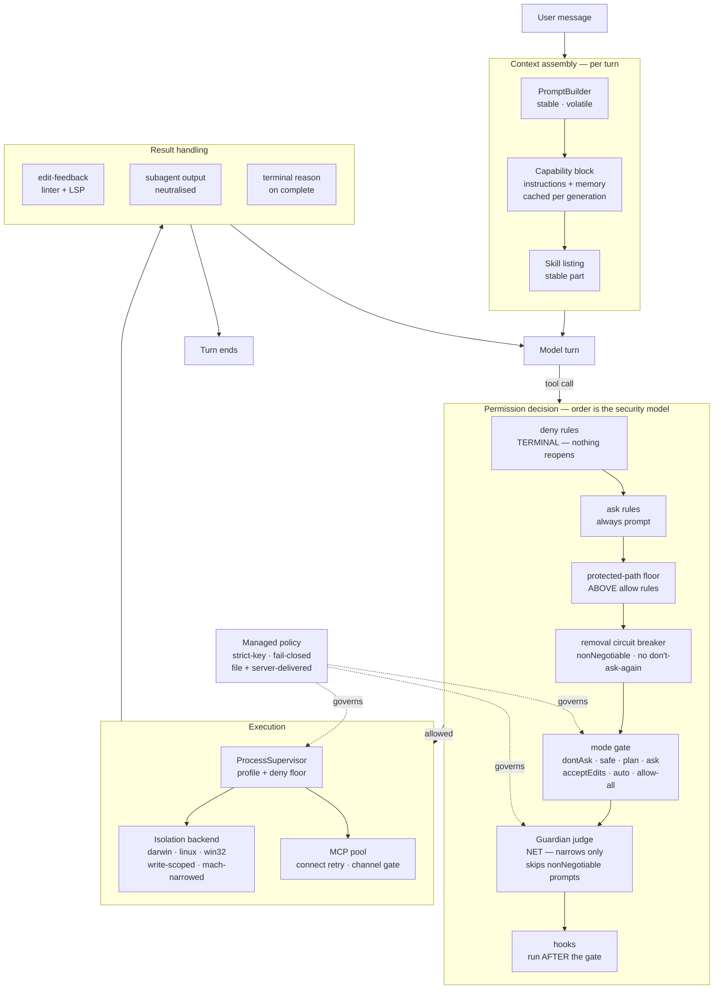

# Nessy vs Claude Code parity audit

> **This file is the source of truth for execution.** Row statuses, evidence,
> commit shas and every correction an executor made to a plan are written HERE.
>
> `2026-07-30-parity-report.md` is a **generated, read-only rollup** of this file
> plus the deviation register, for reading in one pass. Never edit it — a
> hand-edit is lost on the next generation. After changing a row here, run:
>
> ```bash
> python3 scripts/build-parity-report.py > docs/superpowers/specs/2026-07-30-parity-report.md
> ```

## Where the programme stands (2026-07-30)

The owner's six-phase programme, recorded as a state rather than as a plan:

1. **Act on the deviation audit** — done. Six units plus five they spawned; see
   *Deviation remediation* below.
2. **Update the parity plan from that audit** — done. §A is the one table.
3. **Close the remaining queue** — done. Live row states are §A and the generated
   report, never a number written by hand.
4. **Re-derive the contract from Claude's own docs** — done. `llms.txt`, every
   page fetched raw as `<url>.md`, never through a summarizer.
5. **Re-verify the whole parity against the code from that contract** — done. See
   *Re-verification* below and `2026-07-30-reverification.md`.
6. **Full testing weighted toward CDP — IN FLIGHT.** The question is whether the
   functionality works *for a user*, not whether the suites are green: unit tests
   have passed while the feature was dead on the live path several times in this
   series. Case list, passes and outstanding debt are in §0, *Phase 6*.
7. **After parity closes, audit `docs/`** (see *Scope*) — the sweep this pruning
   is part of.

Phases 4-6 were not a formality after 1-3, and 7 is not one either: every phase
so far has found something the previous one declared finished.

**One sweep, still worth running against any new surface.** `InstructionsLoaded`
had `memoryType`, `triggerFilePath` and `matchedPatterns` already built, with doc
comments naming the documented fields, and no reader — `rg memoryType` returned
exactly one hit, the write site. The same shape recurred in
`universal.systemMessage`, `suppressOutput` and `terminalSequence`: parsed,
merged, never read. So: **sweep for identifiers that carry a documented Claude
name and have no consumer.** It is the recurring defect of this series — declared
on one path, enforced on another — in a form a grep can find, rather than one an
auditor stumbles over.

## Plan index, 2026-07-30 — every plan is reachable from a row, or listed here

The report's `plan` column was showing `—` for rows whose plan exists, because a
closed row cited its COMMITS and not its plan file. Every row now names the plan
that built it, which is what makes the report's "is anyone going to do this?"
column answerable in both directions.

**Eight plans remain reachable from no row, and each is a sub-unit whose work a
row already records under a sibling plan's name.** Listed here rather than left
looking forgotten:

| Plan | What it is |
| --- | --- |
| `2026-07-28-trust-chain-remaining-paths.md` | a sub-unit of the trust work R7/R23 record |
| `2026-07-29-headless-interceptor-shipping.md` | the interceptor-pairing half of the server build, recorded in `packages/shared/AGENTS.md` rather than in a row |
| `2026-07-29-inert-unit-a.md`, `-inert-unit-e.md` | the declared-but-inert sweeps whose findings became B1's rows and the deviation register's entries |
| `2026-07-29-managed-model-allowlist.md` | S6, folded into R25's managed-policy row |
| `2026-07-29-plugin-activation-and-styles.md` | B1c, recorded under B1 |
| `2026-07-30-sandbox-mach-and-protected-paths.md` | S16, recorded in §0's security findings rather than in a row of its own |
| `2026-07-30-tool-search.md` | the tool-search row cites its commits; the plan carries the measurement |

**Four of the eight are NOT archive candidates**, and checking rather than
assuming is what found out why. `inert-unit-e` (2), `plugin-activation-and-styles`
(3), `sandbox-mach-and-protected-paths` (7) and `tool-search` (6) carry
**eighteen category strings between them** — recorded decisions that live
nowhere else. Deleting those files would delete the reasons.

**That check also exposed a stale register.** The register on disk carried 185
rows; regenerating from the plans produced **288**. One hundred and three
recorded decisions had never been absorbed, so for some time the register — the
file whose entire purpose is that the open deviations "can be counted in one
pass" — was understating them by more than a third. Regenerated 2026-07-30.
**The live count is the register's own `TOTAL` line**; 288 was that day's number
and is deliberately not maintained here.

**The lesson is the generator's, not the author's:** a derived file that is only
regenerated when someone remembers will drift, and drift downward is invisible
because a smaller number still looks like an answer. The register's own header
already warns that its generator has been wrong before; what it lacked was a
reason to run. Every closing pass should regenerate it, the same way the report
is regenerated after every tracker change.

**The four that ARE archive candidates** — `trust-chain-remaining-paths`,
`headless-interceptor-shipping`, `inert-unit-a`, `managed-model-allowlist` —
carry no category strings and no register entry; their work is fully recorded by
a row. Nothing else in `plans/` can be removed without deleting a reason or
breaking a link the report renders.

## Method rules that outlived the sections that produced them

Every other lesson in this file is attached to the row that produced it. These
are not — they are how to search, how to commit and how to believe a verdict,
and each was paid for once already.

11a. **`rg` silently skips files containing a NUL byte, and eight of ours have
one.** Found 2026-07-29 the hard way: I concluded that S9's marketplace
source policy had "zero production callers" because `rg isManagedMarketplaceAllowed`
returned nothing. It has three callers, all in
`packages/shared/src/marketplace/registry-source.ts`, which uses `'\x00'` as
a deliberate field separator in `registrySignature`. Targeting that one file
directly makes `rg` say "binary file matches"; in a multi-file search it says
**nothing at all**. So a grep-absence conclusion drawn with `rg` is a false
negative for these files, and the failure is invisible.

The eight: `marketplace/registry-source.ts`, `agent/core/guardian-consult.ts`,
`agent/memory/rule-matching.ts`, `sessions/mirror/in-memory.ts`,
`sessions/mirror/host.ts`, `server-core/projects/project-capability-watcher.ts`,
`server-core/sessions/__tests__/workspace-project-contract-corpus.test.ts`,
`server-core/handlers/rpc/capabilities.ts`.

Use `grep -a`, or `rg --text`, when an absence claim touches any of them.
Several rows in this audit rest on `rg` absence over the session-mirror and
capabilities neighbourhoods; those are worth re-checking with `-a`.

11b. **An absence claim needs its search TERMS justified, not just run.** Three
of mine were wrong on 2026-07-29, each by a different mechanism, and I
asserted all three to executors as established fact:

- **`rg` skipped the file.** See 11a — the marketplace source policy had
  three callers and I reported zero.
- **A directory listing cannot see another directory.** R14's plan said the
  backend had no end-to-end test; one existed in `agent/__tests__/`, and it
  never named the class either, so a grep for the class missed it too.
- **I searched for names the feature does not use.** B3's plan told its
  executor the startup capability probe was "genuinely NOT done" because
  `capabilityProbe`/`startupProbe` return nothing. It is called
  `probeIsolationCapabilities`, is probed once at
  `storage-runtime.ts:249`, is exposed over RPC, and is **rendered in
  Settings → Permissions**. I invented two plausible names, found nothing,
  and reported an absence.

The last is the naming-drift failure mode `AGENTS.md` warns about for
Claude's renames, applied to our own code. Before writing "X does not
exist", say what X would be *called* — and search the concept (the
directory, the consumer, the i18n key, the RPC channel), not one guessed
identifier.

11b-iv. **A fourth, and the worst: the refuting fact was in this file.** B2's
plan told its executor the OTel half was greenfield. **This audit's own §2 row
cited `otlp-telemetry.ts:13-20,101-127`** — a working exporter
with a test and a wired `shutdown()`. I searched the filesystem for a
directory (`packages/shared/src/telemetry/`) and for two env-var spellings,
found neither, and never searched the tracker I was planning *from*.

So the rule in 11b needs one more clause: **before claiming absence, grep
the audit's own evidence column.** It is the cheapest search available and
it is the one I skipped four times.

11c. **Pathspec-on-commit is NOT sufficient when two agents share a file.** The
standing rule — put the pathspec on `git commit`, not only on `git add` —
stops an agent absorbing a *different* file. It does not stop it absorbing
another agent's uncommitted edits to a file it legitimately names. On
2026-07-29 the telemetry unit's `1e1ecb67` committed `SessionManager.ts`
while the isolation unit had edits to that same file in the working tree,
swallowing that unit's live-agent ceiling field, import and enforcement
call. The result: **`1e1ecb67` does not build standalone** — it imports a
module that only arrives two commits later.

Only a precisely staged index would have prevented it. So: when dispatching
concurrent units, name the shared files, not just the shared directories —
`SessionManager.ts` is the one every unit eventually touches — and expect a
non-bisectable commit if two units land in it in the same window. Recorded
rather than repaired: rewriting another unit's commit is worse than a
documented rough edge.

**Mitigations for 11c, in order of preference** — folded in from the 2026-07-30
method note, where the hook unit's uncommitted runner-verdict hunks were swept
into `bd64fcff` ("a background shell reports its command to the Stop payload")
and the record unit's in-flight transcript hunks into `9ba4c9ca` ("a command hook
receives its payload on stdin"), each landing under the other's subject so
`git log` for either feature now misleads. The cause is not carelessness, it is
the rule we gave them: `git commit <pathspec>` takes the file's *working-tree*
state, and partial staging is `-p`, which is interactive and therefore
unavailable. So:

1. **Do not put two units in one file in the same wave** — zone by FILE, not by
   subsystem, and if two units both need one file, run them in sequence.
2. **If they must overlap**, have the second unit report the edit as a residual
   for the planner to apply, which is what the locked-file rule already achieves
   everywhere else.
3. **Never try to fix it after the fact** — `--amend` and `reset` are prohibited
   for good reasons, and a commit under the wrong subject is a smaller problem
   than a rewritten history.

**An unchallenged verdict is weaker evidence than a challenged one.** The
2026-07-30 re-verification sent every survival verdict to an adversarial
challenger, and each partial collection understated the damage: 5 verdicts
refuted at first write, 7 after a late result arrived, 11 once the two dead
challengers were re-run to completion. Collect the whole set before believing the
count, and re-verify a refutation first-hand before acting on it.

**Measure at the real delivery boundary, not at the call site you suspect.** §5d
asserted that a subagent "runs without its own system prompt". Measured where the
prompt is actually delivered, the child received 37 960 chars of the full
*parent-shaped* prompt and exactly three things were missing — the agent safety
core, the `contextSeed` and the agent definition's own instructions. The defect
was real and much narrower than the claim, and only the measurement could tell
the difference.

## Scope (owner directive, 2026-07-29)

**Parity means our Pi agent and the app as a whole. The Codex and Claude
integrations are not being worked on now.** Both providers stay flag-off; their
code stays; nothing about them is a blocker for closing parity.

What this decides, so it is not re-litigated per unit:

- **R16 — CLOSED 2026-07-29.** (Left below as written, because the reasoning is
  what kept it in scope.) I parked it and was wrong; the owner caught it within
  the hour. Installing a **Codex-format plugin** is app functionality that serves
  **Pi**: `format-adapters/codex.ts` carries no `isCodexRuntimeEnabled` gate and
  sits on the ordinary import path, so a Codex plugin is normalised into our IR
  and used regardless of the runtime flag. The Codex *agent* is what is flagged
  off. The row's own closing sentence already said this — "survives the runtime
  scope cut because it is plugin-format work, not runtime work" — and I read the
  word "Codex" instead of the sentence. The rule against quoting selectively
  applies to our own tracker, not only to Claude's docs.
- **R14 — stays.** Nestor Cloud is a shipped adjacent runtime and neither Codex
  nor Claude, and the row exists because its extracted tool-call path has no
  end-to-end test.
- **The managed filters skipped on a non-Pi turn** (`storage-runtime.ts:576`,
  `:637`) — **answered by this directive, not by a separate verdict.** The
  unenforced surface is the Claude backend, which is flag-off and out of scope.
  It stays recorded in `2026-07-29-inert-worklist.md` as a known bound, to be
  taken up if and when the Claude backend is worked. It is no longer waiting on
  an owner ruling.
- Deviations already recorded as Claude- or Codex-only carry that scope; do not
  spend a unit on them. When a row is mixed, do the Pi and app half and record
  the other half with its category string rather than deferring the whole row.

**Three consequences, decided with the user 2026-07-26 and applied throughout —
merged here from §0 so the runtime decision is stated once.** Shipped runtimes
are Pi and Nestor Cloud: `NESSY_FEATURE_PROVIDER_NESSY` and
`NESSY_FEATURE_PROVIDER_NESTOR_CLOUD` default **on**,
`NESSY_FEATURE_PROVIDER_CLAUDE` and `NESSY_FEATURE_CODEX_RUNTIME` default **off**
(`AGENTS.md:127-138`).

1. **A Claude-runtime-only gap is `parked`** — not deleted, because the flags can
   flip, but not planned ahead of Pi-facing work. `Bash isolation on the Claude
   backend`, the Claude half of `Prompt caching and pinning` (the TTL mechanism
   exists on the Pi interceptor path and is missing only on Claude) and **R13**
   (Claude-session file checkpoints and rewind) all sit there.
2. **Where a row has a Pi half and a Claude half, the Pi half is the priority.**
   `Termination reporting` is the live example: P4 closed it for Claude and left
   Pi emitting no reason, which is why the row read "done for Claude" rather than
   done until the ten-line Pi fix landed.
3. **This does not narrow the plugin ecosystem.** Importing Claude- and
   Codex-*format* plugins, skills, hooks and MCP servers stays a product feature
   and stays in scope — it is orthogonal to which runtime executes the turn. P3
   and R16 are adapter work, not runtime work, and Claude's docs remain the
   **contract** source for the agent loop whether or not the Claude runtime
   ships.

Do not read this as "stop touching shared code". `base-agent.ts`, the
`packages/core` wire types and the permission gate serve Pi too; they are exactly
where the Pi-facing value is.

After parity closes: audit `docs/`, remove what is stale or superseded, and
establish what genuinely remains. That is a phase of its own, after phase 6.

## The deviation rule (owner directive, 2026-07-29)

**The rule's promise is now keepable, as of `36b31563`.** It said the open
deviations could be counted in one pass; they could not, because the category
strings live inside fifteen plan and spec files and this table has no category
column. `2026-07-29-deviation-register.md` derives them all into one place with
the command that regenerates it. **Read the count from the register's own
`TOTAL` line, never from a number written here.** The figures this paragraph used
to carry drifted to three values that matched nothing, because the register was
hand-edited against its own top-of-file warning. Regenerate it on every closing
pass.

**Claude Code's documentation for the agent system and the harness is the
contract.** Implement to it and verify against it. It is not inspiration and it
is not a starting point to improve on — where our behaviour differs from the
documented behaviour, our behaviour changes.

We build on the Pi SDK, so some documented mechanisms have no Pi equivalent. That
is the only admissible reason to diverge — **and the 2026-07-29 audit showed it
is almost never the real one.** Of 159 recorded deviations, zero qualified; of
the 24 adversarially challenged, zero survived as impossible and eight were
already possible with the mechanism shipped and unwired. Not one reason in the
challenged set named a Pi SDK type, API or measurement. Treat "we can't on Pi" as
a claim requiring proof, not an explanation.

The audit did find four genuine impossibilities, and none of them are Pi's: they
are **host-runtime** limits — Bun reads `NODE_EXTRA_CA_CERTS` before any JS runs;
Chromium can only choose a client certificate from the platform store, never take
a PEM; its only CA hook fails toward *accepting* a bad certificate. That class is
admissible on the same terms as the Pi exception, and category B's wording covers
both: `documented, impossible on <runtime> — <equivalent shipped>`.

Either exception carries three obligations:

1. **Demonstrate the impossibility, do not assert it.** A measurement, a probe,
   or a citation to the SDK's own types. "It looked hard" and "our shape is
   different" are not impossibility. R26b is the standard to match: Bun's native
   `fetch` was *measured* ignoring undici's dispatcher — 0 dispatches — before
   the plan's approach was rejected.
2. **Take the nearest Pi-ecosystem equivalent, not a design of our own.** The
   question is never "what would we build here"; it is "what does Pi already
   offer that is closest to the documented mechanism". A novel shape is a third
   contract to maintain and it is what makes divergence compound.
3. **Record it in the row, in these words:** `documented, implemented` ·
   `documented, impossible on Pi — <Pi equivalent shipped>` ·
   `documented, not implemented — <reason>`. A deviation with no category is a
   defect, not a decision.

Everything not covered by that exception moves toward the documented behaviour.
When a plan and the documentation disagree, the documentation wins and the plan
is corrected. When our existing code and the documentation disagree, the code
changes — this has already happened deliberately several times (R25a reversed a
fail-closed posture the code argued for, because `settings.md:185` rules it out).

**Why this exists:** deviations were accumulating faster than they were being
justified, each individually defensible and collectively a second product. The
categories above make the total visible in one pass over the table.

## Shipping defects the parity work uncovered (S1-S4, 2026-07-29)

Four defects, none of them a parity row; each was found while closing one. S1 and
S2 meant the shipped headless server did not work, S3 meant a deny rule did not
deny, and S4 meant `rm -rf ~` ran with no prompt.

**S4 — in `allow-all`, `rm -rf ~` runs with no prompt.** `permissions.md` states
twice and `permission-modes.md` a third time that root and home removals "still
prompt as a circuit breaker against model error" even under full permission
bypass, and that the breaker outranks plan mode's own suspension of blocks. We
have none of it: `rg` for `rootRemoval|homeRemoval|dangerousRemoval|
destructiveRemoval|removalCircuit` across `packages/` and `apps/` returns
nothing, and the `rm -rf /` strings in `mode-manager.ts` are all comments about
why command substitution is dangerous. **Closed the same day**: `5244cf7a`, `6221249c`, `e5c002d3`. A pure detector in
`removal-circuit-breaker.ts` (67 tests), emitted before every mode branch with
`nonNegotiable` and neither `rememberForMinutes` nor `commandHash`, so there is
no "don't ask again" and a permission-DSL `allow` rule cannot clear it. In
`dontAsk` it denies *without* the `dont_ask_would_prompt` marker, so a
`PermissionRequest` hook cannot re-open it either. Reached by **both** backends —
and the Claude SDK runs with `allowDangerouslySkipPermissions`, which makes our
gate its only permission authority.

**I verified both poles independently of the executor's tests**, on my own case
list: 16 forms fire (including `sudo`/`env -S`/`watch` wrappers, `$(…)`,
backticks, `$HOME`/`${HOME}`/resolved-path spellings, `/*`, `~/*`,
`--no-preserve-root`) and 19 stay quiet (`rm -rf ~/projects/scratch`,
`~/.cache`, `~/Library/Caches/nessy-agent`, `/tmp/session-123`, `node_modules`,
`"$(mktemp -d)"`, `/Users/testuserbackup`, `$HOMEBREW_PREFIX`, quoted strings
inside `echo`/`grep`, `git rm -rf ~`). The negative pole is the one that decides
whether this survives contact with users: a breaker that fires on ordinary
cleanup gets switched off, and then it protects nothing. The executor's own
mutation probe (exact match → `startsWith`) turned 11 negative rows red, so the
negative pole is load-bearing rather than incidental.

**The executor read the substitution clause more narrowly than my plan wrote it,
and was right to.** My §3 said to "implement the documented breadth" of "or
elsewhere in the same command"; taken literally that fires on any `rm` in a
command containing a substitution, which would have hit
`rm -rf "$(mktemp -d)"` and most scripted removals. It fires only when a
*qualifying* removal — one whose target statically resolves to `/` or home —
appears anywhere, at any nesting depth. That is the same rule, without the
cry-wolf.

**Correction to the plan's contract quote:** the live `permission-modes.md`
sentence reads "The plain form, typed as its own command, has prompted in this
mode **since the circuit breaker was introduced**; before v2.1.208, commands
**containing those forms** didn't prompt" — I had transcribed the older wording.
No behavioural difference, but the live phrasing is what makes the plain form
unconditional and the substitution clause purely additive.

**Scope boundary recorded rather than left implicit:** `find … -delete`,
`shred`, `mv <target> /dev/null` and PowerShell `Remove-Item` are
`documented, not implemented` — a `find`-keyed breaker would fire on
`find ~ -name '*.pyc' -delete`, which is ordinary cleanup. Found by the phase-4 sweep
of pages this audit had never cited — see `2026-07-29-phase4-findings.md`, where
seven more findings from the same sweep are recorded, including a managed MCP
denylist that **denies nothing** because the documented entry shape is an object
and ours is a bare string.

**S3 — a deny rule was defeated by one prefixed word.** Measured, then fixed in
`4af8bd1e`: `deny: Bash(rm:*)` returned `no-match` for `sudo rm -rf …`,
`env rm -rf …` and `watch rm -rf …`, so an organisation's managed policy denying
`curl` was bypassed by writing `env curl`. Deny and ask now match through
privilege, `env` and exec wrappers; allow deliberately does not, because an allow
rule that saw through `sudo` would let `Bash(rm:*)` auto-approve `sudo rm` and
escalate the rule to root. Full write-up, including the `env -S` case where the
flag's value is itself a command line, in
`2026-07-29-weekly-changelog-findings.md`.

**How it was found is the part worth keeping.** Not by re-reading
`permissions.md`, which several units had already read correctly — the
`find -exec` half of the same hardening was already implemented here. It came
from `whats-new/2026-w16.md`, one of 17 weekly changelog pages that no unit of
this audit had ever cited. Every unit so far compared the *current* text of a
page against our code; none had asked what the page used to say. See
`2026-07-29-unread-doc-pages.md` for the 110-page gap that search opened up.

**S1 — the packaged server shipped without the network interceptor.**
`bunfig.toml` preloads it for every `bun run` in the repo; `scripts/build-server.ts`
mentioned neither `bunfig`, `preload` nor `interceptor`. So the SSE tool-call
consolidation, the Nestor header rewriting and the rest were dev-only in the
shipped binary. Proving it needed two corrections first, and both are why a
casual check would have called it fixed: `bun` resolves `bunfig.toml` from the
**cwd**, so the first probe — run from inside the repo — silently inherited the
repo's preload; and `resolveUpwards` walks an in-repo dist up into the repo's own
`apps/electron/dist/interceptor.cjs`.

**S2 — the assembled distribution could not boot at all.** `factory.ts` statically
imports `CodexAgent`, whose two packages `build-server.ts` never copied. Relocated
and run, it died with `Cannot find module '@nessy-agent/codex-agent-server'`.
Present since the 1.0.1 baseline, and S1's evidence run had to shim past it.

**Why four releases missed it, which is the transferable part:** the rescue is the
artifact's LOCATION, not the cwd. The same bytes cloned back inside the repo boot
fine from the same neutral cwd, because resolution walks up from
`<dist>/packages/shared/...` into the repository's `node_modules`. My plan said
"run it from a cwd outside the repo" — that is not sufficient, and the executor
corrected it. The guard it built relocates the tree and asserts nothing above it
can rescue resolution.

Both now fail the **build** rather than the user: `verifyInterceptorPairing` and
`verifyDistributionBoots`, each with a test asserting the guard is *called* —
the repo already contained `copyInterceptorBundle`, a guard with no callers that
only warns.

## Deviation remediation — phases 1-3 status (2026-07-29)

All six deviation units closed, plus five units they spawned. The list they ran
from is `2026-07-29-deviation-worklist.md`; it exists because the raw audit
(`2026-07-29-deviation-audit.md`) was written against a stale branch state and
**16% of its rows could not have been acted on as written** — two already fixed,
two premise-false, two partly fixed, and five more with wrong scope or anchors.
Re-verifying before dispatching is what made the difference; it is now standard.

| Unit | What it closed |
| --- | --- |
| 1 | Hook signal, per-format exit contract, PreToolUse `allow`, per-file `InstructionsLoaded` |
| 2 | Six rule/grant specifier-parsing defects |
| 3 | Four MCP configuration-fidelity defects |
| 4 | Managed-policy diagnostics and delivery lifecycle |
| 5 | Sandbox boundary wiring — rules, writable roots, `addDirectories`, escape hatch |
| 6 | Rule sources and destinations — `Cd`, PowerShell, project settings, don't-ask-again, `updatedPermissions` |
| R25c | **Reopened R25** — the delivered policy was never enforced |
| R27c | The Stop and SubagentStop payloads |
| R30c | Subagent frontmatter — closed a plugin privilege-escalation path |
| S1, S2 | The packaged server: no interceptor, and it could not boot outside the repo |

**Three findings the units produced that outrank the rows they were sent for:**
the delivered managed policy reached the cache and never reached enforcement; an
installed plugin could hand its own subagent `permissionMode: bypassPermissions`;
and `SendUserFile` reported a delivery no surface performs.

Every one is the same shape — declared on one path, enforced on another — which
is why the inert-contract sweep (`2026-07-29-inert-contracts.md`) was pulled
forward out of phase 5. Its rows are **candidates, not facts**: its own top
finding was wrong in two ways, and it is being re-verified before anything is
dispatched from it.

## Step 3, 2026-07-30 — twenty candidate rows, ten survive

The re-verification's `newGaps` produced twenty findings no row owned. Each was
re-checked at HEAD and then handed to an adversarial challenger — because
**thirty-five commits landed the same day**, and a row for something already
fixed wastes exactly as much effort as a missing row (the lesson from quoting a
stale §0 note to eight agents).

**The ten that hold are rows in §A.** The ten that do not are kept here, because
each one is otherwise a finding somebody re-derives:

  `policyHelper` (named in the R25b deviation-audit line).
- **Three belonged to an existing row or a parked owner decision**: the
  large-run warning and ultracode-as-effort (R4 and the effort-precedence
  register strings), the three newer `sandbox` keys and the egress-disclosure
  item (R19, parked by owner decision — and the disclosure premise was refuted
  outright: `doctor` prints `sandboxed-command egress: open` on a DEFAULT
  install, which the finder missed by checking only the `unenforceable` path).
- **One was refuted as false**: the claim that the `acceptEdits` comment cites
  the wrong page. It cites `agent-sdk/agent-loop.md`, and that page carries the
  quoted sentence verbatim at `:218`. The 4-vs-7 divergence is real but every
  missing entry WIDENS approval, so ours is fail-closed — and `rm` in an
  auto-approve set is a thing this repo deliberately does not do, having shipped
  a removal circuit breaker.
- **One was withdrawn by its own challenger** (`CLAUDE_CODE_DISABLE_BG_EXIT_HANDOFF`):
  the variable's ON behaviour is Nessy's only behaviour, recorded as a deliberate
  R10 constraint, so the switch would be a no-op.

Two of the ten that hold are worth naming here rather than leaving in a table
cell: **`.mcp.json`'s `oauth` object** is the documented way to hold an MCP
server to a security-approved scope subset, which is an admin lever a bank asks
for by name; and **safe mode** is the documented way to start a session that
loads no third-party code while managed policy still binds.

## Re-verification, 2026-07-30 — the ✅ count was optimistic

Step 2 of the owner's three-step instruction. Eight groups re-checked every closed
row against **current code and the docs as they read now**, and each survival
verdict went to an adversarial challenger. Full record:
`2026-07-30-reverification.md`.

**Every row it demoted has since been re-closed** — the live states are §A and
the generated report, and the full record is `2026-07-30-reverification.md`. What
survives the bookkeeping is the sweep's own history, recorded as a standing rule
in *Method rules* above: each partial collection understated the damage. The
sharpest late finds were: structured output's schema is validated but **never
shown to the model** (R18); the proxy settings form **erases** the four TLS
client-identity fields on save (R26); usage telemetry exports token/cost data on
an ambient `OTEL_EXPORTER_OTLP_ENDPOINT` with the documented required opt-in and
off-switch both unimplemented (B2); and the managed retention window is consumed
from the wrong source on headless and from nowhere on desktop (R25).

**Three findings outrank the row bookkeeping:**

1. **A live user-facing hang.** The `/subtask` seam the CDP wave found also breaks
   manual `/compact`, two lines above it in the same function. All three user
   entry points reach the model as prose — the palette, the 80%-context warning
   button, and the pre-plan-execution compaction, which then waits on a
   `compaction complete` event that will never fire. And **no test exercises the
   `chat()` → `chatImpl` command seam at all**, which is why both could break
   unnoticed.   **FIXED 2026-07-30 (S15: `e77e0b35`, `63ca570b`, `ea38bc4b`)** — the root was
   sharper than recorded: `chat()` ALWAYS prefixes the capability context
   (`base-agent.ts:908` returns at least the generation tag), so both commands
   were unconditionally dead, not state-dependently. One classifier
   (`slash-commands/session-command.ts:parseSessionCommand`) now decides at
   three layers with zero regex copies; the model's bare path is pinned through
   the real `requestCompact`; the pre-plan wait is bounded at 330 s with a
   toast and state cleanup (it previously SURVIVED RELOAD via
   `getPendingPlanExecution`'s early return — restart could not recover the
   plan). Mutation probe red on the seam revert. Follow-ups it found: `/clear`
   and `/help` are dead the same way and deliberately NOT classifier-claimed
   until implemented; the only unverified link is the 3-line
   `App.tsx:912-918` dispatch — owed to the CDP wave (AGT-1 re-run after
   `electron:build:servers`).

2. **`(allow mach-lookup)` unconditionally in every darwin sandbox profile**,
   probe-proven: `pbpaste` under our real profile returns 0 and returns 1 with
   those two lines removed. A sandboxed command can read the clipboard — whatever
   the user last copied — and reach any system mach service by name. Zero mentions
   of `mach-lookup` anywhere in this audit before today.
3. **Protected paths do not exist** — the safety floor that sits *above* allow
   rules, so no deny rule can substitute for it. Ten directories and ~30 files,
   including every shell rc, `.npmrc`, `bunfig.toml`, `.mcp.json` and `.claude.json`.

**S16 landed 2026-07-30 (`f13ac6f1`, `274acc31`, `1fb15826`) — findings 2 and 3 above are FIXED**, with the headline corrected: `SEATBELT_TESTING_WILDCARD` never gated `buildDarwinSandboxProfile`, so the mach narrowing closes the pasteboard read TODAY on the script_sandbox and supervised-Pi paths (probe: `pbpaste` refused, `id -un`/git/local-TLS pass; kept services enumerated from the kernel's own denial log, not guessed). The protected-path floor sits BEFORE allow-rule evaluation (mutation probe: letting allow rules run first turns exactly the allow-rule test red), with per-mode outcomes not collapsed: `dontAsk` denies un-reopenable, `allow-all` allows. `.claude/worktrees` carve-out kept verbatim plus mirrored to our config dirs; ours live outside repos by layout. Keychain (`com.apple.SecurityServer`) now refused — `git credential-osxkeychain` fails inside these profiles, deliberate, recorded.

**S16's correction 4 — an unowned SECURITY row, now CLOSED.** As reported: in
`auto` mode the guardian-judge consult gated on `type === 'prompt'` and mode
alone and did **not** consult `nonNegotiable`, so the judge could convert any
non-negotiable prompt into an allow — `requiresUserInteraction`, an explicit
ask-rule, the S4 removal circuit breaker (`rm -rf ~` guardian-allowable in `auto`)
and the S16 protected-path floor itself. **Fixed:** `pi-agent.ts:3999-4001` now
reads `&& !promptIsNonNegotiable(checkResult)`, with the comment naming the
removal breaker and the protected-path floor. Kept rather than deleted, because
it is why that gate line reads the way it does.

## A. The table

**One table. Order, queue, tracker, parity and the Claude diff in the same rows.**
Everything that has to happen is here in execution position, carrying what it is and how
it differs from Claude, which parity rows it closes, what kind of gap it is, its state,
and the evidence that proves it. Move by this table; every other section in this file is
evidence behind one of its cells.

Generated from this file's own data on 2026-07-26 — **regenerate rather than hand-edit**,
so a fact cannot drift between two places. That drift is a defect this file already
shipped once: the old §1 froze its "Nessy" column at audit time and then disagreed with
the tracker.

**Columns.** `Ord` is execution position, driven by dependency rather than by number —
R21/R22 lead because they change *how* R9 and R15 must be written; blank means no
position (a guard, parked, or a landed plan). `Unit` is `P*` for landed plans, `R*` for
the remaining queue, `B*` for batches, `—` for a parity row no unit owns. `✓` reads
`⬜` open · `🔄` in flight · `✅` closed with evidence · `🛡` ahead, a guard rather than
work · `⏸` parked because the only beneficiary is a flag-off runtime. `Gap` is the cost
signal: `wiring` both ends exist and are not connected · `policy` the mechanism works
with no configuration surface · `build` no mechanism · `ahead` we are further along.

**Quoting selectively is the same failure as quoting a summary — added 2026-07-29
at my own expense.** R25c's plan quoted two sentences from
`server-managed-settings.md` and reasoned from them that the two managed sources
are peers, so their policies union. The executor read the paragraphs *between*
those two quotes and found the opposite: `:139` — "**Sources don't merge**: if
server-managed settings deliver any keys at all, other endpoint-managed settings
are ignored", `:137` — a configured `policyHelper` preempts every other managed
source, and `settings.md:663` — "only one source is used and the others are
ignored rather than merged." Winner-takes-all, not union.

Their argument for why the doc is right is the part worth keeping: unioning deny
lists makes it impossible to *relax* anything from the console, because every
stale deny rule on a disk image outlives the policy meant to replace it.

`managed-refresh-gate.ts:54` already carried the correct reading in a comment —
**the code was a module ahead of the plan.** Read the surrounding paragraphs, not
just the sentence that supports the design you already have in mind, and check
whether the repo already knows better.

**Two git commands, not one — added 2026-07-29 after a near-miss.** R25c's
close-out commit swept in four files another agent had staged: `git add` took
only the plan file, but **`git commit` with no pathspec commits the whole index**.
Nothing was lost and the other agent's work is intact, but with three executors
on one branch this is how one agent's half-finished edit lands under another's
message. Pathspec-limited `add` is not sufficient; the commit must name its paths
too.

**Line cites decay — the quotation is the identifier, added 2026-07-29.** R27c's
executor found every cite in that plan uniformly **7 lines low**, with every
quotation verbatim correct: `hooks.md` had grown from 3162 to 3169 lines between
my fetch and theirs, gaining 7 lines above line 2020. The page is a living
document, so a line number is a convenience that rots, not an identifier. Quote
the sentence and name the section; give the line number after it, and expect the
executor to re-derive it. An executor reporting "your cites were wrong" may be
reporting that the page moved, which is not the same defect as the one the rule
below is about — say which it is.

**Contract text rule, added 2026-07-28 at a cost.** Any external contract a plan states —
hook payload fields, frontmatter keys, JSON shapes — must be quoted from the raw markdown
with a line cite (`curl -sL https://code.claude.com/docs/en/<page>.md`), never from a
`WebFetch` answer. That tool answers through a small model which paraphrases field names,
and a paraphrased name is indistinguishable from a quoted one. R24 shipped the
`Elicitation`/`ElicitationResult` payload with three of four names wrong *twice over*: the
plan said `form_schema`/`form_state` from a summary, the executor correctly rejected those
and substituted `mcp_server`/`schema`/`user_response` — from another summary, also wrong —
and left a code comment asserting the docs spell them that way. The page says
`mcp_server_name`, `requested_schema`, `content`, plus `message`/`mode`/`url`/`action`,
which neither read had at all. Tell executors to fetch the page themselves; treat any
contract claim without a line cite as unverified.

**Review verdicts are evidence, not proof — added 2026-07-28 after two misses.** A
delegated review returning "0 findings" on a security-sensitive diff has been wrong
in its reasoning twice running. On R25a it cleared prototype pollution because
"`JSON.parse` makes `__proto__` an own property, so the unknown-key check refuses
it" — true for a single file, false for the drop-in merge, where a fragment flipped
two managed locks with an empty drop list (`16e88a2e`). On R25b it reached the right
conclusion about a forced `404` but justified it with a **fabricated citation**,
quoting `server-managed-settings.md:143` as defining 404/204 semantics when the page
never mentions either status. Use the reviewer to surface candidates and sweep dead
code; verify every security verdict first-hand, preferably by running the attack.
Write the probe carefully — the first probe of the R25a defect passed a wrong options
shape and read the field off a result wrapper, producing a false "safe".

**Row counts live in the generated report, not here.** Every hand-maintained
count this section carried drifted — one read "16 open, 0 in flight, 26 closed"
and matched none of its three figures; the replacement written to fix it drifted
too. Run `python3 scripts/build-parity-report.py` and read its header line.
The durable part is the reason: **this file says at the top to regenerate rather
than hand-edit, and the close-out series hand-edited it anyway.** A derived
number maintained by hand is a number that will be wrong.

R25, R26, R27 and R30 were each split while planning, because reading the raw
docs showed the row bundled independent work. Slices are tracked in their parent
row's evidence cell rather than as separate rows, which is why "open" and "unit
rows" never lined up.

**Ord 9 internal order, fixed 2026-07-28 by dependency, not by number:**
R24 → R30a → R25a → R26 → R25b → R27 → R30b/c. Two units were split while
planning them, both because reading the raw docs showed the row bundled
independent work: R30 into `a` (skill frontmatter + substitution), `b` (`/doctor`)
and `c` (subagent frontmatter); R25 into `a` (tolerant parsing + drop-in
fragments) and `b` (remote delivery), with R26 in between because R25b's
withheld-env rule is defined over the proxy/TLS/credential variables R26
introduces.

R17 needed a follow-up unit, R17b, to be true end to end — the live pass found the
documented `allowed-tools: Bash(...)` spelling *denying* the tool it names. That is the
nineteenth time in this series a contract was declared on one path and enforced on
another, and the fourth time a unit that was green on its own tests was red in the app.
The live pass is not a formality; it is where these are found.

| Ord | Unit | ✓ | What it is / the diff vs Claude | Parity rows it closes | Gap | State | Evidence / note |
| --- | --- | --- | --- | --- | --- | --- | --- |
| 1 | **R21** | ✅ | **The auto-mode classifier.** `auto` is not a static mode but a classifier evaluating each shell command against org-declared trusted repos, buckets and domains, with overridable block/allow rules, a denial-review flow and `auto-mode` CLI subcommands. It reaches into two things we own: `useAutoModeDuringPlan` routes plan-mode shell commands through it, and the sandbox escape hatch consults it instead of prompting. **Read before R15 is written** — it is a missing dimension of `Permission evaluation and modes`, not a separate row. | deepens `Permission evaluation and modes` | — | **done** | `369c4ac3`, `261b0162`, `dee851e2`, `87f5ff39`, `21bc8a67`, `71c2388b`. Full wave 5339 pass / 7 skip / 0 fail; typecheck:all clean; electron:build ✓. Live pass caught a real hole: read-only allowlist auto-allowed `docker ps` BEFORE the exclusion check — fixed, 2 regression tests. Full evidence in §0 **Re-closed 2026-07-30 (`9306ccd2` + `7aedb58c`):** `useAutoModeDuringPlan` exists, defaults on, and a non-read-only shell command in plan mode now reaches the classifier — approved runs, rejected blocks — and prompts when the setting is off, which is the doc's "Otherwise" branch we also lacked. **The executor caught that my route was too wide, and the catch was load-bearing:** `shouldAllowToolInMode` also gates three host-side surfaces (plugin command hooks, skill-context commands, plugin hooks), none of which can reach the classifier, so the unscoped change turned every plan-mode plugin hook from a silent refusal into an unconditional modal — it surfaced as a real 5000 ms hang in an existing suite. `7aedb58c` scopes the band to the model's own gate with an opt-in only `runPreToolUseChecks` sets. Residual: the setting has no renderer control (its neighbour's toggle lives in a sibling-owned file), and a channel with no consumer would be a false surface, so it is off-by-config-file today and recorded. Plan: `2026-07-30-manifest-mode-and-aliases.md`. |
| 1 | **R22** | ✅ | **Five hook types, not one.** `command`, `http`, `mcp_tool`, `prompt` (an LLM decides allow/block) and `agent` (spawns an agentic worker); 13 events support all five, the rest support the first three. Plus async/background hooks and hooks declared inside a skill or a subagent definition. Every hook row we have is scoped to the command form. **Read before R9 is written** — it turns R9 from "more events" into "events × types". | deepens `Plugin hook event coverage` | — | **done** | `ca7b863c`, `72152bc0`, `795fb99e`, `90466a9a`, `b95f82af`, `0ad0f0e6`, `ca95ced5`, `184c7044`, `1f9e015a`. Full wave 7894 pass / 18 skip / 0 fail; typecheck:all exit 0; both mutation probes re-failed. Full evidence in §0 **Re-closed 2026-07-30:** fixed `634c33e1` — per-event type-support table beside `AGENT_EVENT_CONTRACTS_V1` (12 all-five events + observers + SessionStart/Setup at command+mcp; TeammateIdle is not a Nessy event — the doc's 13th), refusal at registration with a diagnostic, enforcement at dispatch; a prompt hook on Notification no longer consults the judge. 1674-test hooks aggregate green. Plan: `2026-07-30-hook-runtime-contract.md`. |
| 2 | **R1** | ✅ | Claude permission-rule-string parser: compile `Bash(git *)` / `Read(~/x)` / `Edit(//secrets/**)` / `mcp__srv__*` into the existing DSL, incl. the four anchor forms and `Edit` also governing `Write`/`NotebookEdit`; a bare-name deny removes the tool from the manifest. Needs P6's permission work landed first or the two rule surfaces disagree. | **Permission rule syntax and scopes** | build | **done** | `ed613e2b`, `78d52c33`, `631608c9`, `a973cea7`, `147dbfa2`, `fe1c4e49`, `d545c186`. Repo wave 7983 pass / 18 skip / 0 fail; typecheck:all exit 0; all 3 probes re-failed. Six doc-contract corrections found by the executor's own re-fetch. Full evidence in §0 **Re-closed 2026-07-30 (`8a82a0dc`):** the cause was narrower and more interesting than the row's four missing forms — `filterCapabilityIdentitiesByWholeToolDeny` compared a deny rule against `[semanticId, bindingName, piName]` and **never `permissionName`**, the one spelling the gate itself evaluates, so even the bare canonical name never matched. Three further forms never reached the filter at all (they compile to `bashPattern`/`mcp`, not `tool`). **The second half found a session-wide brick:** `Cd(/vendor)` in a Claude settings file or managed policy compiles to a `cdPath` carrying `anchor: 'source'`; both drop sites tested only `kind === 'pathGlob'`, so it reached the compiler, threw, and produced `invalidSource` — **one unsupported rule denied every tool in the session.** The drop is now complete on any matcher. The `/path` anchor itself stays a category string: enforcing it needs the declaring file's directory threaded onto the DSL layer, which lives in sibling-owned files. No pin changed (the descriptor file is byte-identical to base; a test asserts the manifest hash moves while every surviving tool's contract hash does not). Plan: `2026-07-30-manifest-mode-and-aliases.md`. |
| 2 | **R15** | ✅ | **Re-scoped 2026-07-26 — the original premise was wrong** (doc-verification § R15). Claude's hook `allow` does NOT skip deny/ask rules, so no invariant reverses and no threat model is owed; both directions of the floor are already at parity. The real work: fire `PermissionRequest` when a prompt is about to be shown (hook `allow` replaces the human click, except ask-rules / `requiresUserInteraction` / org-`ask` connectors), `permission_suggestions` in and session-scoped `updatedPermissions` out, the `dontAsk` hook-approve branch, and the `PermissionDenied` side event. Plan: `2026-07-26-permission-request-band.md`. | **Permission evaluation and modes** | build | **done (band ships; live delivery gap routed to R9 pre-phase)** | `744d6df9`, `39759a8a`, `ee5c3f41`, `df3255d7`, `5cecd131`, `6d51d62c`, `831b833f`, `ac6a0055`. Repo wave 8016 pass / 18 skip / 0 fail; typecheck:all exit 0; all 3 probes killed. **CDP pass 3 found the band inert live** — plugin path drops command-hook decisions on every event but PreToolUse; fix = R9 pre-phase. Full evidence in §0 **Re-closed 2026-07-30 (`2f711e40`):** reproduced first — one prompt, `PermissionRequest COUNT: 2`, the second payload carrying `decision_id` but no `tool_input` and no `permission_mode`, and the two disagreeing on the tool name (`bash` piName vs `Bash`). `PermissionDenied` doubled identically. The harness permission service is now not an emitter at all (verified first-hand), so the band — which carries the documented input — is the single source. **A source-pin test was holding the defect in place:** `process-supervisor.test.ts:123` asserted the forwarder's existence, so removing it went red; replaced with a pin of the fix at the same site. Mutation probe re-enabling the second emitter reddened 7 tests. Plan: `2026-07-30-approval-path-truth.md`. |
| 3 | **R9** | ✅ | **Corrected 2026-07-27** (doc-verification § R9 — the old text had three defects: there is no `applyRule` field, the event denominator is **30** not 34, and "non-PreToolUse decisions" is **five patterns**, not one). The five: top-level `decision:"block"`+`reason` on 9 events; `hookSpecificOutput` with a per-event shape; **exit-code-2/`continue:false` only** on TaskCreated/TaskCompleted/TeammateIdle (no `decision` field at all); path-return on WorktreeCreate; context-only on SessionStart/Setup/SubagentStart. Plus the five universal output fields with a 10 000-char cap where `continue:false` outranks every event-specific decision, `PostToolUse` `updatedToolOutput` (schema-mismatch on a built-in = ignored), `PermissionDenied` `{retry:true}`, and the breadth fixes (`Elicitation` alias; MessageDisplay→R30 **— that routing was lost: R30 was split into a/b/c and none of the three carried the event; re-found by the 2026-08-02 full-read sweep as f224 and owned by R32 (owner decision 2026-08-04). R30's own closure stands.**, TeammateIdle→R23). Ours: `AGENT_EVENT_CONTRACTS_V1` has 29 entries and only PreToolUse/PermissionRequest are `kind:decision`. Plan: `2026-07-27-hook-decision-patterns.md` | **Hook decisions on non-PreToolUse even…; **Plugin hook event coverage** | build for types | **done** | `dc2250d5`, `108906b1`, `4e28febf`, `3124e730`, `60ca6d5a`, `c63a64f5`, `580283ee`. Repo wave 8089 pass / 18 skip / 0 fail; typecheck:all exit 0. Probe (c) exposed a decorative retry cap — fixed structurally. **CDP pass 4: the band now works live, both halves.** Full evidence in §0 **Re-closed 2026-07-30:** the demotion gap (prompt-branch bypass of the decision table) fixed `634c33e1` — the prompt branch routes through the same `projectHookDecisionForEvent` the command branch uses; mutation probe red on re-opening the bypass. Plus `55200a40` (parallel + dedup per `hooks.md:331`), `9b9b747b` (`disableAllHooks` pair, managed-level rule), `f2bbd01c` + the SessionManager read-site fix (WorktreeCreate abort channel live end-to-end), `dfcb0b89` (`shell` field). Plan: `2026-07-30-hook-runtime-contract.md`. |
| 4 | **R3** | ✅ | **Understated — corrected 2026-07-27** (doc-verification § R3, four counts). The full tool contract is published: `MonitorInput {command?, ws?{url,protocols?}, description REQUIRED, timeout_ms? default 300000 max 3600000, persistent?}` → `{taskId, timeoutMs (0 when persistent), persistent}`, exactly one source per call. Cancellation is the **shared background-task registry** (`type: monitor` in `background_tasks[]`, capped 1000-char description), not a bespoke stop — the registry R10 owns. The `command` source is gated under the **Bash** permission name (R1's parser now compiles those rules); the `ws` source has its own approval with **no always-allow**. The SSRF guard denies private/link-local/cloud-metadata **including hostnames that resolve to one**, plus `sandbox.network.deniedDomains` and managed `allowManagedDomainsOnly` — **ordering decided in the plan: R3 lands those two keys** as an additive extension of P10's `SandboxSettingsV1` rather than shipping an incomplete guard; R19 keeps the egress proxy and per-domain approval. Idle wake has a delivery discipline: idle → start a turn, busy → queue in order and deliver **as one group**, before the first prompt → first-turn context that must never set the title and never read as approval (both are upstream-recorded bugs). Monitors are **never restored on resume**. Plan: `2026-07-27-monitor-and-idle-wake.md` | **Reactive watching (Monitor)** | ? | **done (code green; live dispatch defect routed onward)** | `3c7d633b`, `6fc4fa21`, `b5f8a628`, `3b18badb`, `fd88c11b`, `e2527989`. Repo wave 8185 pass / 18 skip / 0 fail; typecheck:all exit 0; all 4 probes killed. **CDP pass 5: the tool registers and the model calls it, but every live call fails** — `Missing monitor definition for mcp__session__monitor`. Fix = next plan's pre-phase. Full evidence in §0 **Re-closed 2026-07-30:** fixed `2580ca6c` — a literal IP now falls through to `deniedDomains` and the managed allowlist with the deny REASONS pinned in tests (under `allowManagedDomainsOnly` a public literal IP is denied unless the allowlist names it), and `validateWsWatchInput` (url: scheme/credentials/whitespace/ASCII; protocols: RFC 6455 token, no duplicates) is enforced in `SessionMonitorService.start` BEFORE authorize — a credentialed URL reaches neither a prompt nor an error string, and the validator's contract forbids quoting the URL. Mutation probes red on both sides. Still open, recorded as category strings in the plan: the `tools-reference.md:275` availability rule (DISABLE_TELEMETRY pair has no reader), the second belt inside `authorizeMonitor` (file locked to another agent this run), and the live Monitor cases owed to the CDP wave. Plan: `2026-07-30-false-surfaces.md`. |
| 5 | **R2** | ✅ | **Understated — corrected 2026-07-27** (doc-verification § R2, five counts). The names are `EnterWorktree`/`ExitWorktree` exactly (zero occurrences in our tree today — the pre-committed `Task`→`Agent` failure class, so the R20 alias pattern applies). A **non-suppressible approval floor**: a `path` outside `.claude/worktrees/` prompts, and neither an `EnterWorktree` allow rule nor "don't ask again" suppresses it — only `bypassPermissions` does; joins R15's `promptIsNonNegotiable`. Four settings keys in a `### Worktree settings` section (`baseRef`, `symlinkDirectories`, `sparsePaths`, `bgIsolation`), where **`bgIsolation: "worktree"` is the default and blocks `Edit`/`Write` in the main checkout until `EnterWorktree` is called** — the tool is the release valve on a write block, so both are built together. Per-session worktrees are the **desktop default**, not an option. Resume records the session under the new cwd like `/cd`, a fork leaves the original lease untouched, and a missing worktree resumes in the launch directory rather than failing. Plan: `2026-07-27-session-worktrees.md` (retention/orphan cleanup stays R12) | **Session worktrees** | ? | **done** | `bc7415e1`, `6e5c6136`, `505e9861`, `c76af27c`, `d2425848`, `8e700efe`. Repo wave 8236 pass / 18 skip / 0 fail; typecheck:all clean; all 4 probes killed. Pre-phase fix was bigger than reported: **nine session bindings were dead at dispatch**, not just Monitor. bgIsolation default deliberately 'none' (3 reasons in the commit). Full evidence in §0 **Re-closed 2026-07-30 (`4c158a80` + `2f711e40`):** the refutation was exact — the floor minted `admin_approval` with no `command`, so the broker never registered it and Approve settled `false` (reproduced through the real chain). Fixed by giving the floor its OWN `worktree_approval` type, following the `workflow_launch` precedent — the broker is untouched and still fails closed on an unregistered `admin_approval`, and the three real installer forms stay approvable and deniable. **The consumer sweep is the point:** the new type had to reach the wire validator (`protocol/pi-harness-runtime.ts:192`, verified first-hand — an unlisted enum value would have made the whole runtime snapshot unparseable), five union sites, the broker and respond path, four renderer components, persistence, and the CLI/ui/viewer/webui packages. The executor also excluded the floor from the restart one-shot auto-approve, disclosed as scope beyond the plan. Plan: `2026-07-30-approval-path-truth.md`. |
| 5 | **R12** | ✅ | **Understated — corrected 2026-07-27** (doc-verification § R12, five counts). The checkpoint GC is **reference-counted with a per-file first-snapshot pin** (delete predicate: referenced by no retained checkpoint AND not this file's first snapshot), not a ring buffer — lose the pin and session diffs lose their baseline. The age sweep is **not archived-only**: ours touches archived sessions alone, so raising the default would still retain every unarchived transcript forever. Scope is 13 named path classes plus legacy dirs (contents then the empty directory), with an explicit never-swept list — `sessions/` (lifecycle-managed) and `history.jsonl` (kept until the user deletes it, a retention answer a bank asks for by name). Validation: **default 30, minimum 1, `0` fails** — ours is `.min(0)` defaulting to `0`, a value Claude's schema rejects. Fail-safe: an unreadable settings file **pauses** the sweep with a surfaced warning unless managed `cleanupPeriodDays` is set, in which case it runs at the managed value. Orphan-worktree cleanup rides the same cutoff on R2's new `lastUsedAt` — **absent means unknown, never epoch**. Plan: `2026-07-27-retention-and-checkpoint-gc.md` | **Checkpoint and session retention** | build | **done** | `1042af60`, `f3f3b881`, `2baf7ce6`, `21b9f232`, `2dd391dd`, `d103b271`. Repo wave 8294 pass / 18 skip / 0 fail; typecheck:all clean; all 4 probes killed. **Instance six of the recurring defect found**: the zod config schemas are test-only — production validates by hand. **Destructive on upgrade: new 30-day default sweeps old sessions on next launch — release-notes item.** Full evidence in §0 **Re-closed 2026-07-30:** fixed `c5da911a` — both reader-less halves now have named production callers, verified first-hand. The window is settable from the settings page through `RPC_CHANNELS.retention.SET_DAYS` → `setRetentionDays`, so the documented minimum finally guards a real write, and the pause reaches TWO user-visible surfaces (the retention card and `doctor`'s `Retention cleanup:` section, where it sets `hasFindings` and the exit code). **Disabled is a separate boolean** (`retentionSweepEnabled`), not `0` — writing `0` would make `validateConfig` report the user's own choice as an invalid config; a managed `cleanupPeriodDays` still overrides it, checked first. The destructive-consequence test asserts on the FILESYSTEM (a 400-day-old session survives with the sweep off), not on the flag. **Three executor corrections:** the pause triggers on an unreadable `config.json`, NOT a managed-policy parse failure (a managed value is what OVERRIDES the pause) — my gate had it backwards; `getRetentionSweepStatus` could not serve a CLI surface at all, because a doctor process runs no sweep, so the surfaces read a new `readRetentionDecision()` and the status record keeps its one honest job; and a pre-existing hazard worth knowing — `saveConfig` → `ensureConfigDir` runs the once-per-process startup sweep, so on a FRESH process the first setting write of any kind sweeps at the old window. Plan: `2026-07-30-reachable-surfaces.md`. |
| 6 | **R4** | ✅ | Persistent workflow recipes: a filesystem loader over `<projectRoot>/.nessy-agent/workflows/*.js` + `CONFIG_DIR/workflows/*.js` parsing `export const meta`, project-over-personal, symlink refusal; plus a plugin `workflows/` capability kind, the governance dials (`workflowSizeGuideline` advice / `disableWorkflows` hard switch / keyword-trigger toggle) and the per-run launch consent. | **Workflow persistence and governance** | build | **done (code green; four live defects from CDP pass 8 routed to the next plan's pre-phase)** | `33bda9d8`, `11dc9c08`, `f97f5e1f`, `00c57493` (T2–T3), `1aac2f0b`, `33bf2062`, `ddbd2f8a` (T4–T6), + review fixes `9bb59bc1` (test-process CONFIG_DIR guard after a real config corruption), `8188c067` (the `workflow` key was missing from the strict stored-config envelope — startup brick, declared-vs-enforced instance ten). Gates at `33bf2062`: repo 8422/18/0, typecheck:all 0, lint 0, i18n parity+sorted OK; all four probes killed+restored. Independent review: 0 findings. My re-runs: focused suites 75+7+108+9+11 pass / 0 fail. **CDP pass 8** (`docs/testing/cdp-live-checklist.md` § Workflows): saved `/<name>` projection, consent prompt, and `disableWorkflows` command-removal PROVED live; routed onward: consent renders the wrong template header, drops `meta.phases` on the slash path, lacks the per-project "Always", and an approved zero-agent launch HANGS the turn (blocker, pass-5 dispatch family). Plan: `2026-07-27-workflow-recipes-and-governance.md`. |
| 6 | **R5** | ✅ | MCP resource and prompt surfaces: `@<slug>:<uri>` mention resolution into an attachment before the turn is built, and `/mcp__<slug>__<prompt>` slash commands with argument parsing. Cheaper now that P5's pool work is in. | **MCP resources and prompts** | build | **done** | `7295fc47`, `ac594003`, `55a58839`, `b1155316`, `2080e741`, `81abae58`. typecheck:all exit 0; lint 0 errors; touched shared suites 432 pass / 0 fail; all 4 probes killed. A gate-level test caught a declared-vs-enforced split (`ALWAYS_ALLOWED_TOOLS`). Boundary = Option A. Full evidence in §0 **Re-closed 2026-07-30 (`83aa2866`):** both refuted hops fixed — resources now resolve on Pi and `response.resources` has a reader (15 occurrences in `mention-menu.tsx`, verified first-hand). **The plan told the executor to find what `canUseCodexFuzzy` protected, and the answer changed the fix:** it was NOT protecting against a throw (the host returns `null` and the renderer already fell back). It protected the fact that the codex fuzzy path REPLACES the local filesystem walk — on Pi that response carries `files: []`, so deleting the gate would have silently emptied every file row. So the gate was SPLIT, not deleted: `canQuerySession` decides whether the RPC is issued (every backend, resources are host-resolved), `canUseCodexFuzzy` now governs only the file strategy. Selecting a resource inserts `@server:uri` per `mcp.md:1126`. Playground gained the `resource` row variant with two canonical states, per the repo convention. **Residual, word for word:** `SessionManager.ts:10380`'s child-session skill producer passes NO host context at all, so a preloaded subagent skill gets no project dir, session id or effort — recorded as a category string; the file was locked to a sibling this run. Plan: `2026-07-30-mentions-and-skill-vars.md`. |
| 6 | **R8** | ✅ | Auto-compaction `{compaction}` replacement: intercept `session_before_compact` and return a full replacement built from `COMPACTION_HANDOFF_INSTRUCTIONS`. Last of the R group on purpose — it touches the summarisation path and collides with the SDK's overflow abort flow, which is why it was recorded as a limitation. | **Compaction behavior** | build | **done** | `52b9848d`,`14ebdd98`,`b5aa6399`,`20be9ff8`,`bae201ad`,`e5b02c3a`,`b4a6869a`,`4cf327e7`,`897b1e98`,`f9a251d1`,`485cedd7`,`daa05c5e`,`cfcd14f9`,`6e17f55d`. Focused compaction suites green (base-agent 92, selector+envelope 9, pi-auto-compaction 4+2); typecheck:shared/server-core clean. Review caught one Critical (skill re-attach leaked supportingResources past the 5k/25k budget) — fixed in `6e17f55d`. Full evidence in §0 |
| 6 | **R11** | ✅ | Context-window composition and the `/context` breakdown: the per-category producer over the seven documented categories (measuring the production-composed strings via `estimateTokens`), optional `categories`/`loadedFiles`/`unattributedTokens` on `ContextUsageSnapshot` over `context_usage_update`, and the extended `/context` overlay (category rows, loaded-file list, `errors.md` over-limit strings incl. the `/clear` variant). Subagent `provenance` carried through to the runtime definitions. | **Context window composition and /context** | build | **done (live-proven, CDP pass 9)** | Plan: `2026-07-28-context-composition-and-context-surface.md`. `3556dc46` (pre-phase: the four pass-8 workflow defects — `workflow_launch` prompt type ends the admin-broker hang, phases from loader meta, Once/Always/Deny card), `a8d66aa1`, `73d5a537`, `15446e96`, `4b6e6dae`, + live-defect fixes `b9213ec4` (**`projectTrusted` was never set at agent creation** — every preset-cwd session ran untrusted: recipes, trust-gated prompt, permission context, W6) and `16ba114f` (**the snapshot was never emitted on turn completion** and `contextTokens` was never written — the overlay had always shown 0). Gates: pi-agent-server 429/0, server-core 866/0, electron app-shell 158/0, typecheck:all 0, i18n parity+sorted OK; all four probes killed+restored; independent review 0 findings; my re-runs green. **CDP pass 9 proved live**: all seven categories with real numbers (sum drift −0.7% signed unattributed), loaded-file list naming the repo's AGENTS.md/CLAUDE.md, the workflow consent card with phases + durable "Always", and the saved workflow running to completion. Known follow-up (checklist): live trust-flips mid-session don't re-init a live subprocess's registry; loaded-file labels render raw resource keys. **Demoted 2026-07-30 (late challenge result):** the seven ids match the doc, but the CONTENT of two of the seven is systematically mis-assigned on Pi — `context-categories.ts:103-104` splits system vs MCP tools on a bare `mcp__` prefix, and every one of Nessy's ~50 internal session tools is advertised as `mcp__session__*`, so with ZERO user MCP servers connected the challenger measured `mcp_tools` = 11,946 tokens (all internal) and `system_tools` = 1,065. `context-window.md:43-48` makes the MCP-tools row mean MCP-SERVER tools. The codebase draws the correct distinction 450 lines away (`index.ts:1414` keys `kind` off `mcp__session__`), and the cited probe cannot catch it — the fixture list is `['read', 'mcp__gitlab__repos']`, never the production shape. Verified first-hand 2026-07-30. Plan: `2026-07-30-false-surfaces.md`. **Re-closed 2026-07-30:** fixed `3335307a` — the split now reads the shared `isSessionProxyToolName` predicate (the catalog `kind` site reads it too; one prefix copy removed), production-shape test added, mutation probe red on the bare-prefix revert. Executor reproduced the inversion with the real 50-tool proxy surface: `mcp_tools` 6020 → 0, `system_tools` 12 → 6032 (the challenger's 11,946 was the live adapted surface — same mechanism, larger strings). Total and unattributed remainder invariant; renderer overlay is id-keyed and moved with the data. |
| 7 | **R6** | ✅ | Session mirror store — built as the documented **`SessionStore` mirror** per doc-verification § R6 (which corrected this row's original ten-method-`SessionStorage` premise: that interface is a primary-storage replacement, drop-and-continue is only sound for a mirror): `SessionMirrorStore` (`append`/`load` + 4 optional; named to avoid the W5 `SessionStore` facade collision), the exact failure envelope (≤3 attempts, timeout-no-retry, drop + `mirror_error` + uuid dedup), summary sidecar folded in `append` under a self-cleaning per-key lock, `sessionMirror` settings (user layer only — a repo cannot exfiltrate transcripts) with the strict-envelope round-trip, a `directory` adapter, restore-at-boot + open fallback, and a portable conformance suite (ours, not vendored). Checkpoint blobs deliberately not mirrored; retention is the adapter's. | **Session storage location and resume** | build | **done (live-proven, CDP pass 10)** | Plan: `2026-07-28-session-mirror-store.md`. `32e4d61d` (pre-phase: /context label humanization), `36c4258f`, `ce4d8cab`, `4c4e17ac`, `07bd2e36`, `88af0d6c`, + review fix `210eee26` (unbounded host caches → evicted on the production delete seams, self-cleaning lock) and live fix `bd1cff82` (**listing skipped jsonl-less session dirs a layer above the tested fallback** — "This session no longer exists"; restore-at-boot sweep; defect instance twelve). Gates: typecheck:all 0; test:shared:all 48/0; server-core 870/0→353/0 sessions re-run; pi-agent-server 429/0; lint 0; i18n 2004-key parity; probes 4/4 killed+restored; review: 3 findings (one class, fixed), 0 blockers, security pass (traversal blocked, fail-closed settings). **CDP pass 10 proved live**: turn → mirror files; boot-restore of a deleted local transcript (27 lines) with full history; unwritable mirror → "Session mirror error: EACCES … session continues" while chat works. Known bounds recorded: subagent transcripts contract-ready but no host producer; deleted session DIRECTORY not resurrected; re-delivered dropped batches deduped store-side. |
| 7 | **R7** | ✅ | Durable approvals + batched questions + headless `defer` (per doc-verification § R7): `AskUserQuestion` 1–4×2–4 with the exact answer envelope (answers keyed by question text, multi-select join, free-text `response` neutral wording); `askUserQuestionTimeout` (default never, USER settings only, auto-continue + away note — the 5-minute expiry-as-error removed from BOTH its homes, subprocess tool race and host timer); pending approvals persist and re-fire through the production band, and the restart-refired ALLOW re-drives the interrupted turn to completion; `ask_user` unavailable in subagents (inherited AND explicit); `defer` headless-only with `tool_deferred`/`tool_deferred_unavailable` termination, `deny > defer > ask > allow`, resume re-fire with `updatedInput`. | **Durable approvals and clarifying questions** | build | **done (live-proven, CDP pass 11)** | Plan: `2026-07-28-durable-approvals-and-questions.md`. `ad2da471`, `d64dc290`, `dab2421b`, `7735f680`, `5e0b5603`, + live fix `b99ead53` (**settled approval never resumed the interrupted turn** — the pre-kill waiter died with the process; ALLOW now stores a one-shot restart answer (memory-only by design, admin_approval excluded) and re-drives via goal continuation; DENY terminates cleanly). Executor also found+fixed an R6-class hydrate gap (headerToMetadata dropped interaction state). Gates: typecheck:all 0; server-core 885/0; pi-agent-server 435/0; electron app-shell 76/0; i18n 2010-key parity; probes 4/4; review C1–C5 confirmed, S1/S2 (memory-only window) resolved by the live fix, fail direction safe. **CDP pass 11 proved live**: a pending consent survives a SIGKILL, re-fires on open, and "Once" runs the workflow to a transcript-verified completion ("pass11-demo ran") with no second card and no hang. Deferred to live conditions: batched card via a real model ask_user call; 60s auto-continue visuals; headless defer against a live nessy-server. |
| 8 | **R10** | ✅ | Auto-backgrounding per doc-verification § R10: a timed-out Bash command transitions to the background (documented verbatim message: matching seconds, task id, output-file path, the exact cwd sentence; `sleep`-prefixed never; `run_in_background` param added); a main-conversation MCP call past `NESSY_MCP_AUTO_BACKGROUND_MS` (default 120 s, 0 off) detaches with an immediate task id and a settle task-notification (R3 delivery); exclusions (subagents, headless w/o `NESSY_AUTO_BACKGROUND_TASKS=1`, elicitation TODO(R24)); `NESSY_DISABLE_BACKGROUND_TASKS=1` kills all four surfaces incl. manifest removal; die-with-session, never restored on resume. | **Auto-backgrounding long work** | build | **done (live-proven, CDP pass 12)** | Plan: `2026-07-28-auto-backgrounding.md`. `7945186c`, `b2686c7c`, `4aa8e424`, `7251b058`, + three live fixes: `a3c6baca` (stale staged bundle guard), `851bb9e1` (**the model-contract pin is COMPOSITION-DEPENDENT** — projection rewrites tool-name mentions, so a schema-text literal `BashOutput` broke the pin only with session tools registered; schema text made composition-stable + a live-composition pin guard), `d47de6fe` (**tool-input `timeout` ran through secondsToMilliseconds on an already-ms value** → 50-minute deadline; ms end-to-end with a 1000 ms floor). Gates: typecheck:all 0; test:shared:all 0 fail; server-core 892/0; pi-agent-server 442/0 (one known cwd-transaction flake, green isolated); probes 4/4; review 0 blockers (C1–C6 confirmations). **CDP pass 12 proved live**: `timeout: 3000` → the verbatim message at 3 s and the process ran to `ALL_DONE` in its log after the tool returned; Explore-mode gating confirmed as documented. Instances fourteen and fifteen of the recurring defect were found live and killed with committed guards. |
| 8 | **R18** | ✅ | Turn-level structured output per doc-verification § R18: shared draft-07 engine (ajv@8, no ajv-formats — `format` annotation-only; newer-draft `$schema` rejected with a named error, gate pre-model on every entry) + configurable retry loop (default 5, `NESSY_MAX_STRUCTURED_OUTPUT_RETRIES`, ceiling 50) replacing the hand-rolled checker on the subagent AND workflow paths; Pi turn path end-to-end (`SendMessageOptions.outputSchema` → RPC → subprocess prompt → validate-and-reprompt with intermediate `agent_end` held → `.structured_output`/subtype/errors on the wire); the THREE distinct identifiers (env knob, subtype `error_max_structured_output_retries`, terminal `structured_output_retry_exhausted` — our invented terminal value replaced everywhere); the two non-validation endings told apart via `errors`; Claude-side `outputFormat` turn wiring + CLI `--json-schema`/`--output-format json`. | **Turn-level structured output** | build | **done (CDP pass 13: negative live-proven; positive gateway-blocked, e2e-proven)** | Plan: `2026-07-28-structured-output.md`. `3c3ee721`, `3d972dfc`, `a9d69022`, `f513909c`, + review fix `52bab719` (retry knob clamped — 1e10-scale env values were an unbounded model-call loop). Gates: typecheck:all 0; pi-agent-server 453/0 (incl. real-server suite 6/0); server-core 894/0; cli 92/0; test:shared:all 0 fail; probes 4/4 killed+restored; review: 1 finding (fixed), 0 blockers. **Pass 13**: the draft gate live-proven at the CLI (named error, exit 1, zero sessions); the positive single-shot blocked by a gateway 429 storm (schema-less control also 429s — environmental per the checklist rule), fully proven by the scripted-model real-subprocess e2e. Checklist scenarios SO-1…SO-4 added to the standing matrix. **Demoted 2026-07-30 (completed challenge run):** the schema is validated on one path and NEVER communicated on any — the challenger spawned the real subprocess against an HTTP stub and the schema's property names appear nowhere in the first model call (no prompt injection, no `response_format`/`json_schema` on the request), and the reprompt carries only the ajv error strings, so the model is ordered to match a schema it has never been shown. Verified first-hand: `compiledOutputSchema` (`pi-agent-server/src/index.ts:3262`) reaches only `runTurnStructuredOutputValidation` (`:3340`); nothing injects it into the request. Every narrow sub-claim of the row is true; the load-bearing end-to-end one is not. **Re-closed 2026-07-30:** fixed `06ec46e9` — the schema block now rides the turn text, the reprompt, AND (executor's own scope extension, same defect) the subagent and workflow attempt/retry tasks. It is obtained by calling `buildCallLlmRequest` itself, so there is no second renderer and the call_llm and turn paths word it identically. Proven at the challenger's own seam: real subprocess against a loopback stub, request bodies read — the probe field name is absent before and present in both request 1 and the reprompt after. No `PI_STATIC_MODEL_CONTRACT_HASHES` pin changed (prompt text only; verified per-commit). Mutation probe reddened exactly 3 tests. Plan: `2026-07-30-subprocess-contracts.md`. |
| 8 | **R19** | ⏸ | Egress proxy and domain policy: HTTP CONNECT + SOCKS5 per session, wildcard allow/deny, first-use approval through the existing permission UI, `mask` mode for named env vars. A new subsystem rather than a settings key, which is why P10 defers it. | **Sandbox network policy** | build | **PARKED by owner decision 2026-07-28 — "нужно всё разрешить, ограничения будут потом"** | Plan written and kept for when restrictions are wanted: `2026-07-28-egress-proxy.md` (contract distilled from `sandboxing.md` — R19 has no doc-verification entry). Instead of restricting, `d214cb63` OPENED egress: shell commands moved from the `workspace` profile to `networked` (identical writable root, network dimension only) because `local-tools/runtime.ts` passed the profile explicitly and network was denied for every shell command. Unparking means executing that plan; the pinned e2e assertion makes a flip back deliberate. |
| 8 | **R20** | ✅ | The documented task list as the primary surface per doc-verification § R20: the four tools (`TaskCreate`/`TaskUpdate`/`TaskGet`/`TaskList`) against their exact input AND output types with harness-assigned ids, additive `addBlocks`/`addBlockedBy` in both directions, `deleted` as a status, and the two documented key repairs applied before execution but NOT reflected in the stream; a file-backed store surviving resume and compaction with `NESSY_TASK_LIST_ID` sharing and retention riding R12's sweep; `TaskCreated`/`TaskCompleted` flipped from observational to decision-bearing; and the checklist rendered on a new keyboard surface. | **Task tracking tools** | build | **done (code green + review-fixed; live cases blocked by a gateway 429 storm)** | Plan: `2026-07-28-task-tools.md`. `0833c75a`, `a756ab40`, `db38f310`, `9ee9914b`, `0a77b5ea`, + review fix `db39f8a2` (**High: two sessions sharing a list both derived `nextId` from their own read and minted the same id — the second write overwrote the first; ids are now claimed with a non-recursive `mkdir`, an atomic test-and-set**). The plan was wrong in four ways and the executor corrected it: `taskPort` already existed, tasks already survived resume, **`Ctrl+T` and `/tasks` did not exist at all** (the surface was built, bound to `mod+shift+t` because `mod+t` is `app.newChatInPanel`), and `revision` has no documented counterpart. Subagent availability ADOPTED, with the union placed AFTER `toolset` is computed so the two writing task tools cannot widen `worktreePolicy`. Gates: typecheck:all 0; touched-package sweep 3354/0; final sweep 1864/0; probes 4/4; review: 3 findings (1 High fixed, 1 Medium subsumed, 1 Low = R12's documented time-based contract). Live: TSK-1..TSK-3 open on the checklist — the gateway rate-limited every model turn during pass 14. |
| 9 | **R17** | ✅ | Lazy skill supporting resources. P7's Task 6 investigated and stopped: nothing resolves a `skill-resource:` handle — it is minted at `runtime-skill-content.ts:262` and format-validated at `:119`, and that is all. No session tool, no MCP `resources/read`, no skills RPC. The path fallback is also wrong: the model is deliberately never given a skill's absolute path, and reading the live file would bypass the pinned digest that makes the change safe. **Needs a resolver first**, then the lazy emit. | **Skill file contract and disclosure** | build | not started | **done** | `560bfa98`, `0a2ecd0e`, `864f694d` (R17) + `73d44eba`, `2a81032a`, `03c3aa14` (R17b). Handles resolve through a new `read_skill_resource` session tool against the pinned, digest-verified snapshot; `${NESSY_SKILL_DIR}`/`${CLAUDE_SKILL_DIR}` expands in the body AND in `allowed-tools` (`skills.md:300/303/309/315`). Gate: capabilities+agent+session-tools-core 2073/3 skip/0 fail, permission+mode suites 637/11 skip/0 fail, typecheck:all 0, live-manifest-contract 3/3. Live CDP pass 15/16 SKR-1..3,5,6 — see the checklist. The live pass caught the unit-green/live-red split R17b then fixed: the ceiling compared a tool NAME against the whole `Bash(<pattern>)` entry, so the documented spelling DENIED the tool outright (instance 19). Carried out, recorded not absorbed: `readPluginSkillFrontmatter` still drops `allowed-tools` on the plugin-import path (stale "nothing enforces it" rationale in `format-adapters/shared.ts:175`, `skills/types.ts:32`, `capabilities/types.ts:117`, `capabilities/views.ts:85`); two tokenizers for one field (`stringList` vs `normalizeToolList`) diverge on a comma inside a pattern; `skill_validate` passthrough accepts a misspelled key or an unclosed `Bash(`. Subagent prompts carry handles the child cannot resolve. **Demoted 2026-07-30 (late challenge result):** `skills.md:309`'s subject is TWO variables in TWO sites and only one is implemented — `SKILL_VARIABLE_SPELLINGS` (`runtime-skill-content.ts:126-129`) carries skillDirectory/sessionId/effort and no PROJECT_DIR. Worse than Claude's own documented pre-2.1.129 fallback (rule stays literal, command still prompts): ours FAILS CLOSED — `assertStaticRestriction` (`:744-745`, verified first-hand) expands only the skill dir then throws on any surviving `$VAR`, so a documented-valid `allowed-tools: Bash(${CLAUDE_PROJECT_DIR}/…)` aborts the whole skill invocation, and a plugin skill's `${CLAUDE_PLUGIN_ROOT}` in a restriction does the same (the plugin-env pass runs on the body only). Probed through `materializeRuntimeSkillInvocation`, all four cases. Plan: `2026-07-30-false-surfaces.md`. **Re-closed 2026-07-30 (`9cf1a070`):** `projectDirectory: ['NESSY_PROJECT_DIR','CLAUDE_PROJECT_DIR']` added (verified first-hand at `:137`), and — the more important half — **`assertStaticRestriction` no longer throws**: a surviving `$VAR` stays literal, which is the degrade `skills.md:323` actually describes. All four cases probed through the production entry point, before and after. **The plan named ONE throw site and there were TWO** — the restore path `staticRestriction` had the same one, and fixing only the named site would have made any record carrying a literal unrestorable after a restart. On `${CLAUDE_PLUGIN_ROOT}` in a restriction the executor took the alternative branch with a reason: `plugins/manifest-reference.md#where-each-variable-resolves (was line 680 of the retired plugins-reference page)` scopes plugin placeholders to skill and agent *content*, the same word `skills.md:309` uses to separate the body from the frontmatter, and `:309` names only two variables for the frontmatter site — so the documented grant for a plugin's bundled script is `${CLAUDE_SKILL_DIR}`, which already worked. A literal is safe both ways: in `allowed-tools` it grants nothing, in `disallowed-tools` the tool name before the parenthesis still removes the tool. Plan: `2026-07-30-mentions-and-skill-vars.md`. Plan: `2026-07-28-skill-resources.md`. |
| 9 | **R24** | ✅ | **MCP elicitation** — the third client capability beside tools and resources: a server requests structured input mid-task, in form or URL mode, with an interactive dialog by default and an `Elicitation`/`ElicitationResult` hook pair to answer programmatically. Adjacent to P5's `requiresUserInteraction` and R7's approval work, but a distinct protocol surface with its own question: a server driving a dialog inside our permission UI. | widens `MCP resources and prompts` | — | not started | **done (live pass pending)** | `39657933`, `f2b8cf4f`, `5956442a`, `9c26cb5b`, `562e4c63`, `3ec04a1c`, `eaaf67ab`. **The row said "not started" and was wrong** — form-mode elicitation already worked; reading the code before planning is what found the real gaps. URL mode was dead code that answered `decline` and never opened anything (`elicitation.ts` `mapAnswer: () => null`); multi-field forms degraded to "reply with a JSON object"; the two hook EVENTS existed as `McpElicitation`/`ElicitationResult` but all three decision layers were missing (contract table projected `{action,content}` away, stdout parser never read it, matcher returned `''` so the documented server-name matcher never matched); and R10's own `TODO(R24)` marked the auto-background detach site. Client capability is now `{ form: {}, url: {} }`, verified against the SDK's `ElicitationCapabilitySchema` — without `url` a conforming server never sends `mode:"url"`. Gate: hook contract 217/0, mcp+sources 372/0, typecheck:all 0, lint 0 errors; whole-repo 8847 pass/11 fail, all 11 proven pre-existing on a clean worktree at `9d12834f`. Independent review: 0 findings; I re-verified the two security properties myself — the URL guard is blocklist + `http(s)` allowlist on `parsed.protocol` before `open()`, and the background gate is a dialog-id `Set` with `reset()` per subprocess session and a try/finally bracket, so an abnormal close cannot strand it. **Cost a contract-correctness fix (`eaaf67ab`):** the hook payload shipped with three of four field names wrong because the plan AND the executor each trusted a `WebFetch` summary; see the contract-text rule above. Live cases ELI-1..6 and the fixture MCP server are written into the checklist, not yet driven. **Narrowed 2026-07-30 (`cb26f7ec`), NOT closed:** `reset()` is now wired into `handleInit` (the session re-init path) with a real-subprocess e2e planting a stale dialog id — deliberately NOT into the mid-session `toolsChanged` recreation, which runs under the same host agent whose open dialog stays authoritative. **The other two thirds are host-side and still absent:** the vendored MCP SDK 1.29.0 already ships `ErrorCode.UrlElicitationRequired = -32042` and `ElicitationCompleteNotificationSchema` and **nothing consumes either** — the fix belongs in `shared/src/mcp/client.ts`/`elicitation.ts` plus the `pi-agent.ts` dialog runner. **Executor corrected my plan's direction:** `notifications/elicitation/complete` travels server→client, so we owe a HANDLER, not a sender — and the contract is the MCP spec 2026-11-25 elicitation page, not `mcp.md`, which carries none of this text. **Re-closed 2026-07-30 (`117746a5`):** the host half landed — `NessyMcpClient` registers `ElicitationCompleteNotificationSchema` (`client.ts:323`, verified first-hand) and wraps `callTool`/`readResource`/`getPrompt` in `withUrlElicitationRetry`; the unknown-id and already-completed-id checks run FIRST, before any state change, because an arbitrary-id notification from a confused or hostile server is the threat that MUST exists for. **No `pi-agent.ts` edit was needed** — the retry reaches the dialog runner through the existing `mcpPool.setElicitationHandler` wiring. **Executor corrections to my plan:** the spec URL year was wrong (`2026-11-25` 404s; the SDK's `LATEST_PROTOCOL_VERSION` is `2025-11-25`), and I overstated the contract — auto-retry on `-32042` is a **MAY** (`:407`), manual controls a SHOULD (`:408`); the only client MUST is `:406`'s ignore rule. One optional residual recorded: the dialog cannot distinguish a server-initiated elicitation from one synthesized for a retry, so it shows only the server's own message. Plan: `2026-07-30-reachable-surfaces.md`. Plan: `2026-07-28-mcp-elicitation.md`. |
| 9 | **R25** | ✅ | **Server-managed settings** — central org configuration delivered by a server rather than MDM. P10 extends the *file-based* managed policy; this is a different trust and rollout model, and it interacts with retention, sandbox lock keys and an `availableModels` allowlist. High value for a bank fork. | **Server-managed settings** — central org configuration delivered by a server rather than MDM. P10 extends the *file-based* managed policy; this is a different trust and rollout model, and it interacts with retention, sandbox lock keys and an `availableModels` allowlist. High value for a bank fork. **Split 2026-07-28 after reading the raw docs: R25a** — tolerant parsing (`settings.md:185`, per-field table `:191-199`, version gates fail open `:201`) plus the `managed-settings.d/` drop-in directory (`:113-115`). Our `managed-policy.ts` is fail-closed on every malformed key, so one typo in a fleet push bricks every client at startup — the opposite of the documented contract. **R25b** — remote delivery at sign-in, fetch/cache lifecycle, `forceRemoteSettingsRefresh`, and the withheld-env hardening; **ordered AFTER R26**, because the withheld set (`server-managed-settings.md:161-167`) is defined over proxy/TLS, API-routing and credential variables that R26 is the unit that introduces. | — | not started | **done (R25a+b+c)** | **R25a** (tolerant parsing + drop-in fragments): `6073c54a`, `f681708d`, `e1f6921b`, `a31562bd`, `895178eb`, `8ea02bfb`. One typo in a fleet policy push no longer bricks startup: the managed tier parses tolerantly (`settings.md:185`), strips-with-a-record, and enforces the rest; user/project/local stay strict (`:211`, pinned). Per-field security table implemented with the polarity CORRECTED rather than copied: the doc's "treated as `true`" holds for keys where `true` enforces, but three of ours enforce at `false` (`allowPluginHooks`, `channelsEnabled`, `sandbox.allowUnsandboxedCommands`) — copying the constant would have LOOSENED all three; implemented as the enforcing pole per key. allow/deny asymmetry pinned by one fixture through both keys (invalid allowlist → `[]` admits nothing; invalid denylist → dropped). Drop-in `managed-settings.d/` merges base-first, alphabetical, arrays UNION+dedupe, on RAW JSON before parsing (merging parsed policies would concat onto an enforced-empty `[]` and undo the emptying), provenance threaded so per-entry attribution survives. Version gates: we carry none; `:201` applied to the one version-shaped value we do have (`schemaVersion` unreadable → document dropped, built-in policy used, never a refusal to start). Diagnostics: `{source, field, reason, disposition}` per drop, parked on `StorageRuntime.managedPiPolicyDrops` — nothing reads it yet; R30b's `/doctor` is the intended first reader. Gate: policy suites 98/0, perm+sandbox+policy aggregates 2717/3 skip/2 fail (both pre-existing, reproduced on a clean worktree at `e37592d9`), typecheck:all clean, lint 0 errors. **Plan error found by the executor:** my Task 2 named `allowManagedPermissionRulesOnly` as a P10 key — no key of that shape exists in the repo. Carried out, not absorbed: `headless-start.ts:347` comment still claims the load "fails closed for real" (now false); `getUserWorkflowSettings`/`getUserWorktreeSettings`/`getUserSandboxSettings` are strict-but-silent (`catch { return {} }`) where `getUserSessionMirrorSettings` reports; plugin manifest parsing shares the all-or-nothing posture outside `:185`'s scope. **R25b** (remote delivery, fetch/cache, `forceRemoteSettingsRefresh`, withheld-env) starts after R26. **Security fix on top, `16e88a2e`:** the new drop-in merge let a fragment of `{"__proto__":{"allowPluginHooks":true,"channelsEnabled":true}}` turn both locks ON with an EMPTY drop list. `merged[key] = value` reaches the inherited accessor for `__proto__` instead of writing an own property, so the key leaves `Object.keys` (unknown-key refusal blind, no drop recorded) while `root.allowPluginHooks` still resolves up the chain. The single-file path was never vulnerable — `JSON.parse` makes it an own property — so this arrived WITH the drop-in directory. Reproduced by driving the merge and the tolerant parser directly, then pinned with a base that does not declare the keys (an own property shadows the inherited one and hides it); mutation probe fails without the guard. **An independent review had cleared this exact concern**, reasoning that unknown-key refusal catches `__proto__` — true for one file, false for the merge. A clean review is evidence, not proof: keep verifying the highest-consequence claims first-hand. **R25b** (server delivery): `c98f65b6`, `34e69e2e`, `83ea6d80`, `0c7acdfb`, `1f1ff185`, `cc656c47`, `ee2af780`. Delivery rides `ensureNessyGatewayAuth()` on all three success paths — a launch taking only the warm-creds path (the common one) would otherwise never receive a policy. Cache at `<CONFIG_DIR>/managed-delivery.json`, 0600, atomic, salvaged payload only; `dp_auth_creds.json` untouched. **The best decision here was a category the docs do not have:** beyond `:163`-`:165`'s transport/routing/credential classes, an `execution` class withholds `PATH`, `NODE_OPTIONS`, `LD_PRELOAD`, `DYLD_INSERT_LIBRARIES` — `resolveDpBinary` walks `PATH`, so a cached `PATH` plants a fake `dp`, mints an attacker token and authenticates the confirming fetch: the same self-confirming cache, a different vector. 44 variables, frozen per-category membership, plus `buildNetworkEnvVars` driven live so anything it emits must classify. `:205`'s auth exemption was NOT ported literally (we have no `auth` subcommand and a literal port makes credential expiry an unrecoverable lockout); the gate classifies cause instead — no credentials → `needs-authentication`, startup continues; request made and failed → `blocked`, exit. Two causes, no third, so completeness is by construction. `1f1ff185` was an unplanned but necessary fix: hooking delivery unconditionally made LIBRARY code fire a real outbound request on every authentication in every embedder and test suite. **Three of my line cites were wrong** (`:197`→`:199`, `:209`-`:215`→`:211`-`:214`, `:219`→`:218`) and the executor caught all three. Gate: 1144 pass/3 skip/2 fail against a 598/3/2 baseline on clean `3afd37a3`, both failures pre-existing `paths-default-root`; typecheck:all clean, lint 0 errors. Review returned 0 findings; I verified the sharpest claim myself — a forced `404`/`204` CLEARS the cache and returns a state with no env block, so an attacker who can force one destroys the policy but cannot release poisoned transport variables. **The review justified that with a fabricated citation** (it quoted `:143` as defining 404/204 semantics; the page never mentions either), which is the second consecutive review whose reasoning did not hold — see the note below the table. Carried out: R26's `NODE_EXTRA_CA_CERTS` precedence inverts the managed tier (a user `tlsCaPath` overrides a managed value, contradicting `:135`); hourly polling `:147` is not wired; headless and CLI do not run the fail-closed gate; R25a records a phantom drop for every policy omitting `disabledPermissionModes`. **REOPENED 2026-07-29.** I closed this row; the Unit 4 executor found, and I verified, that **the delivered policy is never enforced**. `storage-runtime.ts:193` builds the enforced policy from `loadManagedPiPolicyWithDiagnostics()` — the host-owned FILE — and `rg` finds no reference to the delivery module anywhere in `packages/server-core`. Exactly two things consume a delivered payload: the `env` block and `forceRemoteSettingsRefresh`. Everything else — `permissionDsl`, `claudeRules`, the MCP and plugin allow/deny lists, `sandbox`, `workflow`, `channelsEnabled`, `allowedHttpHookUrls`, `autoMode`, `cleanupPeriodDays`, `autoCompactEnabled` — is fetched, salvaged, approved, digest-pinned, cached, and then dropped. An admin deploying a deny rule through the server sees it accepted and reported as applied; it denies nothing. The series' recurring defect at its largest scale yet: an entire subsystem on the declaring side of the split. Plan: `2026-07-29-delivered-policy-enforcement.md`. **Method note:** R25b's close-out and my own verification both checked that the delivery lifecycle worked — fetch, cache, withholding, approval — and neither asked whether its output was read. "Does the feature work" and "does anything consume it" are different questions, and this series keeps proving the second is the one that fails. **R25c closed it:** `3c259f1f`, `65a159d8`, `69b26caf`, `f7861828`. Reproduced before any code — a delivered `deniedMcpServers` reached the cache while the ENFORCED policy carried only `schemaVersion`/`disabledPermissionModes`, and `isManagedMcpServerAllowed(enforced, …)` returned `true` where the delivered policy returned `false`. **My composition premise was wrong and the docs said so:** I read "both occupy the highest tier" as peers-so-union; `:139` says "**Sources don't merge**: if server-managed settings deliver any keys at all, other endpoint-managed settings are ignored", and `settings.md:663` repeats it. Winner-takes-all. The executor's argument for why that is right is the part to keep: unioning deny lists makes it impossible to RELAX anything from the console, because every stale deny rule on a disk image outlives the policy replacing it. `managed-refresh-gate.ts:54` already carried the correct reading in a comment — the code was a module ahead of the plan. Boot ordering resolved on the cache rather than an ordering assumption (the two hosts disagree: Electron builds the storage runtime ~550 lines BEFORE delivery initialises), with `approvedDigest` re-checked on every read so an unapproved payload cannot take effect. Task 3 got the general property: `EVERY_KEY` sets all 24 schema keys, its key set must equal `MANAGED_PI_POLICY_KEYS`, and the file path must deep-equal the delivered path through salvage → cache → startup → composition — mutation-checked. **Demoted 2026-07-30 (re-run challenger, previously 529-dead):** the R25c reopening's own list is still not closed — `cleanupPeriodDays` is composed, digest-pinned, cached and then dropped at the LAST hop: the only consumer is `readManagedRetentionDays()` fed by `managedRetentionDaysProvider`, registered exactly once (`headless-start.ts:502`) as a read of the host-owned FILE, never `resolveEnforcedManagedPolicy()`; the desktop shell registers no provider at all (verified first-hand: one registration site repo-wide). Also `requiredMinimumVersion`/`requiredMaximumVersion` are file-only by design and unrecorded. The zero-drop suite asserts key-set equality on the composed object — a shape check that cannot see a dropped consumer. **Re-closed 2026-07-30:** fixed `0d15dbfe` — provider reads `resolveEnforcedManagedPolicy()` via a shared helper, registered in BOTH hosts (headless `bootstrapConfigArtifacts`; electron top of `app.whenReady()`, verified first-hand at `main/index.ts:343`). The plan's claim that the electron sweep never runs was FALSE — four lazy `ensureConfigDir` call sites reach it; the executor corrected the plan and wired it. Consumer test walks the approval-stamped cache to `getRetentionDays()` (red under the raw-file mutation: 30 vs 5). Version pins stay file-only by design, recorded. Plan: `2026-07-30-managed-values-and-telemetry.md`. Plan: `2026-07-28-managed-policy-tolerance.md`. |
| 9 | **R26** | ✅ | **The harness's own network trust chain** — corporate HTTP/HTTPS proxy, custom Certificate Authorities, and mutual TLS for our own outbound API connections. Genuinely distinct from R19: that is egress from the *sandboxed subprocess*, this is the app's own trust chain. Nothing in the audit mentions CA bundles or mTLS. High value for a bank fork. | — (enterprise transport) | — | not started | **done (R26b closed; two residuals recorded)** | `013107b9`, `e9eabaca`, `c3c484e7`, `ba4e0e00`, `dbde8fbb`. OS trust store now composed with the bundled set via a new `certStore` key (comma list, `CLAUDE_CODE_CERT_STORE` semantics, default `bundled,system`); `tls.getCACertificates` confirmed present live — Electron 39.8.10 carries Node 22.22.1, `system` returned 29 certs — with a reported-warning degrade pinned through an injectable reader. mTLS cert/key/passphrase applied to the undici dispatcher, re-read per settings apply so rotation-by-file-replacement needs no restart. **Plan correction:** `useBundledCa`/`tlsCaPath` do NOT map onto `bundled`/`system` — they are a different axis, the EXTRA CA (`:78`'s `NODE_EXTRA_CA_CERTS` analogue); `bundled` is the runtime Mozilla set. Subprocess classes verified individually: Pi inherits, interceptor needed the mTLS wiring (proved against a `requestCert` server), native stdio MCP needed full env projection, HTTP MCP inherits via the main-process dispatcher, plugin supervised MCP and the dependency installer needed proxy+CA (mTLS identity deliberately does NOT cross the plugin boundary). **Task 4 closed a real hole:** the bundled corporate CA resolved through `getBundledAssetsDir`'s cwd fallback, so a process without an assets root (CLI, headless, dev shell) with its cwd in a checked-out repo would have trusted `<repo>/resources/certs/tinkoff-bundle.crt` — a git clone supplying trust material, exactly `:114`'s threat. Now app-owned root only; reachability was demonstrated empirically before the fix. SOCKS refused at write, apply and projection without echoing a credentialed URL. Gate: config 348/2 (both `paths-default-root`, reproduced on a clean worktree at `cd5789a1`), credentials 20/0, electron-main 312/0, mcp 203/0, test:shared:all all green, typecheck:all clean, lint 0 errors. **Carried out as R26b, verified by me:** `electron-updater` uses `node:https` and bypasses the undici dispatcher entirely, so the update feed gets neither the composed CA nor mTLS (pre-existing, also true of the old `tlsCaPath`) — the plan's Task 2 claim of update-feed coverage is NOT met on that path; and `applyConfiguredProxySettings` is imported only by `apps/electron/src/main/index.ts`, so the headless server's own outbound calls (model-fetchers) run on the default dispatcher with no proxy, CA or client certificate. **R26b planned (`78525294`), and verifying it corrected the close-out's own characterisation:** `electron-updater` does NOT use `node:https`. `electronHttpExecutor.js:54` issues `electron.net.request` on `session.fromPartition("electron-updater")` (`:7-11`), i.e. Chromium's stack in its OWN named partition — so the OS trust store reaches it for free, while the custom PEM, mTLS AND the proxy do not; `network-proxy.ts:184` configures only `defaultSession` and the browser-pane partition. The proxy gap is the sharp one: a deployment where all egress must traverse a proxy gets a working app and a silently failing updater. Fix is per-session configuration, not a dispatcher change — a different fix from the one the report implied. **R26b closed:** `d6f313a8`, `bcb72155`, `627393a7`, `9ca09a10`. The updater partition is now configured in the same pass as the other sessions, with `NET_SESSION_NAME` imported from `electron-updater`'s own module so a rename fails the suite instead of silently reverting; the implementation also had to carry the `{ cache: false }` creation option, because Electron applies `fromPartition` options only on the call that CREATES the session — configuring it first without them would have handed the updater a cached session. A partition test scans `apps/electron/src/main` for any partition name written outside the registry, so a THIRD partition added later fails the build (verified by planting one). **Two deliberate non-implementations, both correct:** the updater gets proxy only, not our custom CA or mTLS — Chromium has no add-this-root API, only `setCertificateVerifyProc`, which means hand-rolling chain verification whose failure mode is *accepting* a bad certificate, and `select-client-certificate` can only choose among platform-store identities, not take a PEM from a file path, which is the shape our setting has. And `configureNodeProxy` was NOT moved to shared: `bin/nessy-server` runs under Bun, whose native `fetch` ignores undici's global dispatcher (measured: 0 dispatches), and whose undici shim has `Agent` without `close()`, so the plan's re-apply would have thrown — moving it would have shipped a placebo. What moved instead is the resolution half (`network-proxy-utils`, `network-tls-ca`, `network-mtls` → `packages/shared/src/config/`), with the headless server getting a `network-runtime.ts` built on what Bun does honour, each capability measured first: per-request `proxy`, `tls.ca`, `tls.cert`/`key` yes; `NODE_EXTRA_CA_CERTS` is launch-env only and inert in-process, so deliberately not projected. **Demoted 2026-07-30 (re-run challenger):** the one shipped UI that touches network settings DESTROYS the TLS client-identity fields — `ProxyFormState` (`AppSettingsPage.tsx`) carries six fields, and `setNetworkProxySettings` (`storage.ts:2424`, verified first-hand) does `config.networkProxy = normalized` wholesale, so saving a proxy toggle erases `certStore`/`clientCertPath`/`clientKeyPath`/`clientKeyPassphrase` an admin configured out-of-band. Merge-preserve is the fix; no UI for the four fields was in scope, their destruction was not. **Re-closed 2026-07-30:** fixed `37888f2b` — merge-preserve at the storage layer (`undefined` = not-my-field, byte-for-byte preservation proven with unexpanded `~/` fixtures), explicit clear = empty string, delete branch intact one merge later, SOCKS refusal still never echoes a URL; the form now sends explicit clears for its six owned fields. Mutation probe red on wholesale-replace revert. Plan: `2026-07-30-managed-values-and-telemetry.md`. Plan: `2026-07-28-server-managed-delivery.md`. |
| 9 | **R27** | ✅ | **Model-invocable delivery and scheduling.** `PushNotification` (desktop notification when a long task finishes — the phone-push half needs Anthropic infrastructure and is inapplicable), `SendUserFile` (a generated report reaches the user instead of being mentioned in the transcript, with `display: render` for inline), `ReportFindings` (structured code-review findings the host renders — we ship `review` and `auditor` subagents, so we have the work without the contract), and session-scoped scheduling: `CronCreate`/`CronDelete`/`CronList` plus `ScheduleWakeup` for a self-paced loop. The scheduling half overlaps R3's idle-session wake and is probably a task inside R3. | — (product surfaces) | — | not started | **done (R27a+b+c)** | **R27a** (delivery tools): `6bcb52c4`, `ce0f85ee`, `ae997953`, `29f1bbec`, plus `97ab6ba3` and `ba646043` (mine, carried out). `ReportFindings`, `PushNotification`, `SendUserFile` shipped. **The provider gate was deliberately NOT ported:** the docs mark these unavailable on Bedrock/Vertex/Foundry because delivery runs through Anthropic-hosted infrastructure — the hop to a phone or browser client. We are a desktop app, so the user's device is the machine the session runs on and the local half needs no hosted anything; the phone-push half is inapplicable rather than missing. Focus suppression is not a judgement call after all — `env-vars.md:224` documents the default: the tool "skips both the desktop notification and the mobile push when it detects recent keyboard activity or terminal focus". Suppression is a SUCCESS with a named reason so the model does not retry. Posture: `safeMode: block`, deliberately outside `ALWAYS_ALLOWED_TOOLS`, whose own comment draws that set as "read-only by nature" — an OS notification is not. Rate limit 5 DELIVERED notifications per session per rolling 5 minutes; suppressed calls are not charged. `SendUserFile` reuses `isPathWithinDirectory` from `runtime/path-security.ts` and is atomic. **Nothing renders either result today** — both land on `structuredContent` and no renderer reads it; contract and bounds shipped, no UI implied. Gate: whole-repo 9066 pass/12 fail, all 12 proven pre-existing on a clean worktree at `7c7317d2`; typecheck:all clean, lint 0 errors. **Three findings carried out, two fixed by me:** `ReportFindings` was unreachable from `reviewer`/`auditor`, the only agents its contract names, because `BUILTIN_AGENT_DEFINITIONS` gives them `[read,grep,find,ls]` — added to `SUBAGENT_ALWAYS_AVAILABLE_TOOLS` on R20's precedent, while the two side-effecting tools stay out by design; and no `PI_RUNTIME_AGENT_TOOL_ALIASES` entries meant an imported Claude agent naming any of the three was rejected WHOLE, the R2 `EnterWorktree` failure shape again (`97ab6ba3`). Third: `isPathWithinDirectoryForCreation` passed an already-realpathed base into a function that runs a lexical pre-check first, so a contained file under a symlinked base was rejected — over-strict, never permissive; macOS hits it by default since `/tmp` symlinks to `/private/tmp`, and `transform_data` resolves its output path there (`ba646043`, verified by probe before fixing). **Regression found and fixed 2026-07-29 (`a98b656e`):** `SendUserFile` answered "Sent 1 file to the user, opened inline" while NOTHING in `apps/electron/src` or `packages/ui/src` reads its result. The tool reported a delivery that cannot have happened, the model relayed it faithfully, and the product told the user it had sent a file it had not sent. R27a's close-out did say "nothing renders it today" and I accepted that — without noticing the tool CLAIMS SUCCESS. "No UI yet" and "reports a delivery that did not occur" are different statements and only the second is a defect. A tool that cannot deliver must not report delivery. The text now says what happened (files validated and registered) and instructs the model to give the user the path; a test pins the honesty property rather than the wording, and a mutation probe confirms restoring the old sentence fails it. **R27b** (session scheduling): `06ee02e0`, `50e93f69`, `71f9e8ed`, `d8aa3b17`, `c20ed5e9`. Documented cron dialect with the vixie DOM/DOW either-match rule, id-derived deterministic jitter (stability proven by spawning a separate process, not recomputing in one), seven-day expiry with the final fire, no catch-up. Automations was reused at the DELIVERY gate and rejected as the scheduler on a measurement — it aligns to the minute and ticks at 60 000 ms, while the contract needs a per-second check and a fire 90 s EARLY. croner rejected as the parser on a probe: it accepts all six tokens the docs refuse; kept as a test oracle. `ScheduleWakeup` recorded `documented, not implemented — requires /loop`, costed at four tasks. **A real bug the tests caught:** the first draft stamped `lastFiredAt` at enqueue, so after a 40-minute busy turn eight occurrences fired — literally "once per missed interval", the thing the contract forbids. **R27c** (Stop payloads): `4bc0908a`, `9077bd21`, `5287fd49`, `6d352d48`. All four documented fields were missing, not the two R27b reported. `stop_hook_active` reads the `hookBlockStreaks` counter the 8-block override already uses, because the docs put field and cap in one sentence. Six of my line cites were uniformly 7 low — the page had GROWN between fetches, which is what put the quotation-is-the-identifier rule above the table. **Re-closed 2026-07-30 (`912d1975`):** all five documented `SubagentStop` fields are produced, none dropped — `stop_hook_active` reads the same consecutive-block streak `Stop` uses (read BEFORE the update, so it describes the run that is ending), `agent_transcript_path` is the child session's own file (a Nessy child IS a session; Claude's nested folder is its storage layout, not the field's meaning), `last_assistant_message` is the child's final text with the same absent-not-empty rule `Stop` applies. **The alias sweep was bigger than the row:** 24 documented tool names threw, 12 now resolve. The plan's framing was also corrected — the Cron tools landed 112 minutes AFTER the alias commit, but the four `Task*` tools landed BEFORE it and were missed anyway, and since they are unioned into every subagent unconditionally, an agent that stayed silent got them free while an agent that NAMED one failed to load. The remaining 12 have no Pi counterpart; recognized-and-dropped would be a policy change and is a category string. Plan: `2026-07-30-manifest-mode-and-aliases.md`. Plan: `2026-07-28-model-invocable-delivery.md`. |
| 9 | **R28** | ✅ | The rules instruction tier per doc-verification § R28 — and three things that were BROKEN, not merely missing: unscoped rules were dropped entirely (`parseRuleFile` returned null without frontmatter), every path-scoped rule silently never fired (patterns matched the working directory, not the file being read), and discovery was one level deep and symlink-blind while the docs REQUIRE symlinks. Now: recursive two-tier discovery (user `CONFIG_DIR/rules` before project so project wins, `.claude/rules` read beside ours) with symlink resolution and cycle detection; unscoped rules loaded at launch into the pinned context so compaction re-injects them; `paths:` rules triggered per file read at the `runPreToolUseChecks` seam and deliberately lost after compaction until a matching read; brace budgets (1,000 patterns / 4 MiB, over-budget used unexpanded); an excludes matcher built from scratch. | **Instruction rules tier** | build | **done (live-proven, CDP pass 14)** | Plan: `2026-07-28-rules-tier.md`. `847af8e0`, `df687c70`, `6c2e933e`, `6e4e7f48`, `4d66a49d`, + `54f00243` (**the delivery hop the execution carried out — a coordination constraint of mine fenced `pi-agent.ts`, leaving the feature built but NOT wired: nothing spread the gate context into the check args or folded the pending body into `hookAdditionalContext`, so an activated rule never reached the model**) and `5a891027` (**a rule's key derives from its path, so editing its BODY left a stale delivered-key that suppressed the new text forever; delivery is now scoped to the capability generation**). Spec correction recorded: `claudeMdExcludes` does not exist and was built here. **CDP pass 14 proved live**: an unscoped rule reaches the first turn, and a matching read carries `<pre_tool_use_context><rule key=… globs=…>` with the body into the tool result — scored on the transcript payload, not on model compliance. Recursion verified by a direct `discoverRuleFiles` probe. Deferred with its exact edits recorded: per-file `InstructionsLoaded` needs a frozen-contract change in `automations/types.ts` (owner + `once-per-session`) and is routed to the next plan's pre-phase. **Re-closed 2026-07-30:** the demotion gap (path-scoped rule body queued and dropped on the Claude backend while `InstructionsLoaded` reported it loaded) fixed `7c2fc7c0` — `consumePendingPathScopedRuleContext()` folded into the PreToolUse `additionalContext` composition, mirroring the Pi hop one-to-one rather than inventing a second channel; the queue and consumer live on `BaseAgent` itself, so the fix stayed in owned files. Executor correction: the real reason string is `load_reason: 'path_glob_match'`, not `'path'`. Pi unchanged (its seam test plus 25 rules tests green). **Live proof owed:** a `NESSY_FEATURE_PROVIDER_CLAUDE` flagged session showing the body inside a Claude turn — unit seam only. Also recorded: on BOTH backends the body rides only an allowed/modified/approved call, so denying the very prompt that activated the rule drops it after the event already fired. Plan: `2026-07-30-adapter-collisions.md`. |
| 9 | **R30** | ✅ | **Frontmatter and self-diagnosis remainder.** The skill and subagent frontmatter fields §5e-1.9 lists that P7 and P9 closed without (`effort`, `context`, `agent`, `background`, `hooks`, `paths`, `shell` on skills; `isolation`, `memory`, `skills`, `mcpServers`, `hooks`, `background`, `effort`, `initialPrompt` on subagents), the settings-level skill visibility controls, the subagent session and concurrency limits, and a `/doctor`-class config-diagnosis surface. That last one is what would have surfaced this series' own recurring defect — a setting that exists and nothing feeds — to a user instead of to an auditor. | widens `Skill file contract and disclosure`, `Subagent definition and inheritance` | — | not started | **R30a+R30c done; R30b (/doctor) open** | **R30a** (skill frontmatter + substitution remainder): `2eae6d29`, `0b8fc0fd`, `a63a382f`, `e6d0e88a`, `46140ce3`, `220dd982`, plus `7af29f93` (mine, carried out). Full argument contract (`$ARGUMENTS[N]`, `$N`, `$name`, the `ARGUMENTS:` append fallback, shell-style quoting `:321`, the asymmetric missing-placeholder rule `:323`, backslash escaping `:325`), the session-id and effort variables, `effort`, and `paths`. Substitution is one pass, longest placeholder first, and host variables now run BEFORE arguments — a host value can never contain `$ARGUMENTS`, but argument text can contain `${CLAUDE_SKILL_DIR}`. Gate: `{capabilities,skills,agent}` 2009/0, format-adapters 96/0, session-tools-core 179/0, typecheck:all clean, lint 0 errors; whole-repo 8892 pass/11 fail, all 11 reproduced on a clean worktree at `eaaf67ab` (baseline itself fails 16). **Two corrections to my own plan, both from the executor: (a)** it claimed an unavailable `model` degrades today — it does not, `applySkillInvocationGrant` THROWS `Invoked skill model unavailable`, stricter than `:261` documents. `effort` follows the doc and degrades; `model` was left alone and the divergence is still open. **(b)** `globs`, our pre-contract field, was parsed in three places, two Zod schemas and the editor hint — and **read by nothing**. It never had behaviour. Both spellings now feed one `paths` field. **R28 gap found here:** its per-read rule trigger was wired into `pi-agent.ts` only, so no `paths:` rule has ever fired under the Claude backend — a `paths`-gated skill would have been refused there forever. Fixed with the one-line spread into `claude-agent.ts`; Codex and Nestor-cloud never call `runPreToolUseChecks`, so the field is inert there by construction. **Carried out, not absorbed:** a SECOND `SkillMetadataSchema` in `config/validators.ts` (plain `z.object`, silently strips unknown keys — the same blind spot Task 5 closed in session-tools-core); `plugins/runtime-projection.ts:276` projects `globs` but not `paths`; `EditPopover.tsx:165` tells the model the frontmatter fields are `name, description, globs, alwaysAllow, requiredSources, icon`, none of which are the documented ones. **R30b** = the `/doctor`-class config-diagnosis surface; **R30c** = the subagent frontmatter fields. **R30c** (subagent frontmatter): `b31d6421`, `66a90b60`, `0703ae07`, `70f9dc94`. Five fields implemented (`color`, `background`, `skills`, `isolation`, `mcpServers` name-reference form), three costed with categories and NOT half-built (`memory` — the per-agent memory directory is a subsystem we lack; `hooks` — no per-subagent hook scope and the value is a nested event map the flat parser cannot represent; `initialPrompt` — no main-session-agent surface exists, verified: no `--agent` flag, no `agent` setting). None claims impossibility; each is a cost against a mechanism we own. **The unit closed a live privilege-escalation hole, not just a missing field.** The docs mark `permissionMode`, `mcpServers` and `hooks` "ignored for plugin subagents"; `materializePiRuntimeAgentDefinitions` read all of them straight out of a plugin bundle's own agent file, so **an installed plugin could hand its own subagent `permissionMode: bypassPermissions`**. Fixed STRUCTURALLY — the three keys are deleted from the frontmatter record before any field is read, and before validation so an ignored field cannot reject the agent for being malformed — rather than by skipping three reads. The executor's reasoning matches the requirement exactly: `hooks` has no reader today, so a per-field guard would be vacuous and would not survive one being written. The host-supplied route is dropped too, so the rule does not depend on the resolver continuing to leave those empty. **Two predictions checked out and one was better than predicted:** `skills` was pure wiring (the capability path already ran it end to end; only the direct `definitions.ts` parse dropped it), and `isolation`'s risky base-branch detail was ALREADY right — `worktreeBaseShaCandidates` resolves `origin/HEAD` first. The real gap there was different: `worktreePolicy` came solely from `toolset === 'full'`, so a read-only agent asking for isolation silently shared the live tree, and two sites had to change together or the agent is rejected outright by a policy-mismatch throw. **Carried out:** `definitions.ts` produces `skillKeys`/`mcpServerKeys` as LOGICAL NAMES while `SessionManager.selectByKey` matches on capability KEY and throws on a miss — latent now that the direct path populates those fields. **R30b closed the row (2026-07-29):** `1f7c509b`, `67a9b48d`, `e40c1ded`, `4b55cb06`, `92208602`. The surface is a session-free CLI subcommand `nessy-general-agent doctor`, chosen because `debug-your-config.md:46` says "without starting a session" and `settings.md:311`/`:312` put `claude doctor` among the commands that keep working when the version gate refuses to start the app — the gate Unit 4 shipped. It prints the winning managed source in `:706`'s own "(remote)"/"(file)" words, every refused managed entry with source and field, and every strict-tier layer rejected whole. `ManagedPolicyWinnerV1` finally has a reader, and one predicate renders the same ambiguity warning in the report and at startup. **The executor found a literal `/doctor` slash command IS buildable here** — R27b's finding was about a built-in *command* tier, but `slash-commands.md:30` says `/doctor` stopped being one and is now a bundled prompt-based skill, a tier we have; only the tool half is missing, recorded with a costed seam rather than invented. **The lost admin-locks row, dispatched with it, was miscounted in BOTH directions and I was the one who lost it.** Two of the five keys were already shipped under a better name — `disableBypassPermissionsMode` and `disableAutoMode` are `disabledPermissionModes: ['allow-all']`/`['auto']`, and one list is strictly more expressive than two booleans, so no alias keys were added. `defaultMode` was not absent: the concept shipped for session, project, workspace and global, and only the **managed tier** was missing — an admin could forbid modes but never choose one. Two were genuinely absent (`allowManagedPermissionRulesOnly`, `allowManagedHooksOnly`) and are now implemented. The row also called all four "managed-only" when `settings.md:386` says `disableBypassPermissionsMode` "works from any scope". And `allowManagedHooksOnly` has no managed hook *source* to be "only" — we carry no hook-definition key at all, so its first clause names an empty set here. **Propagation reported, not fixed:** `.nessy-agent/hooks.json` has a dead second reader (`loadProjectNessyAgentHooks` parses and validates it; nothing reads `.hooks` — the live path is the `native-sources.ts` capability record, so this is the inert-contract sweep's own shape); `PermissionDslScope` is a tiebreak rather than a precedence gate, so a `plugin`-scope allow competes with a `managed` allow on equal terms whenever no deny or ask matches; `permissions.additionalDirectories` has no scope provenance at all; and two `PermissionsContext` sites (`assertCdRulesPermit`, `shouldPromptForAutoDirectShell`) take the non-pinned branch and read config off disk, a second composition path with different inputs. Gate: typecheck:all clean, lint 0 errors, i18n parity+sorted clean, `test:shared:all` 5+66+48 pass, shared aggregates 3104 pass/2 fail and server-core 980 pass/2 fail (all 4 on the known pre-existing list), mutation probes 5-fail-to-0, live smoke of `doctor` and `--json doctor` against a temp config dir. **Re-closed 2026-07-30:** the demotion's gap — the false doctor finding — is fixed `5ebf2a08`: the `disabledPermissionModes` guard now matches its neighbours, a per-key omission sweep pins EVERY optional key, and the live four-layer doctor pipeline over `{"schemaVersion":1}` prints `Invalid managed entries:\n  none`, exit 0. History: the drop-on-omission arrived with the tolerant parse (`6073c54a`); before it the strict parser rejected an omitting document whole. No sibling shares the shape. Plan: `2026-07-30-false-surfaces.md`. Plan: `2026-07-28-skill-frontmatter-remainder.md`. |
| 10 | **R23** | ✅ | **Agent teams — declined, 2026-07-29 (owner decision).** Multiple full sessions run as a team with a lead, a shared claimable task list, and a per-agent JSON mailbox, driven by a `SendMessage` tool and gated by the `TeammateIdle` hook. We already ship the seam — `spawn_session`, `send_agent_message`, `list_sessions`, `get_session_info`, `set_session_status`, `set_session_labels` are live. **First step is a judgement call on whether we want the model, not a build.** A whole subsystem if we do. | — (new subsystem) | **declined** | `documented, not implemented — subagents, conversation forks and workflows already cover the delegation scenarios agent teams address, and the part teams add on top is a shared-state model (a claimable task list plus per-agent mailboxes across full peer sessions) that Nessy does not have and would have to grow whole. Owner decision 2026-07-29 after the row's own framing was put to them: the first step is a judgement call, not a build.` **What we keep instead**, and why the decision is defensible rather than merely cheaper: the seam is already live — `spawn_session`, `send_agent_message`, `list_sessions`, `get_session_info`, `set_session_status`, `set_session_labels`. A user who wants two cooperating sessions can have them today; what is absent is the *lead/claimable-list* orchestration on top. R29's forks cover in-conversation parallelism, the workflow tool covers deterministic fan-out, and named subagents cover isolated delegation. **Reopen if** a concrete user need arrives that none of those three can express — the honest trigger is someone wanting peer sessions to claim work from one queue without a human routing it. |
| 10 | **R29** | ✅ | **Conversation forks.** A fork is a subagent inheriting the entire conversation instead of starting fresh, which "drops the input isolation that subagents otherwise provide", with observe-and-steer on running forks. §1's three subagent rows all assume fresh-context children, and P9 spent its whole scope on what a child inherits — a fork inverts that threat model. Not to be confused with `SessionBundle`'s `fork` mode in §3, which is host transfer. **Feasibility settled 2026-07-29 before planning: this is a build, not a decision.** Pi already forks sessions — `pi-agent.ts:1434` passes `branchFromSdkSessionId`/`branchFromSessionPath`/`branchFromSdkTurnId` into the subprocess init, and `SessionManager.createSession` accepts `branchFromSessionId`+`branchFromMessageId`. The seam is one call: `startPiChildRuntime` creates the child at `SessionManager.ts:9502` with `createSession(...)`, and a fork is that call plus the branch options. **Split:** R29a = the engine (fork agent type, inheritance, tool pool, depth and no-nested-fork, the degradation path, the fork-mode env gate); R29b = the user surface (`/subtask`, the observe-and-steer panel). Plan: `2026-07-29-fork-subagents.md`. The sharpest requirement is Task 4 — `errors.ts:248` degrades a failed SDK fork into *a summary of the parent conversation*, which for a fork subagent silently converts the thing `:1004` defines into an ordinary child while still calling itself a fork. That is this series' recurring defect wearing a new coat, so the plan forbids silence there. | widens `Subagent definition and inheritance` | — | **done (R29a+R29b)** | **R29a** (engine): `e6852c40`, `6dfe2889`, `4f5f270a`, `a1691d97`, `12ea641e`, `c1400478`. The mid-turn measurement changed the design: Pi appends each message as it is produced, so a fork spawned mid-turn is NOT short by a turn — but the last sidecar entry at that instant is an **unanswered tool call**, so anchoring at the parent's last message would trim history at a dangling `toolCall`. The fork takes the parent's session file untrimmed, which is also literally what `:1004` says. Seven corrections to my plan, including that the summary-degradation defect I aimed it at is **Claude-backend only** — the Pi preflight already throws — while a real one sat where the plan did not point, in a restored branch resolving to `seeded-fresh-session`. **R29b** (surface): `35030610`, `558a3b63`, `29a70d6b`, `3f8deb76`, `bd57d855`. The command is **`/subtask`**, established from `:1013` and `:895` — `/fork` is now a *different* feature (a separate background session) we do not have, so registering the fork engine under it would have shipped the opposite thing. `/subtask` deliberately does not route through the `subagent` tool, because `:1013` says it works "with or without the variable set" while the tool refuses `agent: "fork"` off fork mode. **Five more corrections, two of which changed the outcome.** (a) `:1043` is **not fork-only** — `:1044` and `:770` give a background *named* subagent the same "prompts surface in your main session", so the routing is unconditional for hidden children and a fork gate there would have been wrong. (b) **The memory defect was real but the cited seam was dead code**: `getSystemPrompt` → `loadMemoryPromptBlock` is gated on `capabilityContextPinned`, true on every normal Pi turn, so fixing only where my plan and R29a's close-out both pointed would have shipped a green test and no behaviour change. Both paths fixed. The three routed defects all reproduced and are now tested with the fork and the named subagent asserted on **opposite** sides, five mutation arms red on the correct side each time. `:1046`'s prompt-cache sharing is **now measurable and still unmeasured** — `cached_tokens` surfaces end to end as `cacheReadTokens`, which R29a could not confirm; what remains is one live turn per arm and whether the gateway populates the field at all. Carried out: `searchOutput` on the child port has zero callers anywhere, plumbed through four layers and invoked by nothing. **Re-closed 2026-07-30:** the demotion gap (dead `/subtask` entry point) fixed by S15 `e77e0b35` — one classifier at three layers, seam test red-then-green through the real `BaseAgent.chat()`, wire and panel suites already green. Owed to the CDP wave, not this row: the live AGT-1 re-run after `electron:build:servers` and the 3-line `App.tsx:912-918` dispatch. Plan: `2026-07-30-session-command-seam.md`. Plan: `2026-07-30-fork-panel-registration.md`. |
| 11 | **B1** | ✅ | Plugin component completion: `userConfig`/`dependencies`, the `output-styles/` scan, `bin/` on PATH under the hook trust gate, manifest custom-path REPLACES/EXTENDS resolution with containment validation, managed activation and per-registry auto-update, skills-dir plugins, the plugin-monitor command form (**needs R3 first**), the `.mcp.json` `timeout` the Claude adapter still drops, and the authoring/status tooling (`plugin.validate`, `plugin.status`, a scaffold action). | **Marketplace schema and lifecycle**; **Plugin manifest and component paths** | ? | **audited 2026-07-29; B1a in flight** | **Audited before planning** (`2026-07-29-b1-audit.md`), nine items measured against the raw docs and code, each implemented-claim handed to an independent refuter. **This row was wrong in two places.** (a) The `.mcp.json` `timeout` is NOT dropped — `4a5de555` landed it, `McpClientPool.callTool` is the live reader, and the refuter failed to break it on all three usual axes; I named the wrong one of the series' THREE timeout fixes. (b) `bin/` on PATH does not ride the hook trust gate — the docs attach no trust gate at all, and our trust record cannot represent a directory whose file set changes on update, so the row's premise is itself the thing that would need fixing. Recommendation adopted pending owner objection: **do not build it** — a plugin dropping a file named `git`/`ssh`/`sudo` into `bin/` would have it resolved for EVERY subprocess we spawn, and the plugin never has to be invoked, only enabled. **One verdict was refuted downward:** manifest path REPLACES/EXTENDS is `absent-but-declared`, not partial, proven by execution — with `commands: ["./specialized/deploy.md"]` we load the folder Claude does not scan and drop the file Claude does, and the docs' own `"skills": ["./"]` example yields ZERO capabilities where Claude loads one, so a conforming plugin loads strictly less than a non-conforming one. Zero of ten merge rules resolved, behaviour inverted rather than missing — and the machinery already exists and runs for the CODEX adapter (`normalizeCodexSkills`, `declaresDefaultPath`), which the Claude adapter never calls. Planned as **B1a** (`2026-07-29-plugin-path-resolution.md`), dispatched. **A security finding could not wait for a plan and landed as `93f886f1`:** R30b's `allowManagedHooksOnly` substituted `allowedPluginKeys` for `settings.md:606`'s force-enabled set, which is WIDER than documented — an admin writing "these plugins may be used" would have silently granted in-process hook execution to every plugin on an org allowlist. Closed fail-closed until managed activation ships a real force-enable set. Neither R30b's executor nor my own verification of R30b asked whether the substituted set MEANT the same thing; it took an adversarial pass over a different row. Remaining slice order, with the dependencies the audit measured: `defaultEnabled` carriage (tiny, and it is destroyed at `management-service-v2.ts:659` before any store write, blocking two subsystems) → `userConfig` → managed activation → `outputStyles` → monitors / dependencies / tooling.  **PARTIAL 2026-07-29 — 4 of 7 slices closed; the remainder is two subsystems and one owner decision.** The row was measured before planning; the measurement, the slice order and the per-item security notes are in `2026-07-29-b1-audit.md`, which also corrected two of this row's own claims: the `.mcp.json` `timeout` it names as dropped **is** carried (`4a5de555`, refutation failed on all three of this series' usual axes), and `bin/`-on-PATH's premise is wrong because our hook trust record cannot express a directory grant. **Closed:** *B1a* manifest component paths (`b81bbe45`, `975dbc96`, `fd853258`, `77b05b6a`, `1fd8aa9d`, `95846231`) — not a missing feature but **wrong behaviour proven by execution**: with `commands: ["./specialized/deploy.md"]` we emitted the folder Claude does *not* scan and dropped the file it does, and the docs' own `"skills": ["./"]` example produced **zero** capabilities, so a conforming plugin loaded strictly less than a non-conforming one. *B1b* `userConfig` (`64005a0d`, `52fcecc4`, `727901df`, `134faa6a`, `70b5c146`, `757d7376`) — schema, sensitivity-split storage, `CLAUDE_PLUGIN_OPTION_<KEY>` export, and the settings-source restriction built structurally rather than filtered, with an attack test that byte-scans the whole plugin data root for a value planted by a cloned repo. Plus `defaultEnabled` carriage (`57a8af3b`): it was parsed and then destroyed by re-normalization, so every plugin shipped deliberately disabled installed **enabled**. **Also closed:** *B1c* managed activation + plugin output styles (`a0df2d30`, `e12dc37d`, `b4c19312`, `a3a59286`) — the hook carve-out I shut in `93f886f1` now reads a real force-enable set and **only** that set, verified by my own probe including the case where a map's single entry is `false`; the style id had to be composed at projection because an adapter cannot see the marketplace field the store keys on, so a manifest-time id would have stranded every selection. *B1d* authoring tooling (`809d213f`, `a027d25d`, `aca940b0`, `ea047b8a`) — and the validator this audit recorded as having zero callers turned out to be **a validator on a store nothing writes**, so wiring it would have returned "not installed" for every installed plugin; the door was built over the body `install` and `repair` already share. **Genuinely remaining:** `dependencies` (subsystem — semver store, git-tag `{name}--v{version}` resolution, transitive install, dependents guard, prune); `experimental.monitors` command form (several slices, and three doc-mandated guards must ship in the same slice or an installed bundle gets unauthenticated shell at session start); authoring/status tooling (`plugin validate` has zero callers today — the textbook shape); and `bin/`-on-PATH, **recommended as won't-implement** because any installed plugin dropping a file named `git`/`ssh`/`sudo` into `bin/` would have it resolved by bare-name lookup for every subprocess the agent spawns, and shadowing is the whole attack — the plugin never has to be invoked, only enabled. **B1 fully closed 2026-07-30 (`6cdbd80e`):** `experimental.themes` was the last inert surface and is now **refused with an author-facing diagnostic** rather than loaded — the deliberate choice, because `plugins/components.md#themes-and-output-styles` (was lines 340-342 of the retired plugins-reference page) describe a TERMINAL palette (`base` preset plus overrides keyed `claude`/`error`/`success`) and Nessy's theming is a web token set with no `base` counterpart at all (our presets are files, and light/dark is a mode INSIDE a theme). Loading would mean inventing a mapping, and a guessed mapping renders the author's theme as something they never authored — on the one surface whose whole purpose is looking as specified. Severity `warning`, so the rest of the bundle installs. Executor correction: the key was NOT fully inert — a `deferred` row already existed; what was missing was the author-facing channel. **Two items leave B1 rather than hold it open:** `bin/`-on-PATH is an OWNER DECISION with a recorded recommendation NOT to implement (bare-name shadowing of `git`/`npm`/`ssh` for every subprocess family, and the trust record cannot represent a mutable directory), and dependency auto-install becomes its own row (it needs a git-network capability, which is not what "finish B1" means). Plan: `2026-07-30-plugin-dependencies-and-monitors.md`. |
| 11 | **B2** | ✅ | Observability and cost: gateway correlation headers plus an `ANTHROPIC_CUSTOM_HEADERS` equivalent, the full `modelUsage` map persisted with an explicit cost-unsupported marker on Codex/Nestor, OTel interval flush and shutdown drain with token/cost counters emitted from every shipped backend. | **Observability and cost reporting** | ? | **done 2026-07-29** | `4a2c0ada`, `de32771a`, `1e1ecb67`, `a832b7c6`, `7e7519c1`. **Six corrections, and the first is the worst absence claim I made today** — see method note 11b's fourth bullet: I told the executor the OTel half was greenfield, and **this table's own row at `:1362` cites `otlp-telemetry.ts:13-20,101-127`.** A 278-line working OTLP/HTTP logs exporter with a test and a `shutdown()` already awaited from `SessionManager.cleanup()`. What was genuinely missing is narrower and more interesting: **metrics** (none existed), an actual **interval** (that exporter flushes on `queueMicrotask`, so its interval env var is ignored), and **non-Pi emission** (`emitPiTelemetry` returns early unless the provider is `pi`). **My Task 2 gate could not fail, and my diagnosis was one notch off.** I asked that the cost surface not render a zero; it already did not — `ChatDisplay.tsx` gated on `costUsd > 0`, so a Nestor or Codex turn rendered **no row at all**. That is the silent omission my own prose names as equally bad, not the zero. Fixed as the omission: the row now reads "Not reported", and the test asserts the string contains neither `0.00` nor `$`. **The executor found a credential leak in its own Task 1 on review** (`7e7519c1`): the interceptor is the Pi subprocess's **global** `fetch`, so it also sees MCP HTTP calls and tool fetches — applying the operator header channel on every request would have sent an operator's token to arbitrary egress, which is worse than the logging risk my plan warned about. Now scoped to provider API URLs, deliberately not to `findAdapter`, which can pick an adapter from an env var without looking at the URL. **And a `nestor-cloud` edit turned out unnecessary**, better than my fallback: making *silence* mean `unsupported` at the session layer describes Codex, the Nessy Gateway and Nestor Cloud honestly with zero code in their own files. Cost reporting is a three-state verdict (`reported`/`partial`/`unsupported`) that **merges** across a session — disagreeing turns become `partial`, so a session that switched connection mid-way says its total is a lower bound instead of claiming completeness. Absence on a persisted record means *unknown*, so archived sessions are not retroactively relabelled. Exported attributes are exactly four (`backend`, `model`, `type`, `cost_reporting`), pinned by a test that also asserts the payload contains none of `session`/`workspace`/`user`/`prompt`/`tool`/`account`; a cost-unsupported turn emits **no** cost point and its token points carry the marker, so the omission is stated rather than inferred. Mutation probe: deleting the shutdown flush reddens the drain test. `DELTA` temporality was **validated against the doc's own default**, not chosen. | **Demoted 2026-07-30 (re-run challenger):** the row cites the export-interval table row and skips the rows that govern whether the exporter MAY run: `CLAUDE_CODE_ENABLE_TELEMETRY` ("required") and `OTEL_METRICS_EXPORTER` ("Use `none` to disable") exist nowhere in production code under any name, and `parseConfig` keys solely on `OTEL_EXPORTER_OTLP_ENDPOINT` — so Nessy exports token and cost data whenever an endpoint is set for ANY signal (a common ambient var in corp shells), with telemetry never enabled and the documented off-switch inert. `OTEL_EXPORTER_OTLP_METRICS_ENDPOINT` and `_TEMPORALITY_PREFERENCE` likewise unread. For a bank fork this is an egress defect, not observability parity. **Re-closed 2026-07-30:** fixed `d99daff6` — `NESSY_ENABLE_TELEMETRY`/`CLAUDE_CODE_ENABLE_TELEMETRY` opt-in required (isCronDisabled precedent), `OTEL_METRICS_EXPORTER=none` hard-disables, per-signal metrics endpoint honored, temporality `cumulative` keeps series across flushes (not just the enum — resets would misread as totals going down). Narrow attribute set kept as a RECORDED privacy deviation. Verified first-hand with `grep -a` — the source file contains a NUL byte and plain grep skips it silently, which briefly looked like the declared-not-wired defect; it is wired. OPEN, recorded as category strings: the Pi OTLP LOG exporter (`otlp-telemetry.ts:154-155`) still keys solely on the ambient endpoint — same defect one signal over — and the `console`/`prometheus` exporter selectors. **Follow-up landed 2026-07-30 (`a1bd0f10`):** the OTLP LOG exporter carried the same defect one signal over and now shares the metrics predicate (`telemetryOptedIn` + `otelExporterDisabled(env, 'OTEL_LOGS_EXPORTER')` — generalized, not copied). Egress analysis recorded: a log record CANNOT carry prompt text or a path — six closed-set event names, `exact()` key validation that drops an unexpected key whole, hashed workspace/session ids, and `SAFE_ID` admits neither `/` nor `\`. None of the documented content channels (`OTEL_LOG_USER_PROMPTS`, `_ASSISTANT_RESPONSES`, `_RAW_API_BODIES`) is implemented, so no flag exists that could widen it. Plan: `2026-07-29-observability-and-cost.md`. |
| 11 | **B3** | ✅ | Isolation hardening: the Windows/self-config write-deny set with symlink resolution, the startup capability probe surfaced in Settings (**if P10 did not already do it — check first**), shared `.git` write access when the workspace root is a linked worktree, per-workspace `CLAUDE_CONFIG_DIR`, seccomp `AF_UNIX` on Linux, the live-agent concurrency ceiling with LRU eviction, and implementing-or-formally-retiring `isolated-code`. | — (hardening, no single row) | — | **done 2026-07-29** | `ced6cc8c`, `bab23808`, `cdfc9dde`, `84a5a0d4`. **Seven corrections, and three changed what shipped.** (a) **The startup capability probe was already done** — see method note 11b; my plan asserted the opposite from two invented identifiers. (b) **My symlink gate case was the wrong way round.** A link *pointing into* a denied tree is already refused, because the kernel canonicalises before Seatbelt matches and bwrap resolves the mount. The discriminating case is the inverse — **the protected path itself being a symlink** — which is also what `sandboxing.md:478` describes. Gated on that instead. (c) **`sandboxing.md:314` has a second sentence my plan ignored**: writes to `hooks/` and `config` inside the shared git directory remain denied. Granting the whole directory, as my plan said to, would have handed a sandboxed command arbitrary code execution on the next `git` call through `core.hooksPath`/`core.fsmonitor`/`credential.helper`. Both denies shipped. (d) **The worktree `.git` pointer is repository content**, which my plan never noted: a cloned repo containing `gitdir: /` would have granted the filesystem. Four refusals bound it — the target must exist as a directory, must actually be a git directory, must not be the filesystem root, and must not contain the workspace root. **Eviction: refuse, never evict a busy session.** Disposal drains automations and tears the subprocess down, which for a streaming session ends the turn with no result and no error the user asked for — a refusal lands at the moment the user tried to start something, a dropped turn lands as silence. Ceiling derived from installed memory with a **floor of 2**, because a Pi child needs two live agents and a ceiling of 1 would make subagents impossible. **Task 4 recommendations, both for the owner**: retire `isolated-code` — the docs put the whole-process boundary in the runtime or a container, never a fifth per-command profile, and the leak it would answer lives in the **default** read posture, so an opt-in profile would turn this row green and change nothing; and seccomp `AF_UNIX` stays `documented, not implemented` because a filter written on macOS is a filter nobody ran, and the deciding test — that dbus and socket-dialling CLIs still work — is unanswerable from here. **An eighth sub-item the row carries and my plan omitted**: the win32 owner/mode loader hole at `managed-policy-loader.ts:79`, where `assertPosixOwnerAndMode` returns early on win32 — now load-bearing because the managed policy carries `sandbox` keys, so an unprivileged Windows user can author the sandbox floor. Not built; recorded here so it is not lost. Four mutation probes, all fired. Known-failing list **correct this time** — 13 fail at HEAD, the identical 12-name set reproduced in a clean worktree. | Plan: `2026-07-29-isolation-hardening.md`. |
| 12 | **R14** | ✅ | End-of-series verification of the shipped adjacent runtime, **Nestor Cloud** — in particular the extracted tool-call path that drives a remote agent, which no test exercises end to end. Narrowed on 2026-07-26 to the runtimes that actually ship; Codex and the Claude SDK stay covered by `adjacent-backend-frozen-contract.test.ts` alone, which is proportionate while they are flag-off. | — (not parity; guards the series) | — | **done 2026-07-29** | `499c378f`, `f5d39318`, `68b2194f`. **No defect in production code** — and the row's justification, which I wrote, was wrong twice. I claimed the backend's test directory had five files and none for `local-tool-adapter`. It has **twelve**, and `tool-executor.test.ts` imports `createNestorToolExecutionPorts` from that very module and already asserts the permission subject it derives for all seven builtins plus MCP. Then the executor corrected **its own** first correction: `agent/__tests__/nestor-cloud-e2e.test.ts` already drove the whole seam end to end — real agent, real executor, real adapter, real gate, real file — asserting the payload bound for the remote. **Two reasons both of us missed it, and both will recur**: it lives in `agent/__tests__/`, not the backend's own directory, so a sibling-file census cannot see it; and it never names `NestorCloudToolExecutor`, reaching it through `NestorCloudAgent`, so a grep for the class misses it too. My method note 11a warns that a grep absence is not proof; a *directory listing* absence is weaker still. **The row survives on an accurate gap**: the seam was proven only where everything worked, only for `list_files`, and only with the transport replaced by a double — so nothing had shown a remote request parses out of real SSE framing or that a result reaches the actual JSON-RPC POST body. Five new cases run the real client on a stubbed `fetchImpl`, each starting at an A2A `input-required` frame and ending at the follow-up POST body: two tools in one frame with ordered results, an error travelling from a missing file, a denied `execute_command` where the gate is asked about `Bash` and the command never runs, an outside-workspace read the scope refuses, and an abort reaching an in-flight command. Five mutation probes, one of them a **positive control** — adding the outside root to `additionalRoots` makes the scope case fail with the forbidden bytes present, proving its empty payload comes from the refusal and not from a vacuous assertion. **Two properties recorded rather than filed as defects**: input is re-validated on both sides of the permission decision, so a `PreToolUse` hook cannot widen the argument set past the gate; and the permission subject carries the remote agent's own path spelling rather than the canonical target, so an absolute-anchored `deniedPaths` pattern will not match a relative spelling — repo-wide rather than Nestor-introduced, and confirming it as a deviation means auditing `deniedPaths` across every backend. A live gate already existed (`NESSY_NESTOR_CLOUD_E2E=1`), so no new credentialed dependency was added. | Plan: `2026-07-29-nestor-cloud-verification.md`. |
| 12 | **R16** | ✅ | Codex adapter against a real specification. Two steps in order: (1) search for a published Codex plugin spec — the OpenAI docs site, the `openai/plugins` repo's own docs and schema files, any shipped JSON Schema, release notes — and record what exists; (2) **only if** a real contract is found, plan the adapter against it field by field the way P3 was planned against `plugins-reference.md`. If none exists, the honest outcome is a conformance suite over real manifests plus a written statement that the adapter is empirical. Survives the runtime scope cut because it is **plugin-format** work, not runtime work. | — (plugin format, not an §A row) | — | **done 2026-07-29** | `2026-07-29-codex-adapter-spec.md` | **UNPARKED 2026-07-29, hours after I parked it in error.** I applied the "Codex integration is out of scope" directive to this row; the row's own last sentence rules that out — "Survives the runtime scope cut because it is **plugin-format** work, not runtime work." The owner caught it. Verified: `format-adapters/codex.ts` is NOT gated on `isCodexRuntimeEnabled` (zero occurrences) and is reached from `format-adapters.ts:23` on the ordinary plugin-import path, so a Codex-format plugin is normalised into our IR and served to **Pi** whether or not the Codex runtime flag is on. Installing Codex plugins is live functionality of the app we are working on; the Codex agent is what is flagged off. Two units this session already touched the adapter on exactly that basis (Unit 3 on `codex.ts:1024`, U-C on `:1334`). **CLOSED 2026-07-29**: `7e9550a3`, `ef7b4fe3`, `fdc2ef0d`, `ae44a2a9`, `f8156f58`. **The row's own expected answer was wrong, and our own `AGENTS.md` is why.** It said the Codex help article "is not publicly fetchable, so `github.com/openai/plugins` and real manifests are the practical contract there — which is why the Codex adapter is derived empirically". Half true, and the half that was true poisoned the rest: `help.openai.com/.../plugins-in-codex/` really does return **403** — I verified it — but `developers.openai.com/plugins/build/plugins.md` returns **200 with 23 KB of manifest specification**, `learn.chatgpt.com/docs/hooks.md` **200 with 39 KB of hook specification**, and `developers.openai.com/plugins/deploy/submission-errors.md` **68 KB of ~150 named field-level validation errors** naming what the loader ignores. One dead URL had been generalised into "no spec exists" and written into our contract file. **Three documented shapes were silently broken as a result**, each confirmed by driving the real adapter before and after: a `.mcp.json` wrapped as `mcp_servers` — *the doc's own example* — produced zero servers plus a bogus warning; `hooks` as an array of paths produced zero hooks plus a warning; the default `hooks/hooks.json` produced zero hooks **silently**. All three now read, and I re-verified all three myself. A declared `hooks` entry now replaces the defaults per the doc's explicit sentence. **The negatives are part of the deliverable**: no JSON Schema for `plugin.json` exists anywhere, `openai/plugins` has no format docs or tests, Codex CLI is closed source, and of 180 real manifests none uses `hooks`, `lsp`, `commands`, `settings`, `assets`, `install` or `connectors`. **A practice-versus-spec conflict resolved deliberately**: the docs put plugin hooks at `hooks/hooks.json` and *no plugin in the catalogue has that file* — the only two real hook files sit at the plugin root, undeclared, so under the documented rule neither would ever load. Both are now read, with the reason at the constant. **And it closed a row I had left unfalsifiable**: S8 deliberately did not copy Claude's agent-hook fix onto the Codex adapter, pending "a real manifest to settle the field name". There is no field name — `hooks.md` documents exactly one handler type, `command`, and zero real manifests declare a hook at all; our `prompt`/`agent`/`http`/`mcp_tool` branches are Nessy extensions that cannot diverge from a Codex contract. Copying Claude's fallback would have invented a field, which is the precise failure S8 feared. Six category strings recorded, including one **widening** left open on purpose: we import an undeclared root `.mcp.json`/`.app.json` although the contract says ignored, because a second OpenAI source contradicts it. **Re-closed 2026-07-30:** the refutation (positional hook ids colliding across sources → WHOLE manifest rejected, skills and MCP servers included) fixed `48d4863f`. Collision-SCOPED slotting: a synthesized default switches to `${event}-s${slot}-${index}` only when its unslotted form is already emitted, so single-source plugins keep byte-identical ids and no installed plugin re-prompts (pinned test untouched and green; the explicit-vs-conventional equality assertion would have broken under unconditional slotting). All three conforming triggers now import whole; an explicit duplicate id still errors, deliberately, because rewriting it would detach the trust record it keys. Catalogue sweep: zero of the 180 manifests declare `hooks`, so no real plugin hit this yet. Plan: `2026-07-30-adapter-collisions.md`. |
|  | **R13** | ⏸ | **PARKED** — Claude runtime is flag-off. Claude-session file checkpoints and rewind. P4's Task 6 investigated and stopped: `createFileCheckpoint` has two non-test callers (Pi's local tool runtime, Nestor Cloud's executor), Claude's writes happen inside the SDK, so a Claude session produces **no** checkpoints and `rewindToMessage` succeeds with `restoredCheckpoints: 0`. The prescribed fix is unreachable as written — `claude-agent.ts` nulls `currentQuery` in `chatImpl`'s `finally`, `rewindFiles` is a control request to a *live* subprocess, and it needs an SDK transcript UUID nothing on the Claude path captures. Needs a real design, not a wiring change. | **Rewind and file checkpoints** | ? | parked |  |
|  | **PX** | ✅ | **Not a parity plan**, approved to run ahead of P8: seed the credential deny list at both call sites, and make a plugin skill's own `disable-model-invocation` / `user-invocable` honoured. One is an exploitable credential read, the other a control bypass that shipping P7 activated. | none | — | **done** | re-verified at `e527b776`; `canonicalDeniedReadRoot` already tolerates a missing path on ENOENT, so seeding cannot break spawn on a machine without `… — full evidence in §0 |
|  | **P1** | ✅ | Our own regression found while measuring: per-server plugin bundle re-hash, DP-server eviction, DP probe storm. **Covers no parity row** — prerequisite hygiene on code this milestone shipped. | none | — | **done** | `dabbe622`, `2ba9b776`, `3a739d92`, `ff38db4f`, `5e6b4b52`, `af31b507`. `servers.applied` 13018 → **6.5 ms**; full regression **2627 pass 4 skip 0 fa… — full evidence in §0 |
|  | **P2** | ✅ | The blocker P1's measurement surfaced: any plugin MCP server kills Pi spawn, so no plugin-backed turn reaches the model. **Covers no parity row**; gated the live verification of every plan after it. | none | — | **done** | `b6c1fbd2`, `2ebcb99a`, `6226cad4`. Live: 14 MCP servers, 63 deferred candidates, **0 occurrences** of either error across the run, all 4 turns reach… — full evidence in §0 |
|  | **P3** | ✅ | Claude-adapter silent drops (`lspServers`/`.lsp.json`, default-path deferrals, root `SKILL.md`, inline config, `defaultEnabled`) + the hook execution contract (nested `permissionDecision`, exit codes, two-mode matcher). | **Hook PreToolUse decision contract**; **Plugin LSP servers** | closed | **done** | `e0a87519`, `fba90192`, `2210acb0`, `34743b82`, `d858b620`, `1c8f3ba9`, plus `3e2ceff8` (an empty `hooks: {}` / `mcpServers: []` declares nothing, so… — full evidence in §0 **Re-closed 2026-07-30:** the demotion gap (per-hook `shell` field, reader-less) fixed `dfcb0b89` — carried through the Claude adapter (Codex has NO documented `shell`; ours-tolerant carry recorded), validated to the two values, used at spawn (bash proven end-to-end; powershell absent = stated error, never a bash fallback; exec form ignores it per the doc's closing sentence), and it joins the hook trust hash only when declared so no installed hook re-prompts. Plan: `2026-07-30-hook-runtime-contract.md`. |
|  | **P4** | ✅ | Terminal-reason wire + Claude-backend option wiring + budget cap on both backends + rewind/checkpoint. | **Turn and budget caps**; **Termination reporting** | ?, closed | **done (5 of 6 tasks; task 6 stopped, → R13)** | `d4064337`, `b57b284c`, `ba9833cd`, `fd648afd`, `94d4849d`, `00d6fb7d`, `a138b0e8`. `2523 pass 3 skip 0 fail` / 291 files; 4 typechecks silent; i18n… — full evidence in §0 |
|  | **P5** | ✅ | MCP pool resilience + descriptor metadata: backoff reconnect and bounded initial retry, `_meta`/`annotations` retained on cached descriptors, `requiresUserInteraction` / `maxResultSizeChars` / `alwaysLoad` honoured, per-server `timeout`, idle-progress abort, `${VAR:-default}` expansion. | **MCP config, scopes and auth extras**; **MCP reconnection** | ? | **done** | re-verified at `fa01deb8`; 5 anchors confirmed and **one audit imprecision corrected**: the descriptor store already persists whole `Tool` objects, s… — full evidence in §0 |
|  | **P6** | ✅ | Permissions correctness batch: `additionalDirectories` end-to-end, force-prompt on `requiresUserInteraction` (**needs P5's descriptor metadata**), `dontAsk` mode, `acceptEdits` scoped to cwd + `additionalDirectories`. **Split from P5 on 2026-07-25** — items 6 and 7 together are twelve sub-items, and item 7's floor/overridable-band split deliberately creates a band where a hook `allow` works, which touches the deny-floor invariant §3 records as a place we are *ahead*. That half is now **R15** with its own security review; P6 carries only the parts that do not move the floor. | 7 (part) | — | **done** | re-verified at `4eb6342a`: `shouldAllowToolInMode` (`mode-manager.ts:1990`) implements `additionalDirectories` and uses it in six places, but **no pr… — full evidence in §0 |
|  | **P7** | ✅ | Skills: lenient frontmatter and control fields, a bounded listing in the **stable** context part, model invocation over the existing marker path, `/slug` registration, and lazy supporting resources. `large`. | **Skill auto-invocation** | closed | **done (5 of 6; task 6 blocked → R17)** | re-verified at `be83405f`: `parseSkillFile` (`skills/storage.ts:83`) returns **`null`** when `name` or `description` is missing, so the skill vanishe… — full evidence in §0 |
|  | **P8** | ✅ | Instruction/memory: stop duplicating the full text into every user message, add the ancestor walk. LSP diagnostics: feed the **existing** edit-feedback channel. | **Instruction file discovery** | ? | **done** | the P8 re-verify invalidated both rows as written: post-edit diagnostics already ship enabled-by-default from the project linter (§5c.1) — on Pi and on no other runtime (`HOST_EDIT_TOOLING_SUPPORT`, P3.340), and memory… — full evidence in §0 |
|  | **P9** | ✅ | Subagent trust batch — **now led by child prompt delivery**: the composed child prompt (safety core + `contextSeed` + agent-definition prompt) is discarded, so a subagent runs with none of it. Then the output neutraliser across **nine** paths, the tool-less descriptor granting the parent's whole tool surface, four disagreeing depth defaults, and three partial-text discard sites. | **Subagent definition and inheritance**; **Subagent output safety scan** | ?, closed | **done** | ordered by dependency, not by the audit listing: prompt delivery leads because the composed child prompt is discarded, and the neutraliser precedes t… — full evidence in §0 |
|  | **P10** | ✅ | **The last plan from the §5 shortlist** — not the last parity plan; see the note under this table. Channel push gate, isolation capability probe + remediation text, a `sandbox` settings schema with the credential-deny **floor**, managed-policy extension, and a recorded escape hatch. Egress proxy / domain policy explicitly deferred as its own plan. | **Channel push security**; **Sandbox configuration surface**; **Sandbox escape hatch and availability… | closed | **done** | re-verified at `74f5fb44` with four facts re-checked after PX: the credential-deny half of item 12 is **already done** by PX (`credentialDenyRoots`,… — full evidence in §0 |
|  | — | ✅ | **Claude:** default-on is UNCONDITIONAL — defer everything, always; the 10% is the separate opt-in `auto` mode · **ours:** now `default`/`auto:N`/`off` with an env override, and `alwaysLoad` was already honoured | **Tool search / deferred loading** | ? | **done 2026-07-30 (S14)** | **The owner found this row by reading the table; it was the only `unowned` one — and then three of its four fields turned out to be wrong.** `61f272d2`, `1d2897f0`, `a372dd80`, `f90b64aa`, `74f6b039`. **(a) "On by default, activates at 10% of context" welds together two ALTERNATIVE rows of one table.** `tool-search.md:38`, the `(unset)` row: "Tool search is on. Tool definitions are deferred and discovered on demand" — unconditional, no threshold consulted. The 10% is the opt-in `auto` value at `:40`, and `mcp.md:1167` confirms it from the other side: "If you prefer threshold-based loading, set `ENABLE_TOOL_SEARCH=auto`". So Claude's default is not "defer past a threshold" but "defer everything, always" — which changes what there was to build. **(b) "`ENABLE_TOOL_SEARCH` and per-server control" plus "`alwaysLoad` exemption" is one field counted twice** — the per-server control IS `alwaysLoad` (`mcp.md:1221`). **(c) "no `alwaysLoad` exemption honoured" was stale: we honour it**, landed by P5 at `mcp-pool.ts:1775` (server config *and* per-tool `_meta`), with two existing tests. One of the four fields was already green. **Count and percentage are not reconcilable, measured rather than argued:** 51 session-tool definitions = 12,735 estimated tokens, 250/tool mean — inside Claude's own "50 tools can use 10-20K" band — so 48 tools is **1.2% of a 1M window and 36.6% of a 32K one**. A fixed count is a percentage for exactly one window size. Shipped as two values of one variable (`auto:N` is expressible at our seam because the deferrable set is precisely the dynamic MCP tools, which carry description and schema in the host manifest). **The default-on flip is deliberately NOT taken, for a reason my plan did not anticipate:** Claude's default is safe because tool **names stay in context** while schemas leave (`mcp.md:1157`, `context-window.md:47`), and we list neither names nor server instructions — `prompt-composer.ts:20` filters every candidate out. Flipping the boolean would **hide the catalogue rather than shrink it**. And `deferredMcpToolLoading` has no user-facing surface, so the flip would not be reversible in-app. **My reachability constraint could not be met by a better message, and the executor proved why:** a hidden-tool call gets `Tool <name> not found` from `agent-loop.js:360-365`, a branch that **returns before `beforeToolCall`**, so no host hook can improve it; and a name-only placeholder is projected back to full size because `projectPiToolDefinition` rebuilds from the manifest's `modelSchema`. The informative refusal and the name listing are therefore the **same** manifest-level change, deferred as one row. **No pin changed** — the trigger changes which tools are present, never any tool's shape. But the two discovery pins **were never exercised**: all three compositions in `live-manifest-contract.test.ts` left deferral off, so the loop skipped them. Both match at HEAD, and a fourth composition plus a guard now keeps them covered. **Mutation probe 4 found a real gap:** deleting `toolSearchMode()` from `pi-agent.ts` typechecked clean and reddened **nothing** — the env var could have been read nowhere — which forced the extra test that fails when the call site is gone. | |
| 13 | **N1** | ✅ | **Claude:** Subdirectory `CLAUDE.md`/`AGENTS.md` load ON DEMAND when a file in that subdirectory is read (`memory.md:157`, `:63`; `:447` for the post-compaction reload). · **ours:** discovery walks ANCESTORS only (`native-sources.ts:938-954`), and the lazy channel is keyed strictly to rule files with `paths:` frontmatter (`base-agent.ts:855-866`). A plain instruction file BELOW the cwd is never loaded on any path; `nested_traversal` has zero producers. | **Nested instruction files below the cwd** | ? | **planned 2026-07-30 — `2026-07-30-instructions-and-context-surface.md`** | A monorepo package's own AGENTS.md never reaches the model. The register's `nested_traversal` string does NOT cover this — it is about the ancestor walk and asserts the files ARE loaded, so it mis-states the gap. Challenged and survived. **Re-closed 2026-07-30 (`b8648259`):** delivery REUSES R28's channel exactly — a `**/*` probe rule carries the trigger path, the containment walk from that file up to the cwd decides what enters, and bodies queue on the same `pendingPathScopedRuleContext` Pi already consumes, so `pi-agent.ts` and `SessionManager.ts` were not touched at all. `nested_traversal` now has its producer. Bounded at 8 distinct files per generation (symmetric with the ancestor cap) and 10 KB per body; a new generation or a compaction starts a fresh budget. **The executor chose on-read containment over a descendant scan for a stated reason:** a pre-enumerated scan would cost a recursive `readdir` per inventory build — every turn — while containment costs O(depth) `stat` calls and bounds what actually needed bounding, the accumulation. **Residual, word for word:** the register line `- **not implemented** — every nested instruction file is loaded eagerly at inventory time, so no traversal is lazy; those files truthfully report session_start` is now FALSE on disk and must be replaced; the executor could not edit it because `docs/superpowers/specs/` is planner-owned. |
| 13 | **N2** | ✅ | **Claude:** `/context` gives a breakdown by category **with optimization suggestions** (`context-window.md:1616`). · **ours:** the overlay ships the breakdown, the loaded-file list and the over-limit warnings; no suggestion producer exists anywhere (`context-categories.ts` carries categories and totals, no advisory field). | **/context optimization suggestions** | ? | **planned 2026-07-30 — `2026-07-30-instructions-and-context-surface.md`** | The user is told what fills the window but not what to do about it. R11 is closed and its scope enumerates the delivered halves; suggestions appear in no plan and no register entry. Challenged and survived. **Re-closed 2026-07-30 (`6b781302`):** three suggestion rules, and **each names a control verified to exist here** — defer MCP tools (`NESSY_ENABLE_TOOL_SEARCH`, `deferredMcpToolLoading`, per-server `alwaysLoad`), trim memory files (`/memory`, `instructionExcludes`), gate the skill listing (`disable-model-invocation`). A fourth was deliberately dropped: the only per-capability enable control reaches plugin-supplied subagents, so a native markdown agent has no control to name and the sentence would point at nothing. Each suggestion's token figure is READ FROM the finished category row, so it cannot disagree with the row above it, and the MCP figure is computed after the R11 split so a user with zero MCP servers gets no MCP advice. The gate excludes `conversation_messages` from the denominator — that row is the work, not a setting, and including it would silence every suggestion in exactly the long sessions where trimming is worth most. |
| 13 | **N3** | ✅ | **Claude:** `CLAUDE_CODE_SUBAGENT_MODEL` **overrides both** the per-invocation `model` and the subagent definition's frontmatter; `inherit` restores normal resolution (`model-config.md:611`, `workflows.md:357`). · **ours:** `resolveAgentModelId` (`pi-agent-server/src/orchestrator/spawner.ts:215`) implements the per-invocation and frontmatter tiers only — no env tier under either the `CLAUDE_CODE_` or `NESSY_` spelling. | **Subagent model env override** | ? | **planned 2026-07-30 — `2026-07-30-switches-and-sandbox-key.md`** | An operator cannot pin every subagent to one model — the documented lever for cost control across a fleet. Named in this audit's own doc-verification and closed with R4 without it. **Re-closed 2026-07-30 (`5218dc45`):** the env tier now outranks both the per-invocation model and the frontmatter model, with the documented `inherit` escape; `NESSY_SUBAGENT_MODEL` wins over the Claude spelling per the `isCronDisabled` precedent (`config/subagent-model.ts`, verified first-hand). An unresolvable name fails the way an unresolvable frontmatter model already failed, rather than inventing a second behaviour. |
| 13 | **N4** | ✅ | **Claude:** `disableBundledSkills` removes bundled skills AND workflows entirely — a documented SECOND workflow off switch (`settings.md:260`, `env-vars.md:225`). · **ours:** bundled skills are seeded unconditionally (`apps/electron/src/main/index.ts:412`); only `NESSY_DISABLE_WORKFLOWS` exists, with no bundled-skills switch under either spelling. | **Bundled-skills off switch** | ? | **planned 2026-07-30 — `2026-07-30-switches-and-sandbox-key.md`** | A bank fork that wants to ship the harness without our bundled skill set has no supported way to do it. **Re-closed 2026-07-30 (`9c773060`):** **whichever switch asks for OFF wins** — `disableBundledSkills` contributes a `disableWorkflows: true` layer and the resolver composes tighter-wins, so neither switch can re-enable what the other disabled. The already-seeded case is the substance: seeded copies carry no marker, so they are matched by the pair *(bundled slug, exact managed-root path)*, and a user skill in the SAME root survives while plugin and project skills are untouched. Guarded inside `ensureBundledSkills`, so every entry point is covered, not just a fresh profile. |
| 13 | **N5** | ✅ | **Claude:** `CLAUDE_CODE_SAFE_MODE=1` starts with no CLAUDE.md, skills, plugins, hooks, MCP servers, commands, agents, themes, keybindings, status line, LSP or auto-memory — **while still applying managed policy** (`env-vars.md:318`). · **ours:** no such switch and no `--safe-mode` flag under either spelling. | **Safe mode** | ? | **planned 2026-07-30 — `2026-07-30-switches-and-sandbox-key.md`** | The documented way to start a session that loads no third-party code while managed policy still binds — the exact posture an incident response or a compromised-plugin investigation needs. **Re-closed 2026-07-30 (`e4d9dcc5`):** ONE gate, and not where my plan said — the funnel is `buildCapabilityResolutionInputsV2` (`storage-runtime.ts:606`, verified first-hand), not a capability loader: `toAgentRuntime` has four production call sites, so gating there would not have been single. An empty input set makes every downstream projection empty **by construction**, so a capability kind added later is covered the day it is added. Fifteen surfaces asserted one at a time, plus a proof the installed-plugin registry is never READ. **Managed policy still binds** — managed permission rules ride a path that never enters the funnel; test: `permissionLayers` is `[]` under safe mode AND a managed `deny` on `bash` still evaluates deny. Non-dismissible banner + `--safe-mode` on the CLI. Executor correction: `env-vars.md:318` names TWELVE surfaces and four of them (themes, keybindings, status line, file-suggestion commands) are not capability kinds here at all — recorded, not pretended. |
| 13 | **N6** | ✅ | **Claude:** `CLAUDE_CODE_PRINT_BG_WAIT_CEILING_MS` caps the non-interactive `-p` wait for background subagents and workflows at 600000 ms (`env-vars.md:307`). · **ours:** neither the cap nor the wait — generation disposal aborts every background task (`pi-agent-server/src/index.ts:1888` → `BackgroundTaskRegistry.drain`). | **Non-interactive background wait** | ? | **planned 2026-07-30 — `2026-07-30-switches-and-sandbox-key.md`** | A headless run cannot wait for its own background work; it is torn down instead. Completeness, but it changes what a CI invocation can be used for. **Re-closed 2026-07-30 (`06b7ac1b`):** the wait exists with the documented ceiling and **cannot be silent** — at the ceiling it writes to stderr (stdout is the JSONL channel) naming exactly which tasks were still running, read AFTER settled tasks deregister. `0` is honoured as the documented indefinite wait but is **announced before it starts**; a malformed value falls back to 600000, never to 0. Interactive teardown untouched: the wait runs only on the marked non-interactive shutdown path. Every test asserts through a 2 s bounded guard, never by waiting — and the mutation probe went red THROUGH that guard. |
| 13 | **N7** | ✅ | **Claude:** `.mcp.json` carries an `oauth` object: `authServerMetadataUrl` overrides discovery (`mcp.md:715`) and `oauth.scopes` is "the supported way to restrict an MCP server to a security-team-approved subset" (`mcp.md:735`). · **ours:** `parseProjectMcpServer` (`shared/src/mcp/project-config.ts:33-88`) never reads it; the discovery chain is hardcoded at `auth/oauth.ts:1390-1398` and `prepareMcpOAuth` sends no `scope` at all. | **`.mcp.json` oauth object** | ? | **planned 2026-07-30 — `2026-07-30-mcp-surfaces.md`** | **An admin lever a bank asks for by name:** there is no way to hold an MCP server to an approved scope subset when the authorization server advertises more. Challenged and survived. **Re-closed 2026-07-30 (`19e9e073`):** `authServerMetadataUrl` is a true override — `discoverOAuthMetadata` fetches only that URL and returns null on failure rather than falling back, because a fallback would reach the very public endpoints an internal-proxy operator configured it to bypass. **`oauth.scopes` narrows and never widens:** a pinned scope the server does not advertise is DROPPED from the request and reported by name, because the field exists to restrict a grant and must never be the reason a scope is asked for — and a strict IdP would reject the whole authorization, turning a config typo into a login that cannot succeed and says nothing. `offline_access` is appended when advertised. A malformed `oauth` object warns and drops rather than sinking the server. A test asserts the decision log carries no token, code or secret. **Executor corrected my plan twice:** `parseProjectMcpServer` does NOT return null for anything unexpected, and `prepareMcpOAuth` is not the production entry — `NessyOAuth` is; both now honour the object. |
| 13 | **N8** | ✅ | **Claude:** `type: "ws"` MCP servers accept the same `url`, `headers`, `headersHelper`, `timeout` and `alwaysLoad` fields as `http` (`mcp.md:147`, plugin transport list `:314`). · **ours:** the `SdkMcpServerConfig` union admits only http/sse/stdio (`agent/backend/types.ts:678-727`); `.mcp.json` parsing returns null and logs the refusal to debug only; the Claude plugin adapter drops such a server (`format-adapters/claude.ts:960-966`). | **WebSocket MCP transport** | ? | **planned 2026-07-30 — `2026-07-30-mcp-surfaces.md`** | A conforming plugin or project config is silently dropped — and our own idle-timeout code reasons about WebSocket servers that can never exist. Challenged and survived. **Re-closed 2026-07-30 (`f4cc6ad0` + `ce2b6f18`):** the `.mcp.json` reader, the pool and — after I took the residual myself — plugin import all carry `ws`. **The network guard was not reached on this path and I wired it:** `checkMcpWsTarget` runs BEFORE the client is constructed and calls the same two functions the Monitor path uses, so a literal private address, embedded credentials, a denied domain or a managed-allowlist miss refuses without opening a socket — and `http`/`sse` MCP servers pass through no address guard to this day, which is now a named gap rather than an unnoticed one. **My one-line residual was four hops:** the secret-free projection, the plugin descriptor, the manifest schema (the last gate before a capability id exists) and the managed MCP identity — that last one because a plugin can now ship a ws server, so an administrator's denylist must be able to NAME one. The connector descriptor is deliberately NOT widened: a connector materializes into a source, and `McpTransport` has no ws member. Open, recorded: the SDK's WebSocket transport takes only a URL, so `ws` headers are carried and warned about rather than sent. |
| 13 | **N9** | ✅ | **Claude:** URL-mode elicitation SHOULD highlight the domain and warn on Punycode or otherwise suspicious URIs (MCP client spec, elicitation §). · **ours:** `mcp/elicitation.ts:259-263` shows the full URL and takes explicit consent — every MUST is met — but no domain highlight and no Punycode warning exist in `elicitation.ts` or `utils/url-safety.ts`. | **URL-elicitation display safety** | ? | **planned 2026-07-30 — `2026-07-30-mcp-surfaces.md`** | A server-supplied homograph or subdomain-spoofed URL is indistinguishable in the consent card on Pi. The rate-limiting item the earlier note carried is dropped — the current spec no longer lists it. **Re-closed 2026-07-30 (`fa43ed49`, `bae2ce64`):** four rules, no allowlist, nothing blocks — Punycode (with the decoded host shown beside it), mixed Latin/Cyrillic-or-Greek in one label, an INTERIOR label that is a whole-domain token (`accounts.example.com.attacker.net`), and embedded credentials. **Deliberately a shape rule, not a brand list** — a brand list catches only brands somebody remembered to add, while the shape is what makes the attack work. The registrable domain is visually dominant and the full URL stays untruncated (the spec's MUST), the warning sits above the buttons with `role="alert"` and no dismiss control, and embedded credentials WARN rather than refuse so the card stays the user's decision. |
| 13 | **N10** | ✅ | **Claude:** `sandbox.filesystem.disabled` turns the filesystem layer off while keeping network isolation (`sandboxing.md:201`, `:317`, settings table `:365`). · **ours:** no key in `SANDBOX_SETTING_KEYS` (`config/sandbox-settings.ts:106-113`), so `assertKnownKeys` REJECTS a settings file that sets it. | **sandbox.filesystem.disabled** | ? | **planned 2026-07-30 — `2026-07-30-switches-and-sandbox-key.md`** | Absence is fail-closed, so completeness only — but a conforming settings file is refused, and the coupling matters if anyone adds it: `sandboxing.md:478` turns the deny rules off with the layer, so B3's `selfConfigDenyWriteRoots` would have to go with it. Two plans each assumed the other had recorded it. **Partially landed 2026-07-30 (`2d529580`) — NOT closed.** Everything reachable from the executor's zone works: the key parses as a nested sub-block (our schema flattens the filesystem keys, so a flat key would still have rejected the exact document the doc shows), resolves, keeps the credential floor locked, and `doctor` gained a `Sandbox filesystem layer:` section enumerating what the key surrenders — deliberately WITHOUT flipping `hasFindings`, on the rule that a deliberate off switch is a setting, not a fault. Network isolation proven byte-identical with the layer off. **The residual is the half that matters:** `resolveProcessIsolation` (`pi-harness/isolation.ts:163`, verified first-hand) still composes `selfConfigDenyWriteRoots` unconditionally, so the layer is DESCRIBED as off while every deny root still binds. That file was locked to a sibling. Also enumerated there and dying with the layer when it lands: the shared-git `.git/hooks`/`.git/config` roots, the settings-file `deniedWriteRoots` PLUS every `Edit(...)` deny rule folded in, and the credential deny floor. **Closed 2026-07-30 (`3886fff4`):** the funnel SKIPS the filesystem layer rather than composing an empty one, so the receipt reads `filesystem-off` instead of naming a write scope nothing enforces (verified first-hand at `isolation.ts:47`). Network isolation proven still binding with a real loopback connect. **The credential floor DELIBERATELY survives the key, both halves, and doctor now says what the code does:** `sandboxing.md:478` names exactly one thing the key turns off — the deny rules a SETTINGS FILE wrote — and is silent on a credential floor because `:271` says Claude ships none. Ours is composed inside the isolation funnel precisely so no layer can undo it, and the key is settable at USER scope, so releasing the floor with it would let one boolean in a user settings file hand `~/.ssh`, `~/.aws` and the gateway token to every sandboxed command. The doctor section distinguishes a floor root (no longer listed as surrendered) from a real settings root (still listed). |
| 14 | **D1** | ✅ | **An admin sets autoMode.classifyAllShell and gets nothing. Verified: resolveAutoModeClassifyAllShell (managed-policy.ts:950) has only test callers, so allow-matched Bash still runs unclassified. The key validates and saves, so the admin believes the fleet is under the guardian when it is not.** | **managed-automode-classifyallshell-unread** | ? | **backlog 2026-07-30 (triage) — small/operator** | Recorded deviation promoted to a row by the 2026-07-30 triage of all 162 `not implemented` entries: 117 stayed settled, 14 were stale, 5 were unjudgeable, and a ranking pass cut 9 of 26 build verdicts as over-counted. recorded by the `2026-07-29-deviation-unit-4` plan. GROUP A - managed policy that does not enforce what it accepts. Cheapest row in the group and the clearest lie: one production reader at the auto-mode band. Do it first. | **Closed 2026-07-30 (`a306b17f`):** the key has a production reader at last — `shouldPromptInAutoMode` (`pre-tool-use.ts`), fed from the managed policy through the turn runtime, plus a second consumer on the readable-DSL allow branch. **The deviation audit's own suggested fix was WRONG and the executor caught it:** it said to mark the resulting prompt non-negotiable, but since `8c2990ad` that predicate IS the guardian-consult gate, so marking it would route the command straight past the classifier to a human — the exact opposite of the key's purpose. The prompt stays negotiable and a separate `shellAllowRulesSuspended` marker carries the suspension. **The suspension had to cover the readable DSL too**, because `Bash(npm test)` — the doc's own example of the rule this key suspends — lives there, and a DSL allow can clear a prompt when the judge is unavailable. **One mutation probe stayed GREEN and that was the finding:** the test was not reaching the readable policy at all; the wiring was fixed and only then did it redden. Plan: `2026-07-30-managed-policy-honesty.md`. |
| 14 | **D2** | ✅ | **An admin sets allowManagedPermissionRulesOnly; a workspace or source permissions.json can still add an allowed tool, a write root, or an allowedApiEndpoints EGRESS target. Verified at permissions-config.ts:939-999: the lock gates addPermissionDsl only, the three appliers run unconditionally. Found only by auditing a machine.** | **managed-only-lock-misses-flat-widening-arrays** | ? | **backlog 2026-07-30 (triage) — medium/operator** | Recorded deviation promoted to a row by the 2026-07-30 triage of all 162 `not implemented` entries: 117 stayed settled, 14 were stale, 5 were unjudgeable, and a ranking pass cut 9 of 26 build verdicts as over-counted. recorded by the `2026-07-29-doctor-surface` plan. GROUP A. Egress is what makes this the group's highest-value item; the appliers need scope provenance and must drop non-managed contributions to allow-direction fields only, never the app's own read-only defaults. | **Closed 2026-07-30 (`26330253`):** `underLock` (`permissions-config.ts:1031`, verified first-hand) now filters all four appliers, not one. **Allow-direction fields drop, deny-direction fields survive** — `allowedApiEndpoints` (egress), `allowedWritePaths`, `allowedTools` and `allow` tool-rules go; `deniedPaths`, `deniedToolPatterns`, `disallowedTools` and `deny`/`ask` rules stay; a `toolRules` array carrying both is split ENTRY BY ENTRY. **The shape was taken from the three sibling managed-only locks**, each of which carves the deny half out in so many words ("`deniedMcpServers` still merges from all sources", "`denyRead` still merges from all sources", "Denied domains still merge from all sources"). **One deliberate asymmetry, and it is the right one:** the app's own default layer keeps its read-only CLASSIFICATION (196 bash + 15 MCP patterns) while losing its grants — dropping the classification would make every read-only command prompt in `safe`/`plan`/`auto`, an admin would switch the lock off, and the lock would have made the product LESS safe. Plan: `2026-07-30-managed-policy-honesty.md`. |
| 14 | **D3** | ✅ | **A team or fleet admin writes deny: ["Read(/secrets/**)"] in the documented '/'-anchored form and gets zero coverage; the rest of the layer applies, so nothing looks wrong. A deny that never fires is invisible by construction (claude-project-settings-permissions.test.ts:82 already asserts 2 of 3 rules vanish).** | **anchored-path-rules-dropped-from-settings** | ? | **backlog 2026-07-30 (triage) — small/operator** | Recorded deviation promoted to a row by the 2026-07-30 triage of all 162 `not implemented` entries: 117 stayed settled, 14 were stale, 5 were unjudgeable, and a ranking pass cut 9 of 26 build verdicts as over-counted. recorded by the `2026-07-29-deviation-unit-6` plan. GROUP A. Seam exists: permission-dsl accepts layer.sourceRoot and it is threaded for skill grants; only pinnedConfigs/addPermissionDsl fail to pass it. Managed remote policy has no source dir and can keep dropping - document that half. | **Closed 2026-07-30 (`6c4ded74`):** `sourceRoot` is threaded onto the compiled layer and into `parsePermissionsJson` itself. **The drop was at PARSE time, not compile time** — the executor's correction: the settings-permission reader pre-drops anchored rules, so the root had to reach the parser or the KEEP decision and the ANCHOR would disagree. Reproduced first: three documented rules in, one out. Remote managed policy still drops such a rule per-rule, because a delivered document has no file to anchor to and inventing a root would point an administrator's rule at a directory they never named — the drop now names the rule, the reason and the remedy instead of failing the layer closed. Plan: `2026-07-30-managed-policy-honesty.md`. |
| 14 | **D4** | ✅ | **An admin tightens managed policy after an incident - denies an MCP server, drops a permission - and every desktop already running keeps the snapshot taken at SessionManager construction. The fleet stays on pre-incident rules for as long as users leave the app open, and the admin has no way to see who is still stale.** | **delivered-policy-frozen-at-construction** | ? | **backlog 2026-07-30 (triage) — medium/operator** | Recorded deviation promoted to a row by the 2026-07-30 triage of all 162 `not implemented` entries: 117 stayed settled, 14 were stale, 5 were unjudgeable, and a ranking pass cut 9 of 26 build verdicts as over-counted. recorded by the `2026-07-29-delivered-policy-enforcement` plan. GROUP A. The others make policy honest; this makes it timely. Biggest of the four, and worth doing last in the group so the re-read path picks up the corrected semantics. | **Closed 2026-07-30 (`6f17e50a`):** `refreshManagedPiPolicy` (`SessionManager.ts:3411`, verified first-hand) behind the getter every existing reader already used, driven by the delivery-change signal rather than polling, and resolved through the SAME function the boot snapshot comes from so the two cannot be composed by different paths. **The loosening semantics are the substance:** a change is adopted MID-TURN only when it TIGHTENS — an added constraining key, or a named deny list that only grew — and everything else waits for the turn boundary, even when a per-key reading would call it a narrowing. The asymmetry is stated: a false wait costs one turn; a false immediate applies a widening between the gate and the call. **An in-flight call is never re-decided in either direction, and not by accident:** the policy is read by the gate, the decision is minted as a receipt bound to `{generation, hash, responseEpoch}`, and the executor authorizes against the receipt — so a policy change cannot reach backwards. A resolver that throws keeps the policy already being enforced rather than falling back to the empty default. **Residual:** the capability resolver keeps its own construction-time capture, so a delivered deny reaches the gate and the permission readers without a restart while the resolver's admission filter still applies the boot policy until relaunch. Plan: `2026-07-30-managed-policy-honesty.md`. |
| 14 | **D5** | ✅ | **On Pi - the shipped default - pi-agent.ts:2244 forwards UserPromptSubmit/UserPromptExpansion with void, after the prompt is already sent. A managed prompt-gating hook (the bank's own DLP or policy gate) returns a block and the prompt goes out anyway, while the same hook works on Codex/nestor-cloud.** | **pi-prompt-hooks-fire-and-forget** | ? | **backlog 2026-07-30 (triage) — medium/operator** | Recorded deviation promoted to a row by the 2026-07-30 triage of all 162 `not implemented` entries: 117 stayed settled, 14 were stale, 5 were unjudgeable, and a ranking pass cut 9 of 26 build verdicts as over-counted. recorded by the `2026-07-29-hook-context-injection` plan. GROUP B - hooks are the guardrail and their verdicts are discarded. This is the only row in the group on the default backend, so it is the group's entry point. | **Closed 2026-07-30 (`d9a5090c`):** the block is honoured HOST-side, before `send({type:'prompt'})` — and the executor corrected my framing: the forward could not simply be awaited, because `automation_event` is a one-way notification the subprocess never reads a reply to, so the host is the only place a prompt verdict can act. A block shows the hook's own `reason` and the prompt never enters model context. **Timeout fails CLOSED**, bounded above the documented 600 s ceiling so no correctly-budgeted hook can be cut short — a deliberate divergence taken on the page's own rule that a callback policy gate must not fail open; a hook ERROR still fails open, only silence past the bound blocks. `UserPromptExpansion` shares the decision path, and the subprocess echoes of both are dropped so a hook runs once per turn. Plan: `2026-07-30-hook-verdicts.md`. |
| 14 | **D6** | ✅ | **PluginHttpHookRunner is typed Promise<void> (hooks-automation.ts:134): the request fires and the response is dropped, so a central policy webhook answering 2xx deny blocks nothing. Managed allowedHttpHookUrls and httpHookAllowedEnvVars exist and are enforced (SessionManager.ts:4822), so the operator is told http hooks are governed while their verdict is thrown away. Fail-open.** | **http-hook-response-discarded** | ? | **backlog 2026-07-30 (triage) — small/operator** | Recorded deviation promoted to a row by the 2026-07-30 triage of all 162 `not implemented` entries: 117 stayed settled, 14 were stale, 5 were unjudgeable, and a ranking pass cut 9 of 26 build verdicts as over-counted. recorded by the `2026-07-29-hook-context-injection` plan. GROUP B. Same change as the mcp_tool row: widen the runner return type and honor it. The managed containment already shipped, which is exactly why the silent drop is worse than not having the feature. | **Closed 2026-07-30 (`fc1d254b`, plus the SessionManager half swept into `bd64fcff` — see the method note):** both runners now answer `PluginHookRunnerVerdict` through ONE function, `applyHookRunnerVerdict` (verified first-hand at `hooks-automation.ts:1142`), whose doc comment is the written-down contract. The body is read exactly as command-hook stdout, so the universal fields, the per-event decision surface and `continue:false` behave identically for all three hook types — no second merge. **An unreadable answer blocks on a decision event and is inert elsewhere**, chosen because a broken policy answer must not read as consent, while a body that never opened an object is prose and stays the documented context channel. Nothing logs the body, URL, query or headers. Plan: `2026-07-30-hook-verdicts.md`. |
| 14 | **D7** | ✅ | **runHookCommand spawns stdio ['ignore','pipe','pipe'] and writes no stdin. allowDirectCommandRunner is only set when provider !== 'pi', which includes nestor-cloud-agent - ON by default, not just the flagged runtimes. Every documented hook that does input=$(cat) reads empty there and silently allows.** | **hook-stdin-never-written** | ? | **backlog 2026-07-30 (triage) — small/author** | Recorded deviation promoted to a row by the 2026-07-30 triage of all 162 `not implemented` entries: 117 stayed settled, 14 were stale, 5 were unjudgeable, and a ranking pass cut 9 of 26 build verdicts as over-counted. recorded by the `2026-07-29-hook-context-injection` plan. GROUP B. Affects a shipped-on provider, not only the flagged ones. Smallest fix in the group; pairs naturally with the two runner-return rows. | **Closed 2026-07-30 (`9ba4c9ca`):** one builder, `hookCommandStdinPayload`, used by BOTH execution authorities (verified first-hand at `hook-command.ts:614`/`:710`). **Executor narrowed my framing usefully:** Pi's host runner already wrote stdin — the gap was the DIRECT path, which every non-Pi provider takes, `nestor-cloud-agent` included. Deadlock handled: Node buffers the write in userland so a child that never reads cannot stall the host, and the real failure mode (EPIPE when the child exits first) is caught, because an unhandled error on a child stdio stream is an uncaught exception. Proven with a 128 KiB payload against a hook that exits without reading. **Redaction deliberately does NOT cover input** — the documented `PreToolUse` example greps `.tool_input.command`, and a redacted command is a policy hook that cannot judge; the same JSON already travels to the same process as an env var, so stdin discloses nothing new. Bound found while testing: a 512 KB tool input fails the spawn with `E2BIG` on darwin before stdin matters. Plan: `2026-07-30-hook-verdicts.md`. |
| 14 | **D8** | ✅ | **PluginMcpToolHookRunner returns void (SessionManager.ts:4694+): the hook MCP tool is invoked and its result discarded, so an added-context or deny response has no effect. The plugin imports as supported and the hook visibly runs, so neither the author nor the admin vetting the plugin learns the verdict was dropped.** | **mcp-tool-hook-result-discarded** | ? | **backlog 2026-07-30 (triage) — small/author** | Recorded deviation promoted to a row by the 2026-07-30 triage of all 162 `not implemented` entries: 117 stayed settled, 14 were stale, 5 were unjudgeable, and a ranking pass cut 9 of 26 build verdicts as over-counted. recorded by the `2026-07-29-hook-context-injection` plan. GROUP B. Same seam and same file region as the http-hook row - one change, two runners. | **Closed 2026-07-30 (`fc1d254b` + `bd64fcff`):** same seam and same commit as D6 — the mcp_tool runner's result reaches `applyHookRunnerVerdict` instead of being discarded. Plan: `2026-07-30-hook-verdicts.md`. |
| 14 | **D9** | ✅ | **A Claude plugin whose skill or subagent frontmatter declares hooks: (hooks.md:785) imports as fully supported - no diagnostic, no deferral - and those hooks never register. The admin who vetted the plugin and the author who wrote it both believe a guardrail runs when nothing does.** | **skill-agent-frontmatter-hooks-never-register** | ? | **backlog 2026-07-30 (triage) — medium/author** | Recorded deviation promoted to a row by the 2026-07-30 triage of all 162 `not implemented` entries: 117 stayed settled, 14 were stale, 5 were unjudgeable, and a ranking pass cut 9 of 26 build verdicts as over-counted. recorded by the `2026-07-29-hook-context-injection` plan. GROUP B, but a different seam (adapter registration, not runner returns). If effort is tight, ship the cheap half first: refuse or diagnose the declaration instead of importing it as supported. | **Closed 2026-07-30 (`e1d322a1`) as the LOUD REFUSAL half, deliberately:** a skill or subagent whose frontmatter carries `hooks:` now produces a warning diagnostic and a deferral, so the bundle reports `partial` instead of `supported` and `validate --strict` fails on it — the author and the admin are told, which was the whole defect. Registration was not attempted: it needs the component-lifetime scoping the page describes, and the adapter half was locked. Recorded as a category string. Executor correction: the plan's `hooks.md:785` cite is stale — the section is now *Hooks in skills and agents*, cited by name rather than line. Plan: `2026-07-30-hook-verdicts.md`. |
| 14 | **D10** | ✅ | **credentialDenyRoots is four entries (credentials.enc, ~/.ssh, ~/.aws, ~/.nessy). Under the networked profile the agent still reads Chrome cookie stores, ~/.docker/config.json, ~/.gitconfig and ~/.netrc with open egress, so a prompt-injected repo exfiltrates bank credentials and the first signal is an incident.** | **credential-deny-roots-too-narrow** | ? | **backlog 2026-07-30 (triage) — small/operator** | Recorded deviation promoted to a row by the 2026-07-30 triage of all 162 `not implemented` entries: 117 stayed settled, 14 were stale, 5 were unjudgeable, and a ranking pass cut 9 of 26 build verdicts as over-counted. recorded by the `2026-07-29-sandbox-network-enforcement` plan. GROUP C - read-side exposure. Effort downgraded from large: the deliverable is entries in one shared constant (credential-deny-roots.ts) read by both call sites. Do this before the architectural row below; it buys most of the protection this week. | **Closed 2026-07-30 (`8447472c`):** the floor went from 4 entries to 29 on darwin, and the exposure was **probe-proven both ways** — before, 19 of 22 enumerated credential locations were readable under the `networked` profile (the shipped shell default); after, all 31 fixtures are refused. **Enumerated, not recalled:** every entry is the path the owning tool's OWN documentation names, `curl`-fetched and recorded beside the entry, cross-checked against what exists BY NAME on this host with no file opened. **The `~/.gitconfig` decision is measured, not reasoned:** with the home directory denied, `git --version` exits **128** and does not degrade — a sandbox that breaks `git` gets switched off and then protects nothing — so it stays readable and is denied for WRITE instead, because a `credential.helper`/`core.pager`/`alias` line in it is code execution on the next command. The secret git actually stores lives in `~/.git-credentials`, and that IS denied. **Two real bugs found by probing, either of which would have broken every spawn:** `nearestExistingRealpath` rethrew EPERM, which `lstat` returns for `~/Library/Cookies` on any Mac without Full Disk Access; and bwrap cannot materialise a mount point for an absent deny root under a whole-root bind, so one missing path would have failed the whole linux launcher. Plan: `2026-07-30-read-side-exposure.md`. |
| 14 | **D11** | ✅ | **Every backend grants ambient whole-filesystem read with only additive denies (darwin allow file-read*, linux --ro-bind / /, win32 root=read). A shell command in an approved turn reads ~/.ssh, other repos or credential files the OS user can reach and ships the contents to the gateway; an admin has no allowlist to write.** | **no-read-allowlist-in-any-isolation-profile** | ? | **backlog 2026-07-30 (triage) — large/operator** | Recorded deviation promoted to a row by the 2026-07-30 triage of all 162 `not implemented` entries: 117 stayed settled, 14 were stale, 5 were unjudgeable, and a ranking pass cut 9 of 26 build verdicts as over-counted. recorded by the `2026-07-29-deviation-unit-5` plan. GROUP C, strategic half. Three OS backends plus a policy surface - this is a quarter, not a sprint. Keep it on the roadmap, but let the deny-list expansion above be the mitigation until it lands. | **Closed 2026-07-30 (`bbf97bd8`) as the designed increment the plan scoped:** darwin ENFORCES (`allowRead` + `allowManagedReadPathsOnly` parse, resolve, render, with rules emitted least- to most-specific so last-match-wins gives the documented "more specific path wins", and the receipt changes from `:host-read:` to `:scoped-read:` so it stops claiming whole-filesystem read); **linux and win32 REFUSE loudly** — `resolveProcessIsolation` throws before any filesystem work with a remediation saying no backend there can enforce it, rather than dropping the setting. **Deny outranks allow unconditionally:** the credential floor rides its own list emitted AFTER every administrator read rule, so an `allowRead` naming a credential root exactly still loses — which specificity alone would not give. **Executor correction worth keeping: `allowRead` alone is not an allowlist.** Reads are ambient, so it grants what is already granted; the allowlist is the `denyRead` + `allowRead` pair, and an admin who writes only the allow half gets nothing — which is why the doctor line reports `restricting nothing` explicitly. The built-in allow set was enumerated from a real run: with `$HOME` denied, `sh`/`node`/`bun`/`python3`/`env` all still execute and only `git` fails. **Residual: no host passes the allowlist to the supervisor yet** — the one line that fills it lives in a sibling-locked file. Plan: `2026-07-30-read-side-exposure.md`. |
| 14 | **D12** | ✅ | **A Stop hook sees a background shell as {id, type:'shell', description:<the same id>} because ProcessStore never persists the command line. A fleet Stop hook cannot log or block on what the agent left running - precisely the audit datum the documented field carries, and the one an incident review will ask for.** | **stop-hook-background-shell-has-no-command** | ? | **backlog 2026-07-30 (triage) — small/operator** | Recorded deviation promoted to a row by the 2026-07-30 triage of all 162 `not implemented` entries: 117 stayed settled, 14 were stale, 5 were unjudgeable, and a ranking pass cut 9 of 26 build verdicts as over-counted. recorded by the `2026-07-29-stop-hook-payload` plan. GROUP D - audit record completeness. Persist the command line at ProcessStore and the payload follows. Small, and it is evidence a bank will eventually be asked to produce. | **Closed 2026-07-30 (`bd64fcff`, `b09af205`):** the command is persisted on the durable record and reaches the Stop payload, including across an adopted restart. **The redaction decision is the substance: full command, verbatim, capped by the same helper every other capped field uses.** The reason is that the transcript's own rule IS verbatim — `formatToolInputPaths` relativises paths and redacts nothing, and the same string already reaches every `PreToolUse` hook as `tool_input`. Masking here would hand ONE hook process the raw command at PreToolUse and a masked one at Stop, which is the two-answers-for-one-string defect this audit keeps finding, not a safeguard. Asserted rather than argued: the test builds a command carrying a bearer token and compares the Stop payload against the transcript formatter's own output. Plan: `2026-07-30-record-and-floor.md`. |
| 14 | **D13** | ✅ | **Managed policy can force-enable a plugin key and restrict sources but cannot supply the internal GitLab marketplace, so every workstation must add it by hand before a mandated plugin resolves - and a force-enable of an uninstalled plugin is a silent no-op the admin never sees.** | **managed-policy-cannot-deliver-marketplace** | ? | **backlog 2026-07-30 (triage) — medium/operator** | Recorded deviation promoted to a row by the 2026-07-30 triage of all 162 `not implemented` entries: 117 stayed settled, 14 were stale, 5 were unjudgeable, and a ranking pass cut 9 of 26 build verdicts as over-counted. recorded by the `2026-07-29-marketplace-entry-authority` plan. GROUP E - fleet rollout of the internal catalogue. Blocks first deployment of any mandated plugin; the silent no-op belongs with GROUP A's honesty work if both are open. | **Closed 2026-07-30 (`540c73d3`, `b7cb27b9`):** `extraKnownMarketplaces` reaches the managed schema (verified first-hand at `managed-policy.ts:158`/`:517`) and delivery calls the SAME `PluginRegistrySource.add()` the interactive path uses — so it inherits every gate rather than getting a parallel one. Verified by test in order: `strictKnownMarketplaces` runs BEFORE any network or filesystem work, so a delivered entry outside the allowlist yields `refused-by-allowlist` with zero writes and zero staging calls — **a delivery cannot widen the narrowing**; source classification produces a byte-identical row; dedupe means a restart re-reading the same policy writes nothing. Two source types are refused rather than guessed (a host pattern names no source; an inline catalogue has no reader). **The install gates are deliberately untouched** — delivery registers a CATALOGUE, not a plugin, so a mandated plugin still needs one consented install per workstation; what changed is that `doctor` now names an unfulfilled mandate instead of the no-op being silent. **Executor correction worth carrying:** `MANAGED_PI_POLICY_KEYS` is guarded by TWO independent full-key sweeps, and the first pass missed the second one — worth naming in the next plan that touches the policy schema. Plan: `2026-07-30-plugin-rollout.md`. |
| 14 | **D14** | ✅ | **A user installs a plugin whose MCP/LSP config or skill body carries ${user_config.TOKEN}; only hook processes read configured values, so the literal placeholder reaches the server and it fails to authenticate at the first tool call. Exactly how an internal plugin would talk to an internal service.** | **plugin-user-config-inert-outside-hooks** | ? | **backlog 2026-07-30 (triage) — medium/user** | Recorded deviation promoted to a row by the 2026-07-30 triage of all 162 `not implemented` entries: 117 stayed settled, 14 were stale, 5 were unjudgeable, and a ranking pass cut 9 of 26 build verdicts as over-counted. recorded by the `2026-07-29-plugin-user-config` plan. GROUP F - plugin user_config. Build with the UI row below; a substituted token nobody was asked for is still broken. The dropped multiple:true / MCPB case (cut) rides along in this same substitution work. | **Closed 2026-07-30 (`2a1f6cb7`, `dd09fd13`):** every documented site substitutes, and **the executor's reading of the doc line is sharper than my plan's.** `plugins/manifest-reference.md#environment-variables (was line 577 of the retired plugins-reference page)` is TWO rules, not one: sensitive values may go into MCP/LSP configs and may **NOT** go into skill or agent content ("Non-sensitive values can *also* be substituted…"). So the skill-body answer is not substitute-then-redact — it is **never substitute a sensitive value there at all**, because once a secret is in a skill body there is no boundary left to redact it at. **Unset keys split by site, deliberately:** MCP/LSP REFUSE the capability with `user-config-missing` (verified at `resolver.ts:1742`) naming the field, because an empty substitution sends `Bearer ` and authenticates as nobody while a surviving literal sends the placeholder — both are a 401 with no hint; a skill body keeps the literal, since it is instruction prose the model can read. **Containment proven by test:** the value reaches no renderer view, no generation hash (a digest replaces it), and the trust hash is computed over the UNSUBSTITUTED declaration so a grant survives a rotated token and the hash is not an oracle. **Recorded honestly:** the pool's secret redaction covers `headers` and `env` only, so `args`/`url`/`cwd` and every LSP field are unredacted sinks — a warning names the key and the field, and widening the pool's set is outside this slice. Plan: `2026-07-30-plugin-rollout.md`. |
| 14 | **D15** | ✅ | **PluginInfoPage collects values and masks secrets but labels every field with the raw key, never renders the imported title/description, and nothing prompts at enable. A user turns on a plugin that needs a token, is told nothing, and hits an auth failure at first use with no hint where to fix it.** | **plugin-config-not-prompted-at-enable** | ? | **backlog 2026-07-30 (triage) — small/user** | Recorded deviation promoted to a row by the 2026-07-30 triage of all 162 `not implemented` entries: 117 stayed settled, 14 were stale, 5 were unjudgeable, and a ranking pass cut 9 of 26 build verdicts as over-counted. recorded by the `2026-07-29-plugin-user-config` plan. GROUP F. The user-facing half; shipping it without the substitution row above (or vice versa) leaves the feature broken either way. | **Closed 2026-07-30 (`f7c0f723`):** one controller behind four enable paths, so a new enable path cannot silently ship without the prompt; fields labelled by their imported `title` (key only as fallback), the imported `description` rendered, masking on `sensitive` OR `secret-ref`. **Dismissing is deliberately NOT a disable:** `settings.md:798` makes a managed force-enable undisableable, so a prompt that rolled the enable back on Escape would be fighting the administrator — "Later" leaves exactly D14's state, an enabled plugin whose affected capabilities are refused with the field named. `configure` is one-way and nothing holds a value after the call resolves. A plugin declaring no options still enables silently, pinned by a test. Playground gained six named variants; i18n parity green. Plan: `2026-07-30-plugin-rollout.md`. |
| 14 | **D16** | ✅ | **REMOVAL_COMMANDS is {rm, rmdir} (removal-circuit-breaker.ts:97). Nessy ships a native Windows build where the idiomatic spelling is Remove-Item, so on Windows the one destructive floor that allow-all/auto cannot skip does not exist; find -delete and shred pass on every platform. The loss is a user's files.** | **removal-breaker-misses-windows-spellings** | ? | **backlog 2026-07-30 (triage) — small/user** | Recorded deviation promoted to a row by the 2026-07-30 triage of all 162 `not implemented` entries: 117 stayed settled, 14 were stale, 5 were unjudgeable, and a ranking pass cut 9 of 26 build verdicts as over-counted. recorded by the `2026-07-29-removal-circuit-breaker` plan. GROUP G - destructive-action floor. Standalone, one constant plus argument parsing for -delete. Data loss is the only irreversible harm on this list. | **Closed 2026-07-30 (`6b9fa1e5`):** **the executor corrected my plan on the load-bearing fact** — I wrote that the idiomatic Windows spelling is `Remove-Item`, but this build spawns `cmd.exe /d /s /c` on win32 (verified first-hand at `pi-agent-server/src/index.ts:3644`), so `del`/`rd`/`erase` are what actually run. Both families are covered because a model writes either. **The spellings were enumerated, not recalled:** the shipped `Set-Alias` table is reused through `canonicalPowerShellCommandName` (verified at `:100`) so the breaker and the rule matcher CANNOT drift, and every candidate was probed on this machine inside a temp dir, asserting on the decision. **Declined with probe evidence:** `shred`, `truncate`, `dd of=` and `unlink` each refuse a directory (`Is a directory`, exit 1), so no spelling of them removes `/` or `~` — and my plan was wrong to list `shred` among the misses. `find` is IN because `find <tree> -delete` removed the starting point too, and it fires only when nothing narrows the traversal, so `find ~ -name '*.pyc' -delete` stays silent. Lands on the non-negotiable path, asserted with the exact predicate `8c2990ad` added, so the guardian cannot clear it in `auto`. Plan: `2026-07-30-record-and-floor.md`. |
| 14 | **D17** | ✅ | **After /subtask the fork's answer never lands in the main transcript: the user must know to open the agent panel, and anyone reading the conversation later - including a reviewer or an incident review - sees a fork start with no result attached. The transcript is the record, and it is incomplete.** | **subtask-result-not-in-transcript** | ? | **backlog 2026-07-30 (triage) — small/user** | Recorded deviation promoted to a row by the 2026-07-30 triage of all 162 `not implemented` entries: 117 stayed settled, 14 were stale, 5 were unjudgeable, and a ranking pass cut 9 of 26 build verdicts as over-counted. recorded by the `2026-07-29-fork-surface` plan. GROUP D, lower half. Kept only because the transcript doubles as the audit record; as pure UX it would not have survived the cut. Last of the survivors. | **Closed 2026-07-30 (`c842b3c7`):** **worse than the row stated** — not only the answer was missing; the `/subtask` START line is a transient info event too, so a reloaded transcript carried neither the fork nor its result. The result is written from the child service's exactly-once `SubagentStop`, **before** the hooks, so a blocking hook cannot erase the record. Panel and transcript cannot disagree on the outcome: both entries share a `toolUseId`, so a resumed fork REPLACES the row in place rather than appending; a dismissed child clears the panel row and the transcript entry stays, which is the point of a record. Open, recorded: the start announcement still does not persist, because doing so would mean string-matching an info message — the exact seam this wave keeps removing. Plan: `2026-07-30-record-and-floor.md`. |
|  | **L1** | ✅ | **A running fork shows no progress, only its result.** `read_child` returns **0 chars** for a `running` fork on every poll for several minutes across three runs, while the pane holds "No output yet."; the same read returns the full text once terminal (20,965 chars in one run). So the panel delivers results, not progress — the weaker half of `sub-agents.md:1019`, "while you keep working". **The follow-up marker never landed either, and that is deliberately NOT claimed as a second defect:** with no readable output before settle, "steer dropped" and "steer invisible" are indistinguishable from the renderer. Whoever takes this should read the child's session file directly. | **Fork panel progress** | ? | **unowned — found live 2026-07-30 (AGT-2)** | Found by the CDP wave, not by a test. The panel, the row, stop and dismiss all work — dismiss even survives the next `children` invalidation, which was the specific risk since the panel rebuilds rows from the snapshot. | Plan: `2026-07-30-last-three.md`. **Closed 2026-07-30 (`94fe4b8b`):** the output was **present at the source and never read** — `record.output` is written only at a terminal transition, so a background child served `''` for its whole working life. Measured live while a fork was `running` and the read returned 0: the child's own session held **8 messages, 896 characters and growing**. `attach` now consults a new `readLiveOutput` answered by the same defanged bounded projection the failure paths already recover, so watching a fork and recovering from one cannot disagree; terminal reads short-circuit first. **The 'after' could NOT be measured live and that is stated rather than glossed:** the fix is main-process code, the bundle rebuilt but the running instance keeps the old one in memory, and relaunching was forbidden. **On the steer, one piece of evidence that was impossible before:** reading every fork child's session directly, the follow-up text appears in NONE of them — consistent with a DROPPED steer rather than an invisible one, but explicitly not called proven, because the fork was still running at its settle. Needs one re-run on a relaunched instance. |
|  | **L2** | ✅ | **An answered permission card stays on screen.** The card renders, names its requester ("Requested by: fork"), and Allow genuinely unblocks the fork to `completed` — so the R7/S13 work holds. But the card is not removed. An identical card could mean a second request, so the ambiguity was settled by state: `security.pendingPermissions` is **`[]`** after the answer while one VISIBLE card remains. `App.tsx handleRespondToPermission`'s own comment names this exact failure ("left on screen forever") as the thing it exists to prevent. | **Permission card lifecycle** | ? | **unowned — found live 2026-07-30 (AGT-3)** | The distinguishing evidence is the state read: without it, a stale card and a real second prompt look identical, and this would have been filed as "a second prompt appears". | Plan: `2026-07-30-last-three.md`. **Closed 2026-07-30 (`8489d552`), and the filed evidence was wrong in two ways the executor corrected.** (1) **The distinguishing read cannot distinguish:** the runtime snapshot filters `pendingPermissions` by EXACT session id and a fork's request carries the CHILD's id, so the parent list is `[]` before and after, always — it never settled the stale-vs-second-prompt question. Asking the child instead, the request was still pending long after Allow. (2) **The harness's Allow click misses the button** — the first matching element is `InputContainer`'s hidden measuring copy, whose box is real (`810x226`) so the click is not refused, while the visible card is clamped to `200`; the click lands ~26px below and hits a footer label. **The real defect, proven by answering it manually:** the request cleared, no new request existed, and the card was still there 16 s later — `AnimatePresence` held an exiting layer at `opacity: 1` because `requestAnimationFrame` was DEAD (`frames: 0`, window hidden), and the exit-completion callback comes from the frame loop. The React state was right; the pixels outlived it. Fixed by giving a leaving structured layer no exit animation, so it is removed in the same commit as the state — **not a timer, nothing waits**. **General, not fork-specific:** reproduced on an ordinary top-level Bash prompt. |
| 9 | **V1** | ✅ | **Claude's mode model becomes ours — six of theirs plus Explore.** Owner decision 2026-07-31, from the adversarially verified permission-modes audit: adopt Claude's vocabulary (`ask`→`default`, `allow-all`→`bypassPermissions`, `safe`→`explore`), gates (bypass reachable only behind an explicit enable with a responsibility dialog; auto self-downgrades on 3 consecutive / 20 total classifier blocks and binds write auto-approval to the workspace roots; dontAsk narrows to the three documented approval sources — WebFetch/WebSearch/browser leave its auto-run set), and per-surface labels. `safe` stays as the ONE documented extension under its canonical name Explore. Nestor Cloud untouched: its modes come from the agent card catalog and the exhaustive mapping switch recompiles. Old spellings stay aliases FOREVER on every read path, so no persisted session or managed policy can come back wider. | **Permission evaluation and modes** — the vocabulary and gate half | build | **done — closed 2026-07-31** | Plan: `2026-07-31-claude-mode-vocabulary.md`. Blocked on `2026-07-31-mode-table-and-labels.md` landing first — same files; its derived strictness order, shared write-mode predicate and i18n-only labels are the base the renames sit on. Four named hazards carried in the plan: PERMISSION_MODE_ORDER is the clamp's index; the spawn_session schema enum is pinned by PI_STATIC_MODEL_CONTRACT_HASHES (pin ceremony, subprocess bundles rebuilt); five persisted-spelling doors alias-resolve BEFORE any writer changes; 'ask'/'plan'/'auto' are homonyms of unrelated enums, so no scripted rename. Kept stricter by bank decision, recorded as category strings: no auto-`rm`/`rmdir`/`sed` in acceptEdits, the protected-path deny floor, the persistent plan mode. **Closed 2026-07-31:** `41dc4a98` (aliases, NINE doors — four beyond the plan's five: workspace config defaults, trusted-project permission_mode, config validators, renderer automations parser), `5e8c5b76` (vocabulary flip; the pin correction: spawn_session rides the tool-surface.json ledger, not PI_STATIC_MODEL_CONTRACT_HASHES — zero static hashes moved, three ledger shas named), `326477c9` (four gates red-then-green; downgrade counts FRESH classifier verdicts only so the pinned G3 override contract stays intact), `e1c39432` (labels; parity 2072 keys), `c4f71c17` (four kept-stricter strings). Old-session smoke on COPIES: safe→explore, allow-all→bypassPermissions with 24 messages intact. typecheck:all + cli exit 0; 15 aggregate failures all pre-existing by worktree control. Subprocess bundles rebuilt twice. |
| 10 | **V2** | ✅ | **Plugin install ends in a usable plugin.** Measured 2026-07-31 on a real `nessy-default-extension` install: 2 of 14 MCP servers usable with zero action, while pure Claude-format (context7) and Codex-format (codex-security, honey) plugins were fully usable from one install call — the defect concentrates in remote/auth-bearing MCP. Five stops, each cited in the plan: the install result filters auth requests to a timing no adapter emits; one Source per server per WORKSPACE; the only auth surface terminates the turn; nine dp-backed servers vanish until the first send is held; a Claude plugin's remote MCP has no auth path at all (the hand-created-source complaint verbatim). Claude's contract: servers start automatically at enable, auth is a visible non-blocking notice, one credential per server centrally. | **Plugin MCP install contract** (deepens the B1 plugin series) | wiring | **done — closed 2026-07-31, both waves** | Plan: `2026-07-31-plugin-install-usability.md`, research verdicts refuted=false on both the defect chain and the contract quotes. Both owner decisions recorded 2026-07-31: connector OAuth credentials go GLOBAL across workspaces (T5 GO — dp already was system-wide; this covers the source_oauth keying), and the install checklist follows Claude's no-chaining contract (no OAuth buttons at install; dp sign-in and userConfig stay actionable). T1–T6 staged, then the option-C ADR — removing the MCP→Source translation entirely, Claude's exact model — accepted or rejected in writing after the cheap wins land. **Closed 2026-07-31.** Wave 1: `bca6fa7c` (Claude-adapter oauth http/sse promote; fixture corpus byte-stable), `43e77995` (install result carries pendingAuth/authRequirements/configuration on RPC AND the agent tool path, with the one-dp-login-unblocks-N aggregation; wire authRequests stays ON_INSTALL-only so the renderer's OAuth chaining cannot widen — the executor caught that a literal un-filter would have violated owner decision 0b-2), `1f34905e` (global connector creds, A→B and B→A proven, plain sources byte-identical), `095e0c5f` (diagnostics dedupe + version honesty), `b6f00cc6` (stdio class dead at the manifest funnel — no adapter demotion existed, the plan was corrected). Wave 2: `c0674ed4` (setup checklist: dp actionable, userConfig actionable, connectors informational with ZERO buttons — asserted), `852ba59c` (session-start pending-auth notice through the pool authority with no sync — reading is not intent; sign-in never interrupts a turn), `e2a90a48` (connect-at-start as a policy-gated pool WARM at createSession — flipping awaitConnect at send would have re-introduced the measured 33.7s scaling, plan § 9b corrected; sources.connectOnStartup + managed connectSourcesOnStartup, policy-off byte-identical to intent-only), `b9250e07` (8 category strings). Full aggregates green; the i18n plural-interpolation defect fixed en+ru. Live nessy-default-extension probe deferred to the packaged-build close-out (registry metadata is Nestor-authenticated). |
| 11 | **V3** | ✅ | **Plugin MCP servers leave the Source projection — Claude's ownership model, signed.** ADR `2026-07-31-adr-plugin-mcp-capability-path.md`, owner GO 2026-07-31 with the unified-panel amendment: ONE panel lists every MCP server (plugin-owned and user-created, per-server enable via the existing capabilityId-scoped policy records), plugin servers live on the pinned capability snapshot with a global `{pluginKey, serverName}` credential slot, and Sources return to user-created only. Net −850…−1000 LOC by grep-counted estimate; classes of defect (per-workspace sprawl, lifecycle desync) become unrepresentable. | **Plugin MCP ownership** (completes V2's contract) | build | **done — closed 2026-07-31, C1–C7** | Execution plan `2026-07-31-plugin-mcp-capability-path.md`: C1 extraction is the kill-switch (stall → stop, flag off, post-V2 state stands); copy-only credential migration that never deletes a row, never throws on startup, never partially succeeds; TokenRefreshManager re-point is its own gate. T5's outcome survives — keys re-migrate, no user re-authenticates. **Closed 2026-07-31:** `9a52eb1c` (C1 core ~140 LOC, 408 source-OAuth tests green unchanged — the kill-switch never triggered), `4416fc45`, `31c5101e` (the redirect landed at the ONE normalization funnel, not the ADR's three branches — the list would have missed Codex declarative and native-manifest connectors), `7dbb5732` (copy-only migration: every source row byte-identical before/after, per-row failure counted not thrown, next launch recovers; the ADR's stale-pluginKey purge SKIPPED — it conflicted with the iron rule and moves to the flag-removal release), `a43b9099` (C5: sources created on a 14-server install = 0, 14/14 served via the capability path, 12 deleted symbols at 0 hits, T10 policy-off probe byte-identical, −3851/+380), `959e833f` (ONE panel per the signed § 6 amendment, toggle round-trip through the real layers, T4 notice re-pointed to the generalized feed), `52dba2a0` (8 strings). TokenRefreshManager re-point became a read-through refresher at the pool's consumption point — the mechanism deviated, the named risk is covered. Expanded wave 2611 pass, only the pre-existing families red. Residual for close-out: the C2 trigger's resolvePluginMcpServer ctx seam is tested but not yet wired by SessionManager (model-initiated trigger refuses honestly); § 7 renderer residue; one recorded stash/pop process violation, tree verified restored. |
|  | **L4** | ✅ | **The Electron build does not assert that the interceptor ships.** `resolveInterceptorBundlePath` preloads the `.ts` source when `!isPackaged` and `dist/interceptor.cjs` when packaged, returning `undefined` if the bundle is missing — the Pi subprocess then starts **unpatched, with no error**. The server build has `verifyInterceptorPairing`; the Electron build had no equivalent. | **Packaged interceptor pairing** | build | **done — closed 2026-07-31** | `790f8f7b` + gate fix `838bfe14`. `copy-assets.ts` now fails the build (exit 1) when `dist/interceptor.cjs` is missing, naming the file and the `bun run build:interceptor` remedy; a normal build is unchanged. Live gate run twice (before and after a network interruption): `rm dist/interceptor.cjs` → exit 1 with the message; restore → exit 0; bundle restored byte-identical (`cmp`). **The mutation probe caught the executor's own first test**: `readFileSync`'s ENOENT also carries the path, so a path-only assertion stayed green with the guard deleted — tightened to assert the assertion's own message, probe re-run, red. The `common.ts` execSync type errors found alongside sit OUTSIDE every configured typecheck project (`typecheck:all` covers no `scripts/`) — proven by direct `tsc` and fixed in `838bfe14`. Plan: `2026-07-31-fork-permission-hang.md`. |
|  | **L5** | ✅ | **A fork that needs a permission hangs, and the parent's runtime snapshot cannot see it.** Measured live 2026-07-30: a fork reached a `Write` and froze for ten minutes with `isProcessing: true`; the parent's `security.pendingPermissions` was `[]` while the child's snapshot held the live request. **The original premise was HALF wrong and the executor's reproduction narrowed it**: the permission CARD already rendered in the parent and named the fork (`558a3b63`'s event routing was live on the pre-fix bundle) — what was blind was the parent's snapshot/API, and an answer addressed to the parent hit the session guard and failed. | **Subagent permission prompts** | wiring | **done — closed 2026-07-31** | `0583333c` (snapshot publishes a registered child's prompt with `agentId`; `resolvePermissionChildOwner` re-addresses a parent-addressed answer to the child via exact `encodeSessionKey` equality against the parent's own child records — never a name; a stranger's request stays invisible and unanswerable) + `29e0aa77` (a refused follow-up is visible, `role="alert"`, both locales; the text is KEPT — clearing is the receipt for a delivered message) + `940b8605` (category strings). Both decisions recorded: a closed parent window keeps the request answerable (no timeout, settled false only by explicit teardown); settlement now counts `permission` among a parent's pending reasons. Six mutation probes red on the right side. **Live before** reproduced through the harness (AGT-3 FAIL 235.6 s, frozen at 4 messages); **live after is owed** — the fix is main-process, the dev app loads a built bundle at start, and the owner's rig could not be restarted; the on-disk bundle carries the fix, so the next relaunch + AGT-3 is the live after. A harness defect found en route (click hits the invisible measuring copy; non-fork positive control failed identically) is fixed planner-side in `scripts/cdp/lib/viewport.ts`. Residuals: grandchild prompts surface one level deep while event routing walks to the root; a re-opened parent sees pending-approval with no card (the durable record lives on the hidden child). Plan: `2026-07-31-fork-permission-hang.md`. |
|  | — | ⏸ | **Claude:** Sandbox is a session property covering all Bash under OS enforcement. · **ours:** Claude SDK runs `bypassPermissions` with no `sandbox` option passed at all. | **Bash isolation on the Claude backend** | ? | parked | Prompts bypassed with no isolation underneath — the configuration Claude's own… |
|  | — | 🛡 | **Claude:** Single bundled runtime; API key or proxy-injected credentials. · **ours:** Four swappable backends and a one-click browser SSO flow writing a shared 0600… | **Corporate gateway auth and multi-backend** | ahead | ahead — guard, do not regress | Users switch harnesses without reinstalling and sign in once instead of pasting… |
|  | — | 🛡 | **Claude:** Failure modes documented but mitigation left to the hook author. · **ours:** Deny-loop cap, secret redaction of hook output, mandatory re-gating of `updated… | **Hook runtime hardening** | ahead | ahead — guard, do not regress | A hostile hook cannot hang a turn, leak credentials, or launder a denied path. |
|  | — | 🛡 | **Claude:** Non-blocking connect with `pending` status; `list_changed` refresh keeping prev… · **ours:** Durable descriptor cache serves tools with zero network work, plus serialized h… | **MCP connection timing and dynamic updat…** | ahead | ahead — guard, do not regress | A previously seen server contributes tools on the very first turn with no cold-… |
|  | — | 🛡 | **Claude:** Reactive post-write reminders only; AGENTS.md needs a shim. · **ours:** Scheduled marker-scoped cleanup that never touches human lines; AGENTS.md is a… | **Memory consolidation and AGENTS.md** | ahead | ahead — guard, do not regress | Memory files shrink automatically and AGENTS.md repos work with no symlink or i… |
|  | — | 🛡 | **Claude:** Bash subprocesses inherit the parent env; MCP servers and hooks run unconstrain… · **ours:** Allowlisted env, workspace containment, PID-identity recovery, session drain; M… | **Process supervision and credential expo…** | ahead | ahead — guard, do not regress | Credentials cannot leak into subprocesses and plugin processes cannot escape th… |
|  | **L3** | ✅ | **The pinned block is re-composed into EVERY user message, so memory is paid for on every turn.** Measured on the real gateway: with a 3736-token session memory, `conversation_messages` grew by **4331 tokens per turn** (4325 → 8656 → 12987 → 17318) while the assistant produced ~40 tokens per turn; with no memory it grew ~750. `prompt-caching.md:28` puts CLAUDE.md, auto memory and unscoped rules in a project-context layer that changes only at session start, `/clear` or `/compact` — sent ONCE. **This is the real defect the parked row was pointing at**, found only because the plan demanded a measurement instead of a fix. It interacts with compaction re-injection and with a permission-handoff side effect inside the same builder, so it needs its own plan rather than an edit. | **Prompt caching and pinning** | ? | **unowned — measured 2026-07-30** | Cost and latency on every long session with memory, on both shipped backends. Not a correctness bug: the content is right, it is sent again. | **This row REPLACES the parked `Prompt caching and pinning` row, whose premise I wrote from reading and which measurement refuted.** That row claimed a `remember` call zeroes cache reads for the rest of the session; two live five-turn Pi runs on the real gateway held 32768–38272 cache reads per turn WITH and WITHOUT a mid-session memory edit, and an output-style change on the same rig moved them 36416 → 16384, which is the positive control that makes the negative result mean something. Memory rides the pinned block on the USER-MESSAGE tail, so an edit appends rather than re-stamping the prefix. **Two things from that row are settled and NOT part of L3:** we are better than the doc on freshness (a memory edit reaches the model on the next turn; upstream waits for `/clear`, `/compact` or a restart), and the TTL stays a manual boolean because it rewrites `cache_control`, which only the Anthropic adapter emits, while the shipped Pi/Nestor path is an OpenAI-like relay with zero cache writes on every turn measured. Both recorded as category strings. **Closed 2026-07-30 (`6de2c6c9`):** growth per turn **3811 → 41**, below the no-memory baseline of 55; applied to the live series, 4331/turn becomes ~595/turn, inside the measured 648–724 no-memory band. **The plan's premise was wrong and the executor said so:** composition was ALREADY generation-cached — the repetition was in **delivery**, so the fix is a latch at the send seam, not a recomposition change. **Fail-open by construction:** a backend must CONFIRM at its own send (`notePinnedCapabilityContextDelivered`, verified first-hand at `pi-agent.ts:6620`), and until it does behaviour is bit-for-bit what it was — over-sending costs tokens, under-sending would silently drop the user's instructions for a whole generation. **Freshness survived and did not conflict:** keyed to the generation rather than the session, a codeword written mid-session is absent on turn 2, present on turn 3 and not repeated on turn 4 — asserted on CONTENT. **The #862 split is proven, not assumed:** a test drives the real `PiAgent.chat()` and captures the actual prompt RPC — the block rides turn 1's message and not turn 2's, while `systemPrompt` is BYTE-IDENTICAL across both and never carries the block. **Three defects found beside the fix and recorded, not fixed:** an RPC-driven `/compact` never runs the post-compaction reset on Pi; `clearHistory` has no production caller on any backend; and a resume pays one extra copy. Nestor Cloud, Codex and Claude are left re-sending, each with a named reason. |
|  | — | 🛡 | **Claude:** Interrupt in streaming mode; queued and redirect messages with their own turns. · **ours:** Ten typed abort reasons, draining cancel, native steer with accepted/queued fee… | **Stop, redirect and queued messages** | ahead | ahead — guard, do not regress | Stop and mid-turn redirect settle deterministically instead of losing queued wo… |
|  | — | 🛡 | **Claude:** Raw API stream events, main session only, no subagent token deltas. · **ours:** One product-level event union across backends, with per-subagent attribution; n… | **Streaming shape and subagent deltas** | ahead | ahead — guard, do not regress | Live per-child streaming that the documented SDK cannot do, at the cost of raw-… |
|  | — | 🛡 | **Claude:** Parent bypass/acceptEdits/auto modes are forced onto every child. · **ours:** Children are clamped to the stricter of requested and parent mode. | **Subagent permission inheritance** | ahead | ahead — guard, do not regress | A permissive parent can never hand broader system access to a differently-promp… |
|  | — | 🛡 | **Claude:** Native Windows unsupported; use WSL2 or a container. · **ours:** First-class win32 isolation with a hash-verified pinned toolchain. | **Windows sandboxing** | ahead | ahead — guard, do not regress | Windows users get real OS-level command isolation inside the app. |
|  | **R31** | ✅ | **Documented settings keys our strict parser strips, rejects, or enforces under another name** · All five are the same defect at the same gate: `refuseUnknownKeys` (managed-policy.ts:727-733) and `StoredConfigTopLevelSchema` (validators.ts:208) drop or reject a documented Claude key, so a working Claude Code settings block reads as deployed and enforces … | **admin-setup, auto-mode-config, env-vars, large-codebases, permissions** | wiring | **done** | 3×built-partial, 2×built-wrong; findings f017, f110, f121, f163, f185; spec in `2026-08-02-claude-doc-sweep-worklist.md` **Closed 2026-08-07, doc-sweep parity wave:** `f8f45047d`, `0aa42c23f`, `0e0ecce7d`. Every correction, deviation and refusal is in the wave tracker (`docs/superpowers/plans/2026-08-04-doc-sweep-parity-wave.md`, row R31). |
|  | **R32** | ✅ | **Widen the documented hook-event roster and fix documented-but-unemitted classification** · Three of the four are the same missing event, `DirectoryAdded`, filed off three different pages, and the fourth, `MessageDisplay`, is missing in exactly the same shape. Both fail the adapter's own written rule at `format-adapters.ts:634-635` - a documented-bu… | **agent-sdk/hooks, agent-sdk/typescript, changelog, whats-new/2026-w22** | build | **done** | 4×not-built; findings f000, f079, f129, f224; spec in `2026-08-02-claude-doc-sweep-worklist.md` **Closed 2026-08-07, doc-sweep parity wave:** `8fd1e21a4`, `40b2ba764`, `79076a9ab`. Every correction, deviation and refusal is in the wave tracker (`docs/superpowers/plans/2026-08-04-doc-sweep-parity-wave.md`, row R32). |
|  | **R33** | ✅ | **The 25KB memory cap, and moving the 200-line cap onto the live route** · Four findings off four pages describing one pair of deltas: the 25KB byte limit has no representation anywhere in the repo, and `MEMORY_LOAD_LINE_LIMIT = 200` exists with the right value but lives in `readMemoryFile`, which on a shipped build serves only the … | **context-window, glossary, how-claude-code-works, memory** | wiring | **done** | 3×built-partial, 1×built-wrong; findings f092, f098, f104, f172; spec in `2026-08-02-claude-doc-sweep-worklist.md` **Closed 2026-08-07, doc-sweep parity wave:** `38cff7224`. Every correction, deviation and refusal is in the wave tracker (`docs/superpowers/plans/2026-08-04-doc-sweep-parity-wave.md`, row R33). |
|  | **R34** | ✅ | **What an MCP server config may say, and the environment and headers we connect with** · Five findings on one boundary: the parse of an MCP server entry and the connect that follows it. f037 and f041 are the same missing `streamable-http` spelling filed off two pages, absent from four closed transport sets and from the plugin schema; f042 is the … | **agent-sdk/mcp, mcp, mcp-quickstart, whats-new/2026-w20** | wiring | **done** | 3×built-partial, 2×not-built; findings f037, f041, f042, f044, f221; spec in `2026-08-02-claude-doc-sweep-worklist.md` **Closed 2026-08-07, doc-sweep parity wave:** `3d594fba3`. Every correction, deviation and refusal is in the wave tracker (`docs/superpowers/plans/2026-08-04-doc-sweep-parity-wave.md`, row R34). |
|  | **R35** | ✅ | **Subagent nesting depth: default 3 and its override** · Four findings off four pages, one knob: the nesting budget defaults to 1 where every page says 3, and depth 1 is precisely Claude's documented nesting-off setting, so we ship an opt-out as unconditional product behaviour - plus there is no override to raise i… | **agent-sdk/subagents, changelog, env-vars, sub-agents** | wiring | **done** | 3×built-wrong, 1×built-partial; findings f076, f084, f130, f164; spec in `2026-08-02-claude-doc-sweep-worklist.md` **Closed 2026-08-07, doc-sweep parity wave:** `a65a3159e`, `79d1aff2c`. Every correction, deviation and refusal is in the wave tracker (`docs/superpowers/plans/2026-08-04-doc-sweep-parity-wave.md`, row R35). |
|  | **R36** | ✅ | **Built-in session commands: /clear, /btw, /recap** · All three extend the same three structures - the built-in command id union, `parseSessionCommand`, and the `SessionCommand` wire union - and today all three strings reach the model as ordinary prose. f124 and f183 are the same `/btw` mechanism filed off two p… | **agent-sdk/slash-commands, best-practices, interactive-mode** | build | **done** | 3×not-built; findings f074, f124, f183; spec in `2026-08-02-claude-doc-sweep-worklist.md` **Closed 2026-08-07, doc-sweep parity wave:** `740c308d6`, `707110f81`, `e71a03f67`. Every correction, deviation and refusal is in the wave tracker (`docs/superpowers/plans/2026-08-04-doc-sweep-parity-wave.md`, row R36). |
|  | **R37** | ✅ | **The shell-command response mode and its default** · A single self-contained contract: the shell mode's response half does not exist - no code path dispatches a turn on the shell transcript - so the documented default `respondToBashCommands: true` has nothing to switch on. Kept separate from the built-in comman… | **whats-new/2026-w26** | wiring | **done** | 1×built-partial; findings f228; spec in `2026-08-02-claude-doc-sweep-worklist.md` **Closed 2026-08-07, doc-sweep parity wave:** `d06cc5091`. Every correction, deviation and refusal is in the wave tracker (`docs/superpowers/plans/2026-08-04-doc-sweep-parity-wave.md`, row R37). |
|  | **R38** | ✅ | **Worktree creation include-list, default-branch freshness, and post-removal cleanup** · Five findings, all in `server-core/src/pi-harness/worktree-*.ts`, covering one lifecycle. f096, f147 and f159 are the identical absent `.worktreeinclude` mechanism filed off three pages - nothing opens the file, nothing parses gitignore syntax for it, nothing… | **claude-directory, desktop, large-codebases, worktrees** | build | **done** | 4×not-built, 1×built-partial; findings f096, f097, f147, f159, f186; spec in `2026-08-02-claude-doc-sweep-worklist.md` **Closed 2026-08-07, doc-sweep parity wave:** `2f7f9819a`. Every correction, deviation and refusal is in the wave tracker (`docs/superpowers/plans/2026-08-04-doc-sweep-parity-wave.md`, row R38). |
|  | **R39** | ✅ | **The /loop surface, its default prompt, and self-paced wakeups** · Three layers of one feature over `shared/sessions/cron-*` and `session-cron-service`. f199 is the entry point: no bundled skill, no interval grammar, no self-paced mode, with everything below it already at parity. f200 is the default prompt resolution (a `loo… | **scheduled-tasks** | build | **done** | 3×not-built; findings f199, f200, f201; spec in `2026-08-02-claude-doc-sweep-worklist.md` **Closed 2026-08-07, doc-sweep parity wave:** `60ad5a35b`, `a82a3429b`. Every correction, deviation and refusal is in the wave tracker (`docs/superpowers/plans/2026-08-04-doc-sweep-parity-wave.md`, row R39). |
|  | **R40** | ✅ | **Proxy bypass parsing, provider routing env lists, and gateway request hardening** · Four findings on how a credential-carrying outbound request is routed and bounded. f116 and f118 are literally the same two hand-copied lists in `options.ts:260-262` and `llm-connections.ts:931-935`, short by three Mantle names and by `CLAUDE_CODE_USE_VERTEX`… | **amazon-bedrock, authentication, llm-gateway-protocol, network-config** | wiring | **done** | 3×built-partial, 1×built-wrong; findings f093, f116, f118, f191; spec in `2026-08-02-claude-doc-sweep-worklist.md` **Closed 2026-08-07, doc-sweep parity wave:** `7ace75b32`. Every correction, deviation and refusal is in the wave tracker (`docs/superpowers/plans/2026-08-04-doc-sweep-parity-wave.md`, row R40). |
|  | **R41** | ✅ | **Tool identity and state-change classification in the permission path** · Both are what string or class a permission decision keys off. f021 is one binding whose value is right and name is ours: `stopTask` where the documented name is `TaskStop`, on the two axes that matter (permission rules and hook matchers). f139 is the absent c… | **chrome, tools-reference** | wiring | **done** | 2×built-wrong; findings f021, f139; spec in `2026-08-02-claude-doc-sweep-worklist.md` **Closed 2026-08-07, doc-sweep parity wave:** `581d4251e`. Every correction, deviation and refusal is in the wave tracker (`docs/superpowers/plans/2026-08-04-doc-sweep-parity-wave.md`, row R41). |
|  | **R42** | ✅ | **The home directory must not receive a persisted trust grant** · A single one-branch carve-out with a security consequence. The session-only mechanism exists and works - a process-only persistence keeps a decision in `ProjectTrustStore.processOnly`, salted with a per-process random value so it expires with the process - an… | **glossary** | wiring | **done** | 1×built-wrong; findings f173; spec in `2026-08-02-claude-doc-sweep-worklist.md` **Closed 2026-08-07, doc-sweep parity wave:** `cf691bb3b`. Every correction, deviation and refusal is in the wave tracker (`docs/superpowers/plans/2026-08-04-doc-sweep-parity-wave.md`, row R42). |
|  | **R43** | ✅ | **Deep links must not execute actions without a user step** · One page, one half of it, and it is the security half: an OS- or web-delivered link is not inert - a send flag reaches `sendMessage` with no user step, and six further cases in the same switch mutate state (delete-session, delete-source, rename, flag, set-mod… | **deep-links** | wiring | **done** | 1×built-wrong; findings f154; spec in `2026-08-02-claude-doc-sweep-worklist.md` **Closed 2026-08-07, doc-sweep parity wave:** `2db3f21af`. Every correction, deviation and refusal is in the wave tracker (`docs/superpowers/plans/2026-08-04-doc-sweep-parity-wave.md`, row R43). |
|  | **R44** | ✅ | **Output style placement, the two missing built-ins, and the project directory chain** · Three findings on `prompts/output-styles.ts` and the two composers that read it, with the mechanism itself fully built. f193 is the second documented placement - the style text reaches the model once, in the system prefix, and not per request. f194 is set com… | **output-styles** | wiring | **done** | 2×built-partial, 1×not-built; findings f193, f194, f195; spec in `2026-08-02-claude-doc-sweep-worklist.md` **Closed 2026-08-07, doc-sweep parity wave:** `7bf5c3d8a`. Every correction, deviation and refusal is in the wave tracker (`docs/superpowers/plans/2026-08-04-doc-sweep-parity-wave.md`, row R44). |
|  | **R45** | ✅ | **The informational system subtype dropped by the Claude event adapter** · A single unhandled branch with a defined blast radius: `adaptSystem` has no arm for the informational subtype and no trailing else, so `content`, `level`, `tool_use_id` and `prevent_continuation` are discarded outright. Self-contained in `agent/backend/claude… | **agent-sdk/typescript** | build | **done** | 1×not-built; findings f081; spec in `2026-08-02-claude-doc-sweep-worklist.md` **Closed 2026-08-07, doc-sweep parity wave:** `ea2e0f784`. Every correction, deviation and refusal is in the wave tracker (`docs/superpowers/plans/2026-08-04-doc-sweep-parity-wave.md`, row R45). |
|  | **R46** | ➖ | **The keybindings.json loader, action-id vocabulary, and contexts** · One absent mechanism in four separable pieces that only make sense together: nothing reads a `keybindings.json`, so the declared `userOverrides` map is permanently empty and no user can rebind anything by any route; the action-id vocabulary uses a dot where t… | **keybindings** | build | deferred (owner 2026-08-04, plan 2026-08-04-doc-sweep-parity-wave.md); was queued — doc sweep 2026-08-02, L | 1×not-built; findings f184; spec in `2026-08-02-claude-doc-sweep-worklist.md` **CLOSED as a deliberate divergence 2026-08-08 (owner):** this app ships its own shortcuts settings screen (`settings/ShortcutsPage.tsx`, 48 locale keys); `keybindings.json` is a CLI config-file shape for the same need. |
|  | **R47** | ✅ | **Goal completion must clear the goal and record an achieved entry** · The smallest self-contained unit in the set and the most surgical: on a complete verdict we write `complete_suggested` and keep the record active, and even if that were flipped, `validTerminalState` would reject the record on reload because it demands a manua… | **goal** | wiring | **done** | 1×built-wrong; findings f175; spec in `2026-08-02-claude-doc-sweep-worklist.md` **Closed 2026-08-07, doc-sweep parity wave:** `f7853a135`. Every correction, deviation and refusal is in the wave tracker (`docs/superpowers/plans/2026-08-04-doc-sweep-parity-wave.md`, row R47). |
|  | **R48** | ✅ | **The per-session web-search budget and its over-cap notice** · One absent mechanism with three named pieces in one tool: no per-session count of web_search calls, no 200 default and no env lever, and no over-cap result - and the shape of the third piece is load-bearing, because the existing failure path returns an error … | **whats-new/2026-w29** | build | **done** | 1×not-built; findings f236; spec in `2026-08-02-claude-doc-sweep-worklist.md` **Closed 2026-08-07, doc-sweep parity wave:** `d2cf500e0`. Every correction, deviation and refusal is in the wave tracker (`docs/superpowers/plans/2026-08-04-doc-sweep-parity-wave.md`, row R48). |
|  | **R49** | ✅ | **Host diagnostics: the git-bash filename predicate and /heapdump** · Both are host-environment diagnostics delivered over the system and status RPC surface, and both are a shape mismatch rather than a missing idea. f208 accepts only `bash.exe` where the page specifies `bash.exe`, `sh.exe`, `bash` and `sh`, with two second-orde… | **troubleshoot-install, troubleshooting** | wiring | **done** | 1×built-partial, 1×not-built; findings f208, f210; spec in `2026-08-02-claude-doc-sweep-worklist.md` **Closed 2026-08-07, doc-sweep parity wave:** `1727b6a6f`. Every correction, deviation and refusal is in the wave tracker (`docs/superpowers/plans/2026-08-04-doc-sweep-parity-wave.md`, row R49). |
|  | **R50** | ➖ | **The missing managed-policy source channels and the policyHelper executable** · f027 and f109 are the same absent mechanism (`policyHelper`: unrecognised key, nothing spawns the executable, no timeout, no preemption of the other managed sources) filed off two pages; f108 is the other half of the same sentence - the source SET is short by… | **admin-setup, settings** | build | deferred (owner 2026-08-04, plan 2026-08-04-doc-sweep-parity-wave.md); was queued — doc sweep 2026-08-02, L, after R31 | 2×not-built, 1×built-partial; findings f027, f108, f109; spec in `2026-08-02-claude-doc-sweep-worklist.md` **DROPPED 2026-08-08 (owner):** follows the standing ruling that there are no third-party administrators — the managed-policy delivery tier presumes a fleet admin we do not have. |
|  | **R51** | ✅ | **Sandbox filesystem key names, nesting, and path-prefix expansion** · Both sit on the same parse boundary in `sandbox-settings.ts` plus its managed floor in `managed-policy.ts`, and they are complementary halves: f022 is the key spelling and nesting (`filesystem.allowWrite` versus `additionalWritableRoots`, one level up), whose… | **settings** | wiring | **done** | 1×built-wrong, 1×built-partial; findings f022, f023; spec in `2026-08-02-claude-doc-sweep-worklist.md` **Closed 2026-08-07, doc-sweep parity wave:** `39becf706`. Every correction, deviation and refusal is in the wave tracker (`docs/superpowers/plans/2026-08-04-doc-sweep-parity-wave.md`, row R51). |
|  | **R52** | ✅ | **Fallback-model chain arity and per-model default effort** · f226 and f242 are the same key filed off two pages: `fallbackModel` is typed `string` where the doc gives a list of up to three, and `storage.ts:273-276` silently coerces a doc-shaped array to the empty string, so writing the documented value disables the fea… | **model-config, whats-new/2026-w24, whats-new/index** | wiring | **done** | 2×built-partial, 1×built-wrong; findings f107, f226, f242; spec in `2026-08-02-claude-doc-sweep-worklist.md` **Closed 2026-08-07, doc-sweep parity wave:** `0f7b46586`, `207039518`, `f21a19724`. Every correction, deviation and refusal is in the wave tracker (`docs/superpowers/plans/2026-08-04-doc-sweep-parity-wave.md`, row R52). |
|  | **R53** | ➖ | **statusLine and subagentStatusLine: settings key, runner, and row override** · Two absences of one mechanism at two scopes. Neither key is read at any scope, neither has a command runner, and both need the same pieces: the stdin payload shape, `COLUMNS`/`LINES` export, the refresh tick, and - for the subagent variant - the NDJSON id/con… | **statusline** | build | deferred (owner 2026-08-04, plan 2026-08-04-doc-sweep-parity-wave.md); was queued — doc sweep 2026-08-02, L, after R31 | 2×not-built; findings f205, f206; spec in `2026-08-02-claude-doc-sweep-worklist.md` **DROPPED 2026-08-08 (owner)** for `statusLine`, the terminal bottom bar. **`subagentStatusLine` (f206) was SPLIT OUT, not dropped** — it renders rows in an agent panel this app has, and its payload carries the per-subagent `effort` that CDP AGT-5 is blocked on. See wave tracker R53b. |
|  | **R54** | ✅ | **Documented fields missing or misnamed on hook stdin payloads** · Six findings, one object: `SdkAutomationInput` and the `lifecycle-bridge.ts` emission that fills it. f002 (`file_path`), f003 (`new_cwd`/`old_cwd` aliases), f004 (an `error` projection instead of the raw Nessy `ErrorCode`), f007 (two absent PreCompact/PostCom… | **hooks, whats-new/2026-w19** | wiring | **done** | 2×built-wrong, 2×built-partial, 2×not-built; findings f002, f003, f004, f007, f009, f218; spec in `2026-08-02-claude-doc-sweep-worklist.md` **Closed 2026-08-07, doc-sweep parity wave:** `0f7b46586`, `7d4dff576`. Every correction, deviation and refusal is in the wave tracker (`docs/superpowers/plans/2026-08-04-doc-sweep-parity-wave.md`, row R54). |
|  | **R55** | ✅ | **@path import recognition: position, file family, Markdown awareness, comment stripping** · One recogniser, three layers of the same rule. f099 is where a token may appear (we require first non-whitespace; the page allows anywhere in the line, several per line) and which files expand at all; f100 is the Markdown-awareness pass that must run inside t… | **memory** | build | **done** | 2×not-built, 1×built-partial; findings f099, f100, f101; spec in `2026-08-02-claude-doc-sweep-worklist.md` **Closed 2026-08-07, doc-sweep parity wave:** `ffc563112`, `565d2a0f5`. Every correction, deviation and refusal is in the wave tracker (`docs/superpowers/plans/2026-08-04-doc-sweep-parity-wave.md`, row R55). |
|  | **R56** | ✅ | **Post-write memory measurement, over-limit error, and frontmatter timestamp** · f103 and f166 are the same absent synchronous feedback loop filed off two pages: nothing measures `MEMORY.md` after a write, so neither the near-limit reminder nor the hard over-limit error exists, and both writers return unconditional success. f102 is the ot… | **errors, memory** | build | **done** | 3×not-built; findings f102, f103, f166; spec in `2026-08-02-claude-doc-sweep-worklist.md` **Closed 2026-08-07, doc-sweep parity wave:** `380b9649e`, `0c8c78449`, `1d607d10d`. Every correction, deviation and refusal is in the wave tracker (`docs/superpowers/plans/2026-08-04-doc-sweep-parity-wave.md`, row R56). |
|  | **R57** | ✅ | **MCP roots capability and the channel notification envelope** · Four findings on the MCP protocol surfaces beyond tools, all in `mcp/client.ts` and `mcp-pool.ts`. f040 is the entire client-side roots surface (capability declaration with `listChanged`, the `roots/list` handler, the change notification); f135 is two wrong i… | **channels, channels-reference, mcp** | build | **done** | 2×not-built, 1×built-partial, 1×built-wrong; findings f040, f134, f135, f136; spec in `2026-08-02-claude-doc-sweep-worklist.md` **Closed 2026-08-07, doc-sweep parity wave:** `380b9649e`, `1375145c4`. Every correction, deviation and refusal is in the wave tracker (`docs/superpowers/plans/2026-08-04-doc-sweep-parity-wave.md`, row R57). |
|  | **R58** | ✅ | **The tool-result persist threshold and its MCP-specific settings** · A single self-contained contract with a wide blast radius: `guardLargeResult` has twelve call sites, and the MCP persist threshold is 12,000 estimated tokens where the documented value is 25,000, so every result in the 12k-25k band is replaced by a file refer… | **agent-sdk/mcp** | wiring | **done** | 1×built-wrong; findings f038; spec in `2026-08-02-claude-doc-sweep-worklist.md` **Closed 2026-08-07, doc-sweep parity wave:** `93c873d66`, `e95127a16`. Every correction, deviation and refusal is in the wave tracker (`docs/superpowers/plans/2026-08-04-doc-sweep-parity-wave.md`, row R58). |
|  | **R59** | ✅ | **The headless system/init frame and its CI-gating arrays** · Three findings off three pages describing one absent object: the mandated first stream object does not exist, so `plugins`, `plugin_errors`, `mcp_servers`, `mcp_server_errors` and the optional `capabilities` array have nowhere to live, and `mcp_server_errors`… | **best-practices, changelog, headless** | build | **done** | 2×not-built, 1×built-partial; findings f125, f133, f180; spec in `2026-08-02-claude-doc-sweep-worklist.md` **Closed 2026-08-07, doc-sweep parity wave:** `d1a47ebdd`, `638c005a4`. Every correction, deviation and refusal is in the wave tracker (`docs/superpowers/plans/2026-08-04-doc-sweep-parity-wave.md`, row R59). |
|  | **R60** | ✅ | **Subagent concurrency ceilings, output cap with disk spill, and instruction-shaped output marking** · Three findings that all edit `orchestrator/subagent-tool.ts` and its siblings, and all concern what the orchestrator enforces on a child run and what it hands back. f086 is one semaphore serving two documented independent ceilings, with the workflow number ap… | **env-vars, sub-agents** | wiring | **done** | 2×built-partial, 1×built-wrong; findings f086, f090, f165; spec in `2026-08-02-claude-doc-sweep-worklist.md` **Closed 2026-08-07, doc-sweep parity wave:** `d1a47ebdd`, `3187fa784`. Every correction, deviation and refusal is in the wave tracker (`docs/superpowers/plans/2026-08-04-doc-sweep-parity-wave.md`, row R60). |
|  | **R61** | ✅ | **The skill visibility settings key and its four states** · One absent settings-side mechanism filed off two pages: no key of any spelling reaches skill visibility, so the four states, the absent-means-on default and the `.claude/settings.local.json` destination have no implementation, and two of the four states are n… | **features-overview, skills** | build | **done** | 2×not-built; findings f060, f171; spec in `2026-08-02-claude-doc-sweep-worklist.md` **Closed 2026-08-07, doc-sweep parity wave:** `f59e4bd87`. Every correction, deviation and refusal is in the wave tracker (`docs/superpowers/plans/2026-08-04-doc-sweep-parity-wave.md`, row R61). |
|  | **R62** | ✅ | **Missed scheduled runs and per-task worktree isolation** · Both are the scheduled-task record and its runner in `shared/automations/`. f161 is the entire absent missed-run mechanism: no persisted per-task last-occurrence cursor, no start-time sweep, no seven-day window, and - the detail that shapes the fix - a replay… | **desktop-scheduled-tasks** | build | **done** | 2×not-built; findings f161, f162; spec in `2026-08-02-claude-doc-sweep-worklist.md` **Closed 2026-08-07, doc-sweep parity wave:** `893f12bf4`. Every correction, deviation and refusal is in the wave tracker (`docs/superpowers/plans/2026-08-04-doc-sweep-parity-wave.md`, row R62). |
|  | **R63** | ✅ | **Per-marketplace autoUpdate and the managed pin** · Three findings on the `marketplaces.json` registry row and the managed policy that delivers it. f025 and f046 are the same absent `autoUpdate` mechanism off two pages - unparsed from managed policy, unpersisted on the row, unexposed on the wire, absent from t… | **discover-plugins, settings** | build | **done** | 3×not-built; findings f025, f046, f047; spec in `2026-08-02-claude-doc-sweep-worklist.md` **Closed 2026-08-07, doc-sweep parity wave:** `3c093dc9e`, `d6412e3bd`. Every correction, deviation and refusal is in the wave tracker (`docs/superpowers/plans/2026-08-04-doc-sweep-parity-wave.md`, row R63). |
|  | **R64** | ✅ | **Hook output decision keys, the block-cap lever, and the hook env-file channel** · All four live in `parseHookCommandOutput`, `hook-decision-contract.ts` and `buildHookCommandEnv` - what a hook may say back and what environment it runs in. f010 (four of five SessionStart output keys absent at parser, surface table and decision type) and f21… | **cloud-environments, hooks, hooks-guide, whats-new/2026-w15** | build | **done** | 3×not-built, 1×built-partial; findings f010, f012, f141, f216; spec in `2026-08-02-claude-doc-sweep-worklist.md` **Closed 2026-08-07, doc-sweep parity wave:** `f2129d8e6`, `e71ea300a`. Every correction, deviation and refusal is in the wave tracker (`docs/superpowers/plans/2026-08-04-doc-sweep-parity-wave.md`, row R64). |
|  | **R65** | ✅ | **Two missing instruction-file scopes: the cwd .claude/CLAUDE.md and the system tier** · Both are one absent candidate in the same eager discovery list in `native-sources.ts`, with nothing wrong about the existing behaviour. f068 adds `join(workingDirectory, '.claude', 'CLAUDE.md')`; f207 adds the highest-authority, un-excludable system tier, who… | **agent-sdk/modifying-system-prompts, third-party-integrations** | wiring | **done** | 1×built-partial, 1×not-built; findings f068, f207; spec in `2026-08-02-claude-doc-sweep-worklist.md` **Closed 2026-08-07, doc-sweep parity wave:** `cf9f3ea5c`. Every correction, deviation and refusal is in the wave tracker (`docs/superpowers/plans/2026-08-04-doc-sweep-parity-wave.md`, row R65). |
|  | **R66** | ✅ | **Headless flag names, exit codes, output cap, and session-retention default** · Four findings on the same file and the same process contract. f179 is `--permission-mode` spelled `--mode` plus two non-cosmetic deltas; f176 is SIGTERM exiting 130 instead of 143 through a shared handler with a constant code; f178 is the entirely absent outp… | **best-practices, headless** | wiring | **done** | 2×built-wrong, 1×not-built, 1×built-partial; findings f126, f176, f178, f179; spec in `2026-08-02-claude-doc-sweep-worklist.md` **Closed 2026-08-07, doc-sweep parity wave:** `47f2eb851`. Every correction, deviation and refusal is in the wave tracker (`docs/superpowers/plans/2026-08-04-doc-sweep-parity-wave.md`, row R66). |
|  | **R67** | ✅ | **Per-agent memory directories and the prompt block that names them** · The same absent filesystem half filed off two pages: the frontmatter key, its three scope words and its validation all match the page, and none of the three directories (`agent-memory/<name>/`, `agent-memory-local/<name>/`, `<configDir>/agent-memory/<name>/`)… | **claude-directory, sub-agents** | build | **done** | 2×not-built; findings f089, f148; spec in `2026-08-02-claude-doc-sweep-worklist.md` **Closed 2026-08-07, doc-sweep parity wave:** `895a19865`. Every correction, deviation and refusal is in the wave tracker (`docs/superpowers/plans/2026-08-04-doc-sweep-parity-wave.md`, row R67). |
|  | **R68** | ✅ | **Workflow invocation: undefined args and the child permission floor** · Both are what a workflow run hands its script and its children. f095 is the substitution when `args` is not supplied - Claude leaves the global undefined, we hand an empty object and on the slash path an object with an empty `input`, so every documented no-in… | **workflows** | build | **done** | 1×not-built, 1×built-wrong; findings f094, f095; spec in `2026-08-02-claude-doc-sweep-worklist.md` **Closed 2026-08-07, doc-sweep parity wave:** `68eb515c9`. Every correction, deviation and refusal is in the wave tracker (`docs/superpowers/plans/2026-08-04-doc-sweep-parity-wave.md`, row R68). |
|  | **R69** | 🔄 | **Skill bash placeholders and the context/agent/hooks frontmatter consumers** · Both are the SKILL.md contract at runtime, in `runtime-skill-content.ts` and its context twin. f058 is the placeholder grammar and insertion point - a bare column-0 bang where the doc has an inline backtick form anywhere, exactly one where the doc allows unli… | **skills** | wiring | **partial** | 1×built-wrong, 1×not-built; findings f058, f062; spec in `2026-08-02-claude-doc-sweep-worklist.md` **Partially closed 2026-08-07, doc-sweep parity wave:** `da73600fb`. f058 is DONE — a skill's `!` shell placeholders now execute and are substituted before the model sees the body, on all three consumers including the forked-subagent route where they never ran at all, and backticks are stripped before execution so an `allowed-tools: Bash(gh *)` rule can finally match. **f062 remains open and structurally so:** the fork DISPATCH needs a backend seam and a Pi RPC, and reading `context`/`background` onto the record without a dispatcher would be a dead field. Full note in the wave tracker row R69. |
|  | **R70** | ✅ | **Descendant skill discovery and the global-over-project alias rule** · Both decide which skill a bare name resolves to. f063 is the absent descendant half of discovery - no code path reads a skills directory below the working directory, and there is no first-touch lazy load to compensate. f170 is the one ordering term that makes… | **features-overview, skills** | build | **done** | 1×not-built, 1×built-wrong; findings f063, f170; spec in `2026-08-02-claude-doc-sweep-worklist.md` **Closed 2026-08-07, doc-sweep parity wave:** `e201dbf7c`. Every correction, deviation and refusal is in the wave tracker (`docs/superpowers/plans/2026-08-04-doc-sweep-parity-wave.md`, row R70). |
|  | **R71** | ✅ | **The code-review entry point, target grammar, and the outcome field** · Two layers of one feature. f143 is the review command itself: model-invocable only where the doc is the exact inverse, uncommitted-only scope where the doc is upstream-relative, a narrower target grammar with no path, PR number or ref range, and no fix or com… | **code-review** | wiring | **done** | 2×built-partial; findings f142, f143; spec in `2026-08-02-claude-doc-sweep-worklist.md` **Closed 2026-08-07, doc-sweep parity wave:** `a69afa9cc`, `f7dcd88d6`. Every correction, deviation and refusal is in the wave tracker (`docs/superpowers/plans/2026-08-04-doc-sweep-parity-wave.md`, row R71). |
|  | **R72** | ✅ | **Dependency acquisition and session-scoped installs** · Both are the install path in `plugins/install-service.ts` and `management-service-v2.ts`. f048 is the acquisition half of plugin dependencies: the manifest key, the descriptor shapes and every load-time rule are already correct, and nothing ever fetches a mis… | **plugin-dependencies, whats-new/index** | build | **done** | 2×not-built; findings f048, f244; spec in `2026-08-02-claude-doc-sweep-worklist.md` **Closed 2026-08-07, doc-sweep parity wave:** `29aa2e798`, `88df323b2`. Every correction, deviation and refusal is in the wave tracker (`docs/superpowers/plans/2026-08-04-doc-sweep-parity-wave.md`, row R72). |
|  | **R73** | ✅ | **When lifecycle hooks fire, what trigger they carry, and whether the host waits** · Four findings about occurrence rather than payload. f001 inverts Setup's firing rule (we fire on every Pi `session_start`; the doc excludes exactly that case) and needs a launch mode that does not exist to derive `init`/`maintenance` from. f005 is the same sh… | **hooks, whats-new/2026-w16** | wiring | **done** | 3×built-wrong, 1×built-partial; findings f001, f005, f006, f217; spec in `2026-08-02-claude-doc-sweep-worklist.md` **Closed 2026-08-07, doc-sweep parity wave:** `5e175088e`, `7468b8208`. Every correction, deviation and refusal is in the wave tracker (`docs/superpowers/plans/2026-08-04-doc-sweep-parity-wave.md`, row R73). |
|  | **R74** | ✅ | **Agent definition fields: initialPrompt and name normalization** · Both are the agent-definition frontmatter contract in `shared/agents/definitions.ts` and its Pi wire descriptor. f211 is `initialPrompt`, absent from the definition type, both frontmatter readers, the wire descriptor and both strict validators, and discarded … | **whats-new/2026-w13, whats-new/2026-w20** | build | **done** | 1×not-built, 1×built-partial; findings f211, f220; spec in `2026-08-02-claude-doc-sweep-worklist.md` **Closed 2026-08-07, doc-sweep parity wave:** `da690c56b`, `f7dcd88d6`. Every correction, deviation and refusal is in the wave tracker (`docs/superpowers/plans/2026-08-04-doc-sweep-parity-wave.md`, row R74). |
|  | **R75** | ✅ | **Custom slash commands: skill precedence, positional arguments, and multi-skill runs** · Three findings on the same command parse and expansion path. f144 is the inverted precedence between a skill and a command of the same name, where the loser is dropped instead of kept under its namespaced id; f145 is the entirely unimplemented positional fami… | **claude-directory, commands** | wiring | **done** | 2×built-partial, 1×built-wrong; findings f144, f145, f149; spec in `2026-08-02-claude-doc-sweep-worklist.md` **Closed 2026-08-07, doc-sweep parity wave:** `cbb2789c7`, `e71ea300a`. Every correction, deviation and refusal is in the wave tracker (`docs/superpowers/plans/2026-08-04-doc-sweep-parity-wave.md`, row R75). |
|  | **R76** | ✅ | **Doc-conformant plugin bundle layouts and plugin-provided settings** · Both are what a plugin bundle may contain that we currently ignore. f054 is discovery: no scanner stats a nested `.claude-plugin/plugin.json` under the skills dir, and `skillRecords` gates on `SKILL.md` alone, so a doc-conformant bundle contributes nothing an… | **plugins, plugins-reference** | build | **done** | 2×not-built; findings f053, f054; spec in `2026-08-02-claude-doc-sweep-worklist.md` **Closed 2026-08-07, doc-sweep parity wave:** `f8f45047d`, `92b1523c3`. Every correction, deviation and refusal is in the wave tracker (`docs/superpowers/plans/2026-08-04-doc-sweep-parity-wave.md`, row R76). |
|  | **R77** | ✅ | **`@path` imports inside CLAUDE.md / AGENTS.md — the file family the doc sentence names** · The import syntax was recognised in only part of the instruction-file family, so the doc's own flagship example did not resolve. | **memory** | build | **done** | **Opened and closed inside the doc-sweep parity wave, 2026-08-07:** `2dbe7e157`. Dedupe ORDER was the trap — the naive fix left the documented example unresolved. Full note in the wave tracker row R77. |
|  | **R78** | ✅ | **A seeded bundled skill must not outrank a project skill of the same name** · Fallout the wave created itself: R70's alias inversion made a bundled skill win over the project skill a user actually wrote. | **skills** | build | **done** | **Opened and closed inside the wave, 2026-08-07:** `9df2f3565`. Found by the orchestrator while verifying R70, not by a spec. Full note in the wave tracker row R78. |
|  | **R79** | ✅ | **Skills discovered below the cwd, and their qualified `/dir:skill` form** · The descendant half of discovery plus the qualified name a descendant skill is offered under. | **skills, features-overview** | build | **done** | **Opened and closed inside the wave, 2026-08-07:** `0bfae854f`. Full note in the wave tracker row R79. |
|  | **R80** | ⏸ | **Session-scoped plugin side-load and the plugin-layout .zip** · `--plugin-dir` / `--plugin-url` load a plugin for one session with no install record. | **plugins-reference, discover-plugins** | build | **deferred** | **Deferred by owner decision 2026-08-07: not needed.** It is a DEVELOPER surface and our distribution path is an internal marketplace. Recorded for whoever reopens it: the capability is NOT missing — `plugins/mcpb-archive.ts` already opens zip and ships today; the blocker was a POLICY rule (the extractor refuses any executable entry that is not the declared binary server, right for `.mcpb`, wrong for a plugin zip). Full note in the wave tracker row R80. |
|  | **R81** | ✅ | **`availableUpdateVersion` and the `canUpdate` action** · The app could not tell that a plugin update existed. | **discover-plugins, plugins-reference** | build | **done** | **Opened and closed inside the wave, 2026-08-07:** `b997bfb9b`. The per-turn cost question was settled BEFORE the read shipped: `listItems()` is disqualified three times over (writes `marketplaces.json`, kicks a git clone onto the request path, spends the retry budget), so a cached-only `peekCachedItems()` was added, each disqualification pinned by a test whose control shows `listItems` doing exactly that. Held open until R82 gave it a surface. Full note in the wave tracker row R81. |
|  | **R82** | ✅ | **Surfacing the update badge and wiring the update action in the UI** · R81 made the wire truthful; nothing showed it. | **discover-plugins, plugins-reference** | build | **done** | **Opened and closed inside the wave, 2026-08-07:** `e76b62d15`. The load-bearing part is the notice, not the button: `plugins/cli-reference.md#reload-plugins (was line 703 of the retired plugins-reference page)` says a mid-session update leaves hooks, monitors, MCP and LSP servers on the previous version's path, so a bare success toast would be a lie. Full note in the wave tracker row R82. |
|  | **R83** | ✅ | **The update badge on the surfaces a user actually passes through** · R82 put the badge where a plugin is MANAGED; it is absent everywhere a user merely passes. | **discover-plugins** | build | **done** | `installed.actions` is read by `DetailActions` and nowhere else in the renderer (`grep -a`), so a user who never opens a plugin's detail page is still not told an update exists. The browse page's installed strip carries only `{id, name, icon}` and the Sources ▸ Plugins rows do not project `actions` at all. Full note in the wave tracker row R83. **Closed 2026-08-07, doc-sweep parity wave:** `056be6f5d`. Every correction, deviation and refusal is in the wave tracker (`docs/superpowers/plans/2026-08-04-doc-sweep-parity-wave.md`, row R83). |
|  | **R84** | ✅ | **The hook block-cap lever** · Split out of R64, which refused to half-build it. | **hooks** | build | **done** | The only constant lives in a file R64's executor did not hold, and a resolver with no consumer is dead code — the unused-identifier trap this repo has hit four times. The lever and its consumer must land in one unit. Full note in the wave tracker row R84. **Closed 2026-08-07, doc-sweep parity wave:** `5021cd857`. Every correction, deviation and refusal is in the wave tracker (`docs/superpowers/plans/2026-08-04-doc-sweep-parity-wave.md`, row R84). |
|  | **R85** | ✅ | **The hook env-file channel** · Split out of R64 for a stronger reason than zoning. | **hooks, cloud-environments** | build | **done** | The read-back lives in two other packages, so minting the env var alone hands hooks a file whose exports never apply — the demos-perfectly-does-nothing shape. Filed alongside it: the `session_title` hook INPUT is absent repo-wide, and the page makes it the guard a hook checks before overwriting a user-set title, so R64's title feature is incomplete without it. Full note in the wave tracker row R85. **Closed 2026-08-07, doc-sweep parity wave:** `6abbcab07`. Every correction, deviation and refusal is in the wave tracker (`docs/superpowers/plans/2026-08-04-doc-sweep-parity-wave.md`, row R85). |
|  | **R86** | ⬜ | **A background subagent's or workflow's result must reach the MODEL, not only the UI** · `sub-agents.md`: "A background subagent's results reach Claude as a completion notification in a later turn." Background is the DEFAULT for every top-level subagent call, but `task_completed` only stores the summary for later retrieval, completes the task entry and forwards to the renderer — its one model-facing branch returns unless a `/goal` is active. The idle-wake path the page describes sits one case below it (`task_notification` → `deliverMonitorEvent`, "Idle — the event STARTS a turn"), and monitors, cron and detached MCP calls all use it. Workflows have no retrieval path at all, and the subagent tool's own description tells the model to watch an event that never reaches it. | **sub-agents** | build | queued — opened by the 2026-08-07 agent-system analysis, M, no dependency | Found by an agent-system analysis against the live docs and verified line by line by the orchestrator. Filed rather than fixed in passing: routing it starts a turn on completion — the documented behaviour, but with real token cost and the busy/idle queueing discipline that path already implements. The cheap half (stop telling the model to watch a channel that does not deliver) can land first. Full note in the wave tracker row R86. |
|  | **R69b** | ✅ | **A skill's `context: fork` runs it in a history-isolated subagent** · Ordinary named-subagent spawn (not the `/subtask` conversation fork), `agent`/`model` routed to a new `restrictions.fork` field, `background` default true with the result delivered via R86's path. No-history proven with a parent-only canary. | **skills** | build | **done** | Closed 2026-08-08, `4451c9099`. The design correction (not `FORK_AGENT_DEFINITION`) is in the wave tracker row R69b. |
|  | **R89** | ✅ | **A skill argument cannot inject a shell placeholder by a count-preserving swap** · f058's count guard is bypassable; replaced with a set comparison against a body whose argument values are neutralized. No false positive on author `` !`echo $ARGUMENTS` ``. | **skills** | build | **done** | Post-audit MEDIUM, `f5776db32`. Corrects the audit's own `$0` repro (does not fire; `$ARGUMENTS` is the real vector). |
|  | **R88** | ✅ | **The user-clickable Update fetches the new version instead of reinstalling the installed one** · R82's Update was a no-op on an auto-update-off marketplace; the RPC now resolves the catalog source server-side (cached-only, R81 discipline) and fails honestly with no catalog row. | **discover-plugins, plugins-reference** | build | **done** | Post-audit HIGH, `c8bb4047d`. Bundled two LOW audit fixes (legacy Setup reason, renderer statusType). |
|  | **R88b** | ✅ | **The agent's own `plugin_manage` update tool must not reinstall the installed version** · The third no-op caller of R88's defect; needs the source resolution threaded through the tool's deps. | **plugins** | build | build | Filed 2026-08-08 from R88's audit — not a three-line fix; see wave tracker R88b. **Closed 2026-08-08, `585963a95`.** The decision MOVED into a shared resolver both callers delegate to, so the two surfaces cannot drift; the orchestrator also closed the residual (the headless RPC deps did not carry the catalog source, so the headless agent tool and the headless RPC disagreed about the same plugin). |
|  | **R53c** | ✅ | **The agent panel shows each subagent's applied effort and model** · The value was already resolved at spawn and already cloned into the host's child record; only the wire summary and the row lacked it, so the fill is one line. Ships the APPLIED (post-clamp) value, since the pre-clamp one is carried nowhere and this row's job is saying what ran. | **statusline** | build | **done** | Closed 2026-08-08, `27ec024dd`. Closes the CDP AGT-5 observability block, recorded twice. Trap found: the obvious model-name helper resolves through the deprecated-model replacements and would have labelled a `claude-opus-4-6` child "Opus 4.8". |
|  | **R53b** | ➖ | **`subagentStatusLine`: the per-subagent row body** · Half (a) — surfacing the fields we already hold — shipped as R53c. Half (b), the command that lets a user re-render the row body, remains optional and unbuilt. | **statusline** | build | **partial by choice** | Owner split 2026-08-08. (b) would cost a shell-script runner plus the same trust/`disableAllHooks` gates as `statusLine`, for a cosmetic win; the useful half is done. |
|  | **R87** | ✅ | **A skill's frontmatter `hooks` run while it is active and stop when it leaves** · A fifth hook layer read through a dispatch-time getter, folded last; `once`/trust/`Stop` rules handled. Subagent half deferred. | **hooks** | build | **partial** | Closed 2026-08-08, `78c67bd64` — SKILL hooks are the unit's shipped scope; the subagent half is tracked separately as R87b, so a partial glyph here would double-count the same deferral. Lifetime pinned by an orchestrator control (snapshot instead of live read → exactly the 2 lifetime tests fail). |
|  | **R87b** | ⬜ | **Subagent frontmatter hooks** · A subagent's `Stop`→`SubagentStop` fires parent-side when the child returns — a cross-session emission needing the spawner seam. Diagnostic kept so nothing registers silently dead. | **hooks, sub-agents** | build | build | Split from R87 2026-08-08; skills work today, this is the larger subagent half. |

Below the units are the parity rows no unit owns: `🛡` where we are ahead and the row is a
regression guard, `⏸` parked, and the unowned remainder that gets planned last.

---

## 0. Plan sequence

This audit was bigger than one plan and ran as a sequence, one plan per coherent
subsystem; §A carries the sequence and the state, and the detail below is the
evidence layer §A's cells point at. **Do not start a second tracker elsewhere**;
a duplicate goes stale and then contradicts this one.

### Scope: which runtimes this series serves

Merged into **§ Scope (owner directive, 2026-07-29)** at the top of this file so
the runtime decision is stated once. Its three consequences — a
Claude-runtime-only gap is `parked`, a mixed row's Pi half is the priority, and
plugin-FORMAT work stays in scope regardless of the runtime flag — are recorded
there.

### Operating loop

The loop this series ran on. Kept for the rules inside it, which are standing;
the dated chat narration around them is gone.

1. The planning session re-verifies the next plan against current code, writes or
   corrects it, and commits it.
2. It delegates that one plan to a single background executor with the standing
   constraints: TDD plus the mutation probe each task names, one commit per task
   with the plan's exact message, no `Co-Authored-By`, no push, no MR, no version
   bump, no release notes, do not delete the plan file, honor the stop conditions
   literally, and report `blocked: <reason>` rather than fabricating live
   evidence.
3. The executor reports commits plus real gate output; the planning session
   records it in the `Evidence` column of §A, then returns to step 1.
4. **On close, the plan is marked closed and KEPT.** Its load-bearing numbers move
   into the `Evidence` column, any finding no other doc records moves into
   `### Follow-ups` below, and the file gets this banner as its first lines —
   without it a finished checklist reads as work still to do and the next
   implementer redoes it:

   ```markdown
   > **CLOSED — do not execute.** Landed as `<sha>`, `<sha>`… Retained for the
   > end-of-series review; every checkbox below is finished work. Evidence lives in
   > `docs/superpowers/specs/2026-07-25-nessy-claude-parity-audit.md` §0, row `<Pn>`.
   ```

   **Plans are not deleted.** An earlier decision (2026-07-25) was to delete every
   plan in one sweep at the end of the series; it is **reversed** — a plan is where
   a deviation's reason lives, the deviation register harvests those reasons out of
   `plans/*.md`, and the *Plan index* above records which four files are the only
   archive candidates. `AGENTS.md` now states the same rule.

   P1 and P2 were deleted before that reversal (`4c75117a`). Their evidence is
   below; recover the files with:

   ```bash
   git show 4c75117a^:docs/superpowers/plans/2026-07-25-turn-critical-path.md
   ```

   Two constraints on the close step:
   - **Keep the `Evidence` cell to decision-bearing numbers** — a threshold, a
     baseline someone will re-measure against, a count that must not regress. Not
     the whole run log; those are reproducible and would make the table unreadable.
   - **If the plan settled an architectural contract, write it into
     `docs/architecture/` at close time**, not at the end sweep. A schema shape, a
     store interface, a policy-merge rule is design, not a checklist. P10 (`sandbox`
     schema), R6 (`SessionMirrorStore`) and R1 (the rule-string parser) are the
     known cases; extend an existing architecture doc rather than adding a fourth
     policy owner.
5. **Flip the §A rows the plan closed in the same pass.** The table is only true if
   this actually happens.
6. **If the executor reports `blocked: <reason>`**, record the block in the
   `Evidence` cell with its reason, then choose explicitly: narrow the plan and
   re-delegate the rest, or write the prerequisite plan first and re-queue this
   one. Do not leave a blocked plan sitting as if it were in flight.

**One CODE executor in flight at a time, plus any number of read-only
researchers.** Two code executors in the same working tree collide at two
specific points: the git index (`index.lock` during `add`/`commit`) and
`apps/electron/dist` during `electron:build`. Worktrees would solve it and are
deliberately not used here. So the parallelism that *is* safe:

- **one** executor writing code and committing;
- **N** read-only agents doing the next plans' re-verify research — no edits, no
  commits, no builds, no writing tests. They return anchors and corrections, and
  the planning session writes the plan from them.

A researcher's brief must say explicitly that another agent is committing in the
tree. **The planning session must use pathspec-limited commits while an executor
runs** — see *Method rules*, 11c, for why that is necessary and still not
sufficient. It cost us `d03c1fb6`, where eight production files landed under a
docs subject; the executor handled it correctly by reverting the code unchanged
(`d2c124c8`) and re-landing it under the plan's own message (`1be2c3e4`).

**Interleaving a non-parity fix.** A non-parity fix jumps the queue only when it
matters *for parity* — because parity work activated it, or because a later plan
would build on top of it. Everything else waits for the end of the series. `PX` is
the one interleave, and it qualifies on both counts: P7 turned a discarded skill
field into a live bypass, and P10 would otherwise have inherited an unseeded
credential deny.

**In practice the series stays serial.** A plan gets corrected at delegation time
regardless, so researching two slots ahead buys little and spends real budget.
Keep the parallel lane for the case where the *current* plan needs a question
answered that the executor should not be distracted by. If execution is handed
from one executor to another, stand the first down explicitly before dispatching
the second.

**Before starting any plan in §A, re-verify it.** A plan written today is
measured against code that the plans before it will have changed. The first task
of every plan is therefore to confirm, against current code and against the
parity row it claims to close:

1. Does the gap still exist? Two were already found closed or mis-stated during
   this audit's own follow-up.
2. Are the cited `file:line` anchors still correct? They drift with every landed
   plan.
3. Is the documented Claude contract still what the audit recorded? Re-fetch the
   page; a rename is the recurring failure mode this whole effort exists to catch.
4. Does the plan's target still serve the parity goal, or has an earlier plan made
   it redundant?

Correct the plan in place before executing it, and say what changed. A plan that
cannot be verified is not ready to run.

**Closed-plan evidence, long form.** These are the `✅` rows of §A with their evidence
uncut — the gates that were run, the live checks, and what the independent re-verify found.
§A's `Evidence` cell is the first line of each of these.

#### P1 — `2026-07-25-turn-critical-path.md` — **done**

Our own regression found while measuring: per-server plugin bundle re-hash, DP-server eviction, DP probe storm. **Covers no parity row** — prerequisite hygiene on code this milestone shipped.

**Evidence:** `dabbe622`, `2ba9b776`, `3a739d92`, `ff38db4f`, `5e6b4b52`, `af31b507`. `servers.applied` 13018 → **6.5 ms**; full regression **2627 pass 4 skip 0 fail**, 4 typechecks clean, `electron:build` ✓

#### Spike — `2026-07-25-claude-sdk-typings-spike.md` — **done**

Spike, not a plan: SDK options verified against the installed `0.3.183`. Seven accepted; `rewindFiles` and `excludeDynamicSections` corrected in shape.
*Items:* precondition for 3, 4, 5

**Evidence:** `375d2a0b`

#### P2 — `2026-07-25-plugin-turn-spawn-regression.md` — **done**

The blocker P1's measurement surfaced: any plugin MCP server kills Pi spawn, so no plugin-backed turn reaches the model. **Covers no parity row**; gated the live verification of every plan after it.

**Evidence:** `b6c1fbd2`, `2ebcb99a`, `6226cad4`. Live: 14 MCP servers, 63 deferred candidates, **0 occurrences** of either error across the run, all 4 turns reached the model; `39 proxy` = 37 core + `mcp__tool_search` + `mcp__tool_load`, exactly where the old code returned early. Case B genuinely exercised — **54 of 172** cached descriptors exceed 512 chars, longest `dp_tihon_chat` at **7212**. Both mutation probes re-failed. `3188 pass 4 skip 0 fail` / 340 files; 4 typechecks silent. Baseline line for the §6.10 measurement, worth keeping: `Session tools: 9 builtin + 2 web + 39 proxy + 7 orchestrator = 57 total (63 deferred MCP tools hidden)`. Independently re-checked here: `tool-manifest.ts` and the fixtures have **no diff**, `clampedText` reaches only `description`/`inputSummary`, focused suites **10 pass 0 fail**

#### P3 — `2026-07-25-plugin-import-contract.md` — **done**

Claude-adapter silent drops (`lspServers`/`.lsp.json`, default-path deferrals, root `SKILL.md`, inline config, `defaultEnabled`) + the hook execution contract (nested `permissionDecision`, exit codes, two-mode matcher).
*Items:* 1, 2

**Evidence:** `e0a87519`, `fba90192`, `2210acb0`, `34743b82`, `d858b620`, `1c8f3ba9`, plus `3e2ceff8` (an empty `hooks: {}` / `mcpServers: []` declares nothing, so it is a no-op rather than a deferral) and `1efc0fea` (tracker). Full regression `3483 pass 4 skip 0 fail` / 357 files; 4 typechecks clean; i18n parity `1963 keys`; `electron:build ✓ 23.02s`. **Trust hash byte-identical across the change** (`59ec382137e14ce0…` at both `91af9d2e` and HEAD) — no plugin re-trust prompts. Live: a `deny`-only hook blocked a real gateway-turn write in `allow-all` mode; a root-`.lsp.json` bundle imported as `lsp:lsp.typescript` with `languages` from `extensionToLanguage`. Independently re-checked here: `matchesBasePredicate`'s default is untouched and the new mode is reached only via `matchMode: 'claude'`; `AutomationMatcherSchema` is a plain `z.object` so a user-authored `matchMode` is stripped; `runtime-automations.ts:82` (`if (!hook.pluginInstanceId) continue`) proves both opt-ins are unreachable for native automations

#### P4 — `2026-07-25-claude-backend-turn-contract.md` — **done (5 of 6 tasks; task 6 stopped, → R13)**

Terminal-reason wire + Claude-backend option wiring + budget cap on both backends + rewind/checkpoint.
*Items:* 3, 4, 5

**Evidence:** `d4064337`, `b57b284c`, `ba9833cd`, `fd648afd`, `94d4849d`, `00d6fb7d`, `a138b0e8`. `2523 pass 3 skip 0 fail` / 291 files; 4 typechecks silent; i18n `1968 keys`; `electron:build ✓ 22.98s`. Both mutation probes re-failed. **Pi budget suite unedited** across the whole range — that is the proof the budget check *moved* rather than changed. Independently re-checked here: `as any` is gone from `adaptResult` (now `as SDKResultMessage`), the success `complete` uses the spread form so the reason is **absent** not `undefined`, and exactly one owner accounts per event (`base-agent.ts:1527` passes `0` when `enforcesMaxBudgetUsdInChatImpl`, which only `pi-agent.ts:747` sets). `settingSources: ['user','project','local']` — all three, no narrowing. **Live verification did NOT run — see the follow-up below; the terminal reason has never been seen on a real Claude turn.**

#### P5 — `2026-07-25-mcp-pool-resilience.md` — **done**

MCP pool resilience + descriptor metadata: backoff reconnect and bounded initial retry, `_meta`/`annotations` retained on cached descriptors, `requiresUserInteraction` / `maxResultSizeChars` / `alwaysLoad` honoured, per-server `timeout`, idle-progress abort, `${VAR:-default}` expansion.
*Items:* 6

**Evidence:** re-verified at `fa01deb8`; 5 anchors confirmed and **one audit imprecision corrected**: the descriptor store already persists whole `Tool` objects, so `_meta`/`annotations` survive to disk — they are dropped one layer down by *both* projections (`mcp-pool.ts:501-509` and `:1400-1408`), which rebuild a tool from `description` + `inputSchema` only `1da90020`, `0a7ff0f5`, `66289ae4`, `4cc1a1ba`, `ebe1e7fa`, `71a0959b`, `851eb149`. `3296 pass 4 skip 0 fail` / 348 files; 4 typechecks clean; `lint` 0 errors; `electron:build ✓ 21.04s`. All five mutation probes re-failed. Live: a real stdio server refused two launches, the pool logged `Retrying connect … attempt 2/3` then `3/3` and connected; `SIGKILL` recovered on the next re-sync; with the executable deleted a cold pool still advertised the tool **with** its `annotations` and `_meta` from the durable store. Independently re-checked here: the raised result-size allowance is clamped to the documented 500 000 ceiling with `guardLargeResult` unchanged past it.

#### P6 — `2026-07-25-permissions-correctness.md` — **done**

Permissions correctness batch: `additionalDirectories` end-to-end, force-prompt on `requiresUserInteraction` (**needs P5's descriptor metadata**), `dontAsk` mode, `acceptEdits` scoped to cwd + `additionalDirectories`. **Split from P5 on 2026-07-25** — items 6 and 7 together are twelve sub-items, and item 7's floor/overridable-band split deliberately creates a band where a hook `allow` works, which touches the deny-floor invariant §3 records as a place we are *ahead*. That half is now **R15** with its own security review; P6 carries only the parts that do not move the floor.
*Items:* 7 (part)

**Evidence:** re-verified at `4eb6342a`: `shouldAllowToolInMode` (`mode-manager.ts:1990`) implements `additionalDirectories` and uses it in six places, but **no production caller passes it** — the capability is complete and unfed. `dontAsk` absent; modes are six, ordered. Found `packages/shared/AGENTS.md` stale: it lists five modes and omits `auto`. Carries the Pi terminal-reason gap as task 0b. **Task 3 depends on P5 task 2** `de8dc2f6`, `9a739957`, `b4f7920d`, `63f65f73`, `32303ab4`, `014cb061`, `97a73227`, `52afaf9a`. `3146 pass 4 skip 0 fail`; `typecheck:all` clean; i18n `1972 keys`; `electron:build ✓`; `lint` 0 errors. `dontAsk` placed at index **0**, not the slot this plan proposed — the executor showed the proposed position was the silent widening the plan itself warned about, since a `dontAsk` parent would resolve a child requesting `ask` down to a prompting mode. **12 mode lists needed updating, 4 of them silent** (zod enums, a runtime validator, `MODE_COMMAND_IDS`) — the atomic-commit rule earned its keep. Live verification caught a P0 no unit suite could: Pi file tools send `path`, not `file_path`, so path-scoped auto-approval saw an empty target and turned **every** `acceptEdits` write on Pi into a hanging prompt (`97a73227`).

#### P7 — `2026-07-26-skills-invocation.md` — **done (5 of 6; task 6 blocked → R17)**

Skills: lenient frontmatter and control fields, a bounded listing in the **stable** context part, model invocation over the existing marker path, `/slug` registration, and lazy supporting resources. `large`.
*Items:* 8

**Evidence:** re-verified at `be83405f`: `parseSkillFile` (`skills/storage.ts:83`) returns **`null`** when `name` or `description` is missing, so the skill vanishes whole with no diagnostic; only six fields are kept and every Claude control field is discarded; `materializeSupportingResources` (`runtime-skill-content.ts:245`) eagerly inlines every referenced file on every invocation `c25619c5`, `841d158c`, `f2585066`, `38210606`, `22ecb9d5`, `94cb0f9c`, `ccad6e1c`. `2787 pass 3 skip 0 fail` / 311 files; 4 typechecks clean; i18n `1972 keys`; `lint` 0; `electron:build ✓ 21.07s`. **Measured listing cost: a 12-skill library is 2 001 chars ≈ 527 tokens per request**, capped at ~1 140 tokens for 200 skills with an "(N more)" line. **Live: the model invoked a skill without being told its name** — asked an unrelated question it wrote "I notice there's a skill called [skill:pumpkin-audit]", the continuation fired, and two strings that exist only inside the skill body came back. `disable-model-invocation` refused a marker the model emitted in its own output while a user-typed reference to the same skill still loaded it. Diff review caught a real bug: the continuation flag noticed only a `complete` carrying a `terminalReason`, and Pi returns **no** `complete` on `source_activated` / plan-submitted / auth-request, so a marker would have re-entered `chatImpl` on an aborted turn (`22ecb9d5`).

#### PX — `2026-07-26-credential-and-skill-controls.md` — **done**

**Not a parity plan**, approved to run ahead of P8: seed the credential deny list at both call sites, and make a plugin skill's own `disable-model-invocation` / `user-invocable` honoured. One is an exploitable credential read, the other a control bypass that shipping P7 activated.

**Evidence:** re-verified at `e527b776`; `canonicalDeniedReadRoot` already tolerates a missing path on ENOENT, so seeding cannot break spawn on a machine without `~/.aws` `6a16794e`, `d2c124c8`, `1be2c3e4`, `239aca02`. `4856 pass 7 skip 0 fail` / 467 files; 4 typechecks clean; `electron:build` ✓. All three mutation probes re-failed. **Live: every denied path refused, nothing read** — `~/.ssh`, `~/.ssh/id_ed25519`, `~/.aws` (ENOENT, spawn still fine), `~/.nessy`, the JWT, **its `.bak`**, `credentials.enc`; workspace read+write and a non-denied `$HOME` listing still succeed. The `.bak` refusal is the payoff of the directory-wide deny the planner course-corrected to mid-run — the single-file deny this plan originally proposed would have left it readable. **4 adapters have a skills branch** (claude, codex, `nessy-plugin-json` via `schema.ts`, legacy Nessy); the executor deviated to one format-agnostic pass in `normalizePluginBundle` because `schema.ts normalizeCapability` is sync with no bundle root **and** is the adapter handling marketplace/standalone installs — per-adapter would have missed the most important case.

#### P8 — `2026-07-26-instruction-memory-and-diagnostics.md` — **done**

Instruction/memory: stop duplicating the full text into every user message, add the ancestor walk. LSP diagnostics: feed the **existing** edit-feedback channel.
*Items:* 9, 10

**Evidence:** the P8 re-verify invalidated both rows as written: post-edit diagnostics already ship enabled-by-default from the project linter (§5c.1) — on Pi and on no other runtime (`HOST_EDIT_TOOLING_SUPPORT`, P3.340), and memory does not re-stamp the system prefix on the live path (§5c.2). Nine further corrections in §5c `46ccf138`, `b60581d5`, `0e0db90f`, `22e04372`, `2386046c`, `10a22a7d`. `5128 pass 7 skip 0 fail` / 496 files; `typecheck:all` exit 0; i18n `1972 keys`; `electron:build` exit 0. **Measured saving: 14 058 bytes of duplicate reads plus a SHA-256 per layer, and a 14 395-char recomposition, every turn after the first of a generation.** Live: the monorepo case verified through the production path — a root `AGENTS.md` two levels above the cwd is discovered, read **once** across three turns, ordered nearest-last, third turn byte-identical to the first, and a generation change re-reads. Two plans died on API 529 before this one finished; a fresh executor completed it from a verified state brief.

#### P9 — `2026-07-26-subagent-trust.md` — **done**

Subagent trust batch — **now led by child prompt delivery**: the composed child prompt (safety core + `contextSeed` + agent-definition prompt) is discarded, so a subagent runs with none of it. Then the output neutraliser across **nine** paths, the tool-less descriptor granting the parent's whole tool surface, four disagreeing depth defaults, and three partial-text discard sites.
*Items:* 11

**Evidence:** ordered by dependency, not by the audit listing: prompt delivery leads because the composed child prompt is discarded, and the neutraliser precedes the partial-text fix because returned partial text must pass through it. Enumerates **eight** model-facing child paths, not the three the audit named `a63a75fe`, `e9d910e9`, `0d213d47`, `187ceae0`, `68ee073b`, `d1379bb5`. `5152 pass 7 skip 0 fail` / 499 files, 24 729 expects; `typecheck:all` clean; `electron:build` exit 0. **All five clamp invocations intact — zero clamp lines in the diff**; `READ_ONLY_TOOLS` untouched; no production `toolset`/`worktreePolicy` expression changed; `contextSeed` untouched. Both probes re-failed. Live, through the real chain: the child prompt went 37 960 → **42 795 chars** and now carries the definition marker, `## Subagent Safety Core`, the parent-agent authority line and `## Parent Workspace Context`, with `systemPromptPreset` undefined; hostile output defanged while the child's legitimate sentence survived; a tool-less definition got `[read, grep, find, ls, bash, write, edit]` with `toolset: full` and `worktreePolicy: isolated-worktree` **unchanged**, and the depth probe was refused with `Subagent depth limit exceeded (1)`.

#### P10 — `2026-07-26-sandbox-and-managed-policy.md` — **done**

**The last plan from the §5 shortlist** — not the last parity plan; see the note under this table. Channel push gate, isolation capability probe + remediation text, a `sandbox` settings schema with the credential-deny **floor**, managed-policy extension, and a recorded escape hatch. Egress proxy / domain policy explicitly deferred as its own plan.
*Items:* 12

**Evidence:** re-verified at `74f5fb44` with four facts re-checked after PX: the credential-deny half of item 12 is **already done** by PX (`credentialDenyRoots`, both call sites), no channel gate exists, `ManagedPiPolicyV1` still has exactly 8 strict keys, and the loader still aborts startup on any non-ENOENT problem `5802cf58`, `06d6cb73`, `ab0d61ab`, `174274be`, `7bb75452`, `0cca325b`, `d12241b4`. `5318 pass 7 skip 0 fail` / 526 files; `typecheck:all` exit 0; i18n `1980 keys`; `electron:build ✓ 20.81s`. All five probes re-failed. **All six diff-review invariants held**, independently re-checked here: `managed-policy.ts` is `+67 −0` so `exact()` is untouched, the **loader diff is empty**, and **`pi-agent.ts` has zero diff** so the IPC allowlist is still four values without `plugin-mcp`. Live on the production path: the darwin probe reported `read-only`/`workspace`/`networked`/`plugin-mcp` available and `isolated-code` unavailable **with remediation**, and a real `workspace` run recorded a backend string **byte-identical to the probe's**; an excluded command recorded `excluded-by-policy` with its pattern while a non-matching command under the same config stayed isolated; strict mode refused; a real sandboxed `ls $HOME/.ssh` printed `DENIED`; the pool delivered 0 by default, blocked an unpermitted source and delivered a permitted one.

#### R21 — `2026-07-26-auto-mode-policy.md` — **done**

The auto-mode classifier deepening: uncertainty-tag pins, managed `autoMode` prose sets, plan-mode investigation, judge-before-exclusion.

**Evidence:** `369c4ac3`, `261b0162`, `dee851e2`, `87f5ff39`, `21bc8a67`, `71c2388b`. Full wave **5339 pass / 7 skip / 0 fail** / 526 files; `typecheck:all` clean; i18n parity 1980 keys; `electron:build` ✓ 23.5s; `git diff --check` clean. All three mutation probes re-failed. **Task 1's premise was wrong and the executor said so**: `auto` has consulted the judge since G2 — the real change was two missing uncertainty-tag pins (`failure`, `circuit-open`); commit message states the actual change. Task 3 = investigation only: no plan→auto routing exists, plan-allowed set and auto risky band measured disjoint — routing would widen `plan`, a stop condition. `classifyAllShell` deferred (no consumer; `exact()` refuses it, pinned by test). **Live verification through production `handlePreToolUseRequest` (only the judge port faked) caught a hole the unit suite missed**: the shipped read-only allowlist auto-allowed `docker ps` *before* the exclusion check, so P10's exact motivating commands escaped the band — fixed in `21bc8a67` (sandbox axis now evaluated ahead of the tool-permission axis; session-whitelist exemption kept deliberately, mirroring guardian post-denial precedence). Independently re-checked here: ordering confirmed at `pre-tool-use.ts:1386-1414`, both focused suites re-run green (47 + 20 tests), tracker commit touched only `plans/`. The executor died once mid-run on session limit and was resumed from its own transcript with a state brief — the dirty-tree WIP became `21bc8a67`. Both known-red notes are stale: baseline was already fully green (updates the §0 follow-up).

#### R22 — `2026-07-26-hook-type-contract.md` — **done**

Hook type contract: per-event type-support matrix, `defer` pinned, `async`/`once`/`if` common fields, http env interpolation + two managed containment keys, prompt hooks decide through an injected LLM runner.

**Evidence:** `ca7b863c`, `72152bc0`, `795fb99e`, `90466a9a`, `b95f82af`, `0ad0f0e6`, `ca95ced5`, `184c7044`, `1f9e015a`. Full wave **7894 pass / 18 skip / 0 fail** / 738 files (235s); `typecheck:all` exit 0; `test:shared:all` 48 files green; `lint` exit 0; `git diff --check` clean; no i18n keys. Both mutation probes re-failed (http URL gate; async fire-and-forget). Six recorded deviations, all sound — notably the loader needed no edit (validation lands in the shared `parseManagedPiPolicyV1`, fail-closed unchanged) and `schema.ts`'s hook validator needed extending (manifest re-validation was stripping the new fields; caught by a failing import test). Independently re-checked here: `defer` pinned at `hook-command.ts:116-120`; `CLAUDE_RESTRICTED_LIFECYCLE_EVENTS` at `claude.ts:108`/`:692`; both policy keys strict-parsed at `managed-policy.ts:290-291`; production wiring `SessionManager.ts:4054` (URL gate) and `:4082` (env intersection); prompt runner injected with `PermissionRequest` output discarded (`hooks-automation.ts:714-721`); three focused suites re-run green (11+24+31 tests). Follow-ups recorded: asyncRewake→R3, if→R1 (`ifRule` + fail-open diagnostic), continueOnBlock→R9 (stored, pinned inert), per-hook `model` needs a mini-completion seam if ever wanted.

#### R1 — `2026-07-26-claude-permission-rules.md` — **done**

Claude permission-rule strings compiled onto the DSL: Bash matcher (compound/wrapper/env semantics), `pathGlob` gitignore matcher kind, the rule-string parser, real hook-`if` evaluation (fail-open), managed `claudeRules` (fail-closed).

**Evidence:** `ed613e2b`, `78d52c33`, `631608c9`, `a973cea7`, `147dbfa2`, `fe1c4e49`, `d545c186`. Repo wave **7983 pass / 18 skip / 0 fail** / 741 files (213s); `typecheck:all` exit 0; `test:shared:all` 48 files; `lint` exit 0; `git diff --check` clean. All three mutation probes re-failed (word-boundary inversion 44/1; anyDepth-always-true 9/1; loader-tolerates-inert 30/2). **The executor's own doc re-fetch found six contract corrections to my plan** — most load-bearing: `Bash(git *)` DOES match bare `git` (word boundary includes end-of-string), and ALL Bash rules must compile to the pattern form because the `executable/args` route let `FOO=bar git push` escape a glob-free deny. The hook `if` filter is any-subcommand and never allow-shaped for Bash, and a hook with `if` on a non-tool event never runs (fail-closed for the whole hook). Independently re-checked here: three new modules exist, 78 tests re-run green (45+11+22), `claudeRules` strict-parsed fail-closed in the shared parser (`managed-policy.ts:240`), `if_unparseable_fail_open` + non-tool-event drop at `hooks-automation.ts:597-614`, executor touched zero spec files. Known pre-existing flake noted: `paths-default-root.test.ts` fails from package cwd, passes from repo root — cwd-dependence, unrelated. Follow-ups routed: PowerShell→B3, Cd→R15, EndConversation enforcement→R15, trust dialog→R25, **new: `rawInputPath` threading to the five gate call sites→R15** (symlink-pair asymmetry currently proven at DSL level only).

#### R15 — `2026-07-26-permission-request-band.md` — **done, with a live delivery gap routed onward**

The band as Claude actually builds it: `PermissionRequest` fired at the prompt point, `permission_suggestions` in and session-scoped `updatedPermissions` out, the `dontAsk` hook-approve branch, and `PermissionDenied`. Plus two pre-phase fixes: the live if-filter gap CDP pass 2 caught, and `rawInputPath` through the real gates.

**Evidence:** `744d6df9`, `39759a8a`, `ee5c3f41`, `df3255d7`, `5cecd131`, `6d51d62c`, `831b833f`, `ac6a0055`. Repo wave **8016 pass / 18 skip / 0 fail** / 741 files (212s); `typecheck:all` exit 0; `test:shared:all` 48/0; `lint` 0 errors; `git diff --check` clean. All three mutation probes killed and restored (band-skips-ask-rule dropped `promptIsNonNegotiable` → 3 tests failed; updatedInput-bypasses-regate → 1; dontAsk-approves-interaction-required → 1). Independently re-checked here: `promptIsNonNegotiable` at `pre-tool-use.ts:532` used at the band site `pi-agent.ts:3579`; `ifRule` now present on `runtime-automations.ts`; `EndConversation` guarded at `claude-permission-rules.ts:161`; `PermissionDenied` in the plugin union non-blocking; clamp file untouched across the whole range; two focused suites re-run green (36 + 10 tests). Deviations all recorded and sound — notably `interrupt` mints its own `permission_hook_interrupt` reason rather than reusing a misleading one, and receipts name the event/tool because merged decisions carry no single hook identity.

**CDP pass 3 (real app, 2026-07-27) — one half proved, one half found inert:**
- **The pre-phase if-filter fix is confirmed live:** `git status --short` fired the `Bash(git *)` hook **once** and the `Bash(ls *)` hook **zero** times, and the `SessionStart` hook carrying an `if` never ran. Pass 2's live bug is closed on the real path.
- **The band itself does NOT take effect live.** A `PermissionRequest` command hook returning `hookSpecificOutput.decision.behavior: "allow"` executed (twice, logged through the gate) and the `mkdir` prompt was raised anyway. Cause found in code, not guessed: `hooks-automation.ts:730` gates native `decision` actions on `event === 'PreToolUse'`, and `:847-861` parses a command hook's output as a decision only for `PreToolUse`, keeping every other event observational. R15's own band tests pass because they stub the automation system above that layer — **the third instance of this series' recurring defect: two parallel paths, tests green on the one production does not use** (P6's `path`/`file_path`, pass 2's `ifRule`, now this). Routed to **R9's pre-phase Step 0**, which is the plan that owns exactly this per-event decision gating; CDP pass 4 re-verifies.

#### R9 — `2026-07-27-hook-decision-patterns.md` — **done**

The five documented decision patterns, the five universal output fields with the 10 000-char cap, `PostToolUse` output rewriting, `PermissionDenied` retry, `WorktreeCreate` path return, and the event-breadth fixes. Pre-phase: the live band gap CDP pass 3 proved.

**Evidence:** `dc2250d5`, `108906b1`, `4e28febf`, `3124e730`, `60ca6d5a`, `c63a64f5`, `580283ee`. Repo wave **8089 pass / 18 skip / 0 fail** / 744 files; `typecheck:all` exit 0; `test:shared:all` 139/0; `lint` exit 0; `git diff --check` clean. **The executor found a THIRD copy of the `event === 'PreToolUse'` gate** in `automations/automation-system.ts` beyond the two the plan named, and proved `runtime-automations.ts` needed no change by driving `buildPinnedAgentAutomationSystem` end to end rather than a stub — the right response to the recurring two-paths defect. **Probe (c) did not kill its test and the executor fixed the structure rather than the test**: the one-retry flag was decorative because the still-denied retry path fell through instead of re-dispatching; `MAX_PERMISSION_DENIED_RETRIES` is now the only loop terminator, re-probed at 2 and failing correctly. Probes (a), (b), (d) killed 1 / 6 / 1 tests. Independently re-checked here: `hook-decision-contract.ts` exists with all five patterns, imported by six production modules (`hooks-automation`, `automation-system`, `hook-command`, `pi-agent`, `codex-agent`, `nestor-cloud-agent`); the two remaining `event === 'PreToolUse'` comparisons are both deliberate and documented (fail-closed on missing execution authority; the PreToolUse-only SDK output shape); `PermissionRequest` carries `allow/ask/block/deny` with `interrupt`; two focused suites re-run green (28 + 44 tests). Deviations recorded and sound — notably `Stop` does not re-run the turn (no self-re-prompt loop exists; the documented 8-block override IS implemented as the re-delivery bound) and **four events cannot act on a block on Pi** (`UserPromptSubmit`, `UserPromptExpansion`, `PostToolBatch`, `PreCompact` are emitted inside the subprocess through a one-way sink; the Claude-SDK path honours all four today).

**CDP pass 4 (real app, 2026-07-27) — the band works live, both halves:**
- **allow:** a `PermissionRequest` hook returning `behavior: "allow"` suppressed the `mkdir` prompt entirely (**zero** `Permission request for session` lines after the mark) and the directory was created on disk. This is the exact case pass 3 proved inert.
- **deny:** switching the same hook to `behavior: "deny"` + `message` blocked the command — `band-deny-dir` does **not** exist on disk while `band-pass4-dir` does — and the reason reached the model.
- **Finding worth routing (→ R30 diagnosability):** the deny reason arrives at the model as **bare text with no "denied" framing**, and the model consequently narrated the blocked call as *"The command executed successfully… The directory has been created."* The enforcement was correct and the *presentation* invited exactly the wrong reading. A denial should be self-labelling in the tool result.
- QA artifacts cleaned (two sessions, plugin, registry, the created directory); app stopped.

#### R3 — `2026-07-27-monitor-and-idle-wake.md` — **done in code; one live dispatch defect routed onward**

`Monitor` in both documented source forms, the address guard with the three `sandbox.network.*` keys, and the idle-session wake with grouped delivery and first-turn safety.

**Evidence:** `3c7d633b`, `6fc4fa21`, `b5f8a628`, `3b18badb`, `fd88c11b`, `e2527989`. Repo wave **8185 pass / 18 skip / 0 fail** / 750 files (200s); `typecheck:all` exit 0; server-core + session-tools-core + pi-agent-server **1334 pass / 0 fail**; `lint` exit 0; `git diff --check` clean. All four mutation probes killed (5 / 2 / 1 / 2 tests) — and **the executor rejected its own first attempt at probe (a)** because making the guard deny *everything* is the safe direction and proves nothing; redone as trust-the-hostname, which is the mutation that matters.

**Four anchor corrections the executor made and I re-checked:** (1) the owner-bound registry is the main-process `ProcessSupervisor`, not a subprocess round trip, so a monitor `taskId` **is** a supervisor handle and `ProcessStop` needed extending for the ws source only; (2) a new session tool is five surfaces, not two (descriptor, binding, callback-injection seam, and the pinned `tool-surface.json` fixture with its parity test); (3) **both DSL bash matchers hard-required `toolName === 'Bash' || semanticId === 'bash'`**, so a Monitor under its own name would have compiled a `deny Bash(curl *)` rule and silently never matched it — the recurring defect one line deep, fixed at the matcher (`permission-dsl.ts:591`) so `deny Monitor` still works and the ws source inherits nothing; (4) no generic out-of-turn delivery existed and the title is derived at `sendMessage`'s first-user-message branch, not `generateTitle`. Deviations recorded: a third key `network.allowedDomains` (the documented "deny any host outside the managed allowlist" has no allowlist without it), `Monitor` is `visibility: 'pi-only'` **as a security constraint** (the Claude path gates `Bash` alone, so projecting it there would ship ungated shell execution), and no new `PermissionRequestType` value (`noAlwaysAllow` is the load-bearing field).

**CDP pass 5 (real app, 2026-07-27) — the registration half proves, the dispatch half fails:**
- **Proved:** the Pi surface went 37 → **38 proxy tools**, the model saw `Monitor`, chose it unprompted for a watch task, and the call reached the tool.
- **Failed:** every live call errors with `Missing monitor definition for mcp__session__monitor` (`pi-agent-server/src/local-tools/tool-wrapper.ts:105`). The execution port resolves definitions by the **proxy** name while the group is keyed by the registered name `Monitor` — a registration/dispatch name-space mismatch. The model then fell back to `bash_background` on its own, so the failure is graceful but total. **Unit tests cannot see it: they call the handler directly.** Fourth instance of the series' recurring defect.
- **Consequently blocked, not disproved:** the Bash-rule inheritance case, the ws approval/guard cases, and the idle-wake case could not run live — the tool never executes. They move to CDP pass 6 behind the fix.
- Routed to the next plan's **pre-phase Step 0**. QA session removed.

#### R2 — `2026-07-27-session-worktrees.md` — **done**

`EnterWorktree`/`ExitWorktree` with the non-suppressible approval floor, the four worktree settings keys with the `bgIsolation` write block, worktree-aware cwd across resume, and the pre-phase dispatch fix from CDP pass 5.

**Evidence:** `bc7415e1`, `6e5c6136`, `505e9861`, `c76af27c`, `d2425848`, `8e700efe`. Repo wave **8236 pass / 18 skip / 0 fail** / 756 files; `typecheck:all` clean; `lint` 0 errors; `git diff --check` clean; one isolated-suite failure (`session-branch-rollback.isolated.ts` 1/3) verified identical on the pre-plan baseline — pre-existing, unrelated. All four probes killed and restored. **The pre-phase defect was nine bindings wide, not one**: ports were built from raw proxy definitions (`mcp__session__Monitor`) while requests carry the projected piName (`mcp__session__monitor`) — SubmitPlan, TodoWrite, Task, GoalGet, Goal, SlashCommand, BashOutput, ProcessStop and Monitor all dead on that route; fixed with one shared `piToolPresentedNames()` rule (`harness-tool-descriptor.ts:319`) and a registry-wide parity test that walks every session binding. Ten plan corrections in the executor's re-verify — most load-bearing: the alias map is `PI_RUNTIME_AGENT_TOOL_ALIASES` (not `toolNames.ts`) and an unrecognised imported-agent tool name **throws and rejects the whole agent**; permission rules need no alias because `sessionBinding` sets `permissionName`; our worktree namespace is `<dirname(repo)>/.nessy-worktrees/<slug>/`, expressed once in `worktree-layout.ts`. **A real R15 seam hole found and fixed in passing**: a readable-DSL allow rule demoted an `ask` to `allow` even for `requiresUserInteraction`/`askRule` prompts — now gated on `promptIsNonNegotiable` (`pi-agent.ts:3638`). `bgIsolation` ships as `'none'`, not Claude's `'worktree'` default, with three recorded reasons (no migration for existing sessions; the release valve is pi-only so Claude/Codex sessions would meet a lock with no key; background/subagent sessions already get `worktreePolicy: 'isolated-worktree'`) — the documented value is implemented and one setting away. **R12's seam landed**: `PiWorktreeLeaseV1.lastUsedAt` (absent = unknown, never epoch), `WorktreeLeaseService.touch()`, `SessionWorktreePort.list()`. Independently re-checked here: shared name rule + parity test present, `promptIsNonNegotiable` at both band sites, three focused suites re-run green (8 + 10 + 7 tests).

#### R12 — `2026-07-27-retention-and-checkpoint-gc.md` — **done**

Reference-counted checkpoint GC with the per-file first-snapshot pin, the age sweep across the mapped path classes (archived-only path retired), retention default 30 / min 1 with a deliberate persisted-0 migration, the unreadable-settings fail-safe with managed override, and the orphaned-worktree sweep.

**Evidence:** `1042af60`, `f3f3b881`, `2baf7ce6`, `21b9f232`, `2dd391dd`, `d103b271`. Repo wave **8294 pass / 18 skip / 0 fail** / 760 files (212s); `typecheck:all` exit 0; `lint` 0 errors; `git diff --check` clean; the one isolated-suite failure (`session-branch-rollback.isolated.ts` 1/3) reproduced identically on the pre-plan baseline in a detached worktree — pre-existing. All four probes killed (6/2/2/3 tests). **Instance SIX of the recurring defect, found at re-verify:** `ConfigDefaultsSchema`/`StoredConfigSchema` are referenced only by their own test — production config validation is hand-rolled (`normalizeRetentionDays`, `storage.ts:308`), so changing only the validator changes nothing; the executor asserted through `getRetentionDays`/`setRetentionDays`/`runSessionRetentionSweep`. **A `sessions/` NAME COLLISION corrected before it became a no-op:** Claude's never-swept `sessions/` = live-session markers; OUR `sessions/` = the transcript store (Claude's `projects/`); the never-swept counterpart here is `.pi-processes/`. The persisted-0 migration: disabled-with-warning (reject-on-load = startup crash; silent-promote-to-30 = turning "never delete" into a 30-day delete — the exact pre-v2.1.203 regression the docs record). Nine documented path classes have no counterpart; `backups/` and the v1 quarantine root excluded deliberately (only disaster-recovery copies). `deleteOldArchivedSessions` REMOVED rather than kept — a feature that deletes user data should not have two deletion paths. Independently re-checked here: checkpoint-gc suite 13 tests green, retention suite 12 tests green, sweep wired in `storage.ts`.

**⚠ Release-note / upgrade flag, for the user's end-of-series review:** every existing install has no `retentionDays` key, so the new default 30 activates on the next launch and sweeps sessions untouched for 30 days. Documented contract, identical to Claude — but destructive on upgrade. Belongs in the release notes of whatever version ships this; the version-bump step of the close-out must carry it.

#### R5 — `2026-07-27-mcp-resources-and-prompts.md` — **done**

MCP resource/prompt read paths, the `list_mcp_resources`/`read_mcp_resource` tools, `@slug:uri` mentions, `/mcp__slug__prompt` slash commands, and the resource-mention boundary.

**Evidence:** `7295fc47`, `ac594003`, `55a58839`, `b1155316`, `2080e741`, `81abae58`. `typecheck:all` exit 0; `lint` 0 errors; `test:shared:all` 48/0; touched shared suites (mcp/mentions/slash/perms/pi-harness) **432 pass / 0 fail** / 40 files; session-tools-core 136/0; server-core sessions+rpc 483/0. All four mutation probes killed and restored (keep-on-failure ×2; no-retry-4xx; capability-gate ×2; quote-aware split ×2). **Task 1 found P5 had already built two of Task 2's three lifecycle items** (`list_changed` refresh + keep-on-failure via `refreshContextCapability`), so the real work was the read paths (genuinely absent) + the retry classification; the executor corrected the plan and named the three parity fixtures to update (`pi-harness-baseline.test.ts`, `mcp-capabilities.json`, `tool-surface.json`). **A gate-level assertion caught the series' recurring defect a seventh time**: the two tools declared `safeMode:'allow'`/`readOnly` in the descriptor but were absent from `ALWAYS_ALLOWED_TOOLS`, so their proxy names were blocked in safe/plan mode — declared-vs-enforced split, caught only because the test drove `shouldAllowToolInMode` (the production gate) rather than the descriptor; fixed in `81abae58`, deny-first order preserved so `deny read_mcp_resource` stays the admin lever. **Boundary = Option A** (no resource-URI deny matcher, matching Claude): confirmed `read_mcp_resource` is a named permission target evaluated deny→ask→allow before the safe-mode allowance (`mode-manager.ts:1994`), so an admin `deny` rule is the lever and the `@`-mention is user-trust. Independently re-checked here: read paths at `client.ts:157/159/371`; both tools `ALWAYS_ALLOWED` with the deny-first comment; five R5 suites re-run green.

**CDP pass 7 (real app, 2026-07-27) — negative case proved, positive deferred:**
- **Proved live:** with no resource-advertising server the Pi surface holds **40 proxy tools and neither `list_mcp_resources` nor `read_mcp_resource` appears** — the availability gate is correct on the production path; app healthy, tool result `isError=false`, no console errors.
- **Deferred to the end-of-series wave:** the positive cases (a real MCP server advertising a resource+prompt → `read_mcp_resource` returns it, `@slug:uri` inlines it, `/mcp__slug__prompt` injects it, both tools present) need a live resource-advertising MCP server stood up, which the final wave will do.
- **Renderer gap flagged (→ UI pass):** `@`-autocomplete surfacing of resources is server-side only (`FuzzyFileSearchResponse.resources`); the renderer does not yet render them.

#### R8 — `2026-07-27-compaction-parity.md` — **done**

Auto-compaction instruction routing, the skill re-attach budget (5k/skill, 25k total, newest-first), the threshold/disable knobs, and the thrashing-guard termination reason. **Executed by a user-driven agent; verified independently here.**

**Evidence:** `52b9848d`,`14ebdd98`,`b5aa6399`,`20be9ff8`,`bae201ad`,`e5b02c3a`,`b4a6869a`,`4cf327e7`,`897b1e98`,`f9a251d1`,`485cedd7`,`daa05c5e`,`cfcd14f9`,`6e17f55d`. Focused suites re-run green here: `base-agent.test.ts` 92 tests, `skill-reattach-budget`+`continuation-envelope` 9, `pi-auto-compaction-instructions` 4, `pi-auto-compaction-thrashing` 2; `typecheck:shared` and `typecheck:server-core` clean; `git diff --check` clean. (The executor's `test:shared:all` red is live-gateway 502/no-SSE, not a regression — not re-run per the verification budget.)

**Task 2 reachable + wired:** the auto path owns the summary inside `session_before_compact` and returns the SDK's full `{compaction}` replacement on the auto controller's AbortSignal (`prompt-composer.ts:82-85`); **no parallel `session.compact()` added** — the crash guard holds. Chronology `invokedAt` added to `SkillInvocationRecord` with legacy back-compat (undefined→0, legacy digest path). Threshold/disable knobs landed; the 1 MiB persistence cap was retained deliberately (body-only 25k tokens of CJK/control still serialize past 48 KiB — sound).

**Independent review found one Critical, fixed before close.** `selectActiveSkillReattachments` (`base-agent.ts:1670`) budgeted only `body` via `selectReattachedSkills` but returned the full `SkillInvocationRecord` including `supportingResources` (≤16×32 KiB/skill) — and `formatRuntimeSkillInvocation` emits body **plus** every `<skill-resource>` into the model, so the documented 5k/25k budget did **not** bound what re-enters context after compaction; reattaching uncounted resources right after an overflow-triggered compaction could re-overflow and trip the Task 5 thrashing guard. The three "persistence budget" fixups had treated the symptom (raised the serialization cap to 1 MiB) not the cause. **Eighth instance of the recurring defect** — the reattach tests only covered `supportingResources: []` (`base-agent.test.ts:1192`), so the bypass was uncovered. Fixed in `6e17f55d`: both branches now build a fresh snapshot with `supportingResources: []`, `resourceLoaded: false`, budgeted body, recomputed digest; a new resource-bearing cold-restart test asserts the reinjected AND cold-restored model output contain **zero** `<skill-resource>` (`base-agent.test.ts:1148`,`:1168`) and the continuation references carry zero resources (`:1136`). Independently re-verified here: no residual raw-invocation early-return on the reattach path; the fix covers both reinjection (`:1516`) and continuation-reference (`:1663`) paths.

**Deliberate divergences recorded:** our skill *listing* survives compaction (P7 put it in the stable prompt parts) whereas Claude drops it — arguably ahead. **Scope observation:** `e5b02c3a` changed `runtimeSkillArguments` binding ("one exact reference"→"last matching") — tangential to compaction, tested (`+45`), flagged as an out-of-scope observation, not a blocker.

**CDP (smoke, 2026-07-27):** the app boots with the auto-compaction settings wired (`auto-compaction enabled` at startup) and a normal `acceptEdits` turn runs clean (`isError=false`, no console errors) — proving the instruction-routing and config-knob changes do not break a turn. A **real** auto-compaction trigger needs a near-full context window and is impractical headlessly, so the live compaction pass (summary carries the instruction layer; invoked skills survive within the 25k body budget with no resources) is **deferred to the end-of-series wave** — the resource-bearing bug scenario is already integration-covered through the real BaseAgent + continuation envelope.

**P10 was the last *shortlist* plan, not the last parity plan.** The R queue plus
the B batches carried most of the parity work that remained after it — finishing
the shortlist was roughly a third of the table, not the end of it. Live row
states are §A and the generated report.

#### Execution order

**Order was driven by dependency edges, not by number.** The `Ord` column in §A
carries the positions; §5e-2 restates the two edges that actually mattered (R21
before R15, R22 before R9, because each changes *how* the later row must be
written). **A position was a default, not a contract** — three entries jumped
when execution revealed a dependency: PX ahead of P8 because P7 activated a
bypass, R21/R22 created mid-series and put first, and R18-R20 created when the
owner column was filled a second time and three rows turned out to point at plans
that had closed and explicitly excluded them. When an entry jumped, the reason
went in its `Evidence` cell.

### Not a parity gap: a live credential-read exposure — CLOSED by PX

Found by the P10 re-verify research on 2026-07-26. Every isolation backend
allowed ambient read of the whole filesystem, so a `bash` call could read
`~/.ssh`, `~/.aws` and `~/.nessy/dp_auth_creds.json` — the last living in
`~/.nessy`, a *different* directory from `~/.nessy-agent`, so the single
production `deniedReadRoots: [join(CONFIG_DIR, 'credentials.enc')]` did not cover
it. `script_sandbox` passed no `deniedReadRoots` at all, so even that one deny
was absent on its path.

**PX closed it at both call sites.** `session-tools-core/src/handlers/script-sandbox.ts:83`
computes `credentialDenyRoots(homedir(), ctx.configRoot)` and passes it at `:87`
and `:95`; the tests assert `~/.ssh`, `~/.docker` and `~/.netrc` are in the set.

**The durable lesson: the profile axis is WRITE scope only** — the backend
strings say so literally (`host-read:write-workspace+scratch`) — so read denies
must be seeded explicitly at *every* `applyFilesystemIsolation` call site. A new
call site inherits nothing.

### New exposure created by shipping model invocation — CLOSED

A plugin-provided skill's `disable-model-invocation: true` did not work, because
no plugin format adapter parsed a skill's `SKILL.md` frontmatter, so plugin skills
reached the runtime with no control fields at all. **The causal lesson is the part
worth keeping: this was inert until P7.** Nothing was model-invocable, so a field
parsed nowhere cost nothing — and shipping the feature is what turned a missing
field into a live bypass. Expect that shape whenever a dormant contract is
activated.

Closed by PX and `2026-07-28-skill-frontmatter-remainder.md`: `plugins/schema.ts:546-547`
reads both spellings, `format-adapters/shared.ts:165,208-210` carries the control
fields through, and `format-adapters.ts:470-488` merges declared against capability
values. CDP case 10 below records it verified live.

### Phase 6 — the CDP verification wave (in flight)

**A full verification of everything this series shipped, driven over CDP against
the real running app.** Not a re-run of the unit suites — those are green by
construction at every close-out — but the behaviours, exercised the way a user
would. Since 2026-07-26 it runs **incrementally between plans**: after an executor
closes and before the next one starts, the planning session drives the real app
and marks the cases that plan added off the list below. The end-of-series wave is
then a final regression sweep over the FULL list on the final build, not the first
time anything is exercised. Once the queue is empty, sweep the Claude docs index
one last time against §A and record anything missed.

**Why it is mandatory rather than nice-to-have:** live verification caught things
no unit suite did, repeatedly. P6's live run found that Pi sends `path` where the
gate read `file_path`, which had turned **every** `acceptEdits` write on the
shipped backend into a hanging prompt. PX's found that a single-file deny left the
JWT's `.bak` readable. P7's is the only proof the model actually invokes a skill
unprompted. And three plans in a row could not reach a real model turn at all.

**Scope it from §A and the generated report**, not from the plan files.
`docs/testing/cdp-live-checklist.md` is the driving guide. **The planning session
drives this wave itself** — not delegated: executors hit the same headless
credential wall five plans running, and the whole point of CDP is that the app
does its own auth. One known constraint remains rather than a precondition:
`marketplace:addRegistry` is not wired into the headless server, so plugin-install
scenarios need the app's own surface anyway.

#### Case list, grouped by what it proves

`first proof` = the behaviour has never run against a real model turn, only through the
production code path or a unit suite. `regression` = it was verified live at close-out and
the wave is re-confirming it. **The `first proof` set is the wave's actual job**; the
regressions are cheap insurance.

- **1** (**first proof**): **The gate order end to end**: a deny rule beats an ask rule beats the mode gate beats the judge beats a hook `allow` — one command driven through all five in one session — **No single plan owned this.** Each plan tested its own gate; the *order* is the security model (§7-1) and nothing has exercised the whole chain. Highest-value case in the wave.
- **2** (first proof): Pi budget breach names its reason on the `complete` — `de8dc2f6` landed after four plans could not reach a model turn. Needs an endpoint that reports cost — the gateway does not.
- **3** (first proof): Instruction layers read once across three turns, third turn byte-identical, generation change re-reads — P8 proved it through the production path with a stubbed transport, never against a live turn.
- **4** (regression): Monorepo root `AGENTS.md` discovered from a subdirectory — Verified at P8 close-out on the production path.
- **5** (**blocked → first proof**): LSP diagnostics reach the model in the same payload as linter output, exactly one injection — `resolvePiLspConfig` has no producer, so this needs an installed LSP plugin. Confirm the plugin path works before calling the row closed.
- **6** (first proof): Subagent receives its definition's instructions and the safety core — P9 measured 37 960 → 42 795 chars through the spawn chain, not through a model turn.
- **7** (first proof): Hostile subagent output is defanged on all eight model-facing paths — Only the fixtures were driven. The chain `{previous}` path is child→child and the nastiest.
- **8** (regression): Depth limit refuses at 1; a tool-less definition gets no orchestration tools — Both confirmed live at P9 close-out.
- **9** (regression): Model invokes a skill without being told its name — The one behaviour proved live end to end (P7). Re-run because it is the headline.
- **10** (regression): A plugin skill's `disable-model-invocation` refuses a model marker but not a user reference — PX verified this live.
- **11** (**blocked → first proof**): Deferred plugin components appear in the plugin detail — The adapter half works; the renderer never reads `compatibility.deferred`. Fails today — the wave must not pass it until the UI lands.
- **12** (regression): Credential paths refuse: `~/.ssh`, `~/.aws`, `~/.nessy` incl. the JWT `.bak`, `credentials.enc` — via **both** the supervisor and `script_sandbox` — PX verified live. Never quote a file's contents in the evidence.
- **13** (**blocked → first proof**): The two config-write guards (`validateConfigWrite`, automations block) actually fire on Pi — They read `file_path` only and see an empty target on Pi, so they do not fire. Top follow-up; the wave proves the fix.
- **14** (regression): Channel push: default closed, unpermitted blocked, permitted delivered, and still dropped with no turn in flight — P10 verified on the production path. **SUPERSEDED 2026-08-07 by wave unit R57 (f134):** the no-turn drop was correctly called "the invariant a later feature will want to remove", and that feature has landed. A channel notification now wakes an idle session that holds the lease; several arriving during a turn are grouped onto the next; it still never CREATES a session; and an event before the first prompt is held as context. Push remains off by default.
- **15** (regression): Isolation probe matches reality: the profile the probe reports available is the profile a real run records — P10 got byte-identical strings; re-confirm after any isolation change.
- **16** (regression): Strict sandbox mode refuses `dangerouslyDisableSandbox`; an excluded command runs and records `excluded-by-policy` distinguishably from `no-host-isolation` — The distinguishability is what makes the hatch auditable.
- **17** (first proof): `auto` consults the judge once for a risky command, zero times outside the band, and still prompts on an uncertain verdict — R21, in flight. The zero-calls case is the latency guarantee.
- **18** (regression): MCP server killed mid-session recovers; a cold pool still advertises tools from the durable descriptor cache — P5 verified both live.
- **19** (regression): A turn with a plugin MCP server reaches the model at all — P2 fixed a total blocker here; cheapest possible smoke.

#### Incremental pass 1 — R21+R22, 2026-07-26, real app over CDP (dev build, gateway model)

Driven by the planning session per the between-plans mode. App: `NESSY_CDP_PORT=9223 bun run electron:dev`,
real gateway turns (`ensureGatewayAuth` → `ok`, model `tgpt/qwen35-397b-a17b-fp8`). **The standing
"real model turn unreachable headlessly" blocker is cleared** — the JWT fill works through the running app.

- **R22 / lifecycle restriction (first proof, live):** installing a Claude-format plugin whose
  `SessionStart` declares an `http` hook returned `state: "partial"` with
  `deferred: hook-type-http-on-SessionStart` / `plugin.deferred.claude_hook_type_unsupported_event`,
  while the `command` hook on the same event imported — and fired on the next session
  (`echo session-start-ok` through the gate at 17:08:32).
- **R22 / defer (first proof, live):** the PreToolUse command hook emitting `permissionDecision:
  "defer"` executed on every tool call of a real turn and the turn proceeded normally — no block,
  no prompt.
- **R22 / prompt hook (first proof, live):** receipt `plugin-prompt-hook` `outcome: "success"`
  (4.8s — a real mini-model verdict through the gateway); the turn was not blocked (ok path).
- **R22 / hook effect containment (live):** the async hook's `echo > /tmp/…` was
  `permission_denied` by the hook-effect gate in safe mode (receipt `code: "permission_denied"`),
  and the turn still completed — fire-and-forget confirmed non-blocking even when denied.
- **R21 / auto band (live):** in a real `auto` session, `ls -la` and `mkdir probe-dir` auto-allowed
  (zero prompts), `rm -r probe-dir` raised a human permission request — the risky band asks.
  The judge-consult-count detail was already proven at R21 close-out on the production gate.
- **Follow-up recorded:** guardian verdicts are invisible at info log level (`grep -c 'uardian'
  main.log` = 0 across a consulted turn) — an `unsure` verdict falls to ask silently. Belongs in
  R30's diagnosability surface.
- QA artifacts cleaned: both sessions deleted, probe plugin uninstalled, registry removed.

#### Incremental pass 2 — R1, 2026-07-26, real app over CDP

- **A live bug the unit suites could not see, found and routed:** the hook `if` filter is
  evaluated only on the projection path (`hooks-automation.ts:918`); the capability-runtime
  path SessionManager actually executes through (`runtime-automations.ts`) never reads
  `ifRule`, so live, both `if`-filtered hooks fired on every tool call and a SessionStart
  hook with `if` executed instead of never running. Same defect class as P6's
  `path`-vs-`file_path` catch: two parallel paths, tests green on the dead one. Fix is the
  R15 plan's pre-phase Step 0; CDP pass 3 re-verifies.
- The import half of R1 verified live en route: the probe plugin with `if`-carrying hooks
  imported `state: "supported"`, and each hook's command passed the effect gate per call.
- QA artifacts cleaned (session, plugin, registry); app stopped before delegating.

#### Incremental pass 3 — R15, 2026-07-27, real app over CDP

Recorded in full in the R15 entry above. Summary: the pre-phase if-filter fix verified live
(selectivity 1/0/0 exactly as documented); the band verified **inert** live, cause located at
`hooks-automation.ts:730` and `:847-861`, routed to R9's pre-phase. QA artifacts cleaned
(session cancelled+deleted, plugin uninstalled, registry removed); app stopped.

#### Incremental pass 4 — R9, 2026-07-27, real app over CDP

Recorded in full in the R9 entry above: the band's allow and deny halves both verified live on
the real plugin path, closing pass 3's finding. One new finding routed to R30 — a deny reason
reaches the model unlabelled, which let the model narrate a blocked command as successful.

#### Incremental pass 5 — R3, 2026-07-27, real app over CDP

Recorded in full in the R3 entry above. The tool registers and the model calls it; every live
call fails on a registration/dispatch name mismatch (`Missing monitor definition for
mcp__session__monitor`), which blocks four of pass 5's six cases. Fix routed to the next plan's
pre-phase; those cases move to pass 6.

#### Incremental pass 6 — R3 + R2, 2026-07-27, real app over CDP

The four cases pass 5 could not reach are now proved, plus one new blocker found.

- **Monitor `command` source works end to end (first proof):** `Monitor{command: 'for i in 1 2 3; do echo tick-$i; sleep 1; done'}` completed with `isError=false` and **all three ticks arrived as separate events** in order. Pass 5's `Missing monitor definition` is gone — the pre-phase fix holds on the real path.
- **The ws address guard refuses live (first proof):** `ws://169.254.169.254/stream` was rejected with `Monitor ws connection … is not permitted: 169.254.169.254 is a cloud-metadata address`, and **zero permission prompts were raised** — the guard runs before the approval, exactly as documented.
- **Still owed → pass 7:** the `EnterWorktree` approval floor. A managed-storage session correctly refuses the tool outright (`this session has no repository to create or enter a worktree in`), so the floor needs a **repo-backed** session. Creating one through `projectHandleId` hit `Session <id> not found` on the immediately following `sendMessage`, twice, including with a 4 s delay. **Recorded as needing triage, not as a verdict** — it may be a QA-harness path (a handle issued for one workspace used from another) or a real create/send registration race. Whoever runs pass 7 must resolve which before using that path.
- Also owed to pass 7: Bash-rule inheritance on `Monitor{command}` (needs a rules surface — `~/.nessy-agent/config.json` has no `permissions` key today, so the rule must come from the managed-policy path R1 shipped), and the idle-session wake.
- QA sessions deleted; app stopped.

#### Cases this wave must **add** as the architecture lands

Not yet writable — the behaviour does not exist. Add a row per entry as it closes, and do
not let the wave's scope be frozen at today's list:

- **R22**: each of the five hook types fires, and a `prompt`-type hook's LLM verdict is
  honoured without becoming a second decision authority.
- **R9**: a hook on a non-`PreToolUse` event returns a decision that is actually acted on.
- **R15**: the overridable band — a hook `allow` works *inside* it and provably cannot
  reach the floor. **The single most dangerous case in the whole wave**; it deserves its
  own adversarial pass rather than a checklist line.
- **R19**: a domain allow/deny decision at the egress boundary, plus first-use approval.
- **R25**: a server-delivered policy overrides a user setting and cannot be removed
  locally.
- **R6**: a session mirrored to an external store, then resumed from it on a host that
  never saw the original.
- **R23**: if the judgement call lands as "yes", two peer sessions coordinating through
  the mailbox without either losing its permission clamp.

#### The one precondition that is still live

**Re-establish what is actually red before each sweep.** Both known-red notes
went stale once already: the `session-branch-rollback` 3-test failure stopped
reproducing, and a different order-dependent flake appeared
(`isUsableGitBashPath` / `resizeImageForAPI` in
`packages/server-core/src/handlers`). A stale known-red list is how a real
regression gets waved through as "the known one". *(The second precondition — a
Pi-capable session with the app doing its own auth — was cleared at incremental
pass 1 and is no longer a blocker.)*

Keep the wave's inputs alive as you go: every plan close-out records live evidence
and `blocked:` reasons in §0, and those are exactly the list of what the wave
still owes. A row whose live half was blocked is a wave item; a row verified live
at close-out is a regression check rather than a first proof.

### Follow-ups surfaced while executing — struck as they closed

**Still open.**

- **LSP diagnostics reach the model only through an installed LSP plugin.**
  `resolvePiLspConfig` is declared, stored and called with `?.`
  (`SessionManager.ts:1733`, `:2677`, `:2723`, `:9032`) but **nothing supplies it** in
  either host (`apps/electron/.../index.ts`, `packages/server/src/index.ts`), so the
  native-fallback `LspService` never constructs in a shipped build. P8's Task 4 works —
  it just has no native path to work on. The chain that does work is P3 → P8: `lspServers`
  import landed in `e0a87519`, so a plugin-supplied server is possible and its
  diagnostics now reach the model. Wiring a native producer is a small separate change
  and would multiply Task 4's value.
- **The win32 owner/mode hole in the managed-policy loader.** Verified open at
  HEAD: `assertPosixOwnerAndMode` returns immediately on win32
  (`managed-policy-loader.ts:78-80`) and the file carries no ACL equivalent. P10
  widened the policy surface and recorded in its Task 4 commit body that this
  widens the hole on Windows. It was a note before; with `sandbox` keys in the
  policy it is a gap. Also stated in `2026-07-26-sandbox-and-managed-policy.md`.
- **The plugin detail never shows deferred components.** The adapter half works —
  a bundle with only `monitors/` + `output-styles/` reports `state: "partial"`
  with both deferred records and reason codes — but the renderer never reads
  `compatibility.deferred`, so it says "No issues detected". CDP case 11 is
  blocked on it. Belongs with the Sources-UI divergence work, not the adapter.
- **There is still no mid-session MCP reconnect.** P5 delivered the bounded
  *initial* connect retry. While a server is down mid-session, `callTool` answers
  `Unknown MCP proxy tool` and recovery waits for the next turn's reconcile — no
  timer, no backoff loop. P5's own Architecture paragraph promised "a backoff
  reconnect", so this is a shortfall against its stated goal. Unowned.

**Closed since — struck with the anchor that closes them, rather than deleted, so
nobody re-derives a fixed defect.**

- ~~`dangerouslyDisableSandbox` has no producer.~~ `pi-agent.ts:774` is the
  host-side producer and the ask rule ships with it
  (`claude-permission-rules.test.ts:28`). The rule it was recorded for still
  stands: **whoever adds a model-facing bypass parameter must add its ask rule in
  the same change** — `handleProcessStartRequest` rebuilds the host request from an
  allowlist, so a bypass flag arriving from the Pi subprocess could never be
  honoured, and shipping the parameter first would have been the silent widening.
- ~~A crashing imported hook fails open, silently.~~ `automation-system.ts:711-717`
  now builds a `buildHookErrorNotice` for every non-blocking failure. It was the
  highest-priority follow-up on this list for a reason: we adopted Claude's
  three-way exit-code contract without its transcript notice, so a security hook
  that crashed permitted the call with **no signal at all** — worse than the
  contract we copied.
- ~~A Pi budget breach produces no terminal reason.~~ `pi-agent.ts:6651,6654` yield
  `terminalReason: 'max_budget_usd'`, so the stop is legible on the backend most
  sessions actually use and not only on Claude, Codex and Nestor Cloud.
- ~~The Claude plugin adapter drops `.mcp.json`'s `timeout`.~~ `claude.ts:1007,1068`
  read it into `toolTimeoutMs`.
- ~~`marketplace:addRegistry` is not wired into the headless server.~~ The RPC name
  now appears in `server-core`'s RPC tests. It mattered because a headless install
  from a local directory registry was unreachable through any shipped surface —
  PX's live QA had to drive `PluginManagementServiceV2` directly.
- ~~Two config-write guards are fail-open on Pi.~~ `f4ae5596` made `toolTargetPath`
  read `input.path` as well as `input.file_path`. The policy question it raised was
  answered on purpose rather than by omission: those guards only ever block, so
  closing them changes what a Pi session may write to its own configuration.

**Method lessons, not defects.**

- **A tooling lesson, corrected.** P5 reported "`rg` output is unreliable against
  `node_modules` — it silently rewrote `onprogress`/`_meta` to `n`" and switched to
  `grep`. That diagnosis is wrong and the workaround is unnecessary: `rg -rn "x"`
  parses as `-r n`, i.e. **replace every match with the literal `n`**. Reproduced in
  one line here. The lesson for future briefings is "never pass `-r` to `rg` unless
  you mean `--replace`", not "distrust `rg`". Worth carrying because the same slip
  appeared three times in the planning session too.
- **`runGuardianJudge` is not the production path**, and the P9 plan named only it.
  `pi-agent-server/src/orchestrator/guardian-runner.ts:56` delegates to the shared
  `runGuardianJudgeCore`, and `SessionManager.ts:8732` calls that core directly — two
  adapters, one core. The executor put the neutraliser in the shared core rather than the
  named site, which is what kept production covered. **Generalise the lesson:** when a
  plan names an orchestrator entry point, check whether a `*-core` module in `shared` is
  the real one before editing.
- **Post-parse neutralisation is load-bearing for the two JSON paths.** A hostile ESC in
  reviewer or verdict JSON is six ASCII characters until decoded, so neutralising
  `result.text` cannot see it. Any future scan added to a JSON-carrying path must run
  after the parse, not before.
- **A model 429 inside a child turn never reaches the spawner retry loop** —
  `runPiChildTurn` returns rather than throws, so the host catch site is the real fix and
  the spawner's own recovery is a best-effort `getResult`. Worth knowing before anyone
  "fixes" the retry loop.

**Recorded decisions and known rough edges**, one line each; each is a fact
somebody paid for.

- **Imported Codex hooks got Claude's exit-code semantics too**, accepted
  deliberately on 2026-07-25: `pluginHookAction` is the single constructor for
  every imported hook and carries no source format, so narrowing to Claude bundles
  would mean plumbing the format through the capability IR. The 0/2/other
  convention originates with Claude Code and no evidence says Codex documents a
  different one. **Revisit if a Codex hook is found relying on exit-1 blocking.**
- **P4's user-visible Claude behaviour has never run against a real Claude turn**,
  and the debt is recorded rather than paid: verifying it needs an Anthropic
  connection, and the 2026-07-26 scope decision makes that not worth the cost for a
  flag-off runtime. If the flag flips, this is the first thing to run. On the two
  connections we do have, a Pi turn completing with no `terminalReason` is
  verifiable; a budget breach is not, because the gateway reports no
  `total_cost_usd`.
- **`ProcessSupervisor` is constructed before `this.managedPiPolicy` is assigned**,
  so a resolver reading that field from the constructor reads `undefined`. P10 made
  the resolver static and argument-taking. Anything else reading managed policy
  from a constructor has the same bug.
- **`agent()`'s return does not reach a model via `details.returnValue`** — only
  via `log()` and later task strings. The audit listed it as a direct path; it is
  not.
- **A real TDZ cycle between `memory-store.ts` and `memory-cleanup.ts`** throws when
  `memory-cleanup` is loaded first; the test runner's module ordering hides it.
  Latent production crash, filed as a background task.
- **The ancestor walk covers instruction files only** — a monorepo root `MEMORY.md`
  is still missed, because project memory reads two fixed directories.
- **`glob` is an unused dependency of `@nessy-agent/shared`** after P8's deletions,
  left in place deliberately: removing it moves the lockfile, which is a dependency
  change with its own risk trigger.
- **`script_sandbox` does not `realpath` its session directory**, so where `/var` is
  a symlink to `/private/var` a script gets `EPERM` writing to its **own** session
  directory. Filed as a background task.
- **A cooperative prompt cannot drive a credential probe.** The agent refuses such
  commands before isolation is reached, and the Guardian judge spawns a `scout:`
  child session that outlives a 4-minute timeout — which looks like a hang and is
  not. Prove enforcement at the layer that enforces it, plus a non-secret file
  inside the denied tree.
- **Plugin install fails in a dev tree** with
  `plugin.install.runtime_dependency_installer_unavailable`: the dependency
  installer resolves bun only from host-owned paths and never falls back to `PATH`.
  Setting `NESSY_BUN` works. A `PATH` fallback is the obvious fix but the
  host-owned-paths rule may be deliberate.
- **Known flakes, recorded so a red run is not misread as parity damage:**
  `isUsableGitBashPath` / `resizeImageForAPI` export errors in
  `packages/server-core/src/handlers`; `WorkspaceMcpPoolRegistry > isolates DP state
  and subscriptions…` (25/0 in isolation); and the `session-branch-rollback`
  3-test failure, which predates the series and stopped reproducing.
- **The deferral flip-off case is unverified.** P2's live run had 63 candidates, so
  the count threshold enabled deferral on its own. A plugin with fewer than 49
  cached candidates would exercise the uncached→cached transition. Not a defect.

## 1. Parity table — merged into §A

The 47-row table that lived here is now part of **§A**, fused with the architecture
mapping that used to be §7-2 and with §0's queue and execution-order tables. Nothing was
dropped: every row, its Claude-side description, its status and its "why it matters" text
are in §A, and each row now sits next to the unit that will close it.

Kept as a pointer rather than deleted because plans, commit messages and the other
sections of this file cite "§1" and "§7-2" throughout. **Both now mean §A.**

## 2. Where we are behind, grouped by effort

**How this section related to §A.** §A is the verdict, one row per capability
area. §2 was the same debt expressed as concrete work items with their touch
points in the code. The mapping was never one-to-one: one §A area fans out into
several §2 items, and a number of §2 items had no §A row at all because they are
our own improvements rather than parity (the Nestor model-list cache, the sparse
partial clone). That last group is why this section still exists.

**The item tables are gone; §A and the register are the surviving copies.** Every
owned item in them closed — B1, B2, B3, P4, P5, P10 and the whole R queue are ✅
in §A with their commits, and the behaviours we deliberately did not build are in
`2026-07-29-deviation-register.md` with their category strings. The three batches
those tables introduced are first-class rows in §A now:

- **B1 — Plugin component completion**: `userConfig`/`dependencies`, the
  `output-styles/` scan, `bin/` on PATH, manifest custom-path REPLACES/EXTENDS
  resolution, managed activation and auto-update.
- **B2 — Observability and cost**: gateway correlation headers, the full
  `modelUsage` map with an explicit cost-unsupported marker, OTel flush/drain and
  counters across all four backends.
- **B3 — Isolation hardening**: the write-deny set with symlink resolution, the
  startup capability probe, shared `.git` in a linked worktree, per-workspace
  `CLAUDE_CONFIG_DIR`, seccomp `AF_UNIX`.

**Correction, 2026-07-26.** An earlier version of this section said the `unowned`
count "should only ever go down". That was wrong, and the count has already gone
up: executing a plan *reveals* gaps nobody had scoped. P5 delivered its initial
connect retry but not the mid-session reconnect its own Architecture promised; P4
closed the budget cap and left the main-session turn cap and the missing UI with
no owner. Both went from invisible to `unowned`, which is an improvement, not a
regression. **The number to watch is not the count but whether anything is unowned
silently** — an unowned row with no note is the defect; an unowned row that names
what is missing is the point.

**What is kept below is the unowned remainder**, because these never had an §A row
and would otherwise disappear with the tables. Two of them are not parity work at
all; they are our own improvements.

| Item | Owner | Touch point |
|---|---|---|
| Nestor model-list disk cache with fallback | unowned — not a parity row | `packages/server-core/src/model-fetchers/nestor.ts:37-76` |
| Sparse partial clone for `git-subdir` sources | unowned — not a parity row | `registry-catalog-fetcher.ts:182-188`, `install-service.ts` |
| Channel per-source opt-in + app-level master switch and plugin allowlist | unowned — security, needs a plan | `mcp-pool.ts:790`, `SessionManager.ts:2007-2011`, new channel-policy module |
| `TaskCreate`/`TaskUpdate`/`TaskGet`/`TaskList` aliases over the existing `taskPort` + snake_case key repair + render the task graph | unowned | `packages/session-tools-core/src/tool-defs.ts:732` |
| Token-budget activation mode for tool search (≈10% of the context window) alongside the count threshold, plus an env override | unowned | `harness-manifest.ts` |
| Pi-side structured output (schema on the `prompt` IPC message + validate-and-reprompt loop + a `max_structured_output_retries` abort reason) | unowned — P4 excludes it | `pi-agent.ts:5020` |
| Memory directory per scope (index + on-demand topic files) | unowned | `memory-store.ts:12-26,343-360` |
| Path-scoped rules triggered on files the agent reads | unowned | `memory-store.ts:276-294` + the Read/Edit result path in `base-agent.ts` |
| `nessy-general-agent mcp` command group (`add`/`add-json`/`list`/`get`/`remove` with `--scope`/`--transport`/`--env`/`--header`) | unowned | new module under `apps/cli/src` |
| `home`/absolute `@path` imports behind a one-time per-project approval | unowned | `prompts/system.ts:124,149-153` |
| Extend LSP ops with `implementations` and `call_hierarchy` | unowned | `pi-harness/lsp-port.ts:21-104`, `lsp-service.ts:15-21,170-200` |

---

## 3. Where we are ahead — do not regress

Each of these is a deliberate, tested behaviour that a "align with Claude" refactor could silently undo. Any plan touching the named file must preserve the named invariant.

| Capability | Invariant to preserve | Anchor |
|---|---|---|
| Typed abort reasons + draining stop | Ten `AbortReason`s; `cancelProcessing` lets the generator **drain** before clearing `isProcessing`; pending permissions and pending `ask_user` settle deterministically; plan/auth handoffs are not cancellations | `agent/core/session-lifecycle.ts:22-52`, `SessionManager.ts:13317-13380`, `pi-agent-server/src/index.ts:2853-2869` |
| Per-provider mid-stream policy | `resolveMidStreamBehavior` → native `steer()` on Pi, queue-with-`forceAbort(Redirect)` on Claude; `user_message` status `accepted|queued`; `steer_undelivered` is reported, never dropped | `SessionManager.ts:12091-12160`, `pi-agent-server/src/index.ts:251,3314-3321` |
| Live per-subagent delta attribution | `parentToolUseId` on `text_delta`/`text_complete`; consumers branch on it so a child turn never finishes the parent. The documented SDK stream cannot do this | `packages/core/src/types/message.ts:636-637`, `apps/cli/src/index.ts:429-433` |
| Subagent permission clamping | `clampPermissionModeToParent` returns the **stricter** mode, with the `plan`-parent-never-`safe` rule and parent-fallback on unknown modes. A child can only narrow | `agent/mode-types.ts:43,63-73` |
| Non-overridable deny floor | Hooks run **after** the centralised gate specifically so a hook `allow`/`updatedInput` cannot reopen `deniedPaths`; hook `updatedInput` is mandatorily re-gated | `pi-agent.ts:2983-2989,3008-3033` |
| Hook runtime hardening | Two-level deny-loop cap → visible `forceAbort(HookLoopCap)`; secret redaction of all hook output/reason/context; 6-var env allowlist | `pi-agent.ts:321-322,3035-3097`, `automations/hook-command.ts:15,61-68` |
| Process supervision | Realpath cwd containment; canonicalised roots with a too-broad guard; `environmentDigest`; per-session 0700 temp root; `pidStartMarker` identity check failing closed on PID reuse; group-wide kill; `drainSession` with typed failures | `pi-harness/process-supervisor.ts:60-148,290-306,379-454` |
| Restricted subprocess environment | `restricted` is the **default** profile: a ~30-entry allowlist, so no API key reaches Bash unless a caller opts into `trusted-host` | `process-supervisor.ts:540-577` |
| Windows OS-level isolation | Pinned sibling toolchain verified by absolute path + layout + per-file SHA-256 against the codex-protocol manifest, host-owned profile in a protected state root | `pi-harness/isolation/windows.ts:17-88` |
| Isolation boundary covers MCP + LSP | Plugin stdio MCP servers run `plugin-mcp` and **throw** without a supervisor; plugin LSP servers run `workspace`; `script_sandbox` requires both layers in every mode | `mcp/client.ts:188-190,376`, `lsp-service.ts:118-127`, `handlers/script-sandbox.ts:78-118` |
| LSP bundle integrity | Every start runs `verifyPlugin` + a recomputed normalised bundle hash against the pinned value, behind an explicit trust state and an authority signature | `SessionManager.ts:1745-1786,8920-8927` |
| MCP descriptor cache | A previously-seen cold server contributes tools to the very first turn with **zero** network work; keys include credentials so a rotation invalidates | `mcp/tool-descriptor-store.ts:1-91`, `mcp-pool.ts:1534-1552` |
| `list_changed` serialisation | Per-connection promise chain + coalescing drain, stale-client guard, keep-previous-on-failure, write-through persistence, hash-gated change emission, calls await the in-flight drain | `mcp-pool.ts:580-698,1513-1516` |
| Channel message bounding | Control-char strip + 32 KiB character-boundary cap + slug/liveness/leaser verification before fan-out | `mcp/client.ts:76-95`, `mcp-pool.ts:221-228,750-773` |
| Session identity | Workspace/session composite key — resume can never silently return a fresh session because cwd changed; `sdkCwd` fixed at creation and decoupled from the mutable working directory | `sessions/store-v2.ts:44,256-266`, `workspaces/paths.ts:9` |
| Cross-host session transfer | `SessionBundle` with identity stripped, `{{SESSION_PATH}}` tokenised, `move`/`fork` modes, provider anchor carried, size-capped, chunked RPC; plus summary-based remote transfer | `sessions/bundle.ts:1-60`, `SessionManager.ts:15279-15393` |
| Checkpoint refusal on drift | Revert refuses on digest/mode drift or an unfinalised dispatch, reporting `conflict`/`expectedDigest`/`currentDigest`/`partial`, with a machine-readable `irreversibleEffects` list | `sessions/file-checkpoints.ts:65-84,349-361` |
| Skill invocation integrity | Pinned invocations revalidated against capability generation **and** content digest — a drift throws `Skill invocation stale` rather than serving stale content; tool ceilings intersect and throw on empty | `agent/base-agent.ts:1174-1196`, `capabilities/runtime-skill-content.ts:346-360` |
| Deterministic memory consolidation | Only marker-identified agent-written entries are rewritten; markers stripped before dedup; always-keep on ambiguity; 24 h throttle / 256 KiB / 200-session bounds | `agent/memory/memory-cleanup.ts:1-42` |
| AGENTS.md as a native tier | First pattern, own scope tier ahead of CLAUDE.md, case-insensitive, in the pre-trust contribution report, identical-content deduped | `prompts/system.ts:47,53-57,472-481`, `capabilities/project-contribution-detect.ts:36-44` |
| Volatile/stable prompt split | `buildVolatileContextParts` vs `buildStableContextParts` — per-minute timestamps must never re-enter the cached prefix (this fixed a real Pi regression) | `agent/core/prompt-builder.ts:88-172`, `pi-agent.ts:4962-5010` |
| Curated extension trust boundary | Proxy facade exposing only the descriptor's `allowedApi`; closed `ExtensionContext`; exact-set registration verification; per-tool re-hash against the session manifest; every `execute()` rewrapped through the host `ToolExecutor` | `pi-agent-server/src/extensions/guard.ts`, `.../registry.ts` |
| Host-owned orchestration authority | Depth/concurrency/fan-out/token/cost/elapsed budgets; `min()`-clamped child bounds; `permissionMode` clamped to ≤ parent; child $1 cost cap; validated on every wire hop | `orchestrator/spawner.ts:60-160,337-384`, `SessionManager.ts:3680-3713,8506`, `protocol/pi-harness-runtime.ts:67-79` |
| Workflow script sandbox | acorn parse rejecting `import`/`require`/`process`/`globalThis`/`eval`/`Function`/prototype escapes, 2 s uninterrupted-sync guard, 1 MiB log cap, journal + `resumeRunId` replay | `orchestrator/sandbox.ts:3-56`, `orchestrator/journal.ts:22-61` |
| Idempotent, settled stop | Coalesced `stopping` map, bounded `stopped` set, aborts before descendants, 10 s settlement await, `AggregateError` on failure | `orchestrator/background-task-registry.ts:10-28,61-120` |
| Worktree lease state machine | Serialised mutations, persisted revisions, provenance assertion on branch+baseSha with ancestor tolerance, typed residuals, refusal to remove a dirty worktree, registration with the workspace drain participant | `pi-harness/worktree-lease-service.ts:3-153`, `SessionManager.ts:7819-7844` |
| Privacy-safe telemetry | Six allowed event names, exact-key attribute allowlist, HMAC-SHA256 workspace/session ids over a persisted salt — raw ids never leave the host | `pi-harness/otlp-telemetry.ts:13-28,91-99,209-237` |
| Gateway auth scoping | `Nestor-Token` rewriting scoped strictly to the verified `NESTOR_CLI_BASE_PREFIX`; DP creds merge-preserving, atomic, 0600, shared read-only with nessy-cli; token values never in status codes | `unified-network-interceptor.ts:533-541`, `auth/dp/creds-store.ts:36-95` |
| Fail-closed defaults | Project instruction/skill/agent loading requires `projectTrusted === true`; missing approval UI blocks; an invalid managed policy denies **everything**; unknown plugin env profile throws | `prompts/system.ts:340-355`, `local-tools/permission-gate.ts:32`, `permission-dsl.ts:489-495`, `plugins/data-paths.ts:151-152` |
| Model-agnostic delta stream | One `text_delta` shape across Pi/Claude/Codex/Nestor, forwarded over the wire and re-emitted by the CLI — do not replace it with per-backend raw API events | `packages/core/src/types/message.ts:633-668`, `protocol/dto.ts:307` |
| Nothing vanishes silently in plugin import | Unsupported Claude surfaces become `deferred` records with an `externalKind` + `reasonCode`. Any new adapter field must either import or defer — never drop | `plugins/format-adapters/claude.ts:810-827` |

### 7-3. Two things §1 cannot express, recorded here instead

- **`auto` on our side is currently *stricter* than Claude's**, not weaker: a risky
  command prompts where Claude's classifier may approve. R21 does not "catch up" so much
  as trade a prompt for a judged decision. Anyone reading `Permission evaluation and
  modes` as a deficit is reading it wrong.
- **Four of our `ahead` rows are ahead *because* of an ordering choice**, not a feature:
  gate-before-hooks, judge-as-net, clamp-to-stricter-parent, and re-gated `updatedInput`.
  They cost nothing to keep and are lost by a single careless refactor, which is why §3
  exists and why `guard` is a first-class value in the `Progress` column.

---

## 4. Deliberate differences

| Difference | Why it is deliberate |
|---|---|
| Product-shaped `AgentEvent` union instead of API-shaped SDK messages | One stable delta/tool/permission contract across four backends; a desktop UI and a CLI cannot branch on four raw provider shapes. The cost (no raw stream events, no `ttft_ms`) is accepted — but the **loop-lifecycle** subset (`session_init`, terminal reason, shutdown) is a genuine gap, not part of this trade. |
| Workspace/session composite key instead of an encoded-cwd path | Removes Claude's documented "resume silently returned a fresh session because cwd changed" failure. Cost: no drop-in `~/.claude/projects` tooling compatibility. |
| Four agent runtimes behind one driver registry | Nessy must ship Pi, Claude, Codex and the corporate cloud agent in one product; provider variation cannot be a single runtime's env switch. Consequence: Bedrock/Vertex/Foundry run on Pi, so Claude-Code-specific behaviour does not apply to those models. |
| Ambient Pi discovery disabled; Pi's package manager unreachable | Pi packages execute with full process privileges and Pi's own docs state project trust is not a sandbox. Nessy's registry, trust surfaces, signatures and resolved-snapshot model are the authority. Pi's install UX is a reference for lockfile/profile ergonomics only. |
| Isolation is host-side (`ProcessSupervisor` + `resolveProcessIsolation`), not a Pi extension | `local-tools/runtime-backed-tools.ts` replaces read/bash/edit/write/grep/find/ls with Nessy tools executing through the host `ToolExecutor`, so Pi's `*Operations` seam — the one every Pi sandbox extension hooks — is never consulted. Two isolation owners would be worse than one. `@earendil-works/gondolin` stays on file as a possible future **ProcessSupervisor backend**, not as an extension. |
| Permission decisions are host-side with a signed receipt; Pi's `tool_call` block is not used | A second in-subprocess decision point would create duplicate authority over the same call. This is why hooks run after the gate. |
| Centralised gate before hooks (order inverted vs Claude) | Preserves a non-overridable `deniedPaths` floor that no hook or `updatedInput` can reopen. Accepted cost: Claude's documented hook-`allow` auto-approve pattern is inert — **mitigated as delivered, not as shortlisted: R15 shipped the floor/band split**, so a hook `allow` works inside the overridable band and provably cannot reach the floor. Not fixed by reordering. |
| Skill/prompt/agent content verified at compose time (digest + signed tree) | Tamper-evidence over laziness. It is the reason supporting resources are eagerly inlined and why exceeding a cap throws. The laziness fix must keep handle+digest verification. |
| `safe`/Explore mode with scoped plan+data writes | A read-only-plus-scratch mode Claude has no equivalent for; it is the product's default posture, not an accident. |
| `scout`/`planner`/`worker`/`reviewer` instead of `Explore`/`Plan`/`general-purpose` | A deliberate product taxonomy with reserved immutable names. Only the missing **alias table** for Claude's names is a defect. |
| Shell execution from skill bundle text is EXECUTED under a verified-bundle gate on Pi; plugin prompt-command text and `@file` are still never evaluated | **Half of this row was overtaken by its own §A entries and said the opposite of the shipped code until 2026-09-04 (P3.368).** R69/f058 (`da73600fb`) made a skill's `` !`cmd` `` placeholders EXECUTE and be substituted before the model sees the body, on all three consumers including the forked-subagent route. What is still refused, and is the control this row exists for: (a) execution requires a VERIFIED plugin bundle — `runtime-skill-context.ts:226` `if (!skill?.pluginRuntime) continue`, because the executor's staleness and bundle checks are keyed on it, so a skill from a loose directory never runs a command; (b) it is **Pi-only** — `base-agent.ts:4291` returns an empty map for `reinjection \|\| runtime?.provider !== 'pi'`, and a REINJECTED skill re-ships the literal text on Pi too; (c) plugin PROMPT COMMANDS are never evaluated at all (`plugin.deferred.claude_command_dynamic_substitution`, `format-adapters/claude.ts:830`); (d) `@file` is expanded nowhere. **Residue, stated rather than implied:** R89 (`f5776db32`) replaced f058's bypassable count guard with a set comparison against a body whose argument values are neutralised, so it catches an ARGUMENT-injected placeholder and by construction does not police what an author's own placeholder runs — a verified bundle's author is trusted to run commands, which is the posture, not a gap. **claude-runtime is a NULL, not a guess:** our executor provably does not run there, and whether the SDK performs its own substitution through `settingSources` has not been measured. Claude's own `disableSkillShellExecution` setting has **zero readers** in this tree (it appears only in `scripts/claude-doc-anchors.tsv`) — cited, not fixed. The original defect this row named still stands: an imported bundle should warn visibly. |
| Local-filesystem-only session persistence | Correct for a single-user desktop app; the mirror gap matters for the **headless `nessy-server`** product surface and for bank audit/retention, which is why it is in the shortlist rather than dismissed. |
| No `Co-Authored-By` trailers, branch-name and one-commit-per-task rules | Repo policy (AGENTS.md); unrelated to Claude parity but binding on every plan produced from this document. |
| Per-capability plugin toggles instead of whole-plugin `enabledPlugins` | Finer-grained than Claude and matches the capability policy store that owns activation. The gap is the absence of a **committed team enable-set** and a **managed** target, not the granularity. |

---

## 5. Implementation shortlist — spent

The twelve-item shortlist this section carried is finished. **Eleven landed as
P3-P10**, and each item's rationale now sits in the plan that consumed it rather
than in a row whose own wording this section had to warn readers against. **Item
5 (rewind and checkpoint correctness) became R13**, parked because its only
beneficiary is a flag-off runtime; §A carries it with that reasoning.

Its one real precondition ran: the **SDK typings spike**,
`2026-07-25-claude-sdk-typings-spike.md` (`375d2a0b`), compiled against the
installed `0.3.183` and corrected two option shapes — §6 item 9 records them. The
other stated precondition, **P0U** (a Pi SDK family bump), was itself corrected
as based on unverified research and gated nothing.

---

## 5b-5d. Pre-plan re-verify findings for P10, P8 and P9 — consumed

Three sections of anchored corrections written before P10, P8 and P9 ran, to stop
them being re-discovered. All three plans closed and each cites its section four
or five times, so the plan is the copy that was executed against and the one that
survives: `2026-07-26-sandbox-and-managed-policy.md` (§5b),
`2026-07-26-instruction-memory-and-diagnostics.md` (§5c),
`2026-07-26-subagent-trust.md` (§5d). The headings are kept so those citations
still resolve.

Two things outlived them:

- **The win32 owner/mode hole** (§5b item 2) is still open and is recorded in the
  follow-ups above with its HEAD anchor.
- **§5d's own heading was refuted by its own plan.** "A subagent runs without its
  own system prompt" was wrong; what was actually missing was three things, not
  the whole prompt. The method that caught it is in *Method rules* above —
  measure at the real delivery boundary.

## 5e. Full docs sweep — the layer above the audit's frame

Read-only sweep on 2026-07-26. **All 172 pages in `https://code.claude.com/docs/llms.txt`
enumerated and fetched, every one HTTP 200.** The 47 rows turned out to be substantially
complete for what the audit was built to be — an agent-loop, plugin-import, permissions
and isolation ledger for our Pi runtime. No missing row was found *inside* that core.
What the sweep found is a blind spot one layer up, plus a batch of rows whose Claude side
has changed underneath them.

### 5e-1. Rows whose doc basis has changed — the urgent half

This was the third through fifth instance of the rename failure mode, after
`Task` → `Agent` and `input.lsp` → `lspServers`. **All thirteen were consumed by
the row that owned them**, and each is compressed here to its finding plus that
row, so the by-number citations in four plans and in
`2026-07-26-r-queue-doc-verification.md` still resolve.

1. **`BashOutput` and `KillShell` no longer exist.** The tool table now has
   `TaskOutput` ("Deprecated in favor of `Read` on the task's output file path")
   and `TaskStop`, so the documented direction of travel is *away* from a
   dedicated output tool. → **R10**, re-scoped before it was planned.
2. **`TodoWrite` is disabled by default** as of v2.1.142, in favour of
   `TaskCreate` / `TaskGet` / `TaskList` / `TaskUpdate`
   (`CLAUDE_CODE_ENABLE_TASKS=0` re-enables it). → **R20 is the primary surface,
   not an alias layer.**
3. **Tool search's default is defer-always, not the 10% budget.** The 10% figure
   is what `ENABLE_TOOL_SEARCH=auto` gives you (`auto:N` for a custom threshold),
   and `CLAUDE_CODE_DISABLE_EXPERIMENTAL_BETAS` keeps tool search off in a way
   `ENABLE_TOOL_SEARCH` cannot override. → the tool-search row; our token-budget
   item was chasing the non-default mode.
4. **`AskUserQuestion` has no default timeout** — "questions stay open until you
   answer them", with `askUserQuestionTimeout` as an opt-in (`60s`/`5m`/`10m`),
   and permission prompts including plan approval never auto-resolve on idle. Our
   fixed 5-minute expiry diverged in the **opposite** direction. `defer` also has
   a concrete terminal contract: the tool does not execute and the process exits
   with `stop_reason: "tool_use"`. → **R7** and
   `2026-07-28-durable-approvals-and-questions.md`; the setting now lives at
   `config/storage.ts:96-100`.
5. **The sandbox escape hatch has a lock key no row named:**
   `allowUnsandboxedCommands` (default `true`; `false` disables
   `dangerouslyDisableSandbox` entirely, `excludedCommands` still applies),
   surfaced as **Strict sandbox mode**. → relayed to **P10** mid-flight, because a
   schema built from the row alone would have shipped the hatch without its
   enterprise lock.
6. **"Protected paths" is a named per-mode contract**, absent from
   `Permission evaluation and modes`: never auto-approved except under
   `bypassPermissions`; `default`/`acceptEdits` prompt, `auto` routes to the
   classifier, `dontAsk` **denies**. → **S16**. Separately, `acceptEdits`'s
   documented auto-approve set is `mkdir`, `touch`, `rm`, `rmdir`, `mv`, `cp`,
   `sed`, including behind safe env prefixes (`LANG=C`) and wrappers (`timeout`,
   `nice`, `nohup`); P6 shipped four of the seven and no prefixes or wrappers.
   **Ours is stricter, so that half is a divergence rather than a hole.**
7. **The hook event count is 30**, and neither of our two numbers was right — the
   row said "~30" and R9 said "13 mapped of 34", and R9's denominator drove its
   scope. → **R9**/**R22**.
8. **`agents.md` is now a router page**; the subagent frontmatter contract lives
   at `sub-agents.md`. **A re-verify trap worth carrying:** under our own
   "re-fetch the page" rule, an agent fetching the obvious URL would conclude the
   contract had been gutted. Note it in any plan that touches subagents.
9. **Both closed frontmatter rows under-enumerated.** Skills additionally document
   `argument-hint`, `arguments`, `effort`, `context`, `agent` (run the skill in a
   subagent), `background`, `hooks`, `paths`, `shell`, plus settings-level
   "restrict skill access" and "override skill visibility". Subagents additionally
   document `isolation`, `memory`, `skills`, `mcpServers`, `hooks`, `background`,
   `effort`, `initialPrompt`, `color`, plus a session subagent limit, a concurrent
   limit, and resuming a completed subagent via `SendMessage`. P7 and P9 closed
   their rows against the shorter lists. → **R30a/R30c** and
   `2026-07-28-skill-frontmatter-remainder.md`.
10. **MCP startup and failure reporting changed under an `ahead` row.** Connect
    failures are now reported **to the model**, "including in `ToolSearch` results
    that find no matching tool"; startup is non-blocking by default since v2.1.142
    (`MCP_CONNECTION_NONBLOCKING`, `MCP_CONNECT_TIMEOUT_MS` default 5000);
    `alwaysLoad: true` blocks startup until connect, capped at that timeout; and
    `WaitForMcpServers` exists for the tool-search-disabled case. P5 delivered the
    retry, not this.
11. **Our retention default of `0` is an invalid value in Claude's schema** —
    `cleanupPeriodDays` defaults to 30, minimum 1, and "setting `0` fails with a
    validation error". The same sweep owns **orphaned worktrees**, which collides
    with R2, and pauses on an unparseable settings file. → **R12** carries all
    three.
12. **Auto memory is a subsystem**, not the "reactive post-write reminders only"
    the `ahead` row claimed: on by default, `autoMemoryEnabled` /
    `autoMemoryDirectory` readable from any scope,
    `CLAUDE_CODE_DISABLE_AUTO_MEMORY`, a documented load limit (first 200 lines or
    25 KB of `MEMORY.md`, whichever comes first, with frontmatter and HTML comments
    stripped **before** measurement), and a harness-written `modified` timestamp
    per file. Our ahead-claim survived; the row's summary of the other side was
    stale.
13. **`claudeMdExcludes` cannot reach the managed tier** — "only applies to user,
    project, and local memory; managed policy files cannot be excluded". Exactly
    the rule that decides whether a bank's mandatory instructions can be silenced,
    and P8 owned the key without it.

### 5e-2. Uncovered capabilities — new queue entries

Added as R21-R28 in §A. Two of them were **missing dimensions of rows already
queued** rather than new rows, and both had to be resolved *before* the plan that
owned the row was written — the reasoning, not the instruction, is what is kept:

- **The auto-mode classifier** turns `auto` from a static mode into a policy
  engine evaluating each shell command against org-declared trusted repos, buckets
  and domains, with overridable rules and a denial-review flow — and it reaches
  into two things we own: `useAutoModeDuringPlan` routes plan-mode shell commands
  through it, and the sandbox escape hatch consults it instead of prompting. →
  **R21**, which had to be read before R15 was written.
- **There are five hook types, not one.** `command`, `http`, `mcp_tool`, `prompt`
  (an LLM decides allow/block) and `agent` (spawns an agentic worker); thirteen
  events support all five, the rest the first three. Plus async/background hooks
  and hooks declared inside a skill or subagent definition. Every hook row we had
  was scoped to the command form. → **R22**, which had to be read before R9,
  because it turns R9 from "more events" into "events × types".

The rest are genuinely new: agent teams (R23, a whole subsystem — and we already ship
`spawn_session` / `send_agent_message` / `list_sessions` / `set_session_status`, so the
first step is a judgement call, not a build), MCP elicitation (R24), server-managed
settings (R25), the harness's own network trust chain — proxy, custom CAs, mTLS (R26),
model-invocable delivery and scheduling tools (R27), and `.claude/rules/` as an
always-loaded instruction tier at CLAUDE.md priority (R28).

**Explicitly judged inapplicable, recorded so nobody re-derives it:** everything that
needs Anthropic-hosted infrastructure or a claude.ai tier — remote control, mobile, web,
artifacts, routines, `ultraplan`/`ultrareview`, and the `Artifact`/`RemoteTrigger`/
`ShareOnboardingGuide` tools. All 30 `agent-sdk/*` pages duplicate the main docs for a
flag-off runtime, with two worth bookmarking as contract sources:
`agent-sdk/session-storage.md` for R6 and `agent-sdk/user-input.md` for R7. Provider and
CI pages do not apply since §4 records that Bedrock/Vertex/Foundry run on Pi for us — one
partial exception, `llm-gateway-protocol.md` documents a real corporate-gateway wire
protocol and §3 claims our gateway as an `ahead`, so one read to confirm we are not
diverging is worth it.

**Minor, no row, listed for completeness:** accessibility (often a procurement gate for a
bank, so not purely cosmetic), keybindings, statusline, deep links (`claude-cli://`),
plugin hints and plugin relevance (plugin-format work, in scope per §0, and not in B1),
the curated-bundle half of plugin dependencies, `/goal` as a *completion condition*,
screen control, the `.claude` directory layout as an enumeration check, an org usage
dashboard distinct from OTel, and the desktop product surfaces (preview servers, PR
status, diff view, integrated terminal) that are product decisions rather than loop
parity.

**Depth caveat, stated rather than implied:** the sweep read in full or near-full
`tools-reference`, `hooks`, `permission-modes`, `skills`, `sub-agents`, `memory`, `mcp`,
`settings`, `env-vars`, `advisor`, `agent-teams`, `auto-mode-config`, `checkpointing`,
`sandboxing`, `channels-reference`, `desktop`. The rest were triaged by title,
description and heading tree — enough to answer "is there a row for this", not enough to
audit field by field. **The 18 `whats-new/*` pages were not opened at all**, and they are
the cheapest available tripwire for exactly the rename class of failure in §5e-1.

## 5f. Full read of all 174 pages (2026-08-02)

§5e's sweep triaged most pages by title and **never opened the 18 `whats-new/*`
pages**; it said so in its own depth caveat. This one read all 174 in full, by
`curl -sL <url>.md`, and raised **245** findings of bug/gap level.

**Every finding was then handed to an independent challenger told to refute it**,
and the challengers killed **121 of 245** — 49%, a rate that held steady across
three separately-run batches rather than decaying, so it is the corpus and not a
bad first batch. Promoting the raw findings would have doubled this queue with
work that does not exist. The kinds of mistake are catalogued in the divergence
file; the three that recur are a quote cut where its second half reverses the
conclusion, an identifier that really is unwired whose consequence is already
handled upstream, and a recorded owner decision read as a defect.

**124 survived**, each then read back off the code and classified:
**58 not built**, **38 built narrower than specified**, **28 built with behaviour that
contradicts the page**. Leading subsystems: `hooks` 18, `settings` 16, `context` 12, `agents` 12, `sessions` 12, `mcp` 10.

`permissions` is the one subsystem where *built-wrong* outnumbers *not-built*.
That is the expensive shape: the mechanism is there and users already rely on it,
so the divergence is silently wrong rather than visibly missing.

The 46 units below are **R31–R76** in §A, numbered in dependency order. **R77–R85 were opened by the wave itself** — some as fallout it created (R78), some as follow-ups a closing unit refused to half-build (R83, R84, R85) — and are listed in §A above rather than here.
`Ord` is deliberately blank on all of them — execution position is an owner
decision, and this sweep has no standing to renumber the existing queue.

| Unit | R | What it closes | Findings | After | Effort |
| --- | --- | --- | --- | --- | --- |
| `managed-settings-key-vocabulary` | R31 | Documented settings keys our strict parser strips, rejects, or enforces under another name | 5 | — | L |
| `hook-event-roster` | R32 | Widen the documented hook-event roster and fix documented-but-unemitted classification | 4 | — | L |
| `memory-load-limits` | R33 | The 25KB memory cap, and moving the 200-line cap onto the live route | 4 | — | M |
| `mcp-server-config-and-connect` | R34 | What an MCP server config may say, and the environment and headers we connect with | 5 | — | L |
| `subagent-nesting-depth` | R35 | Subagent nesting depth: default 3 and its override | 4 | — | M |
| `builtin-session-commands` | R36 | Built-in session commands: /clear, /btw, /recap | 3 | — | L |
| `shell-command-response-mode` | R37 | The shell-command response mode and its default | 1 | — | M |
| `worktree-lifecycle` | R38 | Worktree creation include-list, default-branch freshness, and post-removal cleanup | 5 | — | M |
| `loop-and-self-paced-scheduling` | R39 | The /loop surface, its default prompt, and self-paced wakeups | 3 | — | L |
| `egress-and-provider-routing` | R40 | Proxy bypass parsing, provider routing env lists, and gateway request hardening | 4 | — | M |
| `permission-tool-classification` | R41 | Tool identity and state-change classification in the permission path | 2 | — | M |
| `project-trust-home-carveout` | R42 | The home directory must not receive a persisted trust grant | 1 | — | M |
| `deep-link-safety` | R43 | Deep links must not execute actions without a user step | 1 | — | L |
| `output-styles` | R44 | Output style placement, the two missing built-ins, and the project directory chain | 3 | — | M |
| `claude-informational-messages` | R45 | The informational system subtype dropped by the Claude event adapter | 1 | — | M |
| `keybindings-config` | R46 | The keybindings.json loader, action-id vocabulary, and contexts | 1 | — | L |
| `goal-completion-state` | R47 | Goal completion must clear the goal and record an achieved entry | 1 | — | S |
| `web-search-budget` | R48 | The per-session web-search budget and its over-cap notice | 1 | — | M |
| `host-diagnostics-rpc` | R49 | Host diagnostics: the git-bash filename predicate and /heapdump | 2 | — | M |
| `managed-policy-sources` | R50 | The missing managed-policy source channels and the policyHelper executable | 3 | R31 | L |
| `sandbox-path-settings` | R51 | Sandbox filesystem key names, nesting, and path-prefix expansion | 2 | R31 | M |
| `model-selection-defaults` | R52 | Fallback-model chain arity and per-model default effort | 3 | R31 | L |
| `statusline-surfaces` | R53 | statusLine and subagentStatusLine: settings key, runner, and row override | 2 | R31 | L |
| `hook-input-payload-parity` | R54 | Documented fields missing or misnamed on hook stdin payloads | 6 | R32 | L |
| `memory-import-recognition` | R55 | @path import recognition: position, file family, Markdown awareness, comment stripping | 3 | R33 | L |
| `memory-write-feedback` | R56 | Post-write memory measurement, over-limit error, and frontmatter timestamp | 3 | R33 | M |
| `mcp-roots-and-channels` | R57 | MCP roots capability and the channel notification envelope | 4 | R34 | L |
| `tool-result-size-thresholds` | R58 | The tool-result persist threshold and its MCP-specific settings | 1 | R34 | M |
| `headless-init-frame` | R59 | The headless system/init frame and its CI-gating arrays | 3 | R34 | L |
| `subagent-limits-and-child-output` | R60 | Subagent concurrency ceilings, output cap with disk spill, and instruction-shaped output … | 3 | R35 | L |
| `skill-visibility-settings` | R61 | The skill visibility settings key and its four states | 2 | R31 | L |
| `scheduled-task-catchup` | R62 | Missed scheduled runs and per-task worktree isolation | 2 | R38 | L |
| `marketplace-auto-update` | R63 | Per-marketplace autoUpdate and the managed pin | 3 | R31 | L |
| `hook-output-and-process-env` | R64 | Hook output decision keys, the block-cap lever, and the hook env-file channel | 4 | R54 | L |
| `memory-discovery-scopes` | R65 | Two missing instruction-file scopes: the cwd .claude/CLAUDE.md and the system tier | 2 | R55 | M |
| `headless-cli-flags-and-exit` | R66 | Headless flag names, exit codes, output cap, and session-retention default | 4 | R59 | M |
| `agent-memory-directories` | R67 | Per-agent memory directories and the prompt block that names them | 2 | R56, R60 | L |
| `workflow-invocation-contract` | R68 | Workflow invocation: undefined args and the child permission floor | 2 | R60 | M |
| `skill-frontmatter-runtime` | R69 | Skill bash placeholders and the context/agent/hooks frontmatter consumers | 2 | R61 | L |
| `skill-discovery-precedence` | R70 | Descendant skill discovery and the global-over-project alias rule | 2 | R61 | L |
| `code-review-contract` | R71 | The code-review entry point, target grammar, and the outcome field | 2 | R61 | L |
| `plugin-install-and-dependencies` | R72 | Dependency acquisition and session-scoped installs | 2 | R63 | L |
| `hook-firing-and-await` | R73 | When lifecycle hooks fire, what trigger they carry, and whether the host waits | 4 | R54, R66 | L |
| `agent-definition-fields` | R74 | Agent definition fields: initialPrompt and name normalization | 2 | R67 | L |
| `custom-command-expansion` | R75 | Custom slash commands: skill precedence, positional arguments, and multi-skill runs | 3 | R70 | L |
| `plugin-bundle-component-shapes` | R76 | Doc-conformant plugin bundle layouts and plugin-provided settings | 2 | R72, R53 | L |

**Effort is ordinal here, not a estimate.** The classifiers returned 61 `L`, 56 `M`
and 2 `S` across 124 findings — a distribution that says they do not distinguish
small work reliably. Use it to sort, not to size.

Execution plan: `docs/superpowers/plans/2026-08-04-doc-sweep-parity-wave.md` — 43 of the 46 units; 3 deferred by owner decision 2026-08-04, marked ⏸ above.

Detail lives in two generated files, not here:
`2026-08-02-claude-doc-sweep-worklist.md` (the change list per finding, with
file, symbol, blast radius and user impact) and
`2026-08-02-claude-doc-sweep-divergences.md` (all 245 findings including the refuted
ones, each with its verbatim doc sentence). Regenerate both with
`python3 scripts/build-doc-sweep-report.py`.

## 6. Evidence quality — what was contradictory, and how it resolved

Fourteen findings were recorded here as thin or contradictory, each with a named
verification step. **Every step has been run**, and each resolution is now a fact
of the code or of a closed plan, so they are one line apiece. The *method* rules
this section produced — 11a, 11b and 11c — are at the top of this file, because
they are the only part that still applies to work not yet done.

1. **External session storage, `gap` vs `accepted difference`** — both, about
   different products. Recorded as **gap**, because the headless `nessy-server`
   surface and bank audit/retention inherit the limit. → R6.
2. **Prompt-cache TTL, `partial` vs `gap`** — **gap**, resolved 2026-07-25: the
   interceptor does not run for Claude at all (`runtime-resolver.ts:30-32`; the
   Claude path "doesn't accept `--preload`"), so the TTL logic cannot be moved, it
   must be re-implemented. The comment at `claude-agent.ts:1110` is misleading on
   the Claude path and should be corrected by whichever plan next touches it.
3. **Spend caps, `partial` vs `ahead`** — **partial**; auditor 1 was right.
   `maxTurns` ("counts tool-use turns only") and `maxBudgetUsd` are documented,
   both default to no limit, both produce their own result subtype, and the budget
   **covers subagents**. Two corrections it forced into P4: refusal is not a
   subtype (`stop_reason === 'refusal'` alongside `subtype`, so a `success` result
   can still be a refusal and must be checked first), and every subtype carries
   `total_cost_usd`/`usage`/`num_turns`/`session_id`.
4. **"No managed policy layer exists" was false.** It exists
   (`agent/pi-harness/managed-policy.ts`, `server-core/pi-harness/managed-policy-loader.ts`);
   it simply did not carry instruction-text, sandbox, hooks-URL, channel or
   marketplace keys. **Extend that module, never create a second one** — two policy
   owners is the failure this note exists to prevent.
5. **`claude/channel`, `parity` vs `partial`** — **partial**: the headline use case
   (an event arrives while you are away) did not work.
6. **Prompt-cache prefix discipline was in tension with its own auditor's other
   rows** — the volatile/stable split is correct *by design* while per-turn
   instruction/memory re-reads still invalidated the prefix *in practice*. **Do not
   cite the parity row as evidence that caching is healthy.**
7. **`TodoWrite` parity was parity with a deprecated contract** (replaced by four
   `Task*` tools in v2.1.142). A Claude-backend session saw our `TodoWrite` **and**
   the SDK's Task tools with no shared state. → R20.
8. **Subagent dispatch `Task` → `Agent`** — documentation-only drift for the
   fixture field; `claudeBehaviorCounterpart` is read by one test and nowhere in
   production. The real runtime failure was in the runtime agent-tool aliases and
   was fixed earlier by adding the `agent` alias.
9. **Every "pass this SDK option" recommendation was doc-derived, not
   typings-verified** — the spike found two wrong in shape: `rewindFiles` is a
   method on the query handle, not an option, and `excludeDynamicSections` nests
   inside `systemPrompt`. Seven were accepted as written, and **`sandbox`'s type is
   loose enough that a typo compiles.**
10. **A tool-search default flip interacts with the Pi pin** — flipping
    `deferredMcpToolLoading` before the SDK bump trades tool-definition tokens for
    cache misses. Settled by measurement in `2026-07-30-tool-search.md`, not by
    argument, which was the point of the note.
11. **Grep-absence claims** — re-confirmed absent repo-wide at the time
    (`alwaysLoad`, `headersHelper`, `roots/list`, `MAX_MCP_OUTPUT_TOKENS`,
    `claudeMdExcludes`, `channelsEnabled`, the marketplace keys), and the two
    shakiest held. The tail that was still unverified —
    `dangerouslyDisableSandbox` / `excludedCommands` — has since shipped
    (`pi-agent.ts:774`, `config/sandbox-settings.ts:66-70`). **The durable half of
    this item is 11a/11b/11c at the top of the file.**
12. **`mcp__plugin_<plugin>_<server>__<tool>` breakage was inferred, not
    demonstrated** — no fixture showed an official plugin's own rules failing.
    Add the fixture before sizing an alias layer.
13. **Pi ecosystem figures are unverified.** The `~5,300 packages` catalog count
    came from a page nobody independently verified; **no community package was
    installed or executed**, and none of the version/license metadata is
    Artifactory-availability or security proof. Treat every community package in
    that research as a design reference only.
14. **A stale memory note** claimed we had vendored `pi-dynamic-workflows`.
    Corrected in place 2026-07-25: `extensions/orchestrator/` does not exist,
    `extensions/vendor/pi-subagents/` holds only `UPSTREAM.md` + `LICENSE` with
    zero source, and the shipped orchestrator is independent Nessy code under
    `packages/pi-agent-server/src/orchestrator/`. **Any statement of the form "we
    adopted extension X" is false for this branch.**

---

## 7. Achieving parity on our architecture

Added 2026-07-26. Sections 1–6 say *what* to close. This section says *how it lands on
what we already have* — because the single most repeated finding of this series is that
we own the mechanism under a different name, wired to a different place. R21 is the
clearest case: the audit called for a policy classifier, and we already ship one (the
Guardian judge) with the right invariant, just bound to `allow-all` instead of `auto`.
Without this mapping every plan re-derives it, and two plans built the wrong thing before
someone checked.

### 7-1. The turn path, with every parity gate on it



Read it as: **the gate order is the security model.** Deny is terminal and first.
The **protected-path floor sits above allow-rule evaluation**, so a
`permissions.allow` rule in a settings file cannot pre-approve a protected write
(`pre-tool-use.ts:1199-1212`; the mutation probe that proves it turns exactly the
allow-rule test red when the two are swapped). The **removal circuit breaker** is
non-negotiable and carries neither `rememberForMinutes` nor `commandHash`, so
there is no "don't ask again" and an `allow` rule cannot clear it. The judge is a
**net that can only narrow**, and since S16 it does not see a non-negotiable
prompt at all (`pi-agent.ts:3999-4001`). Hooks run **after** the gate, so a hook
`allow` cannot reopen a denied path.

**Per-unit status glyphs were removed from this diagram on 2026-07-30, on
purpose.** They rotted twice — the judge was still labelled `🔄auto R21` long
after R21 closed, and two gates added since were missing entirely. The order is
the durable claim; who built which box is §A's job.

### 7-2. Mechanism mapping — merged into §A

The Claude-name / our-name / gap-type table that lived here is now the `Ours` and `Gap`
columns of **§A**. The reason it existed still stands and is worth restating, because it
is the single most repeated finding of this series:

> We keep owning the mechanism under a different name, wired to a different place. R21 is
> the clearest case — the audit called for a policy classifier and we already ship one
> (the Guardian judge) with the right invariant, bound to `allow-all` instead of `auto`.
> Two plans built the wrong thing before someone checked.

That is why §A carries a `Ours` column naming our mechanism, and why `Gap` distinguishes
`wiring` from `build`. Fifteen of the mapped subsystems turned out to be `wiring`,
`policy`, `closed` or `deliberately ahead`.

## Final regression — 1.16.0 close-out (2026-07-31)

The named final-acceptance gate for the 1.15.0 → 1.16.0 parity train
(mode-table, V1, V2 both waves, C1–C7, S1–S4, W1–W3, A1–A3, L4/L5, docs-site
refreshes), run on the final diff at `ef572998` from the repository root, no
concurrent `bun test`:

| Gate | Result |
| --- | --- |
| `bun run typecheck:all` | exit 0, zero `error TS` occurrences |
| `apps/cli` `bun run typecheck` | exit 0, zero `error TS` occurrences (not covered by `typecheck:all`) |
| `bun run lint` | exit 0 — 0 errors, 4 pre-existing warnings in `packages/ui` |
| `bun run lint:i18n:parity` | exit 0 |
| `bun run lint:i18n:sorted` | exit 0 |
| `bun test` (root, full) | first pass 10763 pass / 18 skip / 22 fail; after the fixes below **10770 pass / 18 skip / 15 fail**, 10803 tests, 986 files, 324 s |

All 15 remaining failures are pre-existing rows of
`2026-07-29-known-failing-tests.md`: orchestration ×2, config default-root ×2,
`ensureStorageLayoutV2` ×7, managed paths ×1, the R0 `isolationProfile` golden
×1, and the session-mirror aggregate flake — BOTH members this run
(`session-mirror-restore` + `session-mirror-resolve`), each green when run
focused, which is that row's own criterion.

Eight red rows beyond the known list were this train's own residue, fixed in
the close-out's first commit:

- **A real routing gap, not just a stale pin:** V2's `dp-auth:probe` (T3) and
  `sources:pendingAuth` (T4) shipped unclassified in `protocol/routing.ts` and
  missing from the wire-format ledger (334 → 336; the generator the ledger
  header cites, `scripts/ipc-inventory.ts`, no longer exists — the hand edit
  is the maintenance path). Both are workspace-owned RPCs and joined their
  siblings in `REMOTE_ELIGIBLE_CHANNELS`.
- `plugin_install` (T2 tool test) pinned the pre-C3 connector id `tracker`;
  the RPC boundary and every sibling suite pin the qualified capability id
  `mcp.tracker.tracker-mcp`. The tool test now pins the same.
- The Claude-parity evidence fixture cited the two connector suites C5
  deleted; repointed to their capability-path successors
  (`auth-shape-conformance`, `plugin-mcp-credentials`).
- The R0 ledger pinned `source_oauth_trigger`'s pre-C2 schema digest — which
  was byte-identical to `source_google_oauth_trigger`'s, because before C2
  grew the plugin-server target the two input schemas were the same object
  shape — lacked C6's `SafeCapabilitySummary.mcpTransport`, and still carried
  the C5-deleted `RuntimeSourceHandle.connectorRuntime`. The live schema was
  verified to still carry C2's `pluginKey`/`serverName` before re-pinning.

**Owner reason for R50, restated 2026-09-02 under the delegation (P3.65).** The recorded reason stands and is primary: *there are no third-party administrators — the managed-policy delivery tier presumes a fleet admin we do not have* (owner, 2026-08-08). The second half, written by the controller so the drop cannot be mistaken for an editing slip: `policyHelper` is also dropped because in this product the managed policy has exactly ONE auditable source — the gateway payload handled by `managed-policy-loader.ts` with its root-ownership, symlink, size and `__proto__` containment — and a locally spawned executable whose stdout becomes the entire policy would be a second, unauditable source that bypasses every one of those checks; no deployment we ship configures policy by local script, so nothing is lost by refusing it.
