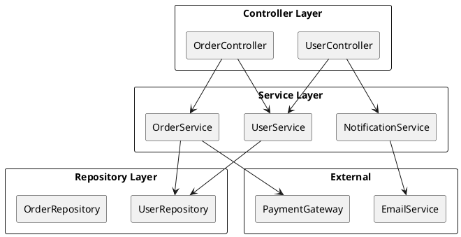
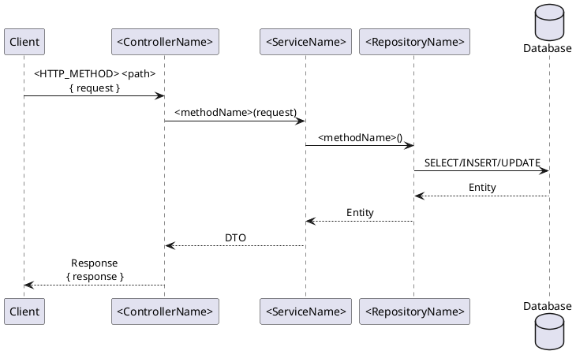
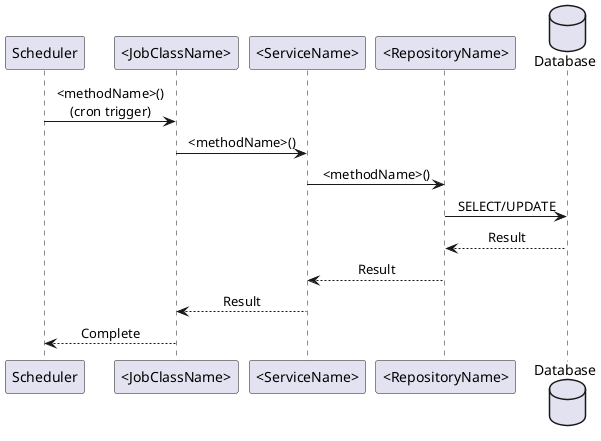
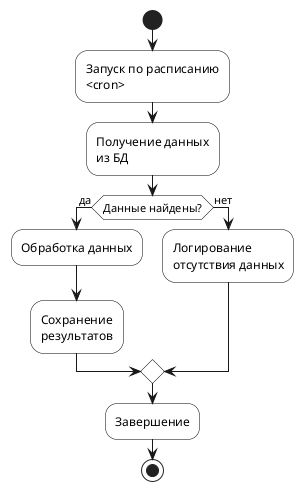
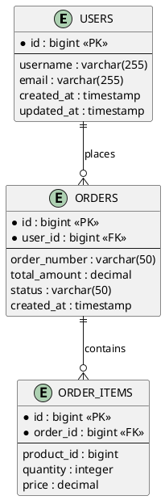

# Процесс генерации документации по коду

## Общее описание

Этот документ описывает процесс генерации технической документации для микросервисов на Java/Kotlin + Spring Boot в формате Markdown с использованием PlantUML-диаграмм. Документация организуется в виде структуры файлов: каждый endpoint или Job сохраняется в отдельный файл, сгруппированный по контроллерам или Job-классам.

## Режимы работы

### Режим 1: Полная генерация (--full)
Генерирует документацию для всего проекта с нуля.

### Режим 2: Инкрементальное обновление по diff (--diff)
Анализирует изменения из Merge Request и обновляет только затронутые разделы документации.

### Режим 3: Проверка незадокументированного (--check-undocumented)
Находит все незадокументированные контроллеры, endpoint'ы и Job'ы.

---

## Этапы процесса

### 1. Анализ проекта

#### 1.1. Определение структуры проекта
- Найди корневую директорию проекта (обычно содержит `pom.xml`, `build.gradle` или `build.gradle.kts`)
- Определи основной пакет (package) сервиса
- Изучи структуру директорий:
  - `controllers` / `rest` / `web` — контроллеры
  - `services` / `service` — сервисы
  - `repositories` / `dao` / `jpa` — репозитории
  - `entity` / `model` / `domain` / `entities` — сущности
  - `dto` / `request` / `response` — DTO
  - `job` / `scheduler` / `task` / `jobs` — Job'ы и планировщики
  - `config` / `configuration` — конфигурации

#### 1.2. Определение типа сервиса
- **API-сервис**: есть `@RestController` — генерируй документацию API
- **Job-сервис**: есть `@Scheduled` / `@Job` — генерируй документацию Job'ов
- **Комбинированный**: есть и то, и другое — генерируй оба раздела

#### 1.3. Анализ конфигурации
- Прочитай `application.yml` или `application.properties`
- Определи имя сервиса (`spring.application.name`)
- Выяви порты (server.port, management.server.port)
- Найди конфигурации интеграций (БД, внешние API, Kafka)

#### 1.4. Проверка существующей документации
- Проверь наличие папки `ai-docs/`
- Если существует — загрузи текущую структуру документации
- Если нет — подготовься к полной генерации

### 2. Анализ компонентов

#### 2.1. Контроллеры (@RestController)
Для каждого контроллера:
- Имя класса (без суффикса Controller)
- Базовый путь (@RequestMapping)
- Для каждого метода:
  - HTTP-метод и путь (@GetMapping, @PostMapping, и т.д.)
  - Модель запроса (параметры метода, @RequestBody DTO)
  - Модель ответа (возвращаемый тип)
  - Обработку ошибок (@ExceptionHandler)
  - Зависимые сервисы (поля контроллера)

#### 2.2. Job'ы (@Scheduled, @Job)
Для каждого Job-класса:
- Имя класса
- Для каждого метода с @Scheduled:
  - Cron-выражение или расписание
  - Описание назначения (по имени метода и логике)
  - Зависимые сервисы
  - Алгоритм работы (анализ кода метода)

#### 2.3. Сервисы (@Service)
- Найди все сервисные классы
- Определи основные бизнес-операции (публичные методы)
- Выяви зависимости между сервисами
- Зафиксируй ключевые алгоритмы для последовательности

#### 2.4. Репозитории (@Repository, JpaRepository)
- Идентифицируй репозитории
- Определи сущности (Entity), с которыми работают
- Выяви кастомные запросы (@Query)
- Зафиксируй имена таблиц

#### 2.5. Entity-классы
- Найди классы с аннотацией @Entity
- Определи имена таблиц (@Table)
- Выяви поля и их типы
- Зафиксируй связи (@OneToMany, @ManyToOne, и т.д.)

#### 2.6. Интеграции
- Найди REST-клиенты (@RestClient, @FeignClient)
- Выяви Kafka-топики (@KafkaListener, KafkaTemplate)
- Определи внешние API и их назначение

### 3. Работа в разных режимах

#### 3.1. Режим полной генерации (--full)

**Процесс:**
1. Создай полную структуру `ai-docs/`
2. Сгенерируй документацию для всех контроллеров и endpoint'ов
3. Сгенерируй документацию для всех Job'ов
4. Создай `architecture.md` со всеми компонентами
5. Создай `data/schema.md` со всеми таблицами
6. Создай главный `README.md` с навигацией

#### 3.2. Режим инкрементального обновления по diff (--diff)

**Входные данные:**
- Список изменённых файлов из MR (git diff)
- Или прямой список файлов от пользователя

**Процесс:**

**Шаг 1: Анализ изменений**
```
Для каждого изменённого файла определи тип:
- src/.../controller/*.java|.kt → контроллер
- src/.../service/*.java|.kt → сервис
- src/.../repository/*.java|.kt → репозиторий
- src/.../entity/*.java|.kt → сущность
- src/.../job/*.java|.kt → Job
```

**Шаг 2: Определение действий**

| Тип изменения | Действие |
|--------------|----------|
| **Новый контроллер** | Создать папку в `api/`, создать README, создать файлы endpoint'ов |
| **Новый endpoint** | Добавить в README контроллера, создать файл endpoint'а |
| **Изменён endpoint** | Обновить файл endpoint'а (параметры, примеры, diagram) |
| **Удалён endpoint** | Удалить файл endpoint'а, обновить README контроллера |
| **Новый Job** | Создать папку в `jobs/`, создать README, создать файл Job'а |
| **Изменён Job** | Обновить файл Job'а (cron, алгоритм, diagram) |
| **Новая entity** | Добавить в `data/schema.md` |
| **Изменена entity** | Обновить описание в `data/schema.md` |
| **Новый сервис** | Обновить `architecture.md` |
| **Изменена архитектура** | Обновить `architecture.md` |

**Шаг 3: Логика для незадокументированных частей**

**Если часть кода ещё не была задокументирована:**

```
IF (документация существует) THEN
    UPDATE существующий файл
ELSE IF (родительская документация существует) THEN
    CREATE новый файл в существующей папке
    UPDATE родительский README (добавить ссылку)
ELSE
    CREATE новую папку
    CREATE README папки
    CREATE файл документа
    UPDATE главный README (добавить ссылку)
END IF
```

**Конкретные сценарии:**

1. **Новый контроллер (не был задокументирован)**:
   ```
   ai-docs/api/<ControllerName>/
   ├── README.md              # Создать с таблицей endpoint'ов
   └── <methodName>.md        # Создать для каждого метода
   ```
   Обновить главный `ai-docs/README.md` — добавить секцию с таблицей endpoint'ов нового контроллера.

2. **Новый endpoint в существующем контроллере**:
   ```
   ai-docs/api/<ControllerName>/
   ├── README.md              # Обновить — добавить строку в таблицу
   ├── existingMethod.md      # Без изменений
   └── newMethod.md           # Создать новый файл
   ```

3. **Изменённый endpoint**:
   ```
   ai-docs/api/<ControllerName>/<methodName>.md
   ```
   Обновить файл:
   - Пересмотреть параметры запроса
   - Обновить примеры JSON
   - Пересгенерировать sequence diagram
   - Добавить новые коды ошибок (если есть)

4. **Новый Job (не был задокументирован)**:
   ```
   ai-docs/jobs/<JobClassName>/
   ├── README.md              # Создать с таблицей Job'ов
   └── <methodName>.md        # Создать для каждого метода
   ```
   Обновить главный `ai-docs/README.md` — добавить секцию с таблицей Job'ов.

5. **Изменённая схема данных**:
   ```
   ai-docs/data/schema.md
   ```
   Обновить PlantUML-диаграмму:
   - Добавить новые таблицы
   - Изменить существующие (поля, связи)

6. **Изменённая архитектура**:
   ```
   ai-docs/architecture.md
   ```
   Обновить component diagram:
   - Добавить новые компоненты
   - Обновить связи между компонентами

**Шаг 4: Обновление навигации**
- Обновить главный `README.md`
- Добавить новые разделы в навигацию
- Обновить таблицы быстрого доступа

#### 3.3. Режим проверки незадокументированного (--check-undocumented)

**Процесс:**

1. **Сканирование контроллеров**:
   - Найти все `@RestController` в проекте
   - Для каждого контроллера найти все методы с `@GetMapping`, `@PostMapping`, и т.д.
   - Проверить наличие файла `ai-docs/api/<ControllerName>/<methodName>.md`
   - Если файла нет — добавить в список незадокументированных

2. **Сканирование Job'ов**:
   - Найти все классы с `@Scheduled` методами
   - Для каждого метода проверить наличие `ai-docs/jobs/<JobClassName>/<methodName>.md`
   - Если файла нет — добавить в список незадокументированных

3. **Сканирование сущностей**:
   - Найти все `@Entity` классы
   - Проверить наличие в `ai-docs/data/schema.md`
   - Если отсутствует — добавить в список

4. **Формирование отчёта**:
   ```markdown
   ## Незадокументированные элементы

   ### Контроллеры
   - [ ] UserController.newMethod() — новый endpoint
   - [ ] OrderController — новый контроллер (3 endpoint'а)

   ### Job'ы
   - [ ] CleanupJob.cleanupOldRecords() — новый Job

   ### Сущности
   - [ ] NewEntity — новая таблица
   ```

### 4. Генерация структуры файлов

#### 4.1. Создание директорий
```
ai-docs/
├── README.md                    # Главная страница
├── architecture.md              # Архитектура
├── api/                         # API endpoint'ы
│   └── <ControllerName>/
│       ├── README.md
│       └── <methodName>.md
├── jobs/                        # Job'ы
│   └── <JobClassName>/
│       ├── README.md
│       └── <methodName>.md
└── data/
    └── schema.md                # Схема данных
```

#### 4.2. Генерация ai-docs/README.md (главная страница)

```markdown
# <Service Name> — <Краткое описание>

## Краткое описание

**<Service Name>** — это сервис, отвечающий за <основное назначение>.

## Основные возможности

1. **<Возможность 1>** — описание
2. **<Возможность 2>** — описание

## Навигация

- [Архитектура](architecture.md)
- [API Endpoints](api/) — если есть
- [Jobs](jobs/) — если есть
- [Схема данных](data/schema.md)

## Быстрый доступ

### API Endpoints

| Контроллер | Метод | Путь | Описание | Файл |
|------------|-------|------|----------|------|
| UserController | GET | `/api/v1/users` | Получение списка | [api/UserController/getUsers.md](api/UserController/getUsers.md) |

### Jobs

| Класс | Метод | Расписание | Описание | Файл |
|-------|-------|------------|----------|------|
| DataSyncJob | syncData | `0 0 * * * *` | Синхронизация | [jobs/DataSyncJob/syncData.md](jobs/DataSyncJob/syncData.md) |
```

#### 4.3. Генерация architecture.md

```markdown
# Архитектура <Service Name>

## Компоненты сервиса



## Базы данных

Сервис работает с <N> база(ми) данных:

1. **PostgreSQL (<dbname>)** — основные данные (пользователи, заказы)
2. **Redis** — кэш сессий

## Зависимости

| Зависимость | Назначение |
|-------------|------------|
| Spring Boot Web | REST API |
| Spring Data JPA | ORM |
| Spring Scheduler | Планировщик |
```

#### 4.4. Генерация документации для endpoint'ов

**Файл: `api/<ControllerName>/README.md`**

```markdown
# <ControllerName>

Контроллер для управления <сущность/домен>.

**Базовый путь:** `<base-path>`

## Endpoints

| Метод | Путь | Описание | Файл |
|-------|------|----------|------|
| GET | `<path1>` | <Описание 1> | [<methodName1>.md](<methodName1>.md) |
| POST | `<path2>` | <Описание 2> | [<methodName2>.md](<methodName2>.md) |
```

**Файл: `api/<ControllerName>/<methodName>.md`**

```markdown
# <ControllerName>.<methodName>()

## Endpoint

- **Метод:** `<HTTP_METHOD>`
- **Путь:** `<full-path>`
- **Описание:** <Подробное описание назначения endpoint'а>
- **Требует авторизации:** Да/Нет
- **IDempotency:** Да/Нет

## Sequence Diagram



## Параметры запроса

### Path Parameters

| Параметр | Тип | Описание |
|----------|-----|----------|
| `id` | Long | Идентификатор сущности |

### Query Parameters

| Параметр | Тип | Обязательное | Описание |
|----------|-----|--------------|----------|
| `page` | Integer | Нет | Номер страницы (default: 0) |
| `size` | Integer | Нет | Размер страницы (default: 20) |

### Request Body

```json
{
  "field1": "value1",
  "field2": 123,
  "nested": {
    "subfield": "value"
  }
}
```

| Поле | Тип | Обязательное | Описание |
|------|-----|--------------|----------|
| `field1` | String | Да | Описание поля 1 |
| `field2` | Integer | Нет | Описание поля 2 |
| `nested.subfield` | String | Нет | Описание вложенного поля |

## Ответ

### Успешный ответ (200 OK)

```json
{
  "id": 123,
  "name": "Example",
  "status": "ACTIVE"
}
```

| Поле | Тип | Описание |
|------|-----|----------|
| `id` | Long | Идентификатор |
| `name` | String | Название |
| `status` | Enum | Статус (ACTIVE, INACTIVE) |

### Коды ошибок

| Код | Сообщение | Описание |
|-----|-----------|----------|
| 400 | Bad Request | Некорректные входные данные |
| 404 | Not Found | Сущность не найдена |
| 409 | Conflict | Конфликт состояния |
| 500 | Internal Error | Внутренняя ошибка |

## Примеры использования

### Пример запроса

```bash
curl -X GET http://localhost:8080/api/v1/users/123 \
  -H "Authorization: Bearer <token>"
```

### Пример ответа

```json
{
  "id": 123,
  "name": "John Doe",
  "email": "john@example.com"
}
```
```

#### 4.5. Генерация документации для Job'ов

**Файл: `jobs/<JobClassName>/README.md`**

```markdown
# <JobClassName>

Job-класс для <назначение: например, синхронизации данных, очистки кэша>.

## Jobs

| Метод | Расписание | Описание | Файл |
|-------|------------|----------|------|
| <methodName1> | `<cron1>` | <Описание 1> | [<methodName1>.md](<methodName1>.md) |
| <methodName2> | `<cron2>` | <Описание 2> | [<methodName2>.md](<methodName2>.md) |
```

**Файл: `jobs/<JobClassName>/<methodName>.md`**

```markdown
# <JobClassName>.<methodName>()

## Job Information

- **Тип:** `@Scheduled` / `@Job`
- **Cron выражение:** `<cron-expression>`
- **Описание:** <Подробное описание назначения Job'а>
- **Включен:** Да/Нет (по конфигурации)
- **Транзакционность:** Да/Нет

## Sequence Diagram



## Activity Diagram



## Алгоритм работы

1. **Инициализация** — подготовка контекста, получение параметров
2. **Загрузка данных** — выборка данных из БД/внешнего API
3. **Обработка** — бизнес-логика, трансформация
4. **Сохранение** — запись результатов
5. **Логирование** — запись статистики выполнения

## Обработка ошибок

| Тип ошибки | Действие |
|------------|----------|
| transient (временная) | Повторная попытка (retry) |
| permanent (неустранимая) | Логирование, продолжение |
| критическая | Остановка Job'а, алерт |

## Логирование

**INFO:**
- Старт выполнения
- Количество обработанных записей
- Время выполнения

**ERROR:**
- Ошибки обработки
- Ошибки подключения к БД

## Метрики

- `job.<name>.duration` — время выполнения
- `job.<name>.records.processed` — количество записей
- `job.<name>.errors` — количество ошибок
```

#### 4.6. Генерация data/schema.md

```markdown
# Схема данных

## Базы данных

### PostgreSQL (<dbname>)



## Описание таблиц

### USERS

| Поле | Тип | Описание |
|------|-----|----------|
| `id` | bigint | Первичный ключ |
| `username` | varchar(255) | Имя пользователя |
| `email` | varchar(255) | Email (уникальный) |
| `created_at` | timestamp | Дата создания |

### ORDERS

| Поле | Тип | Описание |
|------|-----|----------|
| `id` | bigint | Первичный ключ |
| `user_id` | bigint | Внешний ключ на USERS |
| `order_number` | varchar(50) | Номер заказа |
| `total_amount` | decimal | Сумма заказа |
| `status` | varchar(50) | Статус (NEW, PAID, SHIPPED) |
```

### 5. Контроль качества

#### 5.1. Проверка полноты
- Все контроллеры задокументированы
- Все Job'ы описаны
- Все endpoint'ы имеют sequence-диаграммы
- Схема данных актуальна

#### 5.2. Проверка PlantUML
- Все диаграммы валидны
- Синтаксис корректен
- Ссылки на компоненты соответствуют коду

#### 5.3. Проверка ссылок
- Все относительные ссылки работают
- Навигация между файлами корректна

## Best Practices

### При создании PlantUML-диаграмм
- Используй `skinparam` для стилизации
- Добавляй комментарии к сложным участкам
- Избегай слишком сложных диаграмм (разбивай на части)

### При описании endpoint'ов
- Всегда указывай полный путь
- Приводи примеры curl-запросов
- Описывай все возможные коды ошибок

### При описании Job'ов
- Указывай cron-выражение в читаемом формате
- Описывай сценарии обработки ошибок
- Добавляй метрики для мониторинга

### Для Java и Kotlin проектов
- Учитывай особенности синтаксиса (Java vs Kotlin)
- Для Kotlin: обращай внимание на data-классы, null-safety
- Для Java: учитывай Lombok-аннотации (@Data, @Builder)
- Аннотации Spring одинаковы для обоих языков

### При работе в режиме --diff
- Всегда проверяй наличие существующей документации
- Для новых элементов создавай полную документацию
- Для изменённых элементов обновляй только затронутые части
- Не забывай обновлять навигацию в README.md

### При работе в режиме --check-undocumented
- Предоставляй чек-лист незадокументированных элементов
- Группируй по типам (контроллеры, Job'ы, сущности)
- Указывай приоритет документирования

## Выходная структура

```
ai-docs/
├── README.md
├── architecture.md
├── api/
│   └── UserController/
│       ├── README.md
│       ├── getUsers.md
│       ├── getUserById.md
│       └── createUser.md
├── jobs/
│   └── DataSyncJob/
│       ├── README.md
│       ├── syncData.md
│       └── cleanupOldRecords.md
└── data/
    └── schema.md
```

## Матрица решений для режима --diff

| Ситуация | Действие |
|----------|----------|
| Новый контроллер | Создать папку, README, файлы endpoint'ов |
| Новый endpoint в существующем контроллере | Обновить README контроллера, создать файл endpoint'а |
| Изменён endpoint | Обновить файл endpoint'а |
| Удалён endpoint | Удалить файл, обновить README контроллера |
| Новый Job | Создать папку, README, файл Job'а |
| Изменён Job | Обновить файл Job'а |
| Новая entity | Обновить schema.md |
| Изменена entity | Обновить schema.md |
| Новый сервис | Обновить architecture.md |
| Изменена архитектура | Обновить architecture.md |
