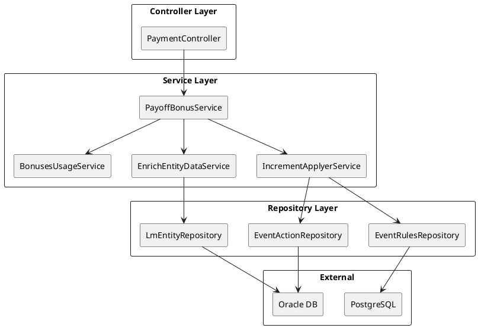
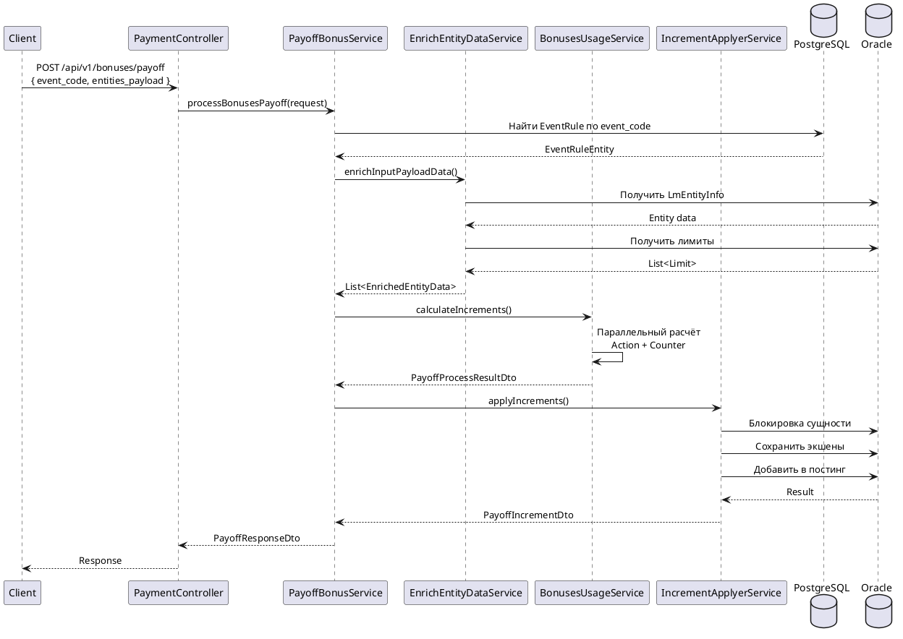
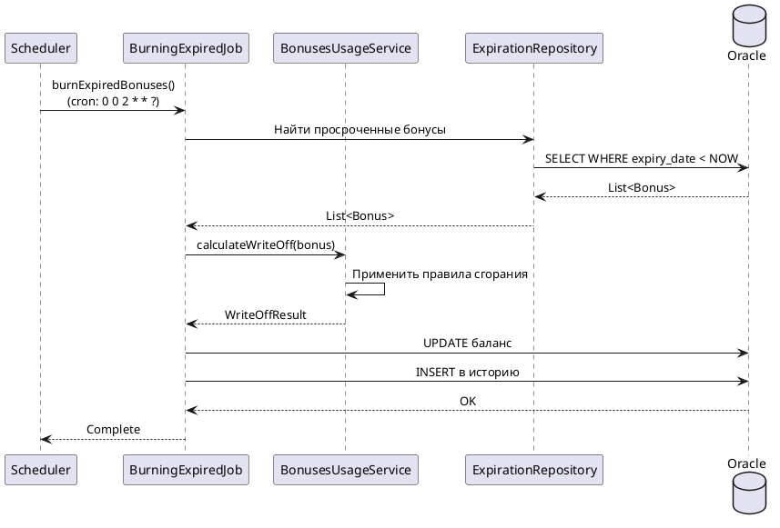
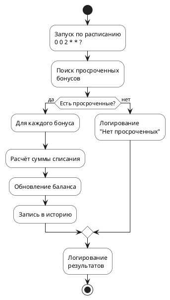
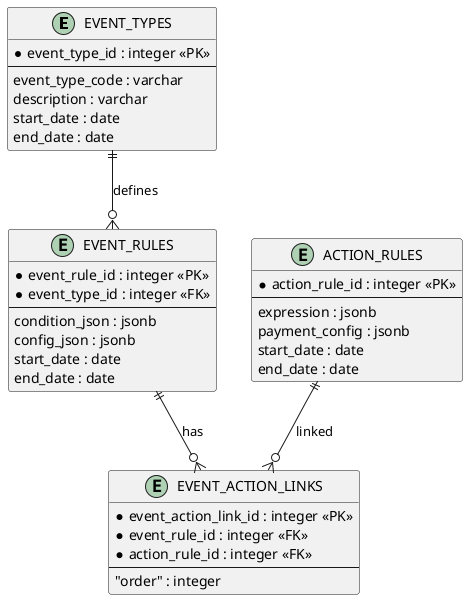
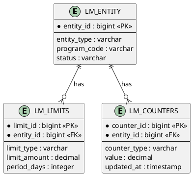

# Примеры сгенерированной документации

## Пример структуры файлов

Для сервиса `payment-control-app` будет создана следующая структура в корне проекта:

```
ai-docs/
├── README.md                      # Главная страница с навигацией
├── architecture.md                # Архитектура с PlantUML-диаграммами
├── api/
│   └── PaymentController/
│       ├── README.md              # Список endpoint'ов контроллера
│       ├── payoffBonuses.md       # POST /api/v1/bonuses/payoff
│       └── getPaymentStatus.md    # GET /api/v1/payments/{id}/status
├── jobs/
│   ├── BurningExpiredJob/
│   │   ├── README.md              # Список Job'ов класса
│   │   ├── burnExpiredBonuses.md  # @Scheduled cron
│   │   └── cleanupOldRecords.md   # @Scheduled cron
│   └── NotificationJob/
│       ├── README.md
│       └── sendNotifications.md
└── data/
    └── schema.md                  # Схема данных PlantUML
```

## Пример: Главная страница (README.md)

```markdown
# Payment Control API — Модуль выплаты и утилизации бонусов

## Краткое описание

**Payment Control API** — это сервис, отвечающий за управление выплатой бонусов клиентам
и утилизацию (списание/перенос) накопленных бонусов по событиям программы лояльности.

## Навигация

- [Архитектура](architecture.md)
- [API Endpoints](api/)
- [Jobs](jobs/)
- [Схема данных](data/schema.md)

## API Endpoints

| Контроллер | Метод | Путь | Описание | Файл |
|------------|-------|------|----------|------|
| PaymentController | POST | `/api/v1/bonuses/payoff` | Выплата бонусов по событию | [api/PaymentController/payoffBonuses.md](api/PaymentController/payoffBonuses.md) |
| PaymentController | GET | `/api/v1/payments/{id}/status` | Статус выплаты | [api/PaymentController/getPaymentStatus.md](api/PaymentController/getPaymentStatus.md) |

## Jobs

| Класс | Метод | Расписание | Описание | Файл |
|-------|-------|------------|----------|------|
| BurningExpiredJob | burnExpiredBonuses | `0 0 2 * * ?` | Сгорание просроченных бонусов | [jobs/BurningExpiredJob/burnExpiredBonuses.md](jobs/BurningExpiredJob/burnExpiredBonuses.md) |
| BurningExpiredJob | cleanupOldRecords | `0 0 3 * * ?` | Очистка старых записей | [jobs/BurningExpiredJob/cleanupOldRecords.md](jobs/BurningExpiredJob/cleanupOldRecords.md) |
```

## Пример: Архитектура (architecture.md)

```markdown
# Архитектура Payment Control API

## Компоненты сервиса



## Базы данных

Сервис работает с 2 базами данных:

1. **PostgreSQL (payment_control)** — правила событий, конфигурации экшенов и счетчиков
2. **Oracle (LOYCO)** — основные данные программы лояльности: счета, лимиты, счетчики

## Зависимости

| Зависимость | Назначение |
|-------------|------------|
| Spring Boot Starter Web | REST API |
| Spring Data JPA | Работа с PostgreSQL |
| Spring JDBC | Работа с Oracle |
| mXparser | Вычисление математических выражений |
| MapStruct | Маппинг DTO |
```

## Пример: Документация endpoint'а (ai-docs/api/PaymentController/payoffBonuses.md)

```markdown
# PaymentController.payoffBonuses()

## Endpoint

- **Метод:** `POST`
- **Путь:** `/api/v1/bonuses/payoff`
- **Описание:** Запуск процесса выплаты/утилизации бонусов по событию
- **Требует авторизации:** Да
- **Idempotency:** Нет

## Sequence Diagram



## Параметры запроса

### Request Body

```json
{
  "event_code": "ML_DEACTIVATE_PAYMENT_EVENT",
  "entities_payload": [
    {
      "entity_id": 123456,
      "counters": [
        {
          "type_code": "PR_PURCHASE_AUTOСATEGORY_BONUS_COUNTER",
          "amount": 1000.00
        }
      ],
      "accounts": [
        {
          "type_code": "PENDING",
          "amount": 500.00
        }
      ]
    }
  ]
}
```

| Поле | Тип | Обязательное | Описание |
|------|-----|--------------|----------|
| `event_code` | String | Да | Код события утилизации |
| `entities_payload` | Array | Да | Массив сущностей для обработки |
| `entities_payload[].entity_id` | Long | Да | Идентификатор сущности (договора) |
| `entities_payload[].counters` | Array | Нет | Массив счетчиков |
| `entities_payload[].counters[].type_code` | String | Да | Код типа счетчика |
| `entities_payload[].counters[].amount` | Decimal | Да | Значение счетчика |
| `entities_payload[].accounts` | Array | Нет | Массив балансов счетов |
| `entities_payload[].accounts[].type_code` | String | Да | Код типа счета (PENDING, AVAILABLE) |
| `entities_payload[].accounts[].amount` | Decimal | Да | Значение баланса |

## Ответ

### Успешный ответ (200 OK)

Возвращает `null` или объект с ошибками по сущностям:

```json
{
  "errors": [
    {
      "entity_id": 123456,
      "error_code": 4001,
      "error_message": "Entity is locked by another process"
    }
  ]
}
```

| Поле | Тип | Описание |
|------|-----|----------|
| `errors` | Array | Массив ошибок (если есть) |
| `errors[].entity_id` | Long | Идентификатор сущности с ошибкой |
| `errors[].error_code` | Integer | Код ошибки |
| `errors[].error_message` | String | Сообщение ошибки |

### Коды ошибок

| Код | Сообщение | Описание |
|-----|-----------|----------|
| 400 | Bad Request | Некорректный формат запроса |
| 404 | Event Code Not Found | event_code отсутствует в справочнике |
| 409 | Entity Is Locked | Сущность заблокирована другим процессом |
| 500 | Internal Error | Внутренняя ошибка сервиса |

## Примеры использования

### Пример запроса

```bash
curl -X POST http://localhost:8080/api/v1/bonuses/payoff \
  -H "Authorization: Bearer <token>" \
  -H "Content-Type: application/json" \
  -d '{
    "event_code": "ML_DEACTIVATE_PAYMENT_EVENT",
    "entities_payload": [
      {
        "entity_id": 123456,
        "counters": [
          {
            "type_code": "PR_PURCHASE_AUTOСATEGORY_BONUS_COUNTER",
            "amount": 1000.00
          }
        ]
      }
    ]
  }'
```

### Пример ответа

```json
null
```

Или с ошибками:

```json
{
  "errors": [
    {
      "entity_id": 123456,
      "error_code": "ENTITY_IS_LOCKED_BY_ANOTHER_PROCESS",
      "error_message": "Entity is locked by another process"
    }
  ]
}
```
```

## Пример: Документация Job'а (ai-docs/jobs/BurningExpiredJob/burnExpiredBonuses.md)

```markdown
# BurningExpiredJob.burnExpiredBonuses()

## Job Information

- **Тип:** `@Scheduled`
- **Cron выражение:** `0 0 2 * * ?` (ежедневно в 02:00)
- **Описание:** Сгорание просроченных бонусов клиентов по расписанию
- **Включен:** Да (по умолчанию)
- **Транзакционность:** Да

## Sequence Diagram



## Activity Diagram



## Алгоритм работы

1. **Поиск просроченных бонусов** — выборка бонусов с `expiry_date < NOW()`
2. **Расчёт суммы списания** — применение правил сгорания по программе лояльности
3. **Обновление баланса** — списание бонусов со счёта клиента
4. **Запись в историю** — логирование операции сгорания
5. **Логирование результатов** — вывод статистики выполнения

## Обработка ошибок

| Тип ошибки | Действие |
|------------|----------|
| transient (временная) | Повторная попытка через 5 минут |
| permanent (неустранимая) | Логирование, продолжение обработки следующего |
| критическая (БД недоступна) | Остановка Job'а, алерт в Slack |

## Логирование

**INFO:**
- `[BurningExpiredJob] Старт выполнения`
- `[BurningExpiredJob] Найдено N просроченных бонусов`
- `[BurningExpiredJob] Обработано M бонусов за K мс`

**ERROR:**
- `[BurningExpiredJob] Ошибка обработки бонуса {id}`
- `[BurningExpiredJob] Ошибка подключения к БД`

## Метрики

- `job.burnExpiredBonuses.duration` — время выполнения
- `job.burnExpiredBonuses.bonuses.processed` — количество обработанных бонусов
- `job.burnExpiredBonuses.bonuses.written_off` — сумма списанных бонусов
- `job.burnExpiredBonuses.errors` — количество ошибок
```

## Пример: Схема данных (ai-docs/data/schema.md)

```markdown
# Схема данных

## Базы данных

### PostgreSQL (payment_control)



### Oracle (LOYCO)


```

## Пример: README контроллера (ai-docs/api/PaymentController/README.md)

```markdown
# PaymentController

Контроллер для управления выплатой и утилизацией бонусов.

**Базовый путь:** `/api/v1`

## Endpoints

| Метод | Путь | Описание | Файл |
|-------|------|----------|------|
| POST | `/bonuses/payoff` | Выплата бонусов по событию | [payoffBonuses.md](payoffBonuses.md) |
| GET | `/payments/{id}/status` | Статус выплаты | [getPaymentStatus.md](getPaymentStatus.md) |
```

## Пример: README Job-класса (ai-docs/jobs/BurningExpiredJob/README.md)

```markdown
# BurningExpiredJob

Job-класс для сгорания просроченных бонусов и очистки старых записей.

## Jobs

| Метод | Расписание | Описание | Файл |
|-------|------------|----------|------|
| burnExpiredBonuses | `0 0 2 * * ?` | Сгорание просроченных бонусов | [burnExpiredBonuses.md](burnExpiredBonuses.md) |
| cleanupOldRecords | `0 0 3 * * ?` | Очистка старых записей | [cleanupOldRecords.md](cleanupOldRecords.md) |
```
