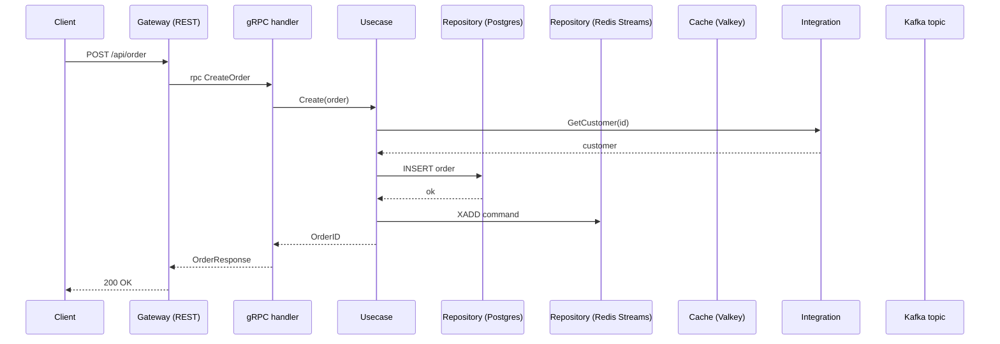

# ARCHITECTURE_SUMMARY.md — шаблон документа

Используй этот шаблон при генерации `ARCHITECTURE_SUMMARY.md` (Артефакт 2
скилла `architecture-analyzer`). Заполни **все** секции. Где данных не
хватает — `[НЕДОСТАТОЧНО ДАННЫХ]` + запись в «Открытые вопросы». Defaults
для нашего стека помечай `[ПОДТВЕРДИТЬ]`, если не уверен.

---

## Мета-информация

```markdown
# Architecture Summary — <service name>

**Дата:** YYYY-MM-DD
**Сервис:** <cmd/<name> или api package>
**Найденные компоненты:** [таблица из Фазы 1]
```

---

## 1. Назначение сервиса

Бизнес-задача (из ответа пользователя), кто пользователи, что хранит,
какую проблему решает. 1 абзац.

---

## 2. Компоненты

| Имя | Тип (repo/cache/integration/kafka/service) | Технология | Ответственность | Owner |
|-----|--------------------------------------------|------------|-----------------|-------|

---

## 3. Цели

### 3.1 Бизнес-цели
| Цель | Описание |

### 3.2 NFR
| Требование | Целевое значение |

### 3.3 Ограничения
- ...

---

## 4. Точки интеграции

### 4.1 Входы (нас зовут)
| Источник | Протокол | rpc/endpoint | Контракт (proto/openapi) |

### 4.2 Выходы (зовём мы)
| Назначение | Папка `integration/*` или `secretary-core/*` | Протокол | Что вызываем |

### 4.3 События Kafka (только consume)
| Топик | Схема | Назначение | Consumer (`internal/kafka/*`) |

---

## 5. Плюсы и минусы

### Плюсы
| # | Плюс | Обоснование |

### Минусы
| # | Минус | Влияние | Критичность (High/Medium/Low) |

---

## 6. Технические детали

### 6.1 Архитектурный стиль
**Default:** Микросервис, repository pattern, layered (handler → usecase
→ repo/integration). `[ПОДТВЕРДИТЬ если иначе]`

### 6.2 Паттерны
| Паттерн | Где применяется |
|---------|-----------------|
| Repository | `internal/repository/*` через sqlc + goverter + gowrap |
| Decorator (cache) | `internal/cache/*` поверх repository |
| Adapter (integration) | `internal/integration/*` или `secretary-core/*` |
| Saga / Outbox / Circuit Breaker / ... | `[ПОДТВЕРДИТЬ если применяется]` |

### 6.3 Протоколы
| Тип | Default | Где используется |
|-----|---------|------------------|
| Sync inbound | gRPC + REST gateway | `api/*.proto` |
| Sync outbound | gRPC или REST (oapi-codegen) | `internal/integration/*` |
| Async | Kafka | `internal/kafka/*` |

### 6.4 Хранение данных
**Default:** Database-per-service. Postgres через sqlc, ClickHouse
аналогично, Valkey для кэшей, Redis Streams для durable очередей.
`[ПОДТВЕРДИТЬ если есть shared DB]`

### 6.5 Безопасность
- Аутентификация: [JWT / mTLS / header — спросить]
- Авторизация: [спросить]
- Шифрование: TLS на gRPC/HTTP

### 6.6 Observability
- Логи: [slog / zap — уточнить]
- Метрики: [Prometheus?]
- Трейсинг: [OpenTelemetry?]

### 6.7 CI/CD и деплой
- `.gitlab-ci.yml`: pipeline (build/test/deploy)
- Деплой: helm-чарт из `helm/`

---

## 7. Оценка и рекомендации

### 7.1 Оценочная таблица
| Критерий | 1-5 | Комментарий |
|----------|-----|-------------|
| Масштабируемость | | |
| Отказоустойчивость | | |
| Поддерживаемость | | |
| Безопасность | | |
| Производительность | | |
| Тестируемость | | |
| Простота развёртывания | | |

### 7.2 Рекомендации
| # | Проблема | Рекомендация | Приоритет (H/M/L) | Сложность (H/M/L) | Эффект |
|---|----------|--------------|-------------------|-------------------|--------|

---

## 8. Sequence-диаграммы

Для каждого сценария из Фазы 2. Стандартные участники нашего стека:



**Примечания** для каждой диаграммы:
- Edge cases
- Обработка ошибок (retry, fallback, dead-letter, transaction rollback)

---

## 9. Дополнительный анализ (опционально, по Фазе 6)

```markdown
**Запрос:** [промпт пользователя]

[Развёрнутый ответ]
```

Раздел добавляется только если пользователь в Фазе 6 ввёл свой промпт.
Если выбрал «Пропустить» — секция отсутствует.
