## Odysseus: user-approved supplied skill

This skill was explicitly added by the user as an exception to the base
local/browser/Obsidian catalog. The services, local applications and MCP/CLI
integrations required by this skill are permitted for its requested workflow.
The local-only restriction of unrelated skills does not disable this exception.

Importing the skill does not connect a service, install a runtime or authorize
sending messages, publishing artifacts or changing external records by itself.
Use the host's available tools and the user's actual task authorization.
Resolve bundled scripts, assets and references from this installed skill's own
root; write task outputs in the user's working project. If a required tool,
connection or referenced resource is absent, report the exact dependency rather
than inventing a successful result.

---


# Mermaid Diagrams Skill

## Правила совместимости (Прочитать сначала)
- Предпочитать `graph LR`/`graph TB` для блок-схем; некоторые рендереры падают на ключевом слове `flowchart`.
- Цитировать метки содержащие пробелы/спецсимволы: `A["Text (x|y) |"]`.
- **Не использовать буквальный `\n` внутри меток** — Mermaid не интерпретирует такие разрывы строк. Использовать `<br/>` для разрывов строк.
- Продвинутые типы как `quadrantChart`, `sankey-beta`, `requirementDiagram`, `gitGraph` могут быть недоступны. Использовать предоставленные fallback блок-схем.
- Code fences должны начинаться с колонки 0 с языком `mermaid`.

## ASCII/Unicode Sidecar (Читаемый человеком Raw Markdown)
Для оптимизации для быстрого человеческого сканирования в raw Markdown и надежного разбора агентом, всегда поставлять ASCII/Unicode sidecar сразу под каждым блоком Mermaid.

Политика:
- MUST включать моноширинную, текстовую диаграмму сразу под блоком Mermaid используя fenced code с языком `text`.
- MUST держать Mermaid и sidecar в синхронизации (те же узлы/ребра, те же метки где возможно). Если расходятся, трактовать Mermaid как источник истины и обновить sidecar.
- SHOULD ограничить ширину до ~80 колонок для читаемости в diffs и терминалах.
- SHOULD использовать простые символы линейной графики (ASCII сначала; Unicode box-drawing опционально когда среда поддерживает).
- MAY добавить однострочную подпись над парой: `Diagram: <имя> (<тип>)`.

Рекомендуемые примитивы:
- Коробки: `[Name]`, `(Name)`, `+-----+\n| N |\n+-----+`
- Потоки: `-->`, решения как `{cond?}` линии, списки с `-`.
- Sequence (text-based): `Actor -> Actor: message` с отступами lifelines.

Пример (Flowchart):
```mermaid
graph LR
  A["Start"] --> B{Auth?}
  B -->|Yes| C["Dashboard"]
  B -->|No|  D["Login"]
```
```text
Diagram: Auth flow (flowchart)
  [Start] --> {Auth?}
      {Auth?} -- Yes --> [Dashboard]
      {Auth?} -- No  --> [Login]
```

Пример (Text-based Sequence):
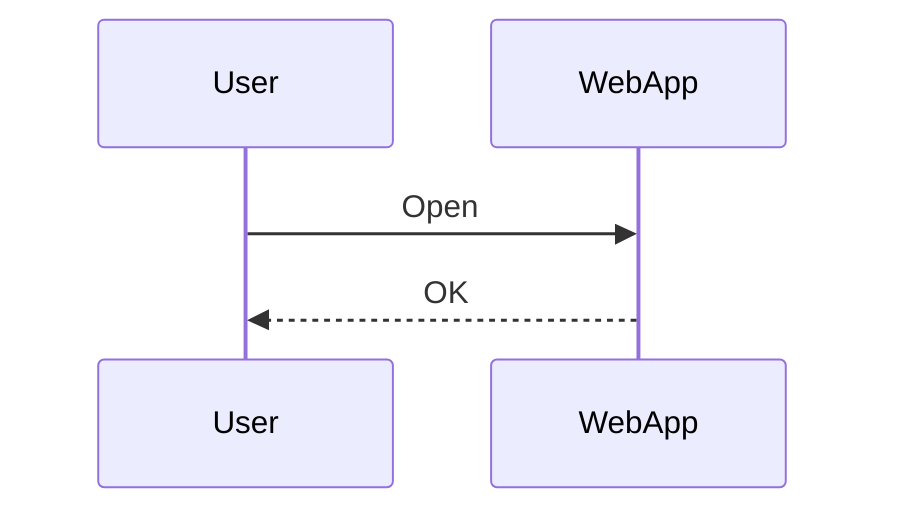
```text
Diagram: Happy path (sequence)
  User -> WebApp : Open
  WebApp -> User : OK
```

## Рабочие шаблоны (Совместимые с рендерером)

### Flowchart
```mermaid
graph LR
  A["Start"] --> B{Auth?}
  B -->|Yes| C["Dashboard"]
  B -->|No|  D["Login"]
  C --> E["Settings"]
```

### Sequence
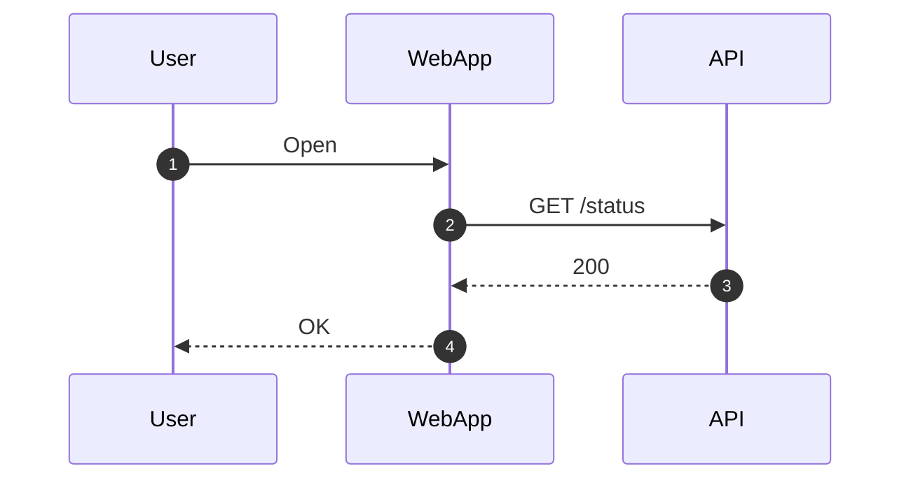

### Class
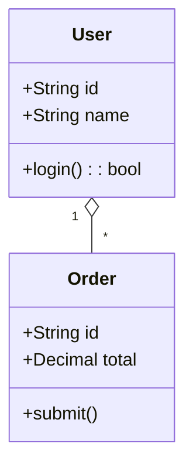

### State (v2)
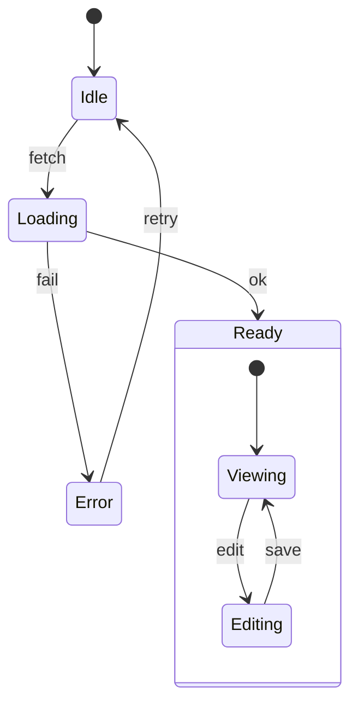

### ER (Entity-Relationship)
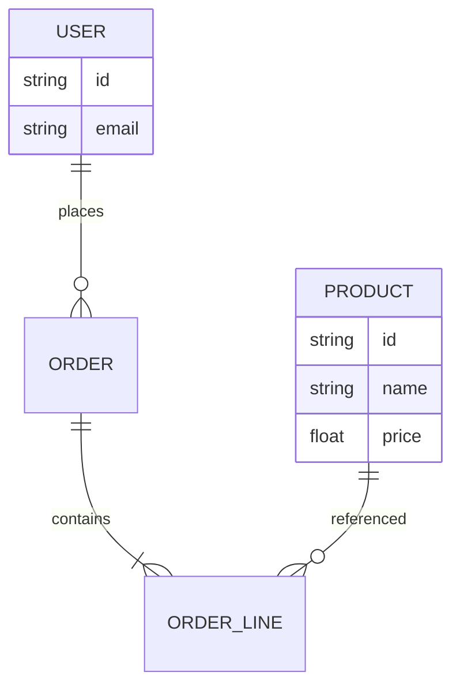

### Journey (User Journey)
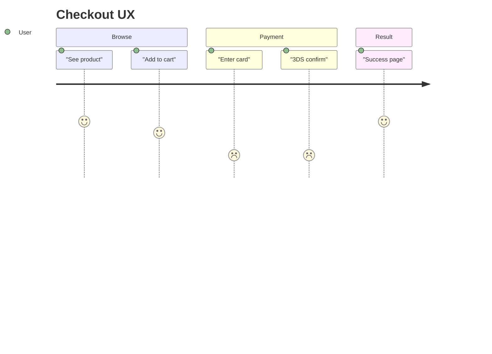

### Gantt
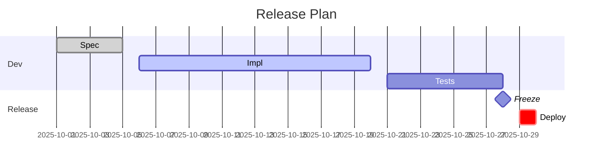

### Pie (совместимый синтаксис)
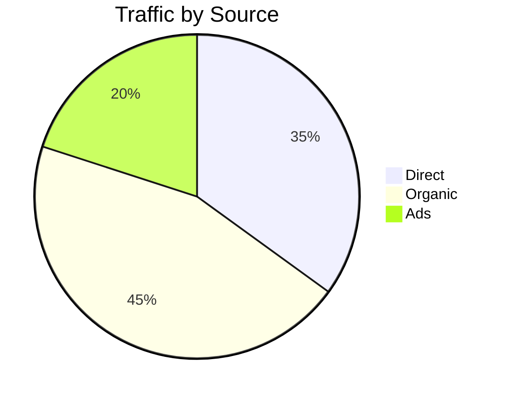

### Quadrant — flowchart fallback
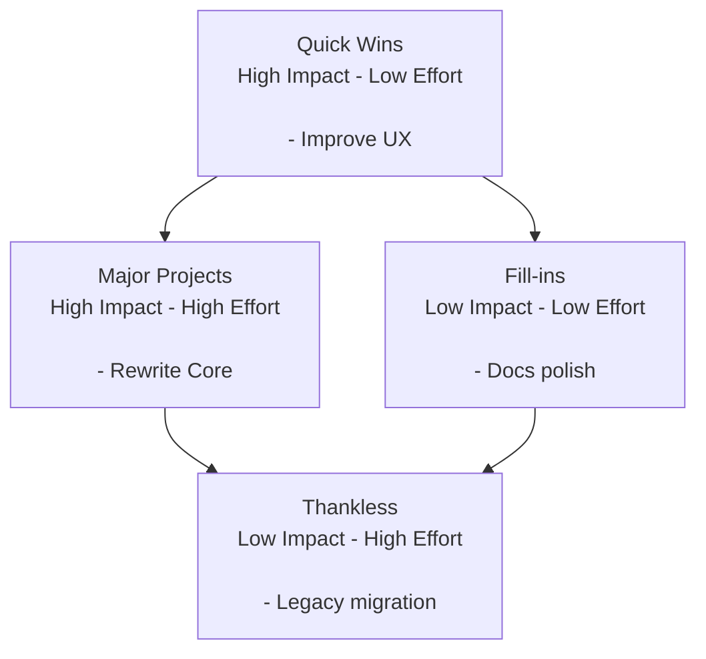

### Requirement — flowchart fallback
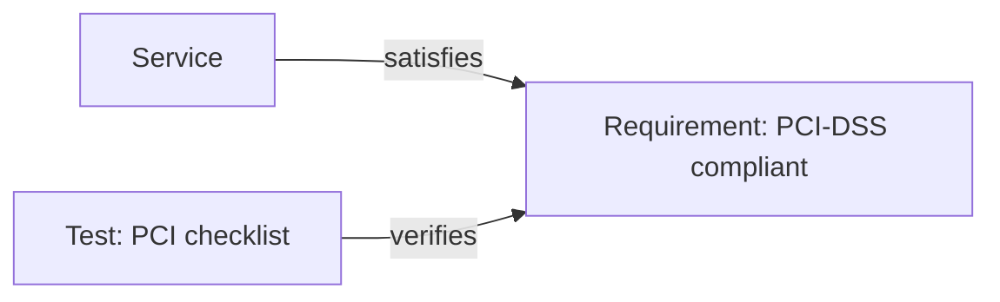

### Sankey — flowchart fallback (веса на ребрах)
```mermaid
graph LR
  Checkout["Checkout"] -->|100| PSP["PSP"]
  PSP -->|60|  Settled["Settled"]
  PSP -->|40|  Declined["Declined"]
```

### Git graph — flowchart fallback (простой DAG)
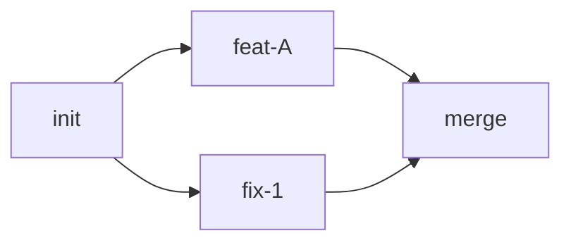

## Когда какую диаграмму использовать
- Flowchart: Общие потоки, решения, и движение данных в specs и PRDs.
- Sequence: Взаимодействия во времени между актерами/сервисами (API, запросы, ответы).
- Class: Модели предметной области и статическая структура; полезно для атрибутов сущностей и связей.
- State: Жизненный цикл сущности/компонента (idle -> loading -> ready/error, вложенные состояния).
- ER: База данных/логическая модель данных с кардинальностями.
- Journey: Пользовательский опыт через шаги/секции (отлично для PRD acceptance flows).
- Gantt: Планирование, релизы, и зависимости по датам.
- Pie: Простая композиция/отношения; предпочитать таблицы когда важна точность.
- Quadrant (fallback): Матрица приоритизации (Impact/Effort) без экспериментальной поддержки chart.
- Requirement (fallback): Трассируемость между требованиями, тестами, и элементами системы.
- Sankey (fallback): Относительные объемы вдоль пути когда `sankey` недоступен.
- Git graph (fallback): Маленькие branch/merge DAGs когда `gitGraph` недоступен.

## Troubleshooting
- Если диаграмма не рендерится, попробовать:
  1) Заменить `flowchart` на `graph` и упростить формы.
  2) Цитировать тексты узлов.
  3) Тестировать в `https://mermaid.live` для изоляции проблем среды.
  4) Fallback на шаблоны выше для максимальной совместимости.
