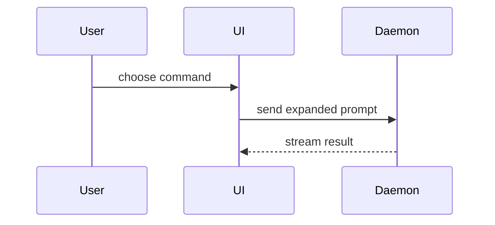

<!-- odysseus-invocation-policy -->
## Выбор и запуск

Навык можно выбирать автоматически, когда текущая задача соответствует описанию. Загружай только нужный режим и относящиеся к нему ресурсы.

Автовыбор не создаёт фонового задания и не расширяет запрос пользователя. Делегирование агентам требует разрешения в текущем запросе или применимых инструкциях. Отправка сообщений, публикация и изменения во внешних системах допустимы только в рамках явно порученного действия. Инструкции исходного руководства применяются с учётом этих границ и профиля выбранного режима.

Ссылки на прежние имена в исходных руководствах разрешай до загрузки навыка: «refactor» → «safe-refactor», режим «refactor». Старое имя не является отдельной командой.
<!-- /odysseus-invocation-policy -->

## Odysseus execution profile: local, browser and Obsidian

This installation is configured for local execution. This profile narrows the
upstream workflows below and takes precedence over their optional online modes.
Use the current Nessy agent/model, local files, installed CLI tools and libraries.
Browser interaction and the local Obsidian integration are explicitly allowed.

- Do not request, configure or use extra API keys, cloud AI providers, hosted
  rendering, SaaS MCP connections or another agent runtime to complete this skill.
- Use local inputs, cached/bundled assets and installed local engines. When web
  content is necessary, use the host's browser tools; do not replace them with a
  provider API, authenticated scraping service or non-browser cloud connector.
- Select documented offline branches without waiting for cloud sign-in. Ignore
  upstream instructions to refresh skills remotely, log into a provider, generate
  media remotely, publish through a SaaS API, or invoke a removed skill.
- Use native host tools for browser control, subagents and language servers when
  available. A local LSP/MCP adapter is allowed; a foreign agent/plugin runtime is
  not a prerequisite to install. Report missing local capability honestly.
- If the requested output cannot be produced locally, explain the missing local
  input or tool. Do not silently switch to a cloud service or claim completion.
  Installing a skill does not install its local engines or dependencies.

---


Use this template for writing the PR body:

```markdown
## Summary

<diagram, diff-sketch, or tree>

## Evidence

- **Before:** <screenshot/output/failing test run>
  **After:** <screenshot/output/passing test run>

## Merge Danger

**Door:** <one-way or two-way>

<optional: description>

**Blast Radius:** <one-word description>

<optional: potential ramifications of merge>
```

## Sections

Skip all preambles and keep prose brief. Use the user's domain language from `GLOSSARY.md`.

### Summary

Pick the smallest view that makes the key point clear.

- Show logic or an algorithm as pseudocode:

```text
on(save)
  if content is unchanged
    return cached result
  write new content
  return fresh result
```

- Show runtime control flow as a call tree:

```text
submitForm
  createSession
    persistPrompt
    launchAgent
  navigateToSession
```

- Show UI structure as a component tree, including state and module boundaries that matter:

```text
<SessionPage> (apps/example/src/routes/session.tsx)
  useSessionEvents()
  <SessionToolbar>
    <RunSkillButton> (packages/ui)
```

- Show file responsibility or a broad refactor as a shallow file tree:

```text
src/
├── commands/       # parses user actions
├── sessions/       # owns session state
└── transport/      # sends API requests
```

- Show component interaction, control flow, or data flow with Mermaid:



- Use `diff` when the point is what changes and the surrounding shape already exists. Match the diff shape to the topic.

For a component change:

```diff
 <SessionPage>
   useSessionEvents()
   <SessionToolbar>
+    <RunSkillButton />
   <SessionTimeline>
+    <SkillResultCard />
```

For a file-layout change:

```diff
 src/
 ├── commands/
+│   └── show-me.ts       # expands the slash command
 ├── sessions/
-└── transport.ts
+└── transport/
+    ├── client.ts
+    └── stream.ts
```

For a call-tree or call-stack change:

```diff
 submitForm
   createSession
     persistPrompt
+    expandSkillMention
     launchAgent
-  navigateToSession
+  navigateToSession
+    subscribeToEvents
```

For a state or control-flow change:

```diff
 on(save)
-  write content
+  if content is unchanged
+    return cached result
+  write new content
+  invalidate cache
```

- Show the whole block when most of it is new, when omitted context would hide ownership or order, or when the user needs a copyable target shape:

```ts
function expandSkill(command: string): string {
  const skillName = command.slice(1);
  return `use the ${skillName} skill`;
}
```

#### Guidance

Place each visual next to the short text it supports. Keep only the calls, files, props, states, and boundaries needed to answer the user's current question or the options to resolve the current discussion point.

You may use one of these, you may use several, it is unlikely you will use all of them. Use your judgement and don't overwhelm the user.

### Evidence

Concrete evidence that the change works. Show a before and after.

Screenshots are S-tier - when the environment is set up for it and the change is visual.

Execution-based evidence is A-tier. Test results, console output. Show the exact test that now fails and passes, using pseudocode.

### Merge Danger

Describe whether it's a one-way or two-way door. You can walk back through two-way doors, but not one-way doors. A PR that is cheap to roll back is lower risk. Changes that involve destructive actions or hard-to-reverse decisions are one-way doors.

The blast radius is the potential impact or scope of the changes introduced by this PR. Consider all possibilities. Examples are layout shift, breakages for consumers, mobile responsiveness, etc.
