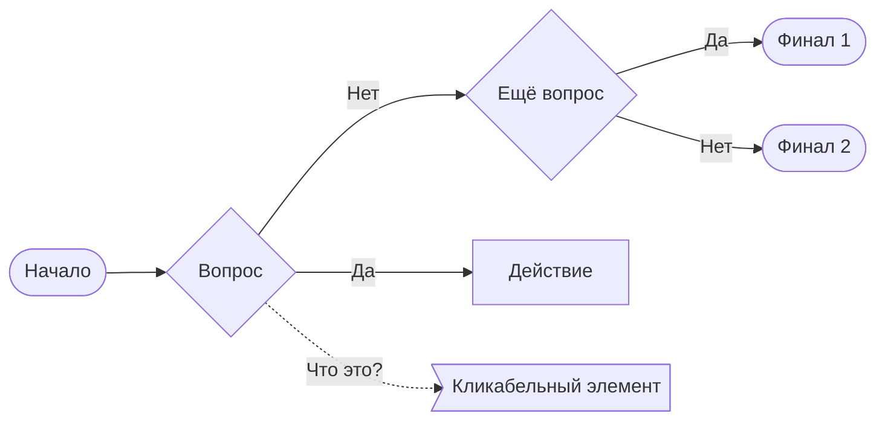
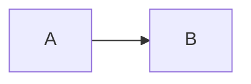

# AutoDoc Features

A reference for the capabilities of the Unic AutoDoc documentation portal (based on Docusaurus). This skill is invoked on demand when a task involves diagrams, tabs, callouts, or static files.

Portal setup — `auto-doc.json`, `api-schemas/`, `.gitlab-ci.yml` — is out of scope: this skill writes documentation content, it does not configure the portal. See the AutoDoc docs for that.

Source of truth: `https://unic.pages.devplatform.tcsbank.ru/autodoc/docs/content/features`. All Docusaurus Markdown features are available on top of what is listed here.

## Diagrams {#diagrams}

**Default to Mermaid.** Use PlantUML only when Mermaid cannot express the diagram (complex sequence layouts, deployment diagrams), Kroki when neither fits, LikeC4 for interactive C4. Do not convert existing PlantUML diagrams to Mermaid unless asked — the rule applies to new diagrams.

Why Mermaid first: it renders natively in GitLab, IDEs and any Markdown viewer without a server round-trip, so a diagram stays readable in a merge request diff and in a local editor, not only on the built portal.

### Mermaid {#mermaid}

Text-based diagrams. The `mdx-mermaid` plugin is enabled; they are also supported in GitLab.

````markdown

````

`click` turns a node into a link — useful for pointing a block of an architecture diagram at the page that describes it.

### PlantUML {#plantuml}

Text-based diagrams rendered to SVG — links and text selection work. Supported in GitLab. The `!include` directive is not supported.

````markdown
```plantuml
Alice -> Bob: Authentication Request
Bob --> Alice: Authentication Response
url of Bob is [[http://www.google.com]]
```
````

External `.puml` files are imported in two ways:

```jsx
// data-url with SVG (default)
import Diagram from './diagram.puml';


// React component — accepts props, easier to style
import Diagram from './diagram.puml?svg';
<Diagram className="my-class" style={{ width: '100%' }} />
```

### Kroki {#kroki}

Use this if Mermaid and PlantUML aren't suitable. Supported: BlockDiag, SeqDiag, ActDiag, NwDiag, PacketDiag, RackDiag, BPMN, Bytefield, C4 (with PlantUML), D2, DBML, Diagrams.net (experimental), Ditaa, Erd, Excalidraw, GraphViz, Mermaid, Nomnoml, Pikchr, PlantUML, Structurizr, SvgBob, Symbolator, UMLet, Vega, Vega-Lite, WaveDrom, WireViz.

Direct usage:

````markdown
```kroki imgType="excalidraw"
{
  "type": "excalidraw",
  "version": 2,
  ...
}
```
````

Via importing an external file:

1. Create a file `_kroki-excalidraw.mdx`. The `_` prefix hides the file from the documentation tree.
1. Import it on the page:

   ```jsx
   import KrokiExcalidrawExample from './_kroki-excalidraw.mdx'

   <KrokiExcalidrawExample />
   ```

### BPMN {#bpmn}

```jsx
import bpmnDiagramXml from "./user-process.bpmn?raw"

<Bpmn xml={bpmnDiagramXml} />
```

### LikeC4 {#likec4}

Interactive C4 diagrams. Requires the second version of the AutoDoc image.

1. Create a `docs/_likec4/` folder and place files with the `.c4` extension there.
1. Insert the component on a page:

   ```jsx
   <LikeC4View viewId="index" />
   ```

Available props:

| Property | Description |
|----------|-------------|
| `viewId` | Typed enumeration of views |
| `interactive` | Whether to open a modal on click, defaults to `true` |
| `where` | Optional filter, as in view predicates |
| `injectFontCss` | Whether to load IBM Plex Sans from a CDN, defaults to `true` |
| `background` | `dots`, `lines`, `cross`, `transparent`, `solid`, defaults to `transparent` |
| `browserBackground` | Same as above, defaults to `dots` |

### FullScreen {#fullscreen}

Wraps any content — primarily a diagram — into a block that opens full screen. Use it for a large architecture or sequence diagram that does not fit the content column, and for wide tables.

```jsx
<FullScreen>



</FullScreen>
```

`disableZoom={true}` turns off zooming when it is not needed (for example, for a table).

### Whiteboard {#whiteboard}

Embeds a whiteboard board whose content updates itself without rebuilding the documentation.

```jsx
<Whiteboard src="https://whiteboard.t-tech.team/app/board/<id>?elementId=<element>" />
<Whiteboard src="..." height={700} />
```

The `src` is taken from the board: right-click the element → **Скопировать ссылку на объект**. Access follows the board's own permissions — a reader without access to the board sees nothing, so switch on **Доступ по ссылке** for documentation embeds.

Prefer a text diagram in the repository over a Whiteboard embed: a board lives outside the repository, is not versioned with the code and is not indexed by search. Use it for live, still-changing sketches only.

## Static Files {#static-files}

### Images {#images}

There are two ways to add an image.

**Your own repository:**

1. Place the file next to the page, for example `./pipelines.png` next to `pipelines.md`.
1. Insert the image:

   ```markdown
   
   ```

**Shared Static repository:**

1. Create a product folder in `static/files/images`, for example `static/files/images/unic`.
1. Add the files to the folder.
1. Insert the image, removing `static` from the path:

   ```markdown
   
   ```

### Logo and Favicon {#logo-favicon}

Place `logo.svg` and `favicon.png` in `static/img/`. The logo will appear in the top-left corner, the favicon — in the browser tab.

### Importing Text Files {#text-import}

To reuse the contents of a file in multiple places throughout the documentation:

```jsx
import CodeBlock from '@theme/CodeBlock';
import codeExample from "./user-extension.js?raw"

<CodeBlock language="js">{codeExample}</CodeBlock>
```

The `?raw` suffix tells the bundler to import the file contents as a string.

## Tabs, Callouts, Collapsible Blocks, Code Blocks {#ui-blocks}

These elements are supported out of the box. Use them to structure content: tabs — for parallel variants (different OSes, versions), callouts — for important notes, collapsible blocks — for optional details.

Allowed callout types: `:::info Примечание`, `:::info В разработке`, `:::tip Совет`, `:::caution Важно`, `:::danger Внимание`.

## Global Search {#global-search}

Nestor Search — cross-cutting search across all AutoDoc documentation. Integration is automatic: indexes are updated on deploy. Local in-site search also runs on the Nestor engine.

## Blog {#blog}

Create a `blog/` folder in the project root. All `.md` and `.mdx` files in it become available at the `/blog/` URL. You can add authors, tags, and dates to posts.

## Global Styles {#custom-styles}

Place an `autodoc-custom.css` file in the project root — AutoDoc will pick it up during the build.
